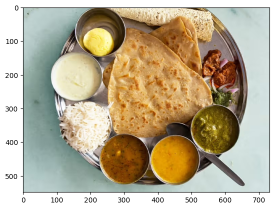

# 使用 Keras 執行 Gemma


生成內容、摘要與分析內容，只是您可以用 Gemma 開放模型完成的其中一些任務。本教學說明如何使用 Keras 開始執行 Gemma，包括使用文本與圖像輸入生成文本內容。[Keras](https://keras.io/) 提供使用 JAX、PyTorch 與 TensorFlow 執行 Gemma 與其他模型的實作。如果您是 Keras 新手，建議先閱讀 [Keras 入門](https://keras.io/getting_started/) 再開始。

Gemma 3 及後續模型支援文本與圖像輸入。較早版本的 Gemma 僅支援文本輸入，但部分變體除外，包括 [PaliGemma](../get-started/index.md)。
!!! Note
    這本筆記本在使用 Gemma 4 時無法在 T4 上執行。請使用 L4 或更高階的 GPU。


### 安裝 Keras 套件

安裝 Keras 與 KerasHub Python 套件。

```bash { .notebook-cell }
pip install -q -U keras keras-hub keras-nlp
```

### 選擇後端

Keras 是設計簡單易用的高階多框架深度學習 API。[Keras 3](https://keras.io/keras_3) 讓您選擇後端：TensorFlow、JAX 或 PyTorch。三者都適用於本教學。在本教學中，請將後端設定為 JAX，因為它通常提供更好的效能。

```python { .notebook-cell }
import os

os.environ["KERAS_BACKEND"] = "jax"  # Or "tensorflow" or "torch".
os.environ["XLA_PYTHON_CLIENT_MEM_FRACTION"] = "1.00"
```

### 匯入套件

匯入 Keras 與 KerasHub 套件。

```python { .notebook-cell }
import keras
import keras_hub
```

## 載入模型

Keras 提供許多熱門[模型架構](https://keras.io/api/keras_nlp/models/)的實作。使用 `Gemma4CausalLM` 類別下載並設定 Gemma 模型，以建構適用於 Gemma 4 模型的端到端因果語言建模實作。使用 `from_preset()` 方法建立模型，如下方程式碼範例所示：

```python { .notebook-cell .model-swap }
gemma_lm = keras_hub.models.Gemma4CausalLM.from_preset(
    "gemma4_instruct_2b",
    dtype="bfloat16",
)
```

!!! note "Keras 預設"
    預設為指令微調權重的 `gemma4_instruct_{SIZE}`，基礎權重為 `gemma4_{SIZE}`。
    沒有 12B 預設，因此上方的選取器提供 KerasHub 發布的四種尺寸。每個指令微調預設還有一個
    `_assistant` MTP 草稿模型——請參閱[多詞元預測](../get-started/capabilities/mtp.md)——絕不能單獨載入它。

`Gemma4CausalLM.from_preset()` 方法從預設的架構與權重具現化模型。在上方程式碼中，字串 `"gemma#_xxxxxxx"` 指定 Gemma 的預設版本與參數大小。您可以在 [Kaggle](https://www.kaggle.com/models/keras/gemma4){ data-model="gemma-4" } 的**模型變體**清單中找到 Gemma 模型的程式碼字串。

模型下載完成後，使用 `summary()` 函數取得模型的更多資訊：

```python { .notebook-cell }
gemma_lm.summary()
```

``` { .no-copy .output }
Preprocessor: "gemma4_causal_lm_preprocessor"
┏━━━━━━━━━━━━━━━━━━━━━━━━━━━━━━━━━━━━━━━━━━━━━━━━━━━━━━━━━━━━━━━┳━━━━━━━━━━━━━━━━━━━━━━━━━━━━━━━━━━━━━━━━━━┓
┃ Layer (type)                                                  ┃                                   Config ┃
┡━━━━━━━━━━━━━━━━━━━━━━━━━━━━━━━━━━━━━━━━━━━━━━━━━━━━━━━━━━━━━━━╇━━━━━━━━━━━━━━━━━━━━━━━━━━━━━━━━━━━━━━━━━━┩
│ gemma4_tokenizer_1 (Gemma4Tokenizer)                          │                      Vocab size: 262,144 │
├───────────────────────────────────────────────────────────────┼──────────────────────────────────────────┤
│ gemma4_image_converter (Gemma4ImageConverter)                 │                       Image size: (1, 1) │
├───────────────────────────────────────────────────────────────┼──────────────────────────────────────────┤
│ gemma4_audio_converter (Gemma4AudioConverter)                 │                Audio shape: (3,000, 128) │
├───────────────────────────────────────────────────────────────┼──────────────────────────────────────────┤
│ gemma4_video_converter (Gemma4ImageConverter)                 │                       Image size: (1, 1) │
├───────────────────────────────────────────────────────────────┼──────────────────────────────────────────┤
│ gemma4_video_converter (ImageConverter)                       │                 Image size: (None, None) │
└───────────────────────────────────────────────────────────────┴──────────────────────────────────────────┘
Model: "gemma4_causal_lm_1"
┏━━━━━━━━━━━━━━━━━━━━━━━━━━━━━━━┳━━━━━━━━━━━━━━━━━━━━━━━━━━━┳━━━━━━━━━━━━━━━━━┳━━━━━━━━━━━━━━━━━━━━━━━━━━━━┓
┃ Layer (type)                  ┃ Output Shape              ┃         Param # ┃ Connected to               ┃
┡━━━━━━━━━━━━━━━━━━━━━━━━━━━━━━━╇━━━━━━━━━━━━━━━━━━━━━━━━━━━╇━━━━━━━━━━━━━━━━━╇━━━━━━━━━━━━━━━━━━━━━━━━━━━━┩
│ audio_indices (InputLayer)    │ (None, None)              │               0 │ -                          │
├───────────────────────────────┼───────────────────────────┼─────────────────┼────────────────────────────┤
│ audio_mask (InputLayer)       │ (None, None)              │               0 │ -                          │
├───────────────────────────────┼───────────────────────────┼─────────────────┼────────────────────────────┤
│ audio_mel (InputLayer)        │ (None, None, None, 128)   │               0 │ -                          │
├───────────────────────────────┼───────────────────────────┼─────────────────┼────────────────────────────┤
│ audio_mel_mask (InputLayer)   │ (None, None, None)        │               0 │ -                          │
├───────────────────────────────┼───────────────────────────┼─────────────────┼────────────────────────────┤
│ padding_mask (InputLayer)     │ (None, None)              │               0 │ -                          │
├───────────────────────────────┼───────────────────────────┼─────────────────┼────────────────────────────┤
│ pixel_position_ids            │ (None, None, None, 2)     │               0 │ -                          │
│ (InputLayer)                  │                           │                 │                            │
├───────────────────────────────┼───────────────────────────┼─────────────────┼────────────────────────────┤
│ pixel_values (InputLayer)     │ (None, None, None, None)  │               0 │ -                          │
├───────────────────────────────┼───────────────────────────┼─────────────────┼────────────────────────────┤
│ position_ids (InputLayer)     │ (None, None)              │               0 │ -                          │
├───────────────────────────────┼───────────────────────────┼─────────────────┼────────────────────────────┤
│ token_ids (InputLayer)        │ (None, None)              │               0 │ -                          │
├───────────────────────────────┼───────────────────────────┼─────────────────┼────────────────────────────┤
│ vision_indices (InputLayer)   │ (None, None)              │               0 │ -                          │
├───────────────────────────────┼───────────────────────────┼─────────────────┼────────────────────────────┤
│ vision_mask (InputLayer)      │ (None, None)              │               0 │ -                          │
├───────────────────────────────┼───────────────────────────┼─────────────────┼────────────────────────────┤
│ gemma4_backbone_1             │ (None, None, 1536)        │   5,104,298,467 │ audio_indices[0][0],       │
│ (Gemma4Backbone)              │                           │                 │ audio_mask[0][0],          │
│                               │                           │                 │ audio_mel[0][0],           │
│                               │                           │                 │ audio_mel_mask[0][0],      │
│                               │                           │                 │ padding_mask[0][0],        │
│                               │                           │                 │ pixel_position_ids[0][0],  │
│                               │                           │                 │ pixel_values[0][0],        │
│                               │                           │                 │ position_ids[0][0],        │
│                               │                           │                 │ token_ids[0][0],           │
│                               │                           │                 │ vision_indices[0][0],      │
│                               │                           │                 │ vision_mask[0][0]          │
├───────────────────────────────┼───────────────────────────┼─────────────────┼────────────────────────────┤
│ token_embedding               │ (None, None, 262144)      │     402,653,184 │ gemma4_backbone_1[0][0]    │
│ (ReversibleEmbedding)         │                           │                 │                            │
├───────────────────────────────┼───────────────────────────┼─────────────────┼────────────────────────────┤
│ true_divide (TrueDivide)      │ (None, None, 262144)      │               0 │ token_embedding[1][0]      │
├───────────────────────────────┼───────────────────────────┼─────────────────┼────────────────────────────┤
│ tanh (Tanh)                   │ (None, None, 262144)      │               0 │ true_divide[0][0]          │
├───────────────────────────────┼───────────────────────────┼─────────────────┼────────────────────────────┤
│ multiply_40 (Multiply)        │ (None, None, 262144)      │               0 │ tanh[0][0]                 │
└───────────────────────────────┴───────────────────────────┴─────────────────┴────────────────────────────┘
Total params: 5,104,298,467 (10.39 GB)
Trainable params: 5,104,186,912 (10.39 GB)
Non-trainable params: 111,555 (435.69 KB)
```

摘要輸出顯示了模型的可訓練參數總數。
在命名模型時，嵌入層不計入參數數量。

!!! Note
    要在 Google Colab 上執行較大的 Gemma 模型，您需要付費方案提供的高階 GPU。或者，您可以使用 [Kaggle](https://www.kaggle.com/code) 筆記本或 Google Cloud 專案執行推論。


## 以文本生成文本

使用您在前述步驟中設定的 Gemma 模型物件的 `generate()` 方法，以文本提示生成文本。選用的 `max_length` 參數指定生成序列的最大長度。以下程式碼範例示範幾種提示模型的方式。

```python { .notebook-cell }
output = gemma_lm.generate("what is keras in 3 bullet points?", max_length=64)
print(output)
```

``` { .no-copy .output }
what is keras in 3 bullet points?

* **A Deep Learning Framework:** Keras is a high-level API that makes it easy to build and train deep learning models by providing a user-friendly interface.
* **User-Friendly and Fast:** It abstracts away complex mathematical details, allowing users to
```

您也可以使用清單作為輸入來提供批次提示：

```python { .notebook-cell }
output = gemma_lm.generate(
    ["what is keras in 3 bullet points?",
     "The universe is"],
    max_length=64)
for item in output:
    print(item)
    print("-"*80)
```

``` { .no-copy .output }
what is keras in 3 bullet points?

* **A Deep Learning Framework:** Keras is a high-level API that makes it easy to build and train deep learning models by providing a user-friendly interface.
* **User-Friendly and Fast:** It abstracts away complex underlying computations, allowing users to
---
The universe is vast and mysterious. It stretches beyond our comprehension, filled with wonders we are only beginning to uncover. From the swirling galaxies to the silent depths of the ocean, the universe whispers secrets of existence, inviting us to explore, to question, and to marvel at the sheer scale of it all.

This
---
```

如果您在 JAX 或 TensorFlow 後端上執行，應該會注意到第二次 `generate()` 呼叫回傳答案的速度更快。這是因為每次以給定的批次大小與 `max_length` 呼叫 `generate()` 時，都會以 XLA 編譯。第一次執行成本較高，但後續執行會更快。

### 使用提示範本

建構較複雜的請求或多輪聊天互動時，請使用提示範本來組織您的請求。以下程式碼為 Gemma 提示建立標準範本：

```python { .notebook-cell }
PROMPT_TEMPLATE = """<|turn>user
{question}
<turn|>
<|turn>model
"""
```

以下程式碼示範如何使用範本格式化簡單的請求：

```python { .notebook-cell }
question = """what is keras in 3 bullet points?"""
prompt = PROMPT_TEMPLATE.format(question=question)
output = gemma_lm.generate(prompt)
print(output)
```

``` { .no-copy .output }
<|turn>user
what is keras in 3 bullet points?
<turn|>
<|turn>model
Here are three bullet points explaining what Keras is:

* **High-Level API for Deep Learning:** Keras is a user-friendly, high-level neural networks API that allows developers to quickly build, train, and evaluate deep learning models with minimal code.
* **Abstraction and Flexibility:** It provides a flexible and modular interface, making it easy to define complex network architectures (like CNNs or RNNs) without getting bogged down in the low-level mathematical details of frameworks like TensorFlow.
* **Backend Agnostic:** Keras acts as a consistent interface that can run on top of various powerful deep learning backends (most commonly TensorFlow, but also others), allowing users to switch frameworks easily.<turn|>
```

### 選用：試試不同的取樣器

您可以透過在 `compile()` 上設定 `sampler` 參數來控制模型物件的生成策略。預設會使用 [`"greedy"`](https://keras.io/api/keras_nlp/samplers/greedy_sampler/#greedysampler-class) 取樣。作為實驗，試著設定 [`"top_k"`](https://keras.io/api/keras_nlp/samplers/top_k_sampler/) 策略：

```python { .notebook-cell }
gemma_lm.compile(sampler="top_k")
output = gemma_lm.generate("The universe is", max_length=64)
print(output)
```

``` { .no-copy .output }
The universe is vast.

The stars glitter like scattered diamonds on a black velvet canvas. Nebulae swirl in vibrant hues, painting cosmic masterpieces, whispering tales of ancient creation. Galaxies spin in majestic dances, their arms reaching out into the void, a breathtaking spectacle for the eyes.

Everywhere, there, in
```

雖然預設的貪婪演算法總是選擇機率最大的詞元，但 top-K 演算法會從機率最高的 K 個詞元中隨機選擇下一個詞元。您不必指定取樣器，如果對您的使用案例沒有幫助，可以忽略上一段程式碼。若想進一步了解可用的取樣器，請參閱[取樣器](https://keras.io/api/keras_nlp/samplers/)。

## 以圖像資料生成文本

使用 Gemma 3 及後續模型，您可以在提示中使用圖像來生成輸出。此功能讓您可以使用 Gemma 解讀視覺內容，或將圖像作為內容生成的資料。

### 建立圖像載入函數

以下函數從 URL 載入圖像檔，並將其分詞以用於 Gemma 提示：

```python { .notebook-cell }
import numpy as np
import PIL

def read_image(url):
    """Reads image from URL as NumPy array."""

    image_path = keras.utils.get_file(origin=url)
    image = PIL.Image.open(image_path)
    image = np.array(image)
    return image
```

### 為提示載入圖像

載入圖像並格式化資料，讓模型可以處理。使用上一節定義的 `read_image()` 函數，如下方範例程式碼所示：

```python { .notebook-cell }
from matplotlib import pyplot as plt

image = read_image(
    "https://ai.google.dev/gemma/docs/images/thali-indian-plate.jpg"
)
plt.imshow(image)
```

``` { .no-copy .output }
<matplotlib.image.AxesImage at 0x7ebbf41738f0>
```




**圖 1。** 金屬盤上的印度塔利餐圖。

### 以圖像執行請求

以圖像內容提示 Gemma 4 模型時，請在提示中使用特定的字串序列 `<|image|>`{.token-multi}，將圖像納入提示。使用提示範本（例如先前定義的 `PROMPT_TEMPLATE` 字串）來格式化您的請求，如下方提示程式碼所示：

```python { .notebook-cell }
question = """Which cuisine is this: <|image|>?
Identify the food items present. Which macros is the meal
high and low on? Keep your answer short.
"""

output = gemma_lm.generate(
    {
        "images": image,
        "prompts": PROMPT_TEMPLATE.format(question=question),
    },
)
print(output)
```

``` { .no-copy .output }
<|turn>user
Which cuisine is this: <|image>?
Identify the food items present. Which macros is the meal
high and low on? Keep your answer short.

<turn|>
<|turn>model
Based on the image, here is the analysis:

**Cuisine:**
The food items strongly suggest **Indian cuisine** or South Asian cuisine.

**Food Items Present:**

*   **Flatbread:** Likely Roti, Chapati, or Naan.
*   **Rice:** Plain steamed white rice.
*   **Dips/Condiments:** A white sauce (like raita or yogurt-based sauce), and several curries/sauces (one appears to be a lentil/vegetable curry, another a tomato/onion-based curry, and others green/spicy sauces).

**Macros Analysis (General Estimate):**

*   **High on:** Carbohydrates (from rice and flatbread) and Fats (depending on how the flatbread was cooked and the richness of the sauces/curries).
*   **Low on:** Protein (unless a significant amount of meat/legumes is present in the unseen curries) and Fiber (unless the curries are vegetable-heavy).<turn|>
```

如果您使用的 GPU 較小，並遇到記憶體不足（OOM）錯誤，可以將 `max_images_per_prompt` 與 `sequence_length` 設為較小的值。以下程式碼示範如何將序列長度縮減為 768。

```python { .notebook-cell }
gemma_lm.preprocessor.max_images_per_prompt = 2
gemma_lm.preprocessor.sequence_length = 768
```

### 以多張圖像執行請求

在提示中使用多張圖像時，請為每張提供的圖像使用多個 `<|image|>`{.token-multi} 詞元，如下方範例所示：

```python { .notebook-cell }
photo_a = read_image("https://raw.githubusercontent.com/google-gemma/cookbook/refs/heads/main/apps/sample-data/GoldenGate.png")
photo_b = read_image("https://raw.githubusercontent.com/google-gemma/cookbook/refs/heads/main/apps/sample-data/surprise.png")

question = """I have two images:

Photo A: <|image|>
Photo B: <|image|>

Tell me a bit about these.
Keep it short.
"""

output = gemma_lm.generate(
    {
        "images": [photo_a, photo_b],
        "prompts": PROMPT_TEMPLATE.format(question=question),
    },
)
print(output)
```

``` { .no-copy .output }
<|turn>user
I have two images:

Photo A: <|image>
Photo B: <|image>

Tell me a bit about these.
Keep it short.

<turn|>
<|turn>model
Photo A is a picture of the **Golden Gate Bridge** in San Francisco, California, with water and hills in the background.

Photo B is a close-up portrait of a **cat** with black and white markings and striking green eyes.<turn|>
```

## 下一步

在本教學中，您學會了如何使用 Keras 與 Gemma 生成文本。以下是一些後續學習建議：

- 了解如何[微調 Gemma 模型](../tuning/qlora.md)。
- 了解 [Gemma 與 Vertex AI 的整合](google-cloud.md)
- 了解如何[在 Vertex AI 上使用 Gemma 模型][vertex-use-gemma]。
