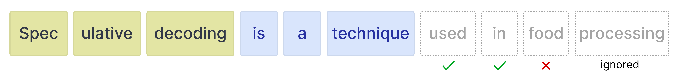

# 使用多詞元預測加速 Gemma 4

在 Gemma 4 中，多詞元預測（Multi-Token Prediction, MTP）是實現高效推測式解碼（Speculative
Decoding）所採用的特定架構。推測式解碼是一種加速大型語言模型推論的技術。與僅依賴大型目標模型以自迴歸方式生成詞元（一次生成一個詞元，每個新詞元都取決於先前的詞元）不同，較小且較快的「草稿模型（draft model）」會提前預測數個詞元。接著，目標模型會平行驗證這些草稿詞元。如果目標模型拒絕了某個草稿詞元，它仍會為該位置產出正確的詞元（確保該步驟不會被浪費），而草稿模型則會從這個新的正確詞元繼續預測。

Gemma 4 的實作方式是以這個較小且較快的草稿模型來擴充基礎模型。這個草稿模型並非獨立存在：它與目標模型共用輸入嵌入表，並直接建立在目標模型最後一層的活化值（activations）之上。這帶來了顯著的解碼加速，同時保證與標準自迴歸生成完全相同的品質，使這些檢查點非常適合低延遲與裝置端應用。

推測式解碼的原理是先草擬數個詞元，再於一次前向傳播（forward pass）中驗證它們。對於稠密（dense）模型，每個詞元都使用相同的權重，因此驗證多個草稿詞元只會增加極小的額外負擔。像 Gemma 4 26B A4B 這樣的混合專家（Mixture of Experts, MoE）模型則不同。每個詞元可能啟用不同的專家，因此驗證草稿詞元可能需要從記憶體載入額外的專家權重，從而抵消了草擬帶來的增益。在較大的批次大小下，不同序列間啟用的專家通常有較多的重疊，進而提高已載入權重的重用率。在批次大小為 1 時，這種重疊有限，這也是為什麼在平行處理能力不佳的硬體平台上，26B A4B 草稿模型可能無法帶來加速。

!!! tip
    若想查看圖文並茂的逐步說明，請參閱
    [多詞元預測圖解指南](../../tutorials/visual-guides/mtp.md)。

## MTP 強化功能

Gemma 4 為標準的推測式解碼管線引入了多項強化功能，以提升草稿詞元的品質與效率：

- **共用輸入嵌入**：草稿模型與目標模型共用輸入嵌入表。
- **目標活化值**：草稿模型使用目標模型最後一層的活化值，將其與詞元嵌入串接後，下投影（down-project）至草稿模型的維度。
- **高效嵌入器**：為了避免在整個詞彙表上進行預測這項昂貴的運算，模型將相似的詞元分組為叢集。它先找出最有可能的叢集，再將最終計算限制在所選叢集內的詞元上（僅適用於 E2B 與 E4B）。

## 在 Transformers 中執行 MTP

在草稿模型預測出多個草稿詞元之後，目標模型現在只需驗證這些建議的草稿詞元。驗證以平行方式進行，因而大幅加快推論速度。這減少了目標模型為每個詞元所需執行的前向傳播次數。由於我們的草稿模型會為驗證生成一連串詞元，我們稱之為多詞元預測（MTP）頭。


### 安裝 Python 套件

安裝執行 Gemma 4 與 Gemma 4 輔助模型所需的 Hugging Face 函式庫。

```bash { .notebook-cell }
# Install PyTorch & other libraries
pip install torch accelerate

# Install the transformers library
pip install transformers
```

### 載入模型

每個目標模型（Gemma 4 系列中的主要模型之一）都有一個輔助模型來協助加速推論。因此，您將載入兩個模型：

- **目標模型**（例如 `google/gemma-4-E2B-it`）：完整的 Gemma 4 目標模型
- **草稿模型**（例如 `google/gemma-4-E2B-it-assistant`）：輕量的 4 層 MTP 草稿模型，用於提出候選詞元

請注意，*drafter*（草稿模型）通常也被稱為 *assistant*（輔助模型），因為這個模型協助較大的模型選擇要預測的詞元。

使用 `transformers` 函式庫，透過 `AutoProcessor` 與 `AutoModelForCausalLM` 類別建立 `processor` 與 `model` 的實例，如以下程式碼範例所示：

```python { .notebook-cell .model-swap }
TARGET_MODEL_ID = "google/gemma-4-E2B-it"
ASSISTANT_MODEL_ID = TARGET_MODEL_ID + "-assistant"

import torch
from transformers import AutoProcessor, AutoModelForCausalLM

# Target Model
processor = AutoProcessor.from_pretrained(TARGET_MODEL_ID)
target_model = AutoModelForCausalLM.from_pretrained(
    TARGET_MODEL_ID,
    torch_dtype=torch.bfloat16,
    device_map="auto",
)

# Assistant Model (the drafter)
assistant_model = AutoModelForCausalLM.from_pretrained(
    ASSISTANT_MODEL_ID,
    torch_dtype=torch.bfloat16,
    device_map="auto",
)
```

### Gemma 4 與輔助模型

在 `transformers` 中使用輔助模型相當簡單，只需將輔助模型傳遞給 `model.generate` 函式：

```python { .notebook-cell }
# Process inputs with the `target_model`
messages = [
    {
        "role": "user",
        "content": "Explain the concepts of speculative decoding and MTP in 3 sentences."
    }
]
input_text = processor.apply_chat_template(messages, tokenize=False, add_generation_prompt=True)
inputs = processor(text=input_text, return_tensors="pt").to(target_model.device)

# `assistant_model=assistant_model` is all you need to enable MTP!
outputs = target_model.generate(
    **inputs,
    assistant_model=assistant_model,
    max_new_tokens=256,
    do_sample=False,
)

# Decode the response into text
response = processor.decode(outputs[0][inputs["input_ids"].shape[1]:], skip_special_tokens=True)
print(response)
```

其底層運作流程如下：

- 草稿模型以自迴歸方式提出 N 個詞元
- 目標模型在**一次**前向傳播中驗證所有 N 個詞元
- 機率高的草稿詞元會被接受
- 機率低的草稿詞元會被拒絕
- 由於目標模型會執行一次前向傳播，無論接受或拒絕了多少草稿詞元，它本身都一定會生成 1 個詞元

### 草稿詞元

草稿模型可為目標模型生成任意數量的詞元以供驗證。然而，目標模型仍可選擇拒絕某些詞元。一旦拒絕，其後的所有詞元都會被忽略。



因此，了解使用不同草稿詞元數量時的權衡非常重要。

**更多草稿詞元**

當您草擬許多詞元（例如 15 個）時，很可能並非所有詞元都會被接受。因此，浪費運算資源的可能性較高。相對地，當接受率高時，它確實有加速推論的趨勢。


**較少草稿詞元**

當您草擬較少的詞元時，接受率通常較高，因為位置更接近初始提示的詞元更為準確。然而，由於只草擬了少數詞元，能從較快的草稿模型獲得的加速效果也會降低。


幸好，在 `transformers` 中您不必為自己的使用情境逐一嘗試最佳值，因為您可以將 `num_assistant_tokens_schedule` 設為 "heuristic"，讓它在執行期間自動調整草稿詞元的數量：

- **所有詞元都被接受**——將草擬的詞元數量增加 2，因為草稿模型對該提示相當準確。若這些詞元同樣被接受，增加草擬數量可能帶來加速。
- **任何詞元被拒絕**——若有任何詞元被拒絕，將草擬的詞元數量減少 1。減少數量可避免在目標模型持續拒絕大多數詞元時，浪費太多已草擬的詞元。

同樣地，您可以像這樣更新草稿模型中的 `num_assistant_tokens` 來調整草稿詞元的數量：

```python { .notebook-cell }
# Update how many draft tokens are generated at the start of inference
assistant_model.generation_config.num_assistant_tokens = 4

# Update how the number of draft tokens are updated ("heuristic" for a dynamic schedule and "constant" for a constant schedule)
assistant_model.generation_config.num_assistant_tokens_schedule = "heuristic"

# Run with MTP
outputs = target_model.generate(
    **inputs,
    assistant_model=assistant_model,
    max_new_tokens=256,
    do_sample=False,
)

# Decode the response into text
response = processor.decode(outputs[0][inputs["input_ids"].shape[1]:], skip_special_tokens=True)
print(response)
```

## 後續步驟

<div class="card-grid">
<a class="card" href="../../deployment/index.md">
  <span class="card-icon">{{ icon('lucide/play') }}</span>
  <div class="card-title">執行 Gemma</div>
  <p class="card-desc">從筆電到叢集，所有能執行 Gemma 的推論引擎。</p>
</a>
<a class="card" href="../qat.md">
  <span class="card-icon">{{ icon('lucide/shrink') }}</span>
  <div class="card-title">量化感知訓練</div>
  <p class="card-desc">每個推論引擎該下載哪些量化權重，以及原因。</p>
</a>
<a class="card" href="../../tutorials/visual-guides/mtp.md">
  <span class="card-icon">{{ icon('lucide/book-open') }}</span>
  <div class="card-title">MTP 圖解指南</div>
  <p class="card-desc">以圖解方式說明草稿模型與推測式解碼。</p>
</a>
</div>
