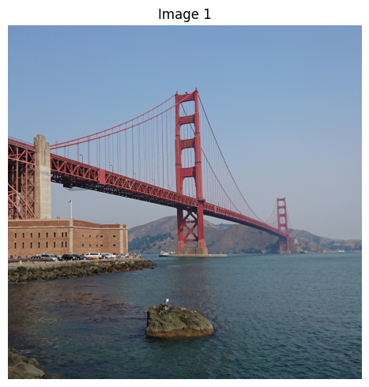

# 推理


Gemma 是一系列輕量級、最先進的開放模型，建立在與建立 [Gemini](https://deepmind.google/technologies/gemini/#introduction) 模型相同的研究與技術之上。Gemma 4 旨在成為全球最具效率的開放權重模型系列。

本文件示範如何使用 Gemma 4 的思考功能，在給出最終答案前產生推理過程。您將學會如何使用 Hugging Face [`transformers`](https://github.com/huggingface/transformers) 函式庫，為純文字與多模態（圖像＋文字）任務啟用思考模式，並解析輸出以將思考過程與答案分開。

## 安裝 Python 套件

安裝執行 Gemma 模型與發出請求所需的 Hugging Face 函式庫。

```bash { .notebook-cell }
# Install PyTorch & other libraries
pip install torch accelerate

# Install the transformers library
pip install "transformers>=5.10.1"
```

## 載入模型

使用 [`transformers`](https://github.com/huggingface/transformers) 函式庫，如以下程式碼範例所示，使用 `AutoProcessor` 與 `AutoModelForImageTextToText` 類別建立 `processor` 與 `model` 的執行個體：

```python { .model-swap .notebook-cell }
MODEL_ID = "google/gemma-4-E2B-it"

from transformers import AutoProcessor, AutoModelForMultimodalLM

model = AutoModelForMultimodalLM.from_pretrained(MODEL_ID, dtype="auto", device_map="auto")
processor = AutoProcessor.from_pretrained(MODEL_ID)
```

## 單次文字推論搭配思考模式

若要使用模型的思考功能產生回應，請傳入 `enable_thinking=True`；處理器會在提示中插入正確的思考詞元，指示模型在回應前先思考。
!!! Note
    我們已在 `gemma-4-12B-it`、`gemma-4-26B-A4B-it` 與 `gemma-4-31B-it` 的聊天範本中加入了空白思考詞元，可抑制思考停用時仍可能出現的「幽靈」思考頻道（thought channel），使模型輸出更穩定。

| 模型大小 | 思考狀態 | 範本結構／輸出 |
|---|---|---|
| **E2B/E4B** | **OFF** | `<|turn>user\n[Prompt]<turn|>\n<|turn>model` |
| **E2B/E4B** | **ON** | `<|turn>system\n<|think|><turn|>\n<|turn>user\n[Prompt]<turn|>\n<|turn>model` |
| **12B/26B/31B** | **OFF** | ⚠️ `<|turn>user\n[Prompt]<turn|>\n<|turn>model\n<|channel>thought\n<channel|>` |
| **12B/26B/31B** | **ON** | `<|turn>system\n<|think|><turn|>\n<|turn>user\n[Prompt]<turn|>\n<|turn>model` |

```python { .notebook-cell }
from transformers import TextStreamer

message = [
    {
        "role": "user", "content": "What is the water formula?"
    }
]

text = processor.apply_chat_template(message, tokenize=False, add_generation_prompt=True, enable_thinking=True)
inputs = processor(text=text, return_tensors="pt").to(model.device)
input_len = inputs["input_ids"].shape[-1]

streamer = TextStreamer(processor)
outputs = model.generate(**inputs, streamer=streamer, max_new_tokens=1024)
```

``` { .no-copy .output }
<bos><|turn>system
<|think|>
<turn|>
<|turn>user
What is the water formula?<turn|>
<|turn>model
<|channel>thought
Thinking Process:

1.  **Analyze the Request:** The user is asking, "What is the water formula?"
2.  **Interpret Ambiguity:** This phrase is highly ambiguous. "Water formula" could refer to several things:
    *   **Chemical Formula:** The molecular formula (\\(\text{H}_2\text{O}\\)).
    *   **Hydration/Biological Formula:** How water interacts with cells, molecules, or systems.
    *   **Chemistry/Solubility Formula:** Equations related to water (e.g., \\(\text{H}_2\text{O} \leftrightarrow \text{H}^+ + \text{OH}^-\\)).
    *   **Engineering/Hydrology Formula:** Equations describing fluid dynamics, flow, or phase changes.
    *   **A specific context (e.g., a game, a specific scientific model, or a metaphor).**
3.  **Determine the Most Likely Interpretation:** In a general knowledge context, when someone asks for a "formula," they usually mean the chemical formula or a fundamental concept/equation. The chemical formula is the most direct answer.
4.  **Formulate the Answer (Addressing different levels of specificity):**
    *   *Start with the literal chemical formula.* (\\(\text{H}_2\text{O}\\))
    *   *Explain what it is.* (Two hydrogen atoms, one oxygen atom.)
    *   *Address potential deeper meanings.* (Mentioning its role in chemistry, bonding, or the \\(\text{H}_2\text{O}\\) molecular structure.)
5.  **Refine the Output:** Present the answer clearly, acknowledging the different interpretations to ensure the user gets the information they need, even if they didn't specify the context. (Self-Correction: Don't just give \\(\text{H}_2\text{O}\\); provide context.)

6.  **Final Output Generation.** (Proceed to generate the final response.)<channel|>The term "water formula" can refer to a few different things, depending on the context you are interested in.

Here are the most common interpretations:

### 1. The Chemical Formula (The most common answer)

The chemical formula for water is:


$$\text{H}_2\text{O}$$


**What this means:**

*   It represents one molecule of water.
*   It consists of **two** atoms of Hydrogen (\\(\text{H}\\)).
*   It consists of **one** atom of Oxygen (\\(\text{O}\\)).

---

### 2. The Molecular Structure (How it is bonded)

The "formula" also describes how these atoms are arranged:

*   **Polarity:** Water is a **polar molecule**. The oxygen atom is much more electronegative than the hydrogen atoms, meaning it pulls the shared electrons closer, giving the oxygen end a partial negative charge (\\(\delta-\\)) and the hydrogen ends partial positive charges (\\(\delta+\\)).
*   **Shape:** The molecule has a **bent** or **V-shape**, with a bond angle of about 104.5 degrees. This bent shape is crucial for water's ability to form hydrogen bonds with other water molecules, which gives water its unique properties (like high surface tension and high heat capacity).

---

### 3. The Chemical Equation (Reactions)

If you are referring to water in a chemical reaction, you might be thinking of the basic relationship between water, hydrogen ions, and hydroxide ions:


$$\text{H}_2\text{O} \rightleftharpoons \text{H}^+ + \text{OH}^-$$


This equation shows that water can dissociate (break apart) into hydrogen ions (\\(\text{H}^+\\)) and hydroxide ions (\\(\text{OH}^-\\)).

***

**If you were looking for a specific type of formula (e.g., in biochemistry, fluid dynamics, or physics), please provide more context, and I can give you a more precise answer!**<turn|>
```

文字產生後，回應將包含以特殊詞元為界的推理區塊與最終答案。您可以使用 `parse_response` 工具函式，輕鬆將它們擷取為包含 `thinking` 與 `answer` 的字典。
!!! Note
    若要讓推理解析器正確運作，必須使用 `skip_special_tokens=False`。

```python { .notebook-cell }
response = processor.decode(outputs[0][input_len:], skip_special_tokens=False)
result = processor.parse_response(response)

for key, value in result.items():
  if key == "role":
    print(f"Role: {value}")
  elif key == "thinking":
    print(f"\n=== Thoughts ===\n{value}")
  elif key == "content":
    print(f"\n=== Answer ===\n{value}")
  elif key == "tool_calls":
    print(f"\n=== Tool Calls ===\n{value}")
  else:
    print(f"\n{key}: {value}...\n")
```

``` { .no-copy .output }
Role: assistant

=== Thoughts ===
Thinking Process:

1.  **Analyze the Request:** The user is asking, "What is the water formula?"
2.  **Interpret Ambiguity:** This phrase is highly ambiguous. "Water formula" could refer to several things:
    *   **Chemical Formula:** The molecular formula (\\(\text{H}_2\text{O}\\)).
    *   **Hydration/Biological Formula:** How water interacts with cells, molecules, or systems.
    *   **Chemistry/Solubility Formula:** Equations related to water (e.g., \\(\text{H}_2\text{O} \leftrightarrow \text{H}^+ + \text{OH}^-\\)).
    *   **Engineering/Hydrology Formula:** Equations describing fluid dynamics, flow, or phase changes.
    *   **A specific context (e.g., a game, a specific scientific model, or a metaphor).**
3.  **Determine the Most Likely Interpretation:** In a general knowledge context, when someone asks for a "formula," they usually mean the chemical formula or a fundamental concept/equation. The chemical formula is the most direct answer.
4.  **Formulate the Answer (Addressing different levels of specificity):**
    *   *Start with the literal chemical formula.* (\\(\text{H}_2\text{O}\\))
    *   *Explain what it is.* (Two hydrogen atoms, one oxygen atom.)
    *   *Address potential deeper meanings.* (Mentioning its role in chemistry, bonding, or the \\(\text{H}_2\text{O}\\) molecular structure.)
5.  **Refine the Output:** Present the answer clearly, acknowledging the different interpretations to ensure the user gets the information they need, even if they didn't specify the context. (Self-Correction: Don't just give \\(\text{H}_2\text{O}\\); provide context.)

6.  **Final Output Generation.** (Proceed to generate the final response.)

=== Answer ===
The term "water formula" can refer to a few different things, depending on the context you are interested in.

Here are the most common interpretations:

### 1. The Chemical Formula (The most common answer)

The chemical formula for water is:


$$\text{H}_2\text{O}$$


**What this means:**

*   It represents one molecule of water.
*   It consists of **two** atoms of Hydrogen (\\(\text{H}\\)).
*   It consists of **one** atom of Oxygen (\\(\text{O}\\)).

---

### 2. The Molecular Structure (How it is bonded)

The "formula" also describes how these atoms are arranged:

*   **Polarity:** Water is a **polar molecule**. The oxygen atom is much more electronegative than the hydrogen atoms, meaning it pulls the shared electrons closer, giving the oxygen end a partial negative charge (\\(\delta-\\)) and the hydrogen ends partial positive charges (\\(\delta+\\)).
*   **Shape:** The molecule has a **bent** or **V-shape**, with a bond angle of about 104.5 degrees. This bent shape is crucial for water's ability to form hydrogen bonds with other water molecules, which gives water its unique properties (like high surface tension and high heat capacity).

---

### 3. The Chemical Equation (Reactions)

If you are referring to water in a chemical reaction, you might be thinking of the basic relationship between water, hydrogen ions, and hydroxide ions:


$$\text{H}_2\text{O} \rightleftharpoons \text{H}^+ + \text{OH}^-$$


This equation shows that water can dissociate (break apart) into hydrogen ions (\\(\text{H}^+\\)) and hydroxide ions (\\(\text{OH}^-\\)).

***

**If you were looking for a specific type of formula (e.g., in biochemistry, fluid dynamics, or physics), please provide more context, and I can give you a more precise answer!**
```
## 多輪對話範例與思考過程剝除

在多輪對話中妥善管理模型產生的思考內容，對於維持效能至關重要。

- **標準多輪對話（Standard Multi-Turn Conversations）**：在將對話歷史記錄傳回模型進行下一輪對話前，您必須移除（剝除）模型在上一輪產生的思考內容。若想在對話中途停用思考模式，可在剝除先前思考內容時一併移除 `<|think|>`{.token-think} 詞元。
- **函式呼叫（例外，Function Calling）**：如果單一模型回合涉及函式或工具呼叫，在函式呼叫之間**不得**移除思考內容。
- **維持對話歷史記錄（Maintaining Conversation History）**：歷史模型輸出只能包含最終回應。在下一輪使用者提問開始前，請確保先前回合產生的思考內容都沒有留在上下文視窗中。

```python { .notebook-cell }
from transformers import TextStreamer

# Append the clean response to the message history
message.append({
    "role": "assistant",
    "content": result["content"]
})

# ==========================================
# TURN 2
# ==========================================
print("\n--- Turn 2 ---")
# Add the next user query to the history
message.append({
    "role": "user",
    "content": "What is its boiling point in Celsius?"
})

text = processor.apply_chat_template(message, tokenize=False, add_generation_prompt=True, enable_thinking=True)
inputs = processor(text=text, return_tensors="pt").to(model.device)
input_len = inputs["input_ids"].shape[-1]

streamer = TextStreamer(processor)
outputs = model.generate(**inputs, streamer=streamer, max_new_tokens=1024)
```

``` { .no-copy .output }
--- Turn 2 ---
<bos><|turn>system
<|think|>
<turn|>
<|turn>user
What is the water formula?<turn|>
<|turn>model
The term "water formula" can refer to a few different things, depending on the context you are interested in.

Here are the most common interpretations:

### 1. The Chemical Formula (The most common answer)

The chemical formula for water is:


$$\text{H}_2\text{O}$$


**What this means:**

*   It represents one molecule of water.
*   It consists of **two** atoms of Hydrogen (\\(\text{H}\\)).
*   It consists of **one** atom of Oxygen (\\(\text{O}\\)).

---

### 2. The Molecular Structure (How it is bonded)

The "formula" also describes how these atoms are arranged:

*   **Polarity:** Water is a **polar molecule**. The oxygen atom is much more electronegative than the hydrogen atoms, meaning it pulls the shared electrons closer, giving the oxygen end a partial negative charge (\\(\delta-\\)) and the hydrogen ends partial positive charges (\\(\delta+\\)).
*   **Shape:** The molecule has a **bent** or **V-shape**, with a bond angle of about 104.5 degrees. This bent shape is crucial for water's ability to form hydrogen bonds with other water molecules, which gives water its unique properties (like high surface tension and high heat capacity).

---

### 3. The Chemical Equation (Reactions)

If you are referring to water in a chemical reaction, you might be thinking of the basic relationship between water, hydrogen ions, and hydroxide ions:


$$\text{H}_2\text{O} \rightleftharpoons \text{H}^+ + \text{OH}^-$$


This equation shows that water can dissociate (break apart) into hydrogen ions (\\(\text{H}^+\\)) and hydroxide ions (\\(\text{OH}^-\\)).

***

**If you were looking for a specific type of formula (e.g., in biochemistry, fluid dynamics, or physics), please provide more context, and I can give you a more precise answer!**<turn|>
<|turn>user
What is its boiling point in Celsius?<turn|>
<|turn>model
<|channel>thought
Thinking Process:

1.  **Identify the core question:** The user wants to know the boiling point of water in Celsius.
2.  **Recall/Verify the fact:** What is the standard boiling point of pure water at standard atmospheric pressure?
3.  **State the answer:** The boiling point of water is \\(100^\circ \text{C}\\).
4.  **Add necessary context/nuance (Crucial step):** Boiling point is dependent on pressure. Standard atmospheric pressure is the reference.
5.  **Determine the required output:** Clear, direct, and accurate. (Self-correction: Ensure the Celsius unit is explicitly stated.)

*Drafting the response.*<channel|>The boiling point of pure water at standard atmospheric pressure (1 atmosphere or 101.325 kPa) is:


$$\mathbf{100^\circ\text{C} }$$


**Note:** If the atmospheric pressure is lower (e.g., at high altitudes), the boiling point will be slightly lower than \\(100^\circ\text{C}\\). If the pressure is higher, the boiling point will be higher.<turn|>
```

```python { .notebook-cell }
response = processor.decode(outputs[0][input_len:], skip_special_tokens=False)
result = processor.parse_response(response)

for key, value in result.items():
  if key == "role":
    print(f"Role: {value}")
  elif key == "thinking":
    print(f"\n=== Thoughts ===\n{value}")
  elif key == "content":
    print(f"\n=== Answer ===\n{value}")
  elif key == "tool_calls":
    print(f"\n=== Tool Calls ===\n{value}")
  else:
    print(f"\n{key}: {value}...\n")
```

``` { .no-copy .output }
Role: assistant

=== Thoughts ===
Thinking Process:

1.  **Identify the core question:** The user wants to know the boiling point of water in Celsius.
2.  **Recall/Verify the fact:** What is the standard boiling point of pure water at standard atmospheric pressure?
3.  **State the answer:** The boiling point of water is \\(100^\circ \text{C}\\).
4.  **Add necessary context/nuance (Crucial step):** Boiling point is dependent on pressure. Standard atmospheric pressure is the reference.
5.  **Determine the required output:** Clear, direct, and accurate. (Self-correction: Ensure the Celsius unit is explicitly stated.)

*Drafting the response.*

=== Answer ===
The boiling point of pure water at standard atmospheric pressure (1 atmosphere or 101.325 kPa) is:


$$\mathbf{100^\circ\text{C} }$$


**Note:** If the atmospheric pressure is lower (e.g., at high altitudes), the boiling point will be slightly lower than \\(100^\circ\text{C}\\). If the pressure is higher, the boiling point will be higher.
```

## 單次圖像推論

將思考模型用於視覺資料的程序非常類似。您可以將圖像作為 `messages` 陣列的一部分提供。只需確保將圖像與格式化的文字一同傳給處理器，模型便會在回應前對視覺輸入進行推理。

```python { .notebook-cell }
from PIL import Image
import matplotlib.pyplot as plt

prompt = "What is shown in this image?"
image_url = "https://raw.githubusercontent.com/google-gemma/cookbook/refs/heads/main/apps/sample-data/GoldenGate.png"

# download image
!wget -q {image_url} -O image.png
image = Image.open("image.png")

# Display all images
print("=== Downloaded image ===")
fig, ax = plt.subplots(1, 1, figsize=(5, 5))
ax.imshow(image)
ax.set_title("Image 1")
ax.axis("off")
plt.tight_layout()
plt.show()

message = [
    {
        "role": "user", "content": [
          {"type": "image"},
          {"type": "text", "text": prompt}
        ]
    }
]

text = processor.apply_chat_template(message, tokenize=False, add_generation_prompt=True, enable_thinking=True)
inputs = processor(text=text, images=image, return_tensors="pt").to(model.device)
input_len = inputs["input_ids"].shape[-1]

outputs = model.generate(**inputs, max_new_tokens=1024)
response = processor.decode(outputs[0][input_len:], skip_special_tokens=False)

result = processor.parse_response(response)

for key, value in result.items():
  if key == "role":
    print(f"Role: {value}")
  elif key == "thinking":
    print(f"\n=== Thoughts ===\n{value}")
  elif key == "content":
    print(f"\n=== Answer ===\n{value}")
  elif key == "tool_calls":
    print(f"\n=== Tool Calls ===\n{value}")
  else:
    print(f"\n{key}: {value}...\n")
```

``` { .no-copy .output }
=== Downloaded image ===
```



``` { .no-copy .output }
Role: assistant

=== Thoughts ===
Here's a thinking process to arrive at the suggested answer:

1.  **Analyze the Image:**
    *   **Dominant Feature:** A massive red suspension bridge spanning a body of water.
    *   **Bridge Identification:** The structure is highly recognizable. It has distinctive towers and suspension cables. This is clearly the Golden Gate Bridge.
    *   **Foreground/Midground:**
        *   Water (ocean/bay).
        *   A rocky outcrop/island in the immediate foreground.
        *   A breakwater or shoreline where the land meets the water.
    *   **Background:**
        *   Hills/landmasses in the distance.
        *   A clear, pale blue sky.
    *   **Other Details:**
        *   A large brick/stone building near the shoreline (part of the structure/area).
        *   Vehicles on the shoreline (suggesting it's an accessible area).

2.  **Identify the Location (Verification):**
    *   The Golden Gate Bridge is iconic and located in San Francisco, California, spanning the Golden Gate strait. The landscape, water color, and overall feel match this location.

3.  **Determine the Subject of the Request:** The user asked, "What is shown in this image?"

4.  **Draft the Description (Focusing on Key Elements):**
    *   *Start with the main subject.* (The bridge).
    *   *Add context.* (Location/setting).
    *   *Include foreground details.* (Water, rocks).

5.  **Refine the Description (Making it comprehensive and clear):**
    *   *Initial Draft thought:* It's the Golden Gate Bridge over water with rocks.
    *   *Improved Draft:* The image shows the iconic Golden Gate Bridge spanning a strait. In the foreground is water and rocks.
    *   *Final Polish (Adding visual detail and clarity):* Ensure the description captures the scale and color of the bridge.

6.  **Final Output Generation.** (This matches the structured answer provided below.)

=== Answer ===
This image shows the **Golden Gate Bridge** in San Francisco, California.

Key elements visible in the photograph include:

*   **The Golden Gate Bridge:** The massive red suspension bridge is the dominant feature, stretching across the water.
*   **Water:** A large expanse of blue water (likely the Golden Gate Strait or the Pacific Ocean) is visible in the foreground.
*   **Foreground Rocks:** A dark, rocky outcrop or small island is prominent in the immediate foreground.
*   **Shoreline/Land:** Parts of the coastline and a large brick structure are visible near the water's edge.
*   **Sky:** A clear, pale blue sky dominates the upper portion of the image.

The image captures the iconic scale and grandeur of the bridge against the backdrop of the water and landscape.
```

## 摘要

在本指南中，您學會了如何使用 Gemma 4 模型的思考功能，在最終答案前產生推理過程。內容包括：

1. **啟用思考模式（Enabling thinking mode）**：在 `apply_chat_template` 中使用 `enable_thinking=True`。
2. **文字串流（Text streamer）**：使用 `TextStreamer` 即時觀察思考過程。
3. **解析合併輸出（Parsing the combined output）**：使用 `parse_response` 分離 `thinking` 與 `answer` 區塊。
4. **多模態任務（Multimodal tasks）**：將思考功能應用於多模態任務（圖像＋文字）。

## 後續步驟

<div class="card-grid">
<a class="card" href="../prompt-formatting.md">
  <span class="card-icon">{{ icon('lucide/braces') }}</span>
  <div class="card-title">提示格式設定</div>
  <p class="card-desc">建構 Gemma 提示的控制詞元。</p>
</a>
<a class="card" href="function-calling.md">
  <span class="card-icon">{{ icon('lucide/wrench') }}</span>
  <div class="card-title">工具呼叫</div>
  <p class="card-desc">提供函式讓 Gemma 呼叫，並將結果回傳。</p>
</a>
<a class="card" href="../../deployment/index.md">
  <span class="card-icon">{{ icon('lucide/play') }}</span>
  <div class="card-title">執行 Gemma</div>
  <p class="card-desc">從筆記型電腦到叢集，執行 Gemma 的各種引擎。</p>
</a>
</div>
