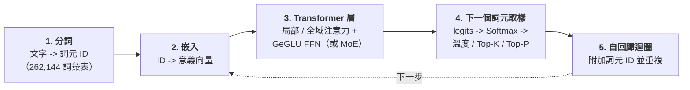

# LLM 如何運作（搭配 Gemma 4）

這份指南把 Gemma 4 一次前向傳遞的全部五個階段放在同一畫面。點選側邊欄的階段，開啟它的即時展示；想看你點選內容背後的完整說明時，隨時展開這個終端機。

<!--
  Each <section class="llm-doc"> is one terminal "file": the shell (overrides/llm-shell.html,
  javascripts/llm-ascii-shell.js) shows the one matching the active stage, and the paragraph
  above belongs to the overview. Keep `data-llm-doc` in step with the stage ids in the template.
  Use <section>, not <div>, as the wrapper: nested admonitions close with </div>.
-->

<section class="llm-doc" data-llm-doc="overview" markdown="1">

從本質上說，像 **Gemma 4** 這樣的大型語言模型（LLM）就是一個「預測下一個詞元」的引擎。給定一串輸入——不論是文字、程式碼、影像或音訊——它會計算整個 **262,144 個詞元詞彙表**上的機率分布，一次選出下一段文字。

然而，這個簡單的迴圈卻能寫軟體、解數學題、在 140 多種語言之間翻譯，還能逐步推理。這份互動式的五部分系列會打開黑盒子，帶你走過提示在 Gemma 4 內部經歷的每一個階段。

## 五階段 LLM 管線

你傳給 Gemma 4 的每個提示，都會先流經五個彼此相連的階段，才產生第一個詞——接著再把每個新取樣的詞元 ID 送回**嵌入（階段 2）**，產生下一個詞元：



## Gemma 4 模型系列一覽

在整個系列中，你會看到完全相同的五階段管線，如何從精巧的行動裝置友善模型（`E2B` 與 `E4B`），一路擴展到工作站與雲端的旗艦模型（`12B`、`26B A4B` 與 `31B`）：

| 模型 | 參數 | 架構風格 | 解碼器層數 | 最大上下文 | 局部滑動視窗 | 局部：全域比例 | 原生模態 |
|---|---|---|---|---|---|---|---|
| **Gemma 4 E2B** | **2.3B 有效**（5.1B 含 PLE） | **高效**（密集 + 逐層嵌入） | 35 | 128K | 512 個詞元 | **4 : 1** | 文字、影像、音訊、影片 |
| **Gemma 4 E4B** | **4.5B 有效**（8.0B 含 PLE） | **高效**（密集 + 逐層嵌入） | 42 | 128K | 512 個詞元 | **5 : 1** | 文字、影像、音訊、影片 |
| **Gemma 4 12B** | **11.95B** | **統一**（無編碼器的線性投影） | 48 | 256K | 1,024 個詞元 | **5 : 1** | 文字、影像、音訊、影片 |
| **Gemma 4 26B A4B** | **25.2B 總計 / 3.8B 啟用** | **混合專家（MoE）**（128 個路由專家中啟用 8 個 + 1 個共享專家） | 30 | 256K | 1,024 個詞元 | **5 : 1** | 文字、影像、影片 |
| **Gemma 4 31B** | **30.7B** | **密集** | 60 | 256K | 1,024 個詞元 | **5 : 1** | 文字、影像、影片 |

</section>

<section class="llm-doc" data-llm-doc="tokenization" markdown="1">

## 1. 分詞：從文字到數字 <a id="1-分詞從文字到數字"></a>

電腦無法直接對 `"Hello world!"` 這類原始字串做矩陣運算。在神經網路讀取你的提示之前，**分詞器**會先把文字切成稱為**詞元**的小片段，再把每個片段對應到唯一的整數**詞元 ID**。

### 為什麼用子詞，而不用字元或整詞？

語言模型需要的詞彙表，必須在序列長度與字典大小之間取得平衡：

- **逐字元**（`'c'`、`'a'`、`'t'`）只需要很小的詞彙表，但序列會拉長 4 到 5 倍，模型還得花好幾層去學字母如何拼成單字。
- **逐詞**需要數百萬個詞彙表項目，才能涵蓋各種詞形變化（`"run"`、`"running"`、`"ran"`）、錯字與語言——而且遇到新的複合詞或變數名稱時，還是會以 `<unk>`（「未知」）詞元失敗。
- **子詞分詞**（Gemma 4 採用 SentencePiece 風格的 Byte-Pair Encoding 詞彙表）正好落在甜蜜點：像 `▁cat`（`ID 5866`）這類常見詞保持完整，罕見或複合詞如 `"unbelievable"` 則拆成可重複使用的詞根、前綴與字尾。

### Gemma 4 的 262,144 個詞元詞彙表內部

Gemma 4 五種模型尺寸共用完全相同的 **262,144 個詞元**（`262K`）詞彙表（`0` 到 `262,143`）：

| 詞元類別 | Gemma 4 範例 | 實際詞元 ID | 重要性 |
|---|---|---|---|
| **前置空白詞（`▁`）** | `▁the`、`▁is`、`▁cat`、`▁Gemma`、`▁multimodal` | `506`、`563`、`5866`、`147224`、`151359` | 空白會以 `▁`（U+2581）附在詞首，讓分詞 100% 可還原，不會遺失空白。 |
| **子詞詞幹與字尾** | `Ant`、`idis`、`establishment`、`arian`、`ism` | `14054`、`33090`、`163524`、`8225`、`1929` | 任何不熟悉的詞，都能用已知的子詞積木拼出來。 |
| **個別數字** | `1`、`4`、`0`（在 `"140"` 中） | `236770`、`236812`、`236771` | 把數字拆成個別數字，可確保位值運算一致，不必死記任意的多位數片段。 |
| **程式碼與縮排** | `def`、`▁▁▁▁`（4 個空白）、`return`、`\n` | `2063`、`140`、`2060`、`107` | 用單一詞元表示 4 個空白的縮排（`140`），讓 Python 程式碼的讀取與生成快上許多。 |
| **多語言與表情符號** | `안녕하세요`、`▁지원`、`🚀` | `61659`、`65363`、`242015` | 262K 的大詞彙表避免在 140 多種支援語言中，把非拉丁文字切得支離破碎。 |
| **UTF-8 位元組備援** | `<0x00>` .. `<0xFF>`（例如 `<0xEB>`、`<0x98>`、`<0xA0>`） | `238`–`493`（`473`、`390`、`398`） | 詞彙表中沒有的極罕見字元，會編碼為原始 UTF-8 位元組，讓 Gemma 4 永遠不會以 `<unk>`（`ID 3`）失敗。 |
| **特殊控制詞元** | <code class="token-turn">&lt;&#124;turn&gt;</code>、<code class="token-turn">&lt;turn&#124;&gt;</code>、<code class="token-think">&lt;&#124;think&#124;&gt;</code>、<code class="token-multi">&lt;&#124;image&#124;&gt;</code> | `105`、`106`、`98`、`258880` | 這些保留的原子 ID 負責組織多輪對話、推理通道、工具呼叫與多模態輸入。 |
| **保留的 `<unusedXX>` 槽位** | `<unused0>`、`<unused1>`、……、`<unused6226>` | `6`–`45`、`53`–`97`、`99`、`102`–`104`、`256001`–`258879`、`258885`–`262143` | 預先配置的「空白」詞元 ID（共 `6,227` 個），讓開發者在微調時加入自訂控制詞元，不必調整嵌入矩陣大小。 |

### 詞彙表裡沒有某個詞時會發生什麼？（例如 `똠얌꿍` 與 `加鬮さん`）

即使有 **262,144** 個詞彙表項目，任何固定字典也記不住所有人類文字中的音譯外來詞、人名或罕見字元。當 Gemma 4 遇到韓文 **`똠얌꿍`**（*Tom Yum Goong*，泰式酸辣湯）或日文 **`加鬮さん`**（名字中含有極罕見的 26 畫漢字 **`鬮`** *kuji*，意思是「抽獎」或「彩券」）時，會發生什麼事？

Gemma 4 不會就此放棄、把不熟悉的文字換成 `<unk>`（「未知」，`ID 3`）詞元——那會永久抹除原始字元——而是改用**雙層安全網**：

1. **第 1 層——字元與子詞拆解**：只要整詞不在詞彙表裡，Gemma 4 就把已知部分拆成字典裡確實存在的個別音節、字元或子詞：
    - 在 **`똠얌꿍`** 中，韓文音節 **`얌`**（`ID 249170`）與 **`꿍`**（`ID 249927`）各有專屬的字元詞元。
    - 在 **`加鬮さん`** 中，常見漢字 **`加`**（`ID 237410`，空白後為 `▁加` `ID 50624`）與兩個平假名的敬稱 **`さん`**（`ID 9821`）會立刻被辨認出來。
2. **第 2 層——UTF-8 位元組備援（`<0x00>`–`<0xFF>`，ID `238`–`493`）**：罕見韓文音節 **`똠`**（`U+B620`）與罕見漢字 **`鬮`**（`U+9B2E`）呢？這兩個字元都不在 Gemma 4 的子詞字典裡。Gemma 4 不會輸出 `<unk>`，而是把缺失的字元轉換為原始 UTF-8 位元組，再把每個位元組對應到 **256 個保留位元組詞元**之一（`<0x00>` 為 `ID 238` 到 `<0xFF>` 為 `ID 493`，其中 `ID = 238 + 位元組值`）：
    - **`똠`**（`U+B620` → UTF-8 位元組 `0xEB 0x98 0xA0`）變成 **3 個位元組詞元**：`<0xEB>`（`ID 473`）、`<0x98>`（`ID 390`）、`<0xA0>`（`ID 398`）。
    - **`鬮`**（`U+9B2E` → UTF-8 位元組 `0xE9 0xAC 0xAE`）變成 **3 個位元組詞元**：`<0xE9>`（`ID 471`）、`<0xAC>`（`ID 410`）、`<0xAE>`（`ID 412`）。

| 輸入文字 | Gemma 4 如何拆分 | 實際 Gemma 4 詞元 ID | 為何有效 |
|---|---|---|---|
| **`똠얌꿍`** | `<0xEB>` + `<0x98>` + `<0xA0>` + `얌` + `꿍` | `[473, 390, 398, 249170, 249927]` | 罕見音節 `똠` 退回 3 個 UTF-8 位元組（`473, 390, 398`）；已知的音節 `얌`（`249170`）與 `꿍`（`249927`）各自維持 1 個詞元。 |
| **`加鬮さん`** | `加`（或 `▁加`）+ `<0xE9>` + `<0xAC>` + `<0xAE>` + `さん` | `[237410, 471, 410, 412, 9821]`（空白後為 `50624`） | 已知的漢字 `加`（文首為 `237410`，空白後為 `▁加` `50624`，如預設值所示）與字尾 `さん`（`9821`）夾住罕見漢字 `鬮` 的 3 個 UTF-8 位元組（`471, 410, 412`）。 |

!!! tip "全 Unicode 零 `<unk>` 資訊損失"
    因為每個合法的 Unicode 字元都能寫成 1 到 4 個 UTF-8 位元組，Gemma 4 可以讀取、推理並產生地球上的任何字元——從罕見的中日韓表意文字與外來詞，到古文字與新表情符號——完全不必把文字壓縮成 `<unk>`。唯一的代價是序列長度：一個位元組備援字元要花 3 到 4 個詞元，而不是 1 個。

### 保留的 `<unusedXX>` 詞元及其用途

如果你檢查 Gemma 4 的 `tokenizer.json`，會看到 **6,227** 個名為 **`<unused0>`** 到 **`<unused6226>`** 的項目：

- **低 ID 控制範圍（`89` 個詞元）**：`<unused0>`–`<unused39>`（`ID 6–45`）、`<unused40>`–`<unused84>`（`ID 53–97`）、`<unused85>`（`ID 99`），以及 `<unused86>`–`<unused88>`（`ID 102–104`）。
- **高 ID 擴充範圍（`6,138` 個詞元）**：`<unused89>`–`<unused2967>`（`ID 256001–258879`）與 `<unused2968>`–`<unused6226>`（`ID 258885–262143`）。

為什麼 LLM 的設計者要刻意在詞彙表裡放進數千個「空白」詞元？

1. **在微調時加入自訂特殊詞元，不必調整權重矩陣大小**：假設你正在為某個專門工作流程微調 Gemma 4，想加入像 `<|citation|>`、`<|sql_query|>` 這類原子控制標記，或自訂的代理狀態分隔符號。如果你把全新的詞元（`ID 262144`）附加到分詞器，就必須同時調整 `262,144 × d_model` 的輸入嵌入表與最終輸出投影矩陣——改變張量維度、破壞與標準推論引擎的相容性。相反地，你可以重複利用 `<unused0>`（`ID 6`）或 `<unused1>`（`ID 7`），它們在嵌入矩陣中已有專屬的列，在微調時訓練它們的向量即可。
2. **跨模型世代的無縫升級**：注意到低 ID 未使用範圍的缺口（`ID 46–52`、`98`、`100–101` 與 `258880–258884`）了嗎？在更早的 Gemma 世代中，那些位置正好就是 `<unusedXX>` 詞元！設計 Gemma 4 時，Google 把這些保留槽位升級為原生工具呼叫詞元（<code class="token-tool">&lt;&#124;tool&gt;</code> / <code class="token-tool">&lt;tool&#124;&gt;</code>、<code class="token-tool">&lt;&#124;tool_call&gt;</code> / <code class="token-tool">&lt;tool_call&#124;&gt;</code>、<code class="token-tool">&lt;&#124;tool_response&gt;</code> / <code class="token-tool">&lt;tool_response&#124;&gt;</code>，以及字串分隔符 <code class="token-tool">&lt;&#124;"&#124;&gt;</code>，位於 `ID 46–52`）、思考模式（<code class="token-think">&lt;&#124;think&#124;&gt;</code>，位於 `ID 98`）、推理通道（<code class="token-think">&lt;&#124;channel&gt;</code> / <code class="token-think">&lt;channel&#124;&gt;</code>，位於 `ID 100–101`）與多模態佔位符（`ID 258880–258884`）——完全不必改變 `262,144` 的詞彙表大小，也不必移動任何一個現有詞的 ID。

!!! tip "在瀏覽器即時體驗 Gemma 4 分詞器"
    上方的互動遊樂場透過 `@huggingface/tokenizers`，在你的瀏覽器中執行實際的 `google/gemma-4-E2B-it` 分詞器——在背景 Web Worker 中載入 Gemma 4 完整的 **32.2 MB** `tokenizer.json`（`262,144` 個詞彙表項目、另外 `514,906` 條 BPE 合併規則、全部特殊控制與 `<unused0>`–`<unused6226>` 槽位，以及 `<0x00>`–`<0xFF>` UTF-8 位元組備援表），並快取在本機 IndexedDB 中，方便即時重新載入。如果你在詞彙表快取完成前完全離線開啟本頁，它會優雅地退回內嵌的子集。

### 重點整理

分詞是一種確定性的字典查詢——到目前為止還沒有任何神經網路運算。步驟 1 的輸出只是一串整數 ID，例如 `[818, 5866, 2838, 580, 506, 1756, 236761]`。接下來，模型要把這些任意的 ID 數字轉化為*意義*。

</section>

<section class="llm-doc" data-llm-doc="embeddings" markdown="1">

## 2. 嵌入：將 ID 轉化為意義 <a id="2-嵌入將-id-轉化為意義"></a>

經過[分詞](#1-分詞從文字到數字)之後，`"The cat sat on the mat."` 變成一串整數 ID：`[818, 5866, 2838, 580, 506, 1756, 236761]`。

然而，數字 `5866`（`▁cat`）與 `5867` 之間沒有任何數學關係——就像字典第 586 頁與第 587 頁毫無共通之處。為了捕捉*意義*，Gemma 4 把每個詞元 ID 當作列索引，去查詢一張巨大的**嵌入查詢表**。

### 高維語義空間

在 **Gemma 4 E2B** 中，主嵌入表的 `262,144` 列，每一列都是一個由 **1,536 個浮點數**組成的向量（`d_model = 1,536`；E4B 最高 `2,560`，31B 最高 `5,376`）。你可以把這 1,536 個數字想像成一張意義地圖上的座標：

- 這個空間中的某個方向，可能代表*「動物對機器」*。
- 另一個方向可能代表*「單數對複數」*、*「過去式對現在式」*，或*「正式對隨意語氣」*。
- 因為這些方向是在預訓練期間從數兆個詞學來的，意義相近的詞自然會聚在一起。

我們用**餘弦相似度**衡量兩個意義向量 $\vec{a}$ 與 $\vec{b}$ 有多接近，也就是計算它們之間夾角的餘弦值：

$$\text{similarity}(\vec{a}, \vec{b}) = \frac{\vec{a} \cdot \vec{b}}{\|\vec{a}\| \, \|\vec{b}\|}$$

分數接近 **`+1.0`**，表示兩個向量幾乎指向相同的語義方向（像 `▁cat` 與 `▁kitten`）；**`0.0`** 表示互不相關（正交）；**`-1.0`** 表示方向相反。

### Gemma 4 如何統一影像、音訊與裝置端記憶體

Gemma 4 在嵌入階段帶來兩項重大創新：

1. **同一向量空間中的多模態「軟詞元」**：當你傳入一張影像（<code class="token-multi">&lt;&#124;image&#124;&gt;</code>，ID `258880`）或一段音訊（<code class="token-multi">&lt;&#124;audio&#124;&gt;</code>，ID `258881`）時，Gemma 4 會把視覺圖塊（每張影像可設定為 **70 到 1,120 個視覺詞元**）或音訊波形，轉換成與文字詞元**完全相同維度**（E2B 為 `1,536`）的向量。在 **Gemma 4 12B Unified** 中，沉重的視覺與音訊編碼器被移除——原始 $48 \times 48$ 像素圖塊與 40ms（640 個取樣點）音訊影格，會透過單一輕量線性投影，直接進入 LLM 的嵌入串流！
2. **E2B 與 E4B 中的逐層嵌入（PLE）**：為什麼 Gemma 4 的裝置端模型叫 **E2B**（*2.3B 有效參數*，*5.1B 總計*）與 **E4B**（*4.5B 有效*，*8.0B 總計*）？**「E」**代表**有效參數**——把載入 GPU／手機（V）RAM 的主動運算權重，與稀疏的嵌入查詢表分開看。一般來說，要增加模型的知識，就得加寬層或增加解碼器區塊，同時膨脹（V）RAM 與矩陣乘法的 FLOPs。PLE 的做法不同：它給**每個解碼器層各自專屬的 256 維嵌入表**（`262,144 × 35 × 256` = E2B 的 **2.35B 參數**；`262,144 × 42 × 256` = E4B 的 **2.82B 參數**）：
    - **零額外運算、快閃記憶體友善的儲存**：在推論開始時，Gemma 4 會對全部 35 或 42 層執行一次 $O(1)$ 字典查詢（`embed_tokens_per_layer`，合併連續的 `per_layer_model_projection` 特徵，讓多模態軟詞元也獲得條件化處理）。因為每個提示只會取用少數幾列，數 GB 的 PLE 表可以留在**快閃儲存／系統記憶體**中，不必占用寶貴的（V）RAM。
    - **各層專屬的詞元表示**：不必強迫單一的第 0 層嵌入與精簡的 `1,536` 維殘差串流，從底層到頂層承載所有詞彙、句法與事實細節，每一層都能學到自己需要的精確詞元特徵——**早期層（`L1–L10`）**專精表面句法與詞性（*「`▁cat` 是單數可數名詞」*）、**中間層（`L11–L24`）**專精語義類別與世界知識（*「`▁cat` 是小型家養貓科哺乳動物」*）、**晚期層（`L25–L35`）**專精細緻的搭配與下一個詞元的措辭。每個解碼器區塊結束時，一個學得的 **GeLU 門**（`per_layer_input_gate`，`d_model → 256`）會動態選擇該層 `256` 維 PLE 切片的哪些部分，投影（`per_layer_projection`，`256 → d_model`）、正規化（`post_per_layer_input_norm`），再加（`⊕`）進殘差串流。

!!! warning "⚠️ 瀏覽器展示中的示意性 2D 投影與 PLE 頻譜"
    Gemma 4 E2B 的主嵌入表（`model.language_model.embed_tokens.weight`，BF16 的 `262,144 × 1,536`，**0.40B 參數**）在磁碟上約 **805 MB**，35 張逐層嵌入表（`model.language_model.embed_tokens_per_layer.weight`，`262,144 × 35 × 256`，**2.35B 參數**）在磁碟上約 **4.7 GB**，因此完整的權重矩陣無法隨瀏覽器頁面一起傳送。在上方的互動探索器中：

    - **已驗證的 Gemma 4 規格與 BF16 切片（分頁 A 與分頁 B）**：每個**詞元 ID**（`#5866`、`#9615`、`#147224` 等）、**前 8 個 BF16 浮點值**（`embed_tokens[:8]`）、**PLE 門電路**（`embed_tokens_per_layer`、`per_layer_model_projection`、`per_layer_input_gate` $\rightarrow$ `GELU` $\odot$ `ple[l]` $\rightarrow$ `per_layer_projection` $\rightarrow$ `post_per_layer_input_norm`），以及**主動（V）RAM 與快閃記憶體卸載的參數拆分**（`E2B`：`2.37B` 主動 + `2.75B` 查詢 = `5.12B`；`E4B`：`4.51B` 主動 + `3.49B` 查詢 = `8.00B`），都與官方 Gemma 4 檢查點一致。
    - **示意性的 2D 投影與門控子空間頻譜（分頁 A 與分頁 B）**：平面 `(x, y)` 畫布座標、簡化的 2D 群集餘弦相似度長條圖、向量類比箭頭（`king − man + woman ≈ queen`）、執行時期的多模態軟詞元（`🖼 Image` 與 `🔊 Audio`，其佔位列 `#258880` 與 `#258881` 會在推論時被投影後的視覺／音訊特徵取代），以及橫跨 `Syntax`、`Semantics` 與 `Phrasing` 波段的 24 條 `GELU ⊙ ple[L]` 啟動頻譜，都是**教學用的視覺化呈現**（這種嚴格劃分是教學上的簡化；實際上，神經網路學到的是連續、分散式的表示）。在實際的 1,536 維第 0 層表中，未經上下文處理的原始詞元已經展現出清楚的語義聚類（例如 $\cos(\text{▁king}, \text{▁queen}) = 0.58$、$\cos(\text{▁kitten}, \text{▁puppy}) = 0.54$、$\cos(\text{▁cat}, \text{▁kitten}) = 0.43$，以及 $\cos(\text{▁king} - \text{▁man} + \text{▁woman}, \text{▁queen}) = 0.56$），而完整的語義分離會隨著向量透過 Transformer 層而出現。

### 重點整理

嵌入查詢會給每個詞元的每次出現完全相同的起始向量——不論 `"bank"` 指的是河岸還是金融銀行。為了讓每個詞的意義適應周圍的句子，這些向量現在要進入 **Transformer 層**。

</section>

<section class="llm-doc" data-llm-doc="attention" markdown="1">

## 3. 注意力與層：連結上下文 <a id="3-注意力與層連結上下文"></a>

嵌入查詢會給每個詞元的每次出現完全相同的起始向量。但語言非常依賴**前面的上下文**：

- 在 *"Mia took the **trophy** from the **suitcase** and **polished** **it** again"* 中，代名詞 **"it"** 指的是前面的 **trophy**。
- 只要把前面的一個動詞換掉——*"…and **zipped** **it** again"*——**"it"** 指的就變成 **suitcase**！

為了解決歧義、代名詞與長距離關係，詞元向量會流經一疊 **Transformer 解碼器層**（E2B `35` 層、E4B `42` 層、12B `48` 層、26B A4B `30` 層、31B `60` 層）。每一層都有兩個主要階段，外面包著 **RMSNorm** 正規化層。

### 階段 A：因果自注意力（查詢、鍵與值）

對序列中的每個詞元，自注意力層會把它的向量投影成三個較小的向量（再加上**旋轉位置編碼，即 RoPE**，讓模型知道詞序）：

- **查詢（$\vec{Q}$）**——*「我正在找什麼樣的先前上下文？」*（例如，在讀到 `"polished"` 之後，較深層中的代名詞 `"it"` 會回頭尋找一個可以被擦亮的單數物件；在 `"zipped"` 之後，則尋找有拉鍊的東西。）
- **鍵（$\vec{K}$）**——*「我向後面的詞元宣傳哪些屬性？」*（例如，`"trophy"` 宣傳金屬獎盃表面；`"suitcase"` 宣傳有拉鍊的容器。）
- **值（$\vec{V}$）**——*「如果我被選中，要把哪些語義資訊往前傳？」*

模型會計算目前詞元的查詢與每個先前詞元的鍵之間的內積（以頭部維度 $d_k$ 縮放），再加上**因果遮罩（$M$）**，把未來位置（$j > i$）設為 $-\infty$，讓模型無法偷看後面的內容作弊，最後套用 Softmax，把這些分數轉成總和為 $100\%$ 的注意力權重：

$$\text{Attention}(Q, K, V) = \text{softmax}\!\left(\frac{Q K^T}{\sqrt{d_k}} + M\right) V$$

!!! info "僅解碼器規則：詞元只能向後看，無法向前看"
    與雙向編碼器模型（如 BERT）不同，像 Gemma 4 這樣的**僅解碼器** LLM 會在**每一層**都套用因果遮罩，因此資訊嚴格由左向右流動：

    - **較早的線索立即解開 `"it"`**：在 *"…polished **it** again"* 與 *"…zipped **it** again"* 中，動詞（`polished`／`zipped`）出現在 `it` 之前，因此 `it` 可以注意那個動詞，馬上選出 `trophy` 或 `suitcase`——未來的詞元 `again.` 則仍被遮罩（`0%`）。
    - **較晚的線索在較晚的詞元處解開**：在 *"The robot picked up the glass ball because **it** was **fragile.**"* 中，當 Gemma 4 處於 **`it`** 時，它還看不到 `was` 或 `fragile.`——因此 `it` 會同時保留兩個候選（`ball` 與 `robot`）。消歧發生在兩個步驟之後：當 **`fragile.`**（以及之後產生的任何詞元）回頭看 `it`、`glass` 與 `ball` 時！

### 階段 B：前饋網路（GeGLU 密集式對混合專家）

一旦注意力從相關的先前詞彙收集到上下文，每個詞元向量就會透過**前饋網路（FFN）**，使用 **GeGLU**（帶 GELU 的門控線性單元）啟動函數來深化它的表示：

- **密集模型（E2B、E4B、12B、31B）**：每個詞元在每層都會透過一個統一的 FFN 區塊。在 **E2B**（`use_double_wide_mlp: true`）中，20 個共用 KV 的層（`L16–L35`）會把 FFN 寬度從 `6,144` 加倍到 `12,288`（`2× 寬`，在分頁 B 中以較深的綠色標示），把省下的 K/V 參數再投資回去；而 **E4B**、**12B** 與 **31B** 則在所有層保持統一的 $4 \times d_{\text{model}}$ FFN。
- **混合專家（`Gemma 4 26B A4B`）**：每一層不是一個巨大的 FFN，而是 **128 個專門的路由專家**，再加上 **1 個永遠開啟的共享專家**。一個輕量的**路由器**會檢查每個詞元，只啟用 **8 個路由專家 + 1 個共享專家**（`25.2B` 總參數中僅 `3.8B` 主動參數），以 4B 模型的速度提供 26B 等級的推理能力！

### Gemma 4 如何處理 128K–256K 上下文：交錯式局部與全域注意力

在標準的全注意力中，每個詞元都要與每個先前的詞元比較（$O(N^2)$ 運算量，以及記憶體中龐大的 **KV 快取**）。在 **256K 個詞元**（約一本 600 頁的書）時，對全部 48 或 60 層都執行完整的全域注意力，會壓垮記憶體。

Gemma 4 以**混合式局部 + 全域注意力**架構解決這個問題：

| 注意力層類型 | 回看多遠 | 交錯模式 | Gemma 4 效率技巧 |
|---|---|---|---|
| **局部（滑動視窗）注意力** | **512 個詞元**（E2B、E4B）或 **1,024 個詞元**（12B、26B A4B、31B） | **4 個局部**對 1 個全域（E2B，`4:1`）<br>**5 個局部**對 1 個全域（E4B、12B、26B A4B、31B，`5:1`） | 以固定且極小的記憶體成本處理局部句法、措辭與附近上下文（在 E2B/E4B 上，後段的局部層會重複使用先前的 KV 快取）。 |
| **全域（完整）注意力** | **整個 128K／256K 序列** | 每 5 層（E2B）或每 6 層（其他）；**最後一層永遠是全域** | 1. **加倍的 $512$ 維全域頭部與 GQA**：全域頭部尺寸加倍到 $512$，搭配 **8:1 全域 GQA**（26B A4B、31B）或 **16:1 全域 GQA**（12B），而 E2B（`8:1`）與 E4B（`4:1`）在各層保持統一的 GQA（`num_global_key_value_heads: null`）。<br>2. **模型群組 KV 壓縮**：<br>• **12B、26B A4B 與 31B——統一的鍵與值（`K = V`，`attention_k_eq_v: true`）**：全域層把鍵張量當作值共用，讓全域 KV 快取記憶體減半！<br>• **E2B 與 E4B——跨層 KV 共用（`attention_k_eq_v: false`）**：保持 $K$ 與 $V$ 分開，改為在 E2B 的最後 **20 層**（`num_kv_shared_layers: 20`）與 E4B 的 **18 層**（`18`）重複使用先前層的 KV 快取。<br>3. **比例式 RoPE（`p-RoPE`，`p = 0.25`）**：只對 25% 的維度做位置旋轉，留下 75% 不旋轉，讓長距離語義回憶更清晰。 |

!!! warning "⚠️ 瀏覽器展示中的虛擬注意力權重"
    要執行一次即時的 Gemma 4 前向傳遞來擷取多層注意力張量，需要數 GB 的模型權重與 GPU/NPU 運算。在上方的互動檢查器中：

    - **示意性／虛擬的因果注意力權重（分頁 A）**：向後看的詞對詞百分比（例如，`polished` 之後，`it` 對 `trophy` 的注意力為 `54%`，`zipped` 之後對 `suitcase` 為 `56%`，未來詞元遮罩為 `0%`）是**示意性的虛擬注意力權重**，展示較深層的因果注意力如何從前面的上下文解開共指關係。在實際推論時，Gemma 4 會在每一層的多個查詢頭之間平行計算各自的 $\text{softmax}(Q K^T / \sqrt{d_k} + M)$ 矩陣（E2B `35` 層、E4B `42` 層、12B `48` 層、26B A4B `30` 層、31B `60` 層），其中早期層連結局部句法（`polished` $\rightarrow$ `it`），讓較深層能連結 `it` $\rightarrow$ `trophy`。
    - **已驗證的 Gemma 4 架構規格 vs. 模擬的路由器軌跡（分頁 B）**：層數（`35`、`42`、`48`、`30`、`60`）、局部：全域交錯比例（E2B 為 `4:1`，E4B/12B/26B A4B/31B 為 `5:1`）、滑動視窗大小（`512` 與 `1,024` 個詞元）、模型群組 KV 最佳化（12B/26B A4B/31B 為 `K = V` 的統一全域 KV，搭配 `16:1`／`8:1` 全域 GQA；E2B/E4B 則為跨越最後 `20`／`18` 層的跨層 KV 共用）、`p-RoPE (p = 0.25, θ = 1,000,000)`，以及 `128` 個路由專家中啟用 `8` 個 + `1` 個共享專家的 MoE 專家數量，都是**已驗證的 Gemma 4 架構規格**；而 26B A4B MoE 範例網格中亮起的特定專家圓點，則代表**模擬的路由器軌跡**。

### 重點整理

Transformer 層把靜態的詞嵌入轉化為**上下文感知的向量**：

- **因果自注意力由左至右連結詞元**：使用**查詢（$\vec{Q}$）**、**鍵（$\vec{K}$）**與**值（$\vec{V}$）**投影加上**因果遮罩**，每個詞元嚴格**向後**看先前的詞元——因此 *"it"* 會依前面的動詞（*"polished"* 對 *"zipped"*）解讀為 *"trophy"* 或 *"suitcase"*，而 *"fragile."* 這類較晚的線索則回頭連結先前的詞。
- **FFN 與 MoE 層深化每個詞元的意義**：每一層都把注意力（跨詞元的溝通）與 **GeGLU 前饋網路**或**混合專家**區塊（詞元內的運算——`Gemma 4 26B A4B` 每個詞元只啟用 `128` 個路由專家中的 `8` 個 + `1` 個共享專家，以 3.8B 的速度達到 26B 品質）配對。
- **混合式局部 + 全域注意力擴展到 128K–256K 上下文**：透過交錯快速的**局部滑動視窗**層（`4:1` 或 `5:1`）與定期出現的**全域注意力**層（`p-RoPE`，加上 12B/26B A4B/31B 的 `K = V` 統一全域 KV 快取，或 E2B/E4B 的跨層 KV 共用），Gemma 4 能讀取書籍長度的提示而不耗盡記憶體。

當最後一個詞元的向量離開最後一層全域注意力層時，它已經掌握提示的完整意義，準備好預測**下一個詞元**。

</section>

<section class="llm-doc" data-llm-doc="sampling" markdown="1">

## 4. 取樣：預測下一個詞元 <a id="4-取樣預測下一個詞元"></a>

一旦最後一個詞元的向量離開最後一層 Transformer 層（在 Gemma 4 中永遠是全域注意力層），它就準備好預測下一個詞元。

### 步驟 4A：LM Head 與 Logits

Gemma 4 使用**語言模型頭（`lm_head`）**，把最終隱藏向量投影到詞彙表空間；`lm_head` 與轉置後的 `262,144` 列輸入嵌入矩陣共用權重，產生 262,144 個原始 logits。接著，它會在 Softmax 正規化之前套用**最終 Logit 軟限幅（Final Logit Softcapping）**，限制極端值。

$$\text{logits}_{\text{capped}} = 30.0 \times \tanh\left(\frac{\text{logits}}{30.0}\right)$$

### 步驟 4B：Softmax 與取樣控制（`Temperature`、`Top-K`、`Top-P`）

為了把原始 logits 轉換成總和為 $100\%$ 的機率，我們把它們透過 **Softmax** 函數，並以一個稱為**溫度（$T$）**的參數縮放：

$$P(\text{token}_i) = \frac{\exp(z_i / T)}{\sum_{j=1}^{262144} \exp(z_j / T)}$$

如果我們永遠挑機率最高的第 1 個詞元（**貪婪解碼**，$T = 0$），模型會變成確定性的，在開放式任務中容易陷入重複迴圈。如果我們從全部 262,144 個詞元中盲目取樣，26 萬個無意義詞元上那微小的 $0.0001\%$ 機率，偶爾會注入胡言亂語。

Gemma 4 使用**三個標準化的取樣參數**來塑造機率分布：

| 參數 | Gemma 4 預設值 | 控制內容 |
|---|---|---|
| **溫度（`temperature`）** | **`1.0`** | 在 Softmax 之前重新縮放 logits。**較低（$T < 1.0$）**會讓峰值向首選靠攏、更尖銳（最適合事實問答或程式碼）。**較高（$T > 1.0$）**會把分布壓平，讓創意替代選項獲得更高的機會。 |
| **Top-K（`top_k`）** | **`64`** | 硬性截斷，只保留 **$K$ 個最可能的詞元**（例如 262,144 個中的前 64 個），其餘 262,080 個詞元歸零。 |
| **Top-P／核（`top_p`）** | **`0.95`** | 動態截斷，把詞元從最可能排到最不可能，只保留累積機率達到 **$95\%$** 的最小「核」，切掉不太可能的長尾詞彙。 |

經過 Top-K 與 Top-P 篩選後，剩下的機率會重新正規化為總和 $100\%$，Gemma 4 再擲一次加權骰子，抽出一個勝出的詞元。

### 多詞元預測（MTP）與推測式解碼

在標準的**自回歸生成**中，產生 20 個詞元需要把完整的 31B 或 E2B 目標模型執行 20 次——因為第 2 個詞元會成為預測第 3 個詞元所需的輸入一部分。

為了突破這個瓶頸，Gemma 4 附帶一個輕量的 4 層**[多詞元預測（`-assistant`）草稿模型](../get-started/capabilities/mtp.md)**（E2B 僅約 76M 參數、256 維隱藏狀態）。Gemma 4 的 MTP 草稿模型不是一個獨立的小模型，而是透過三項強化與目標模型緊密結合：

1. **共用嵌入與目標啟動值**：草稿模型共用目標模型 `262,144` 個詞元的輸入嵌入表，把目標模型最後一層的隱藏啟動值與詞元嵌入串接起來，再投影到草稿模型精簡的維度（E2B 為 `1,536 → 256`）。
2. **KV 快取共用**：草稿模型不必從頭處理提示來建立自己的 KV 快取，而是直接交叉注意目標模型已經算好的局部與最終全域 KV 快取。
3. **群集式 LM Head（E2B 與 E4B 上的高效嵌入器）**：草稿模型不在每個草稿步驟都對全部 `262,144` 個詞彙表詞元評分，而是把詞元嵌入分組成語義群集，先預測最可能的群集，再只在勝出的群集內計算詞元 logits。

在每個推測步驟中，草稿模型會快速依序提出 $N$ 個候選詞元（例如 `4` 個詞元），完整的 Gemma 4 目標模型再以一次平行前向傳遞驗證全部 $N$ 個詞元——保證與標準自回歸解碼**完全相同的輸出品質**：

- **全部草稿都被接受**：$N$ 個草稿詞元一次全部提交，再加上目標模型自己的驗證傳遞所產生的 **1 個獎勵詞元**（一次目標前向傳遞產生 $N + 1$ 個詞元）。
- **部分拒絕**：如果目標模型拒絕第 $k$ 個草稿詞元，第 $k$ 個之後的草稿詞元都會被捨棄，目標模型會在同一次前向傳遞中，立即以自己有效的詞元取代第 $k$ 個詞元——因此目標前向傳遞永遠不會白費。

#### 在 Hugging Face `transformers` 中設定 MTP

在 `transformers` 中，你可以載入對應的 `-assistant` 檢查點，並把 `assistant_model=assistant_model` 傳給 `target_model.generate()`，來啟用 MTP 推測式解碼。你可以在 [`assistant_model.generation_config`](https://huggingface.co/google/gemma-4-E2B-it-assistant/blob/main/generation_config.json) 上調整草稿模型每步提出的詞元數量：

| `assistant_model.generation_config` 設定 | 預設值 | 運作方式 |
|---|---|---|
| **`num_assistant_tokens`** | **`6`** | 草稿模型在推論開始時提出的候選詞元數量。草稿詞元**越多**，在可預測文字（如程式碼或樣板）上的峰值加速越高，但若早期詞元被拒絕，就會浪費草稿步驟；草稿詞元**越少**，接受率越高，但加速上限較小。 |
| **`num_assistant_tokens_schedule`** | **`"constant"`** | 控制 `num_assistant_tokens` 在執行時期的適應方式。**`"constant"`** 會把草稿長度固定在 `num_assistant_tokens`。**`"heuristic"`** 會在每一步動態調整草稿視窗——所有草稿詞元都被接受時**增加 `+2`**，任何草稿詞元被拒絕時**減少 `-1`**。 |

```python { .model-swap }
# 設定 4 層 MTP 草稿模型（`google/gemma-4-E2B-it-assistant`）
assistant_model.generation_config.num_assistant_tokens = 4
assistant_model.generation_config.num_assistant_tokens_schedule = "heuristic"

outputs = target_model.generate(
    **inputs,
    assistant_model=assistant_model,
    max_new_tokens=256,
)
```

!!! warning "⚠️ 瀏覽器展示中的模擬候選 logits"
    要執行一次即時的 Gemma 4 前向傳遞，在每個解碼步驟計算全部 `262,144` 個輸出 logits，需要數 GB 的模型權重與 GPU/NPU 運算。在上方的互動模擬器中：

    - **已驗證的 Gemma 4 規格與精確的即時數學**：每個候選**詞元 ID**（來自 `google/gemma-4-E2B-it/tokenizer.json` 的 `▁Paris` `#9079`、`▁located` `#5628`、`▁Lyon` `#49533`、`▁crystal` `#12707`、`len` `#3469` 等）、Gemma 4 的預設生成設定（`temperature = 1.0`、`top_k = 64`、`top_p = 0.95`）、**最終 Logit 軟限幅**公式（$30.0 \cdot \tanh(z / 30.0)$），以及**溫度縮放的 Softmax（$P(t_i) = \text{softmax}(z_i / T)$）、Top-K／Top-P（核）截斷與加權隨機取樣**，都會在你拖曳滑桿時即時在瀏覽器中執行。
    - **模擬的候選 logits 與 MTP 軌跡**：模擬器不是透過神經前向傳遞對全部 `262,144` 個詞彙表詞元評分，而是在每個自回歸步驟使用**精選的前 6 個虛擬 logit 表**（以及一個具代表性的 4 詞元**多詞元預測**推測步驟，其中目標模型接受 3 個草稿、把未命中的第 4 個草稿換成自己的預測），讓你清楚看到溫度如何重塑機率分布，以及 `✂ 核／Top-K 截斷線`在何處切掉尾部。

### 重點整理

下一個詞元取樣會把最終的 Transformer 隱藏狀態，一步一步轉換成生成的文字：

- **logits 轉機率**：**語言模型頭（`lm_head`）**一次對全部 `262,144` 個詞彙表詞元評分（重複使用綁定的嵌入矩陣，並把極端 logits 軟限幅在 `30.0`），再由 **Softmax** 把原始分數轉換成總和為 `100%` 的機率分布。
- **取樣形塑精確度與創意**：**溫度（$T = 1.0$）**控制分布的尖銳或平坦程度，而 **Top-K（`64`）**與 **Top-P（`0.95`）**則剪掉不太可能的長尾詞元，讓 Gemma 4 即使在創意生成時也能保持連貫。
- **自回歸迴圈（與 MTP 加速）**：LLM 一次產生一個詞元：把每個取樣的詞元附加回輸入，再重複前向傳遞，直到它輸出 `<turn|>`（`ID 106`）或 `<eos>`（`ID 1`）——而 Gemma 4 的 4 層**多詞元預測（MTP）**草稿模型會以一次平行傳遞提出並驗證 4 個詞元，把這個迴圈加速約 3 倍。

既然我們已經知道模型如何預測下一個詞元，接下來在**步驟 5**看看指令微調、聊天範本、`<|think|>` 推理通道與工具呼叫，如何把這個「下一個詞元」迴圈變成聰明的助理。

</section>

<section class="llm-doc" data-llm-doc="putting-it-together" markdown="1">

## 5. 融會貫通：對話、思考與工具 <a id="5-融會貫通對話思考與工具"></a>

如果 LLM 只會預測下一個詞元，為什麼它不會用另一個問題來接續你的問題（就像未經訓練的**預訓練（PT）**基礎模型在預測網頁文件時經常做的那樣）？

答案是**後訓練**（監督式微調與強化學習），再加上由[步驟 1：分詞](#1-分詞從文字到數字)中的特殊控制詞元組成的結構化**聊天範本**。

### Gemma 4 如何組織對話

當你傳送聊天訊息給指令微調（**`-it`**）Gemma 4 模型時（`processor.apply_chat_template(..., add_generation_prompt=True)`），處理器會在把你的文字送進管線之前，用保留的控制詞元把它包起來，一直到 <code><span class="token-turn">&lt;|turn&gt;</span><span class="token-role">model</span>\n</code> 為止；接著模型會逐詞元產生推理通道（<code><span class="token-think">&lt;|channel&gt;thought</span>\n...<span class="token-think">&lt;channel|&gt;</span></code>）與最終回覆（<code>...<span class="token-turn">&lt;turn|&gt;</span></code>）：

<pre><code><span class="token-turn">&lt;|turn&gt;</span><span class="token-role">system</span>
<span class="token-think">&lt;|think|&gt;</span>
You are a helpful science tutor.<span class="token-turn">&lt;turn|&gt;</span>
<span class="token-turn">&lt;|turn&gt;</span><span class="token-role">user</span>
What is the water formula?<span class="token-turn">&lt;turn|&gt;</span>
<span class="token-turn">&lt;|turn&gt;</span><span class="token-role">model</span>
<span class="token-think">&lt;|channel&gt;thought</span>
The user is asking for the chemical formula of water (H2O). I should state H2O clearly and explain its two hydrogen and one oxygen atoms.<span class="token-think">&lt;channel|&gt;</span>The chemical formula for water is **H₂O** (two hydrogen atoms bonded to one oxygen atom).<span class="token-turn">&lt;turn|&gt;</span></code></pre>

### 為什麼 `<|think|>` 讓 LLM 更聰明

注意當 <code class="token-think">&lt;&#124;think&#124;&gt;</code> 放在系統輪次時會發生什麼事：

1. 因為 LLM 每產生一個詞元都要做固定量的運算，在第一個輸出詞元就回答困難的數學或邏輯問題，會迫使模型在一次前向傳遞中「猜」答案。
2. 當 <code class="token-think">&lt;&#124;think&#124;&gt;</code> 啟用時，Gemma 4 會先產生 <code><span class="token-think">&lt;|channel&gt;thought</span>\n...<span class="token-think">&lt;channel|&gt;</span></code>。
3. 它在思考區塊內寫下的每個詞元，都會透過自回歸迴圈送回上下文視窗——讓後續的自注意力層能夠注意自己的中間步驟、驗證假設，並在輸出 <code class="token-think">&lt;channel|&gt;</code>、寫下最終面對使用者的答案之前，先抓出錯誤！
4. 同樣地，當工具以 <code class="token-tool">&lt;&#124;tool&gt;</code>...<code class="token-tool">&lt;tool&#124;&gt;</code> 宣告時，Gemma 4 可以使用 <code class="token-tool">&lt;&#124;"&#124;&gt;</code> 字串分隔符號發出結構化的 <code class="token-tool">&lt;&#124;tool_call&gt;</code>，在你的程式碼執行函數期間停在 <code class="token-tool">&lt;&#124;tool_response&gt;</code> 停止詞元上，再讀取結果來回答使用者。

!!! info "多輪對話的思考內容剝離"
    在多輪對話中，Gemma 4 會在傳送下一個使用者輪次之前，先從對話紀錄中剝離先前輪次的 <code><span class="token-think">&lt;|channel&gt;thought</span>\n...<span class="token-think">&lt;channel|&gt;</span></code> 區塊（單一輪次內的多步驟工具呼叫進行中除外），讓上下文保持乾淨快速。Hugging Face `transformers` 這類程式庫會透過 `processor.parse_response()` 自動處理。

!!! warning "⚠️ 瀏覽器展示中的模擬串流"
    要在全部 35–60 層 Transformer 層上執行端到端的 Gemma 4 生成傳遞，需要數 GB 的模型權重與 GPU/NPU 運算。在上方的互動模擬器中：

    - **驗證自 `google/gemma-4-E2B-it`**：聊天範本結構（預先填入的輸入提示結束於 `<|turn>model\n`）、每個控制詞元字串（包括 `<|think|>`、`<|channel|>` / `<channel|>`、`<|tool_call|>` / `<tool_call|>`、`<|tool_response|>` / `<tool_response|>`、`<|"|>` 與 `<|image|>`），以及動態發出順序，都與官方 Gemma 4 分詞器與聊天範本一致。
    - **模擬的詞元串流**：打字機串流不是在瀏覽器中執行即時神經推論，而是重播**精選的範例回覆**（數學與邏輯、視覺與工具呼叫），讓你可以逐步檢查 `<|channel>thought...<channel|>` 與工具呼叫如何展開。

### 用 Python 自己動手試試

你可以用 Hugging Face `transformers`，以幾行 Python 檢查你剛才探索的每一步——從精確的詞元 ID 與原始聊天範本，到思考模式與取樣參數：

```python { .model-swap }
import torch
from transformers import AutoModelForMultimodalLM, AutoProcessor, TextStreamer

MODEL_ID = "google/gemma-4-E2B-it"

processor = AutoProcessor.from_pretrained(MODEL_ID)
model = AutoModelForMultimodalLM.from_pretrained(
    MODEL_ID, dtype="auto", device_map="auto"
)
streamer = TextStreamer(processor)

# 1. 建立聊天提示，並啟用 Gemma 4 的 <|think|> 推理模式
messages = [
    {"role": "user", "content": "Why does ice float on liquid water?"}
]
raw_prompt = processor.apply_chat_template(
    messages, tokenize=False, add_generation_prompt=True, enable_thinking=True
)
print("=== Raw Prompt with Gemma 4 Control Tokens ===")
print(raw_prompt)

# 2. 把文字分詞為整數詞元 ID（來自 262,144 個詞元的詞彙表）
inputs = processor(text=raw_prompt, return_tensors="pt").to(model.device)
input_ids = inputs["input_ids"][0]
print(f"\n=== Tokenized into {len(input_ids)} Token IDs ===")
for tid in input_ids[:12]:
    print(f"ID {int(tid):>6} -> {repr(processor.decode([tid]))}")

# 3. 以 Gemma 4 的標準化取樣參數執行自回歸迴圈
outputs = model.generate(
    **inputs,
    streamer=streamer,
    max_new_tokens=1024,
    do_sample=True,
    temperature=1.0,
    top_k=64,
    top_p=0.95,
)

# 4. 解碼並把內部的 <|channel>thought...<channel|> 與最終答案分開
generated_text = processor.decode(
    outputs[0][len(input_ids):], skip_special_tokens=False
)
parsed = processor.parse_response(generated_text, prefix="")

print("\n=== Internal Reasoning (Thought Channel) ===")
print(parsed.get("thinking", "(Thinking disabled)"))

print("\n=== Final Answer ===")
print(parsed["content"])
```

### 摘要

每次你向 Gemma 4 提問時，本系列的五個階段都會在毫秒之間協同運作：

1. **[分詞](#1-分詞從文字到數字)**把文字、數字與控制標記拆成整數 ID，來自共用的 **262,144 個詞元**詞彙表。
2. **[嵌入](#2-嵌入將-id-轉化為意義)**把這些 ID（連同投影後的影像圖塊與音訊影格）對應到高維意義向量（`1,536` 到 `5,376` 維），在行動裝置尺寸（E2B/E4B）上再以快閃記憶體友善的**逐層嵌入（PLE）**強化。
3. **[注意力與 Transformer 層](#3-注意力與層連結上下文)**透過交錯快速的**局部滑動視窗**層與記憶體最佳化的**全域注意力**層（`p-RoPE`，加上 12B/26B A4B/31B 的 `K = V`，或 E2B/E4B 的跨層 KV 共用），再搭配 **GeGLU** 或**混合專家（MoE）**前饋網路，把上下文連結到 **256K 個詞元**。
4. **[下一個詞元取樣](#4-取樣預測下一個詞元)**把最終向量轉換成 **262,144 個 logits**，以**溫度（`1.0`）**套用 Softmax，用 **Top-K（`64`）**與 **Top-P（`0.95`）**篩選，再抽出下一個詞元——並由**多詞元預測（MTP）**推測式解碼加速。
5. **聊天範本與思考模式**使用保留詞元（<code class="token-turn">&lt;&#124;turn&gt;</code>、<code class="token-think">&lt;&#124;think&#124;&gt;</code>、<code class="token-think">&lt;&#124;channel&gt;thought</code>、<code class="token-tool">&lt;&#124;tool_call&gt;</code>），讓自回歸迴圈能像聰明的助理一樣計畫、推理與行動。

### 接下來

- [快速入門](../get-started/index.md)：選擇一個執行環境，在本機或雲端執行你的第一個 Gemma 4 模型。
- [提示格式](../get-started/prompt-formatting.md)：每個輪次、思考、多模態與工具使用的控制詞元。
- [Gemma 4 視覺指南](../tutorials/visual-guides/gemma-4.md)：以圖解說明 p-RoPE、K=V 全域注意力、MoE 路由與逐層嵌入。
- [MTP 視覺指南](../tutorials/visual-guides/mtp.md)：逐步說明草稿模型與推測式解碼。
- [Gemma 4 模型](../models/gemma-4/index.md)：比較 E2B、E4B、12B、26B A4B 與 31B 的規格與記憶體需求。

</section>

--8<-- "glossary.md"
