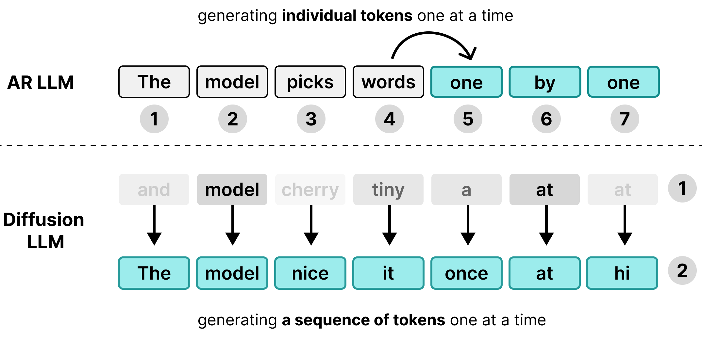
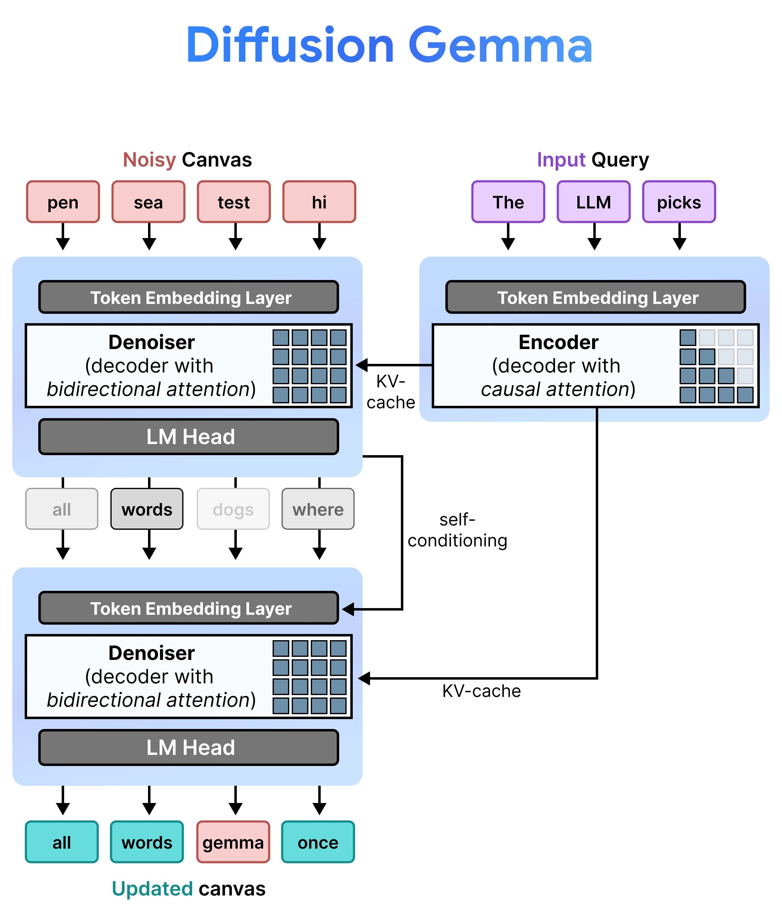
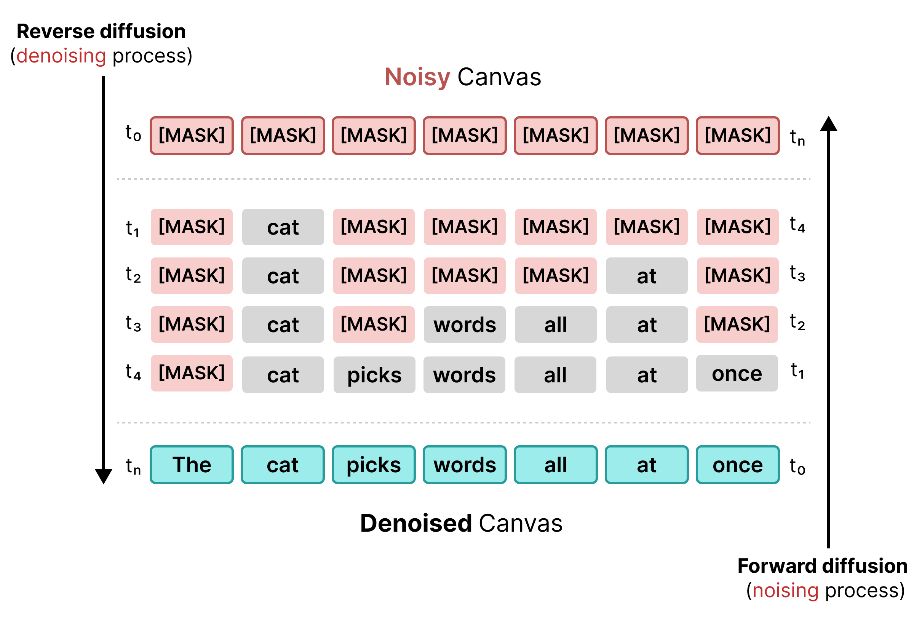
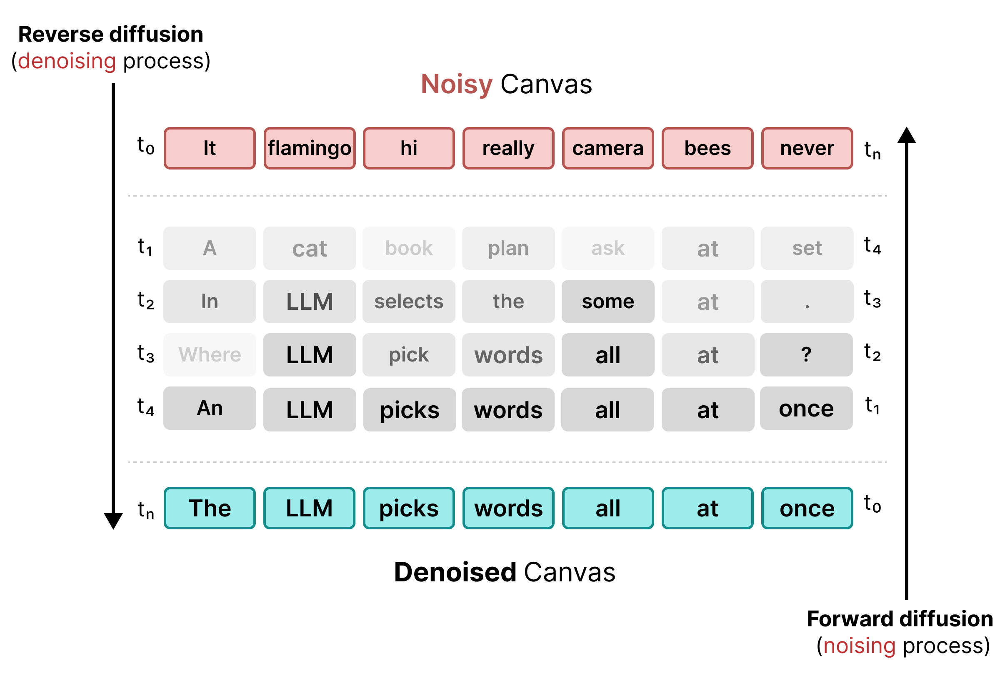
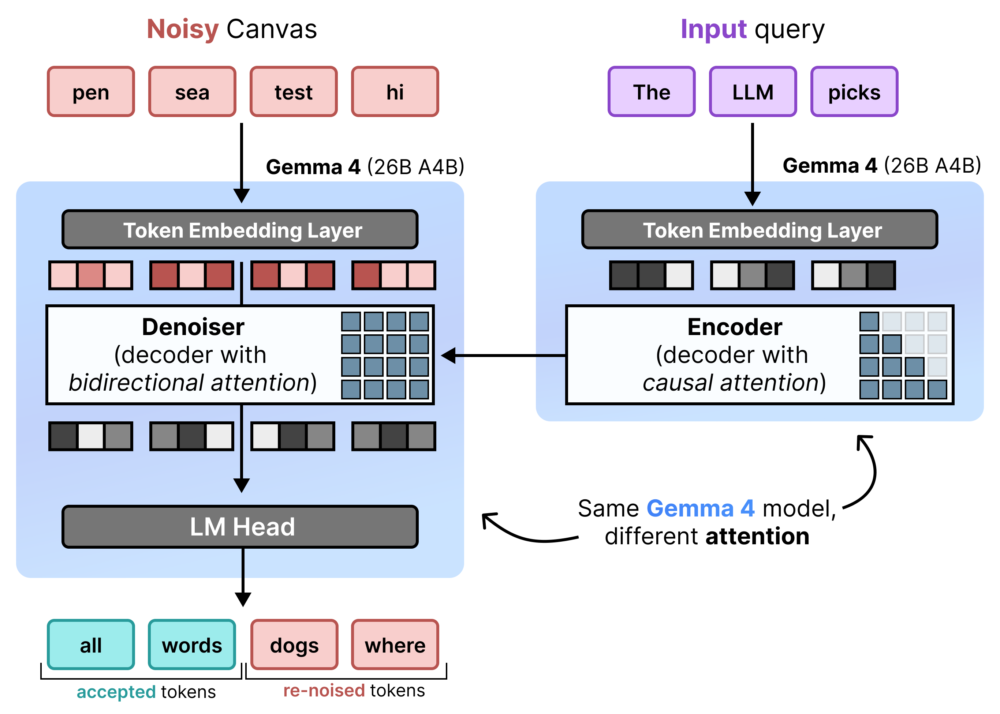

# 文字生成中的擴散模型解析

要理解 DiffusionGemma，有助於先檢視標準語言模型的核心限制，以及文字擴散（text-based diffusion）有何不同。

## 自迴歸模型的問題

許多大型語言模型（LLM）是**自迴歸（autoregressive）**模型，也就是一次只生成一個詞元。雖然這種做法透過批次處理可以很好地同時服務多位使用者，但對個別使用者而言卻造成了延遲瓶頸。

在解碼階段，標準 Transformer 模型受限於**記憶體頻寬**而非運算能力。生成過程的大部分時間都花在將模型權重從硬體記憶體載入處理單元，而非執行實際的數學計算。由於無論批次大小為何，每個步驟只需要載入一次權重，因此一次為 1 位使用者生成一個詞元所花費的時間，與同時為 256 位使用者生成幾乎相同。

因此，個別使用者感受不到任何延遲優勢；硬體的運算能力在等待記憶體傳輸時只能閒置。

**DiffusionGemma** 將個別使用者這段閒置的運算時間利用起來。它不是為 256 位不同的使用者各生成 1 個詞元，而是為單一使用者**一次生成 256 個詞元**。

模型會先初始化一段由 256 個隨機詞元組成的空白序列（稱為**畫布（canvas）**），然後同時反覆評估並精修整塊畫布。這讓模型從記憶體受限轉為**運算受限（compute-bound）**，使其能隨著運算能力提升而有效率地擴展處理速度。

| 比較面向 | 文字自迴歸 | 文字擴散 |
|---|---|---|
| **詞元生成** | 一次生成一個詞元 | 一次生成整塊畫布的詞元 |
| **步驟** | 每個詞元需要一個步驟 | 一個步驟生成多個詞元 |
| **生成順序** | 由左至右 | 所有位置平行生成 |
| **起點** | 空序列 | 從詞彙表中隨機取樣的詞元 |
| **錯誤修正** | 靜態；無法修正過去的詞元 | 動態；可修正畫布上任何位置 |
| **硬體瓶頸** | 記憶體受限 | 運算受限 |
| **吞吐重點** | 高多使用者吞吐量 | 超低單一使用者延遲 |

## 理解文字擴散的運作機制

在影像生成中，擴散模型從 100% 隨機的高斯雜訊開始，在文字提示的引導下逐步去除雜訊（去噪）多個步驟。將這個邏輯套用到文字上更具挑戰性，因為文字詞元是離散實體，而不像像素值那樣連續。

DiffusionGemma 透過一系列專門的方法實現文字擴散：

### 1. 遮罩擴散

早期的文字擴散仰賴遮罩，類似 BERT 的訓練方式。序列中的隨機詞元會被 `[MASK]` 詞元（代表雜訊）取代。在反向擴散過程中，模型預測遮罩背後正確的詞元，當信心度達到特定閾值時就替換該詞元。

然而，遮罩擴散有個僵化的缺點：一旦 `[MASK]` 詞元被替換成某個詞，它就被鎖定了。如果後續步驟中周圍的上下文發生變化，也無法在之後的步驟修正。

### 2. 均勻狀態擴散

為了解決遮罩的限制，DiffusionGemma 使用**均勻狀態擴散（Uniform State Diffusion）**。它不再使用明確的 `[MASK]` 詞元，而是以來自詞彙表的完全**隨機詞元**取代原始詞語來引入雜訊。

在去噪過程中，模型會分析整塊畫布來判斷哪些詞元是上下文雜訊並加以更新。如果某個詞元是正確的，它會保留高機率；如果因為後續步驟出現新的上下文而導致某個詞元的機率降到閾值以下，它就會被重新注入新的隨機詞元。這個循環讓模型能持續進行錯誤修正，並平行精修整塊畫布。

## 架構：漸進式預填充與去噪

DiffusionGemma 透過在**漸進式預填充（Incremental Prefill）**與**去噪**之間交替，來有效率地實現均勻狀態擴散。Gemma 4 26B A4B 模型並非直接使用，而是經過微調以支援去噪與編碼這兩種不同任務。模型不是使用兩個獨立的模型，而是由單一骨幹網路在兩種模式之間動態切換：

- **預填充 / 漸進式預填充（因果式）：**使用因果注意力（causal attention）來讀取提示的上下文並寫入 KV 快取。這個模式只在最開始執行一次來預填充初始上下文，之後每個區塊再執行一次，把每個完成去噪的 256 詞元畫布附加到 KV 快取後，才繼續對下一塊畫布去噪。
- **去噪（雙向）：**使用*雙向注意力*來反覆對畫布去噪。畫布上任何位置的查詢詞元都能關注畫布上所有其他詞元（以及 KV 快取），讓模型能以雙向方式處理上下文。

## 進階推論框架

為了將畫布從純雜訊逐步變為最終文字，DiffusionGemma 使用了一套底層的解碼系統：

### 自條件（Self-Conditioning）

在推論期間，解碼器（也稱為去噪器）會保留它先前的狀態。在完成一個去噪步驟後，它會將產生的機率分布矩陣乘以詞元嵌入表。這會產生一個帶有先前預測記憶與信心度指標的局部向量表示，並直接傳入下一個步驟。

### 多畫布取樣（區塊擴散）

因為單一畫布固定為 256 個詞元，DiffusionGemma 將擴散與自迴歸串連起來產生長文本。它先執行擴散循環生成完整的一塊 256 詞元文本，將完成的那一塊附加到提示上下文中，更新編碼器的 KV 快取，然後開啟全新的 256 詞元畫布開始下一輪擴散循環。

## 摘要

標準自迴歸語言模型依序生成文字（一次一個詞元），因此受限於記憶體頻寬，對個別使用者造成延遲瓶頸。**DiffusionGemma** 轉為運算受限的模型，一次同時生成完整的 256 詞元「畫布」，解決了這個問題。

透過**均勻狀態擴散**，模型用隨機詞彙雜訊取代文字，並平行地反覆精修整塊畫布。它使用微調後的 Gemma 4 26B A4B 來支援去噪與編碼這兩種不同任務。自條件、多畫布區塊取樣等進階框架，讓模型能動態修正錯誤、處理長文本生成，並達到超低的單一使用者延遲。
