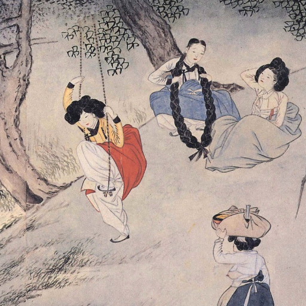
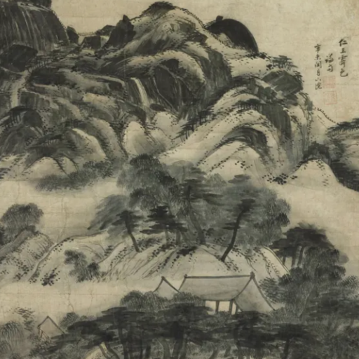
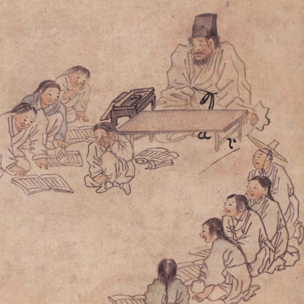

# 使用 Sentence Transformers 微調多模態 EmbeddingGemma 2

**EmbeddingGemma 2** 能將文字、圖像、音訊和影片映射到統一的 768 維向量空間。因此，您可以使用與文字相同的 Sentence Transformers 訓練管線，在**跨模態三元組**（例如 `(text_query, positive_image, negative_image)`）上對其進行微調。

!!! note "注意"
    本指南需要支援 bfloat16 資料型別的 GPU，例如 NVIDIA L4 或 NVIDIA A100。

### 範例情境：韓國水墨畫典藏搜尋

想像您正在為一場傳統朝鮮王朝韓國畫作的博物館展覽，打造一個數位典藏搜尋引擎：

* **[Shin Yunbok](https://artsandculture.google.com/entity/sin-yun-bok/m0749t2), *Dano Pungjeong* (Scenery on Dano Day)** (`ink-wash-1.png`)：描繪端午節期間女子在溪邊沐浴、盪鞦韆的風俗畫（*pungsokhwa*）<br>
* **[Jeong Seon](https://artsandculture.google.com/entity/jeong-seon/m06w7x2), *Inwangjesaekdo* (Clearing after Rain on Mount Inwang)** (`ink-wash-2.png`)：描繪雨後仁王山花崗岩峰巒自霧中浮現的真景山水畫（*jingyeong sansuhwa*）<br>
* **[Kim Hongdo](https://artsandculture.google.com/entity/gim-hongdo/m0749cz), *Seodang* (Village School)** (`ink-wash-3.png`)：描繪鄉村書塾老師、哭泣的學生與竊笑同學的風俗畫<br>

開箱即用的 **EmbeddingGemma 2** 在給定**描述性場景說明文字**（例如 *"Scenery on Dano Day"* 或 *"Village School"*）時，可以檢索出正確的畫作。但是，當使用者僅以**畫家姓名**搜尋（例如 *"Show me an ink wash painting of Shin Yunbok."*）時，模型面對三幅視覺上相似的傳統韓國水墨畫作，若缺乏特定領域的畫家歸屬知識，就可能排錯順序。

**本指南涵蓋：**

* 安裝相依套件，並載入具備文字與視覺編碼器的 **EmbeddingGemma 2** (`google/embeddinggemma-2`)
* 在微調前評估基準 **文字轉圖像**檢索效能（比較以畫家為基礎的查詢與描述性場景查詢）
* 準備將畫家姓名連結到其畫作的跨模態 `(anchor, positive, negative)` 訓練三元組
* 使用 `SentenceTransformerTrainer`、`MultipleNegativesRankingLoss` 與欄位特定的任務提示（task prompt）微調模型
* 評估訓練後的改善情況，並儲存您調適後的多模態模型

!!! tip "第一次使用 EmbeddingGemma 2 做多模態推論？"
    請參閱 [EmbeddingGemma 2 多模態嵌入](multimodal.md)，了解圖像、音訊、影片與交錯式輸入的概覽。

## 設定與安裝

安裝用於圖像處理的 `sentence-transformers`、`transformers`、`datasets` 和 `pillow`。

Sentence Transformers 是一個用於使用與訓練嵌入（embedding）及重排序（reranker）模型的 Python 框架。如需更多框架細節，請參閱 [Sentence Transformers 文件](https://www.sbert.net/)。

```bash { .notebook-cell }
pip install -U sentence-transformers transformers datasets pillow soundfile torchcodec
```

## （選用）Hugging Face 驗證

您需要有效的 Hugging Face Token 才能發佈模型。若您在 Google Colab 內執行，可以從 Colab 密鑰安全載入 Hugging Face Token；否則可以直接將 Token 傳給 `login()`。如果您打算將微調後的模型推送到 Hub，請確保 Token 具有寫入權限。

```python { .notebook-cell }
from huggingface_hub import login
login()
```

## 載入基礎模型

使用 `SentenceTransformer` 載入 `google/embeddinggemma-2`。

```python { .notebook-cell }
from sentence_transformers import SentenceTransformer

model_id = "google/embeddinggemma-2"
model = SentenceTransformer(
    model_id,
    config_kwargs={"audio_config": None},
)

print(f"Device: {model.device}")
print(f"dtype: {model.dtype}")
print(model)
print("Total number of parameters in the model:", sum(p.numel() for p in model.parameters()))
```

``` { .no-copy .output }
Loading weights:   0%|          | 0/624 [00:00<?, ?it/s]
Device: cuda:0
dtype: torch.bfloat16
SentenceTransformer(
  (0): Transformer({'transformer_task': 'feature-extraction', 'modality_config': {'text': {'method': 'forward', 'method_output_name': 'last_hidden_state'}, 'image': {'method': 'forward', 'method_output_name': 'last_hidden_state'}, 'audio': {'method': 'forward', 'method_output_name': 'last_hidden_state'}, 'video': {'method': 'forward', 'method_output_name': 'last_hidden_state'}, 'message': {'method': 'forward', 'method_output_name': 'last_hidden_state', 'format': 'structured'}}, 'module_output_name': 'token_embeddings', 'architecture': 'EmbeddingGemma2Model'})
  (1): Pooling({'embedding_dimension': 768, 'pooling_mode': 'mean', 'include_prompt': True})
  (2): Normalize({'module_input_name': 'sentence_embedding', 'module_output_name': 'sentence_embedding'})
)
Total number of parameters in the model: 438760448
```

!!! tip
    由於本教學是在**文字與圖像**資料上微調，我們在初始化時傳入 `config_kwargs={"audio_config": None}` 來省略音訊編碼器，以減少訓練期間的 GPU 記憶體使用量。如果您的微調資料集也包含音訊，請使用預設設定初始化 `SentenceTransformer(model_id)` 以載入所有模態編碼器。

!!! note "精度說明"
    EmbeddingGemma 2 的激活值與 `float16` 不相容。請使用 `bfloat16`（支援的 GPU 上為預設值）或 `float32`。

## 基準評估（微調前）

首先，載入三幅朝鮮王朝水墨畫，並測試基礎模型在訪客以畫家姓名搜尋時的排名：
> *「向我展示一幅 Shin Yunbok 的水墨畫。」*

我們的三幅候選畫作：

1. **Shin Yunbok, *Dano Pungjeong* (Scenery on Dano Day)** (`ink-wash-1.png`) — **正確匹配**
2. **Jeong Seon, *Inwangjesaekdo* (Clearing after Rain on Mount Inwang)** (`ink-wash-2.png`) — **困難負樣本**
3. **Kim Hongdo, *Seodang* (Village School)** (`ink-wash-3.png`) — **困難負樣本**

```python { .notebook-cell }
from PIL import Image
from IPython.display import display
import requests

IMAGE_SIZE = 240

def load_image(url):
    return Image.open(requests.get(url, stream=True).raw).convert("RGB").resize((IMAGE_SIZE, IMAGE_SIZE))

# Load Korean ink wash paintings
ink_wash_1 = load_image("https://github.com/bebechien/gemma/raw/refs/heads/main/images/ink-wash-1.png")
ink_wash_2 = load_image("https://github.com/bebechien/gemma/raw/refs/heads/main/images/ink-wash-2.png")
ink_wash_3 = load_image("https://github.com/bebechien/gemma/raw/refs/heads/main/images/ink-wash-3.png")

task_name = "Retrieval-query"
query = "Show me an ink wash painting of Shin Yunbok."

candidates = [
    {"label": "Shin Yunbok, Dano Pungjeong (Scenery on Dano Day)", "image": ink_wash_1},
    {"label": "Jeong Seon, Inwangjesaekdo (Clearing after Rain on Mount Inwang)", "image": ink_wash_2},
    {"label": "Kim Hongdo, Seodang (Village School)", "image": ink_wash_3},
]

for item in candidates:
    print(item["label"])
    display(item["image"])

def evaluate_retrieval(query_text, candidate_items):
    print(f"Query: {query_text}")
    query_emb = model.encode(query_text, prompt_name=task_name)
    image_embs = model.encode([item["image"] for item in candidate_items])
    similarities = model.similarity(query_emb, image_embs)[0]

    for item, score in zip(candidate_items, similarities):
        print(f"Painting: {item['label']:<66} -> 🤖 Score: {score.item():.4f}")

print("-"*80)
print("Baseline Scores (Before Fine-Tuning):")
evaluate_retrieval(query, candidates)
```

``` { .no-copy .output }
Shin Yunbok, Dano Pungjeong (Scenery on Dano Day)
```


``` { .no-copy .output }
Jeong Seon, Inwangjesaekdo (Clearing after Rain on Mount Inwang)
```


``` { .no-copy .output }
Kim Hongdo, Seodang (Village School)
```


``` { .no-copy .output }
--------------------------------------------------------------------------------
Baseline Scores (Before Fine-Tuning):
Query: Show me an ink wash painting of Shin Yunbok.
Painting: Shin Yunbok, Dano Pungjeong (Scenery on Dano Day)                  -> 🤖 Score: 0.6753
Painting: Jeong Seon, Inwangjesaekdo (Clearing after Rain on Mount Inwang)   -> 🤖 Score: 0.7005
Painting: Kim Hongdo, Seodang (Village School)                               -> 🤖 Score: 0.6631
```

!!! note "跨模態搜尋任務提示說明"
    任務專用提示前綴僅適用於**文字輸入**。在此我們以 `prompt_name="Retrieval-query"`（`"task: search result | query: "`）編碼文字查詢，並直接編碼候選圖像（不加文字前綴）。如需所有可用提示的細節，請參閱 [EmbeddingGemma 2 模型卡](model-card-v2.md#最佳實務)。

### 為什麼基準查詢排錯了畫作順序？

在上述基準評估中，搜尋 *"Show me an ink wash painting of Shin Yunbok."* **排錯了**候選順序：基礎模型給 **Jeong Seon 的 _Inwangjesaekdo_** 的相似度分數最高，而非真正的匹配 **Shin Yunbok 的 _Dano Pungjeong_**。

請注意，當您提供關於視覺場景本身的**描述性說明文字**（例如下方的 *"Dano Pungjeong (Scenery on Dano Day)"* 或 *"Seodang (Village School)"*）時，基礎模型**確實**能開箱即用檢索出正確圖像。然而，由於畫家姓名（*"Shin Yunbok"*）是領域元資料（metadata），而非場景的字面視覺描述，因此需要微調來教會模型將每位畫家與其畫作關聯起來。

```python { .notebook-cell }
query_desc = "Dano Pungjeong (Scenery on Dano Day)"
evaluate_retrieval(query_desc, candidates)

print("-"*80)
query_desc = "Seodang (Village School)"
evaluate_retrieval(query_desc, candidates)
```

``` { .no-copy .output }
Query: Dano Pungjeong (Scenery on Dano Day)
Painting: Shin Yunbok, Dano Pungjeong (Scenery on Dano Day)                  -> 🤖 Score: 0.6892
Painting: Jeong Seon, Inwangjesaekdo (Clearing after Rain on Mount Inwang)   -> 🤖 Score: 0.6767
Painting: Kim Hongdo, Seodang (Village School)                               -> 🤖 Score: 0.6478
--------------------------------------------------------------------------------
Query: Seodang (Village School)
Painting: Shin Yunbok, Dano Pungjeong (Scenery on Dano Day)                  -> 🤖 Score: 0.6777
Painting: Jeong Seon, Inwangjesaekdo (Clearing after Rain on Mount Inwang)   -> 🤖 Score: 0.6782
Painting: Kim Hongdo, Seodang (Village School)                               -> 🤖 Score: 0.6997
```

## 準備多模態微調資料集

為了教會模型將每位朝鮮王朝大師與其作品關聯起來，我們將訓練資料組織為跨模態對比三元組：**`(anchor, positive, negative)`**：

* **`anchor`（文字）**：畫家姓名（`"Shin Yunbok"`、`"Jeong Seon"`、`"Kim Hongdo"`）。
* **`positive`（圖像）**：該畫家對應的 `PIL.Image` 畫作。
* **`negative`（圖像）**：另一位畫家的傳統韓國水墨畫，作為視覺困難負樣本。

`SentenceTransformerTrainer` 會自動檢查每個欄位的模態，並透明地預處理文字與圖像——無需手動分詞或像素預處理。

```python { .notebook-cell }
from datasets import Dataset

triplets = [
    [
        "Shin Yunbok",
        ink_wash_1,
        ink_wash_2,
    ],
    [
        "Jeong Seon",
        ink_wash_2,
        ink_wash_3,
    ],
    [
        "Kim Hongdo",
        ink_wash_3,
        ink_wash_1,
    ],
]

# Convert into a Hugging Face Dataset with text 'anchor' and image 'positive'/'negative' columns
data_as_dicts = [
    {"anchor": row[0], "positive": row[1], "negative": row[2]}
    for row in triplets
]
train_dataset = Dataset.from_list(data_as_dicts)
print(train_dataset)
```

``` { .no-copy .output }
Dataset({
    features: ['anchor', 'positive', 'negative'],
    num_rows: 3
})
```

!!! tip "提示（其他多模態格式）"
    在交錯式輸入上訓練時，資料集欄位也可以包含圖像檔案路徑/URL、音訊波形、影片路徑，或像 `{"text": "caption", "image": pil_image}` 這樣的多模態字典。

!!! note
    為示範起見，我們在下方建立一個僅含 3 個跨模態三元組的精簡資料集。在實際生產應用中，請使用數百或數千個特定領域的配對或三元組，以達到穩健的泛化能力。

## 微調多模態模型

我們使用 `SentenceTransformerTrainer` 和 **`MultipleNegativesRankingLoss`** 微調模型；此損失函數會將 `(anchor, positive)` 文字-圖像配對在共享的 768 維嵌入空間中拉近，同時將 `(anchor, negative)` 配對（以及批次內的負樣本）推遠。

關鍵是：由於只有 `anchor` 欄位包含文字，而 `positive` 和 `negative` 包含圖像，我們在 `SentenceTransformerTrainingArguments` 中傳入**欄位特定的提示映射** `prompts={"anchor": model.prompts[task_name]}`。這能確保任務前綴只加到文字查詢上，而不會加到圖像輸入上。

```python { .notebook-cell }
from sentence_transformers import (
    SentenceTransformerTrainer,
    SentenceTransformerTrainingArguments,
)
from sentence_transformers.sentence_transformer.losses import MultipleNegativesRankingLoss
from transformers import TrainerCallback

# Initialize contrastive ranking loss
loss = MultipleNegativesRankingLoss(model)

# Configure training arguments
args = SentenceTransformerTrainingArguments(
    output_dir="my-multimodal-embeddinggemma-2",
    prompts={"anchor": model.prompts[task_name]},  # Apply task prompt prefix only to the text 'anchor' column
    num_train_epochs=5,
    per_device_train_batch_size=1,
    learning_rate=2e-5,
    bf16=True,                                     # EmbeddingGemma 2 uses bfloat16 (incompatible with fp16)
    fp16=False,
    logging_steps=train_dataset.num_rows,
    report_to="none",
)

class EvaluationCallback(TrainerCallback):
    """Callback that evaluates cross-modal retrieval scores at each logging step."""

    def __init__(self, eval_fn):
        self.eval_fn = eval_fn

    def on_log(self, args, state, control, **kwargs):
        print(f"\n--- Step {state.global_step} Evaluation ---")
        self.eval_fn()

trainer = SentenceTransformerTrainer(
    model=model,
    args=args,
    train_dataset=train_dataset,
    loss=loss,
    callbacks=[EvaluationCallback(lambda: evaluate_retrieval(query, candidates))],
)

trainer.train()
```

``` { .no-copy .output }
Computing widget examples:   0%|          | 0/1 [00:00<?, ?example/s]
 [15/15 00:19, Epoch 5/5]
Step	Training Loss
3	1.000404
6	0.602180
9	0.364761
12	0.281820
15	0.247832

--- Step 3 Evaluation ---
Query: Show me an ink wash painting of Shin Yunbok.
Painting: Shin Yunbok, Dano Pungjeong (Scenery on Dano Day)                  -> 🤖 Score: 0.7203
Painting: Jeong Seon, Inwangjesaekdo (Clearing after Rain on Mount Inwang)   -> 🤖 Score: 0.6359
Painting: Kim Hongdo, Seodang (Village School)                               -> 🤖 Score: 0.6785

--- Step 6 Evaluation ---
Query: Show me an ink wash painting of Shin Yunbok.
Painting: Shin Yunbok, Dano Pungjeong (Scenery on Dano Day)                  -> 🤖 Score: 0.7185
Painting: Jeong Seon, Inwangjesaekdo (Clearing after Rain on Mount Inwang)   -> 🤖 Score: 0.6257
Painting: Kim Hongdo, Seodang (Village School)                               -> 🤖 Score: 0.6610

--- Step 9 Evaluation ---
Query: Show me an ink wash painting of Shin Yunbok.
Painting: Shin Yunbok, Dano Pungjeong (Scenery on Dano Day)                  -> 🤖 Score: 0.7107
Painting: Jeong Seon, Inwangjesaekdo (Clearing after Rain on Mount Inwang)   -> 🤖 Score: 0.6157
Painting: Kim Hongdo, Seodang (Village School)                               -> 🤖 Score: 0.6544

--- Step 12 Evaluation ---
Query: Show me an ink wash painting of Shin Yunbok.
Painting: Shin Yunbok, Dano Pungjeong (Scenery on Dano Day)                  -> 🤖 Score: 0.7067
Painting: Jeong Seon, Inwangjesaekdo (Clearing after Rain on Mount Inwang)   -> 🤖 Score: 0.6129
Painting: Kim Hongdo, Seodang (Village School)                               -> 🤖 Score: 0.6515

--- Step 15 Evaluation ---
Query: Show me an ink wash painting of Shin Yunbok.
Painting: Shin Yunbok, Dano Pungjeong (Scenery on Dano Day)                  -> 🤖 Score: 0.7070
Painting: Jeong Seon, Inwangjesaekdo (Clearing after Rain on Mount Inwang)   -> 🤖 Score: 0.6126
Painting: Kim Hongdo, Seodang (Village School)                               -> 🤖 Score: 0.6522
Writing model shards:   0%|          | 0/1 [00:00<?, ?it/s]

--- Step 15 Evaluation ---
Query: Show me an ink wash painting of Shin Yunbok.
Painting: Shin Yunbok, Dano Pungjeong (Scenery on Dano Day)                  -> 🤖 Score: 0.7070
Painting: Jeong Seon, Inwangjesaekdo (Clearing after Rain on Mount Inwang)   -> 🤖 Score: 0.6126
Painting: Kim Hongdo, Seodang (Village School)                               -> 🤖 Score: 0.6522
TrainOutput(global_step=15, training_loss=0.49939937591552735, metrics={'train_runtime': 20.5693, 'train_samples_per_second': 0.729, 'train_steps_per_second': 0.729, 'total_flos': 0.0, 'train_loss': 0.49939937591552735, 'epoch': 5.0})
```

## 微調後評估

讓我們在微調後的模型上再執行一次測試查詢，並將訓練後的跨模態相似度分數與基準比較：

```python { .notebook-cell }
print("Post-Training Scores (After Fine-Tuning):")
evaluate_retrieval(query, candidates)
```

``` { .no-copy .output }
Post-Training Scores (After Fine-Tuning):
Query: Show me an ink wash painting of Shin Yunbok.
Painting: Shin Yunbok, Dano Pungjeong (Scenery on Dano Day)                  -> 🤖 Score: 0.7070
Painting: Jeong Seon, Inwangjesaekdo (Clearing after Rain on Mount Inwang)   -> 🤖 Score: 0.6126
Painting: Kim Hongdo, Seodang (Village School)     
```

### 微調後有什麼改變？

在微調前，三幅朝鮮王朝畫作具有相似的傳統韓國水墨美學，導致基礎模型在查詢 *"Show me an ink wash painting of Shin Yunbok."* 時，將 **Jeong Seon 的 _Inwangjesaekdo_** 排在 **Shin Yunbok 的 _Dano Pungjeong_** 之上。

僅在 `(artist_name, positive_image, negative_image)` 三元組上進行 5 個 epoch（15 個步驟）的對比式微調後：
* 雖然訓練錨點僅包含畫家姓名（`"Shin Yunbok"`、`"Jeong Seon"`、`"Kim Hongdo"`），模型仍能泛化到自然語言查詢 *"Show me an ink wash painting of Shin Yunbok."*。
* **Shin Yunbok, *Dano Pungjeong* (Scenery on Dano Day)** (`ink-wash-1.png`) 從第 2 名上升到第 1 名，在第一個 epoch（第 3 步）後就已奪下榜首。
* 競爭的水墨畫困難負樣本（**Jeong Seon** 與 **Kim Hongdo**）在共享的 768 維嵌入空間中被推得更遠。

## 儲存與分享您的模型

將微調後的多模態模型儲存在本機，以便直接用 `SentenceTransformer` 重新載入：

```python { .notebook-cell }
# Save locally
model.save_pretrained("my-embeddinggemma-2-multimodal-finetuned")
```

若要與團隊分享調適後的模型，或從 Hugging Face Hub 部署，請使用 `push_to_hub`：

```python { .notebook-cell }
# Optional: Push your fine-tuned model to the Hugging Face Hub
model.push_to_hub("my-embeddinggemma-2-multimodal-finetuned")
```

## 摘要與後續步驟

您已學會如何使用多模態三元組與 `SentenceTransformerTrainer`，針對跨模態**文字轉圖像檢索**微調 **EmbeddingGemma 2**。

探索 EmbeddingGemma 2 的更多用法：

- [EmbeddingGemma 2 多模態嵌入](multimodal.md)
- [使用 Sentence Transformers 微調 EmbeddingGemma（純文字）](fine-tuning.md)
- [Sentence Transformers 訓練概覽](https://sbert.net/docs/sentence_transformer/training_overview.html)
- [Gemma Cookbook 中的 EmbeddingGemma 簡易 RAG](https://github.com/google-gemma/cookbook/blob/main/tutorials/RAG_with_EmbeddingGemma.ipynb)

--8<-- "glossary.md"
