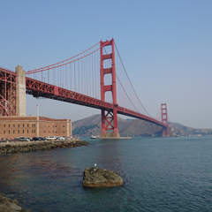

# 使用 Sentence Transformers 的多模態嵌入

**EmbeddingGemma 2** 是一個輕量、開源的 740M 參數模型，專為統一多模態嵌入而設計。它基於 Gemma 4 解碼器架構，能將**文字、圖像、音訊和影片**映射到單一 768 維向量空間。

由於所有模態共用同一語義空間，您可以在同一模態內（例如圖像對圖像相似度）或跨不同模態（例如文字轉圖像、文字轉音訊與文字轉影片檢索）比較輸入，並在消費級 GPU 或 CPU 上本機執行。

**本指南涵蓋：**

- 安裝多媒體相依套件並載入 **EmbeddingGemma 2**
- 選擇性模態載入以減少 GPU 記憶體使用量
- **圖像嵌入**與跨模態**文字轉圖像搜尋**（含軟詞元預算調整）
- **音訊嵌入**與跨模態**文字轉音訊檢索**
- **影片嵌入**與跨模態**文字轉影片檢索**
- **交錯式多模態輸入**（在單一表示中結合文字 + 圖像/音訊/影片）
- 打造跨文字、圖像、音訊與影片的**統一跨模態搜尋索引**

!!! tip "第一次接觸 EmbeddingGemma 2？"
    如需純文字基礎、任務提示、零樣本分類、RAG 與 Matryoshka Representation Learning (MRL)，請先從 [使用 Sentence Transformers 產生嵌入](inference.md)指南開始。

## 設定與安裝

安裝 `sentence-transformers`、`transformers`，以及處理圖像、音訊和影片所需的多媒體函式庫（`pillow`、`soundfile`、`torchcodec`）。

Sentence Transformers 是一個用於使用與訓練嵌入（embedding）及重排序（reranker）模型的 Python 框架。如需更多框架細節，請參閱 [Sentence Transformers 文件](https://www.sbert.net/)。

```bash { .notebook-cell }
pip install -U sentence-transformers transformers pillow soundfile torchcodec
```

## 模型初始化

直接使用 `SentenceTransformer` 類別實例化 EmbeddingGemma 2。預設會載入文字主幹，同時載入視覺與音訊編碼器。

```python { .notebook-cell }
from sentence_transformers import SentenceTransformer

model_id = "google/embeddinggemma-2"
model = SentenceTransformer(model_id)

print(f"device: {model.device}")
print(f"dtype: {model.dtype}")
print(f"Supported modalities: {model.modalities}")
print("Total number of parameters in the model:", sum(p.numel() for p in model.parameters()))
```

``` { .no-copy .output }
Loading weights:   0%|          | 0/1376 [00:00<?, ?it/s]
device: cuda:0
dtype: torch.bfloat16
Supported modalities: ['text', 'image', 'audio', 'video', 'message']
Total number of parameters in the model: 744371488
```

!!! note "精度說明"
    EmbeddingGemma 2 的激活值與 `float16` 不相容。推論一律使用 `bfloat16`（支援的 GPU 上為預設值）或 `float32`。

### 選用：選擇性編碼器載入

如果您的工作流程只需要特定模態（例如純音訊檢索），可以透過 `config_kwargs` 只選擇性載入所需的編碼器，以最佳化記憶體使用量與初始化速度。

初始化模型時傳入 `"vision_config": None` 和/或 `"audio_config": None`，即可只載入啟用的編碼器。

```python
from sentence_transformers import SentenceTransformer

model_id = "google/embeddinggemma-2"
audio_only_model = SentenceTransformer(
    model_id,
    config_kwargs={"vision_config": None},
)

print("Total parameters (audio-only):", sum(p.numel() for p in audio_only_model.parameters()))
```

``` { .no-copy .output }
Loading weights:   0%|          | 0/1165 [00:00<?, ?it/s]
Total parameters (audio-only): 576613664
```

*（本教學的其餘部分使用上方初始化的完整多模態 `model`。）*

## 多模態與跨模態嵌入

由於 EmbeddingGemma 2 將所有模態映射到統一的 768 維向量空間，您可以在模態**內**（例如圖像對圖像）與**跨**模態（例如文字轉圖像、圖像轉音訊或文字轉影片）計算相似度。

### 處理圖像

將圖像以字典 `{"image": <source>}` 傳入，其中 `<source>` 可以是檔案路徑、URL 或 `PIL.Image` 物件。

```python { .notebook-cell }
from PIL import Image
from IPython.display import display
import requests

IMAGE_SIZE = 240

img_url = "https://raw.githubusercontent.com/google-gemma/cookbook/refs/heads/main/apps/sample-data/GoldenGate.png"
input_image = Image.open(requests.get(img_url, stream=True).raw).resize((IMAGE_SIZE, IMAGE_SIZE))

print("Input Image:")
display(input_image)

# Embed the image directly from a URL, file path, or PIL Image object
emb_goldengate = model.encode({"image": img_url})

# Compare the image embedding against another image and text candidates
example_img_url = "https://raw.githubusercontent.com/google-gemma/cookbook/refs/heads/main/apps/sample-data/kitchen_painting.jpg"
example_image = Image.open(requests.get(example_img_url, stream=True).raw).resize((IMAGE_SIZE, IMAGE_SIZE))

candidates = [
    {"image": example_img_url},
    "San Francisco",
    "a cute cat walking",
    "a friendly dog sitting in the grass",
]
emb_candidates = model.encode(candidates)
image_similarities = model.similarity(emb_goldengate, emb_candidates)[0]

print("\nSimilarity with candidates:\n"+"-"*80)
for idx, score in enumerate(image_similarities):
    if idx == 0:
        display(example_image)
    else:
        print(candidates[idx])
    print(f" `-> 🤖 score: {score:.3f}\n")
```

``` { .no-copy .output }
Input Image:
```



``` { .no-copy .output }
Similarity with candidates:
--------------------------------------------------------------------------------
```


``` { .no-copy .output }
 `-> 🤖 score: 0.585

San Francisco
 `-> 🤖 score: 0.641

a cute cat walking
 `-> 🤖 score: 0.534

a friendly dog sitting in the grass
 `-> 🤖 score: 0.509
```

請注意，文字查詢 `"San Francisco"` 與金門大橋照片的跨模態相似度最高。

#### 自訂圖像處理參數

您可以透過 `processing_kwargs` 調整每次推論呼叫的視覺詞元預算：

```python { .notebook-cell }
img_processing_args = {
    "image": {
        "max_soft_tokens": 1120,
    }
}

emb_goldengate = model.encode({"image": img_url}, processing_kwargs=img_processing_args)
emb_candidates = model.encode(candidates, processing_kwargs=img_processing_args)
image_similarities = model.similarity(emb_goldengate, emb_candidates)[0]

print("Similarity with candidates:\n"+"-"*80)
for idx, score in enumerate(image_similarities):
    if idx == 0:
        display(example_image)
    else:
        print(candidates[idx])
    print(f" `-> 🤖 score: {score:.3f}\n")
```

``` { .no-copy .output }
Similarity with candidates:
--------------------------------------------------------------------------------
```


``` { .no-copy .output }
 `-> 🤖 score: 0.568

San Francisco
 `-> 🤖 score: 0.674

a cute cat walking
 `-> 🤖 score: 0.545

a friendly dog sitting in the grass
 `-> 🤖 score: 0.531
```

您可以選擇 70、140、280、560 或 1120 詞元的預算大小。提高輸入圖像的視覺預算會以延遲與詞元數換取品質。

### 處理音訊

以 `{"audio": <source>}` 傳入音訊輸入。支援的音訊來源包括本機檔案路徑、URL，或記憶體內波形（1D/2D `float32` NumPy 陣列或 PyTorch 張量）。音訊檔案會自動解碼並重新取樣為 16 kHz。

```python { .notebook-cell }
from IPython.display import display, Audio

aud_url = "https://ai.google.dev/gemma/docs/audio/roses-are.wav"

print("Input Audio:")
display(Audio(aud_url))

# Embed audio directly from a URL or file path
emb_speech = model.encode({"audio": aud_url})

# Compare audio embedding with text descriptions
candidates = [
    "a person speaking English",
    "random static white noise",
    "Roses are red, violets are blue.",
]
emb_candidates = model.encode(candidates)
audio_similarities = model.similarity(emb_speech, emb_candidates)[0]

print("\nSimilarity with candidates:\n"+"-"*80)
for idx, score in enumerate(audio_similarities):
    print(candidates[idx])
    print(f" `-> 🤖 score: {score:.3f}\n")
```

``` { .no-copy .output }
Input Audio:
```

<audio controls>
  <source src="../../assets/embeddinggemma/output_roses-are.wav" type="audio/mpeg">
  Your browser does not support the audio element.
</audio>

``` { .no-copy .output }
Similarity with candidates:
--------------------------------------------------------------------------------
a person speaking English
 `-> 🤖 score: 0.679

random static white noise
 `-> 🤖 score: 0.651

Roses are red, violets are blue.
 `-> 🤖 score: 0.876
```

### 處理影片

以 `{"video": <source>}` 傳入影片輸入。模型原生解碼 MP4 檔案/URL 並取樣影片幀。您也可以傳入預先擷取的幀，作為 `PIL.Image` 物件列表或 4D/5D 張量。

```python { .notebook-cell }
from IPython.display import display, Video

vid_url = "https://github.com/bebechien/gemma/raw/refs/heads/main/videos/cat_dozing.mp4"

print("Input Video:")
display(Video(vid_url))

# Embed video directly from a URL or file path
emb_video = model.encode({"video": vid_url})

# Compare video embedding with text descriptions
candidates = [
    "a cat dozing",
    "a cat playing with a small lizard",
    "a sports car racing on a highway",
]
emb_candidates = model.encode(candidates)
video_similarities = model.similarity(emb_video, emb_candidates)[0]

print("\nSimilarity with candidates:\n"+"-"*80)
for idx, score in enumerate(video_similarities):
    print(candidates[idx])
    print(f" `-> 🤖 score: {score:.3f}\n")
```

``` { .no-copy .output }
Input Video:
```

<video controls>
  <source src="../../assets/embeddinggemma/output_cat_dozing.mp4" type="video/mp4">
  Your browser does not support the video element.
</video>

``` { .no-copy .output }
Similarity with candidates:
--------------------------------------------------------------------------------
a cat dozing
 `-> 🤖 score: 0.688

a cat playing with a small lizard
 `-> 🤖 score: 0.602

a sports car racing on a highway
 `-> 🤖 score: 0.440
```

!!! note "FPS 說明"
    預設情況下，影片以 **每秒 1 幀**的取樣幀透過視覺編碼器處理；FPS 取樣率可設定。

#### 自訂影片處理參數

您可以透過 `processing_kwargs` 調整每次推論呼叫的幀取樣行為：

```python { .notebook-cell }
# Override video processing parameters for a specific encode() call
emb_video_custom = model.encode(
    {"video": vid_url},
    processing_kwargs={
        "video": {
            "max_frames": 16,               # Maximum frames to keep (default is 32)
            "fps": None,                    # Frames per second to extract (None keeps all up to max_frames)
            "overflow_strategy": "uniform", # How to sample when total frames exceed max_frames ('uniform' or 'truncate')
            "add_timestamps": True,         # Whether to insert frame timestamps into the multimodal sequence
        }
    },
)

video_similarities = model.similarity(emb_video_custom, emb_candidates)[0]

print("Similarity with customized video processing:\n"+"-"*80)
for idx, score in enumerate(video_similarities):
    print(candidates[idx])
    print(f" `-> 🤖 score: {score:.3f}\n")
```

``` { .no-copy .output }
Similarity with customized video processing:
--------------------------------------------------------------------------------
a cat dozing
 `-> 🤖 score: 0.739

a cat playing with a small lizard
 `-> 🤖 score: 0.668

a sports car racing on a highway
 `-> 🤖 score: 0.492
```

### 交錯式多模態輸入

EmbeddingGemma 2 在單次查詢中支援豐富的混合模態輸入：

* **多模態字典：** 在同一字典中傳入多個鍵（`"text"`、`"image"`、`"audio"`、`"video"`）以自動組合模態。
* **顯式佔位符交錯：** 在 `"text"` 字串中使用 `<|image|>`、`<|audio|>` 與 `<|video|>` 標籤，控制媒體項目插入的精確詞元位置。

```python { .notebook-cell }
img_url = "https://raw.githubusercontent.com/google-gemma/cookbook/refs/heads/main/apps/sample-data/GoldenGate.png"
example_img_url = "https://raw.githubusercontent.com/google-gemma/cookbook/refs/heads/main/apps/sample-data/kitchen_painting.jpg"
aud_url = "https://ai.google.dev/gemma/docs/audio/roses-are.wav"
vid_url = "https://github.com/bebechien/gemma/raw/refs/heads/main/videos/cat_dozing.mp4"

# 1. Multimodal query combining text, multiple images, and audio
query_multimodal = {
    "text": "Landmark and interior photos with spoken narration",
    "image": [img_url, example_img_url],
    "audio": aud_url,
}
emb_multimodal = model.encode(query_multimodal)

# 2. Interleaved query using placeholders to specify media ordering in text
query_interleaved = {
    "text": "Compare the scene in <|video|> with <|image|> and <|image|>.",
    "image": [img_url, example_img_url],
    "video": vid_url,
}
emb_interleaved = model.encode(query_interleaved)

# 3. Media-only interleaving using placeholders to control sequence order
query_media_sequence = {
    "text": "<|image|><|audio|><|image|>",
    "image": [img_url, example_img_url],
    "audio": aud_url,
}
emb_media_sequence = model.encode(query_media_sequence)

print("Multimodal embedding shape:", emb_multimodal.shape)
print("Interleaved embedding shape:", emb_interleaved.shape)
print("Media sequence embedding shape:", emb_media_sequence.shape)
```

``` { .no-copy .output }
Multimodal embedding shape: (768,)
Interleaved embedding shape: (768,)
Media sequence embedding shape: (768,)
```

## 摘要與後續步驟

您現在已經知道如何使用 **EmbeddingGemma 2** 與 `sentence-transformers` 函式庫，產生跨**文字、圖像、音訊和影片**的統一多模態與跨模態嵌入，以及如何設定模態編碼器與自訂影片處理參數。

### 延伸閱讀

- [EmbeddingGemma 2 模型卡](model-card-v2.md)
- [使用 Sentence Transformers 微調 EmbeddingGemma](fine-tuning.md)
- [使用 Sentence Transformers 視覺微調 EmbeddingGemma](fine-tuning-multimodal.md)
- [Sentence Transformers 文件](https://www.sbert.net/)

--8<-- "glossary.md"
