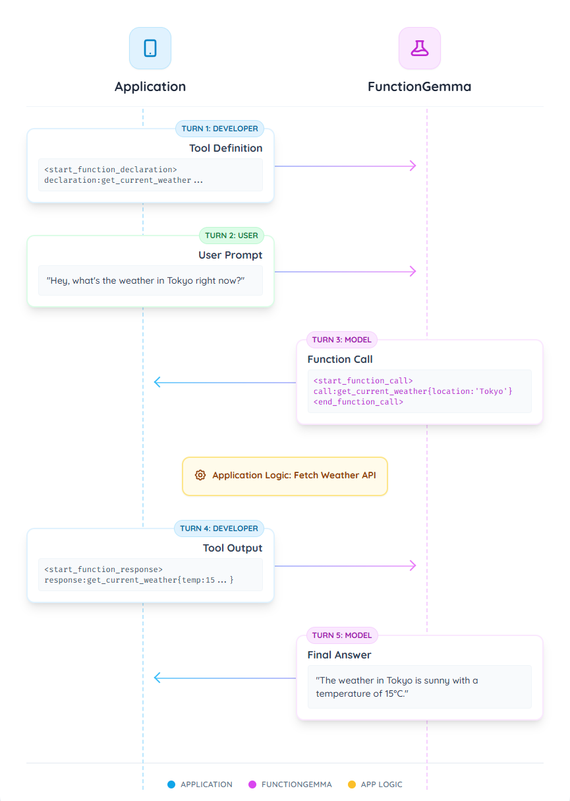

# FunctionGemma 格式與最佳實務

FunctionGemma 是 Gemma 3 270M 模型的專門版本，
專為**函式呼叫**（即工具使用）訓練。

為了管理自然語言指令與結構化工具相關資料之間的互動，FunctionGemma 使用一組特定的格式控制詞元。這些詞元是模型區分對話與資料、理解工具定義、工具呼叫與工具結果的關鍵。

## 基礎提示結構

FunctionGemma 建立在 [Gemma 提示結構](../../get-started/prompt-formatting.md)之上，使用
`<start_of_turn>role`{.token-turn} 與 `<end_of_turn>`{.token-turn} 來描述對話回合。
`role`{.token-role} 通常是 `user`{.token-role} 或 `model`{.token-role}（有時也會用 `developer`{.token-role}
來提供初始上下文，如下所示）。

函式專用的詞元用在這些回合*之內*，用來組織工具相關的資訊。

### 控制詞元

FunctionGemma 訓練了六個特殊詞元來管理「工具使用」的生命週期。

| 詞元對 | 用途 |
|---|---|
| `<start_function_declaration>`{.token-tool} `<end_function_declaration>`{.token-tool} | 定義一個工具。 |
| `<start_function_call>`{.token-tool} `<end_function_call>`{.token-tool} | 表示模型要求使用某個工具。 |
| `<start_function_response>`{.token-tool} `<end_function_response>`{.token-tool} | 將工具的結果傳回給模型。 |

!!! Note
    `<start_function_response>`{.token-tool} 是推論引擎的額外停止序列。


### 字串值的分隔符：`<escape>`{.token-tool}

單一詞元 `<escape>`{.token-tool} 作為結構化資料區塊中**所有字串值**的分隔符。

- **目的：**這個詞元確保字串內任何特殊字元（如 `{`、`}`、`,` 或引號）都被視為字面文字，而非資料結構語法的一部分。
- **用法：**函式宣告、呼叫與回覆中的所有字串字面值都必須用這種方式包起來，例如：<code>key:<span class="token-tool">&lt;escape&gt;</span>string value<span class="token-tool">&lt;escape&gt;</span></code>。

## 訓練範疇與限制

FunctionGemma 針對特定類型的代理式工作流程訓練。了解模型的訓練背景對生產環境的可靠性很重要。

### 支援的工作流程

模型已明確在**單回合**與**平行**函式呼叫上訓練。

- **單回合：**使用者提出查詢，模型選擇單一工具來處理。
- **平行：**使用者的查詢包含多個獨立請求，模型在單一回覆中同時生成多個工具呼叫。

**範例：平行（支援）**
> **使用者：**「東京的天氣如何，以及 Google 的股價是多少？」

模型在單一回覆中為 `get_weather(Tokyo)` 與 `get_stock_price(GOOG)` 生成呼叫。這兩個動作互不依賴。

### 不支援的工作流程

模型**沒有**明確在**多回合**或**多步驟**工作流程上訓練。
!!! Note
    我們預期模型在這些情境下能有一定程度的泛化能力，特別是針對特定使用場景微調後，但它並非開箱即能執行這些任務。


- **多步驟（串連）：**某個工具的輸出必須作為後續工具的引數的情境。

    - **範例：**「擲一顆 20 面骰子，檢查數字是否為質數。」
    - **複雜度：**這需要先擲骰子（工具 A），*然後*用結果檢查是否為質數（工具 B）。FunctionGemma 沒有受過訓練，無法自動推理想出這種依賴鏈。
- **多回合：**需要模型在漫長的一來一回對話中維持狀態或上下文來決定工具參數的情境。

> **使用者：**「幫我訂一張桌子。」
>
> **模型：**「幾位呢？」
>
> **使用者：**「四位。」

- **複雜度：**模型沒有受過明確訓練，無法在沒有外部狀態管理的情況下，把這些分散的回合彙整成最終的 `book_table(people=4)` 呼叫。

### 語意細微差別

如果使用者的提示抽象或間接，模型有時會錯過語意相關概念之間的關聯。

以下是一個範例函式。

```python
def get_current_temperature(location: str, unit: str):
    """
    Get the current temperature at a location.

    Args:
        location: The location to get the temperature for.
        unit: The unit to return the temperature in. (choices: ["celsius", "fahrenheit"])
    """
    return 22.0
```

例如，「cold」或「hot」這類概念隱含溫度，但在該特定上下文中如果模型沒有建立語意連結，可能就不會觸發名為 `get_current_temperature` 的特定工具。

- **緩解策略：**
    - **豐富的工具定義：**這通常是最有效的修正方式。擴充函式描述，加入語意關鍵字，幫助模型搭起這座橋。例如，在 docstring 中加入「此函式可用來判斷給定地點的天氣是熱還是冷」，就能讓 FunctionGemma 正確地把這些質性描述詞對應到工具。
    - **提示工程：**把使用者查詢寫得更詳細或更明確，可以幫助模型觸發正確的工具，但這仰賴使用者的行為。
    - **微調：**對於使用者經常使用高度間接語言的生產環境（例如「外面天氣好嗎？」相對於「查天氣」），我們建議在明確對應這些語意細微差別與正確工具定義的資料集上[微調](fine-tuning.md)模型。

**範例：建立語意連結**
> **使用者：**「嘿，巴黎現在冷嗎？」

**情境 A：有限的描述** 如果工具描述只有 `Get the current temperature at a location.`，模型可能無法把「cold」與 get_current_temperature 連結起來，而回覆無法提供天氣資訊。

**情境 B：豐富的描述** 如果工具描述更新為包含：`Get the current temperature at a location. This function can be used to determine if the weather is hot or cold in a given location.`，模型就能成功建立連結：

<code><span class="token-tool">&lt;start_function_call&gt;</span>call:get_current_temperature{location:<span class="token-tool">&lt;escape&gt;</span>Paris<span class="token-tool">&lt;escape&gt;</span>,unit:<span class="token-tool">&lt;escape&gt;</span>celsius<span class="token-tool">&lt;escape&gt;</span>}<span class="token-tool">&lt;end_function_call&gt;</span></code>

## 範例：天氣工具流程

以下是使用 `get_current_weather` 工具的完整逐步格式範例，示範整個流程。



### 回合 1：工具定義（開發者）

首先，您以 `developer` 角色的第一個回合提供模型所有可用工具的定義。這個區塊用來提供模型可用函式的「schema」，包括函式名稱、功能描述與參數。

務必包含系統提示 `You are a model that can do function calling with the following functions` 來啟用模型的工具呼叫能力。這句話是個基於提示的觸發器，用來在工具能力與一般對話之間切換。

<pre><code>
<span class="token-turn">&lt;start_of_turn&gt;</span><span class="token-role">developer</span>
You are a model that can do function calling with the following functions<span class="token-tool">&lt;start_function_declaration&gt;</span>declaration:get_current_weather{description:<span class="token-tool">&lt;escape&gt;</span>Gets the current weather in a given location.<span class="token-tool">&lt;escape&gt;</span>,parameters:{properties:{location:{description:<span class="token-tool">&lt;escape&gt;</span>The city and state, e.g. "San Francisco, CA" or "Tokyo, JP"<span class="token-tool">&lt;escape&gt;</span>,type:<span class="token-tool">&lt;escape&gt;</span>STRING<span class="token-tool">&lt;escape&gt;</span>},unit:{description:<span class="token-tool">&lt;escape&gt;</span>The unit to return the temperature in.<span class="token-tool">&lt;escape&gt;</span>,enum:[<span class="token-tool">&lt;escape&gt;</span>celsius<span class="token-tool">&lt;escape&gt;</span>,<span class="token-tool">&lt;escape&gt;</span>fahrenheit<span class="token-tool">&lt;escape&gt;</span>],type:<span class="token-tool">&lt;escape&gt;</span>STRING<span class="token-tool">&lt;escape&gt;</span>}},required:[<span class="token-tool">&lt;escape&gt;</span>location<span class="token-tool">&lt;escape&gt;</span>],type:<span class="token-tool">&lt;escape&gt;</span>OBJECT<span class="token-tool">&lt;escape&gt;</span>}<span class="token-tool">&lt;end_function_declaration&gt;</span><span class="token-turn">&lt;end_of_turn&gt;</span>
</code></pre>

### 回合 2：使用者提示（使用者）

接著，使用者提出一個需要用到剛定義的工具的問題。

<pre><code>
<span class="token-turn">&lt;start_of_turn&gt;</span><span class="token-role">user</span>
Hey, what's the weather in Tokyo right now?<span class="token-turn">&lt;end_of_turn&gt;</span>
</code></pre>

### 回合 3：模型發出函式呼叫（模型）

模型處理使用者的請求與工具定義。它判斷需要呼叫 `get_current_weather` 函式，並輸出以下回合。

<pre><code>
<span class="token-turn">&lt;start_of_turn&gt;</span><span class="token-role">model</span>
<span class="token-tool">&lt;start_function_call&gt;</span>call:get_current_weather{location:<span class="token-tool">&lt;escape&gt;</span>Tokyo, Japan<span class="token-tool">&lt;escape&gt;</span>}<span class="token-tool">&lt;end_function_call&gt;</span>
</code></pre>

> **應用程式邏輯：**此時您的應用程式必須攔截這個輸出。不要直接顯示給使用者，而是解析函式呼叫（例如 `get_current_weather(location="Tokyo, Japan")`），在您自己的程式碼中執行這個函式，取得結果（例如一個 JSON 物件）。

### 回合 4：應用程式提供函式回覆（開發者）

現在您把函式的回傳值送回給模型。這個回合使用函式回覆詞元。

<pre><code>
<span class="token-tool">&lt;start_function_response&gt;</span>response:get_current_weather{temperature:15,weather:<span class="token-tool">&lt;escape&gt;</span>sunny<span class="token-tool">&lt;escape&gt;</span>}<span class="token-tool">&lt;end_function_response&gt;</span>
</code></pre>

### 回合 5：模型生成最終答案（模型）

模型收到回合 4 的函式結果。現在它已經掌握回答回合 2 使用者原始問題所需的全部資訊，處理這個新上下文後生成最終的自然語言回覆。

<pre><code>
The current weather in Tokyo is sunny with a temperature of 15 degrees Celsius.<span class="token-turn">&lt;end_of_turn&gt;</span>
</code></pre>

您可以在 [FunctionGemma 完整函式呼叫序列](full-sequence.md) 看到這個範例更完整的版本
