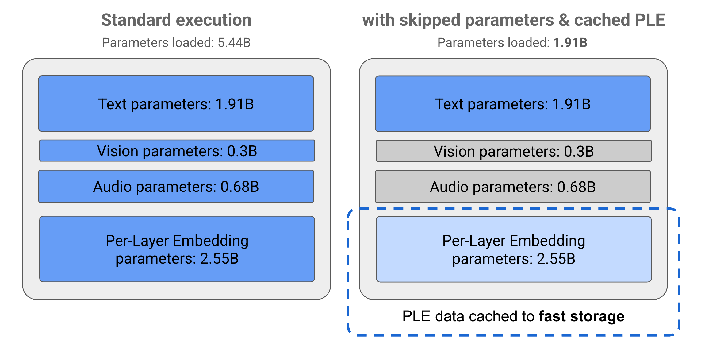

# Gemma 3n 模型總覽 {: #hidden-title style="display: none;" }

  <iframe src="https://www.youtube.com/embed/eJFJRyXEHZ0"
          title="影片" loading="lazy" allowfullscreen
          allow="accelerometer; encrypted-media; gyroscope; picture-in-picture"
          referrerpolicy="strict-origin-when-cross-origin"></iframe>

Gemma 3n 是針對日常裝置（如手機、筆記型電腦與平板）使用而優化的生成式 AI 模型。此模型在參數高效處理方面有所創新，包括逐層嵌入（Per-Layer Embedding, PLE）參數快取，以及提供彈性以降低運算與記憶體需求的 MatFormer 模型架構。這些模型支援音訊輸入處理，以及文字與視覺資料。

Gemma 3n 具備以下主要功能：

- **音訊輸入** ：處理聲音資料以進行語音辨識、翻譯與音訊資料分析。[深入了解](../../deployment/huggingface.md#從音訊資料生成文本)
- **視覺與文字輸入** ：多模態能力讓您能處理視覺、聲音與文字，協助理解與分析周遭世界。[深入了解](../../deployment/huggingface.md#從圖像資料生成文本)
- **視覺編碼器：**高效能 MobileNet-V5 編碼器大幅提升處理視覺資料的速度與準確度。[深入了解](https://developers.googleblog.com/en/introducing-gemma-3n-developer-guide/#mobilenet-v5:-new-state-of-the-art-vision-encoder){ data-model="gemma-3n" }
- **PLE 快取** ：這些模型中的逐層嵌入（Per-Layer Embedding, PLE）參數可快取至快速的本地儲存，以降低模型記憶體運行成本。[深入了解](index.md#ple-快取)
- **MatFormer 架構：**套娃式 Transformer（Matryoshka Transformer）架構可針對每次請求選擇性啟用模型參數，以降低運算成本與回應時間。[深入了解](index.md#matformer-架構)
- **條件式參數載入：**略過載入模型中的視覺與音訊參數，以減少載入的參數總數並節省記憶體資源。[深入了解](index.md#條件式參數載入)
- **廣泛的語言支援**：具備廣泛的語言能力，在超過 140 種語言上訓練。
- **32K 詞元上下文**：充裕的輸入上下文，用於分析資料與處理任務。

<a class="cookbook-card" href="https://www.kaggle.com/models/google/gemma-3n" target="_blank" rel="noopener">
  
Kaggle ↗

  
在 Kaggle 上取得

</a>
<a class="cookbook-card" href="https://huggingface.co/collections/google/gemma-3n-685065323f5984ef315c93f4" target="_blank" rel="noopener">
  
Hugging Face ↗

  
在 Hugging Face 上取得

</a>

與其他 Gemma 模型一樣，Gemma 3n 提供開放權重，並授權用於負責任的[商業用途][gemma-terms]，讓您能在自己的專案與應用中微調與部署。

!!! Tip
    如果您有興趣為 Android 行動應用程式打造生成式 AI 解決方案，歡迎參考 Gemini Nano。詳情請見 Android [Gemini Nano](https://developer.android.com/ai/gemini-nano) 開發者文件。

## 模型參數與有效參數

Gemma 3n 模型標示的參數量（例如 **`E2B`** 與 **`E4B`**）*低於*模型實際包含的參數總數。**`E`** 前綴表示這些模型可以較少的有效（Effective）參數集運作。這種精簡參數運作可透過 Gemma 3n 模型內建的彈性參數技術實現，協助它們在資源較低的裝置上高效運行。

Gemma 3n 模型的參數分為 4 大群組：文字、視覺、音訊與逐層嵌入（PLE）參數。在標準執行 E2B 模型時，執行模型會載入超過 50 億個參數。然而，使用參數略過與 PLE 快取技術，此模型的有效記憶體負載可降至略低於 20 億（1.91B）個參數，如圖 1 所示。

**圖 1.** Gemma 3n E2B 模型在標準執行下的參數，與使用 PLE 快取與參數略過技術時的有效較低參數負載之比較。

使用這些參數卸載與選擇性啟用技術，您可以以非常精簡的參數集運行模型，或啟用額外參數以處理視覺與音訊等其他資料類型。這些功能讓您能根據裝置能力或任務需求，增強或縮減模型功能。以下各節將進一步說明 Gemma 3n 模型提供的參數高效技術。

## PLE 快取

Gemma 3n 模型包含逐層嵌入（Per-Layer Embedding, PLE）參數，在模型執行期間用於產生可提升各模型層效能的資料。PLE 資料可在模型運行記憶體之外單獨產生、快取至快速儲存，再於各層運行時加入模型推論流程。此方法讓 PLE 參數不必佔用模型記憶體空間，降低資源消耗，同時仍提升模型回應品質。

## MatFormer 架構

Gemma 3n 模型採用套娃式 Transformer（Matryoshka Transformer），即 *MatFormer* 模型架構，在單一較大模型內嵌套了較小的模型。巢狀子模型可在回應請求時用於推論，而無需啟用外層模型的參數。這種僅運行 MatFormer 模型內較小核心模型的能力，可降低模型的運算成本、回應時間與能源足跡。以 Gemma 3n 而言，E4B 模型包含 E2B 模型的參數。此架構還讓您能選擇參數，組裝出介於 2B 與 4B 之間的中間尺寸模型。關於此方法的更多細節，請見 [MatFormer 研究論文](https://arxiv.org/pdf/2310.07707)。歡迎使用 [MatFormer Lab](https://goo.gle/gemma3n-matformer-lab){ data-model="gemma-3n" } 指南，透過 MatFormer 技術縮小 Gemma 3n 模型的規模。

## 條件式參數載入

與 PLE 參數類似，您可以略過將 Gemma 3n 模型中的部分參數（如音訊或視覺參數）載入記憶體，以降低記憶體負載。若裝置具備所需資源，這些參數可在運行時動態載入。整體而言，參數略過可進一步降低 Gemma 3n 模型所需的運行記憶體，使其能在更廣泛的裝置上執行，並讓開發者為需求較低的任務提升資源效率。

準備好開始打造了嗎？
[立即開始](../../get-started/index.md)
使用 Gemma 模型！

--8<-- "glossary.md"
