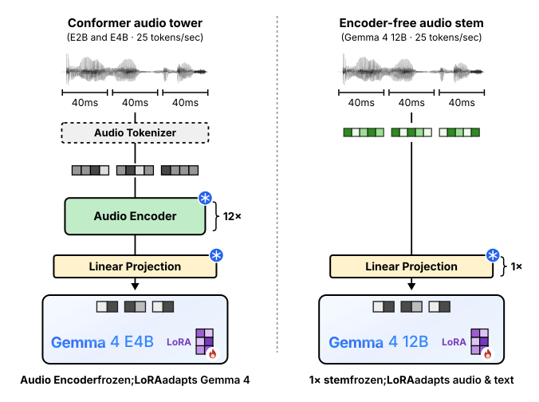
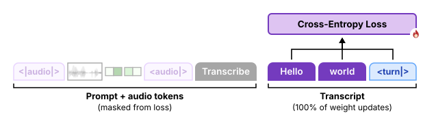
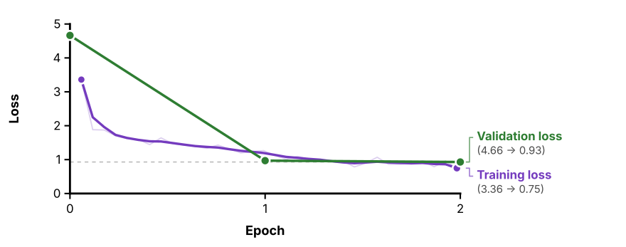

# 音訊微調

Gemma 4 家族中的三個模型（E2B、E4B 與 12B）能與文字和圖片一起原生理解音訊。您可以在自訂音訊資料集上微調這些檢查點，用於低資源語音辨識、地區方言適應、醫療聽寫與口說問答。

---

## 1. 兩種架構

如同視覺任務，Gemma 4 會透過專用的音訊編碼器（E2B 與 E4B）或完全不使用編碼器（12B）來處理音訊。如同視覺任務，請注意除了轉接器之外，其他所有部分都是凍結的：



兩種情況下，音訊都會被切成 40 毫秒的窗口（每秒 25 個音訊軟 token），再依模型以不同方式處理：

1. **音訊編碼器** *(E2B 與 E4B)*：將 16 kHz 音訊切成 40 毫秒的片段，並透過音訊 tokenizer 提取特徵，接著通過凍結的 12 層音訊編碼器，再投影到 Gemma 模型中。
2. **無編碼器** *(12B)*：沒有獨立的音訊編碼器。相同的 40 毫秒音訊片段改為通過凍結的線性投影層，直接進入 12B 模型。


如同視覺範例，建議一開始先保持音訊編碼器凍結，只在語言層上訓練 LoRA 轉接器。

---

## 2. 遮罩詞元

在為 Gemma 4 準備音訊資料集時，每段音訊都會重新取樣為 16 kHz 單聲道，並展開為一串音訊軟 token，包在 `<|audio|>`{.token-multi} 與 `<audio|>`{.token-multi} token 之間。在訓練期間，助手回應之前的所有提示詞與音訊 token 都會從損失計算中遮罩掉：



如同視覺任務，這能讓模型把所有更新集中在輸出上，而不必嘗試猜測輸入。 

訓練時，請遵循以下準則：

1. **重新取樣為 16,000 Hz 單聲道**：Gemma 4 的音訊處理器需要 16 kHz 單聲道波形。請將 44.1 kHz 或 48 kHz 的錄音重新取樣為 16 kHz，並將立體聲聲道平均為單聲道。
2. **每段音訊不超過 30 秒**：音訊編碼器最多支援 30 秒，因此請在靜音邊界處將較長的錄音切成 10 到 30 秒的片段。
3. **遮罩提示詞與音訊 token**：將所有系統、使用者與音訊軟 token 排除在訓練損失之外，讓模型只學習預測文字轉錄。

---

## 3. 設定環境

我們將在 [`google/fleurs`](https://huggingface.co/datasets/google/fleurs) 的威爾斯語（`cy_gb`）切分上微調 Gemma 4，讓它學會辨識威爾斯語。這項任務通常稱為自動語音辨識（ASR）。

安裝 Hugging Face 的訓練後、量化、多模態與評估函式庫：

```python { .notebook-cell }
# Install Hugging Face post-training, quantization, multimodal, and evaluation libraries
%pip install -q -U "transformers>=5.10.1" "trl>=0.16.0" "peft>=0.19.0" accelerate datasets bitsandbytes torchao
%pip install -q -U evaluate sacrebleu jiwer pillow soundfile librosa matplotlib tensorboard
```

如果您打算將訓練好的轉接器推送到 Hugging Face Hub，請使用具寫入權限的 token 登入：

```python { .notebook-cell }
# Optional: Uncomment if using gated checkpoints or pushing to the Hub
# from huggingface_hub import login
# login()
```

---

## 4. 準備資料集

載入資料時，我們會使用 `librosa` 與 `soundfile` 函式庫來解碼波形並存放在記憶體中。這樣就不需要把數千個 `.wav` 檔案寫入磁碟。


```python { .notebook-cell }
import io
import librosa
import numpy as np
import soundfile as sf
from datasets import Audio, load_dataset


# Decode raw audio bytes or file paths into a 16 kHz mono float32 waveform (<= 30s)
def decode_audio(audio_dict: dict) -> np.ndarray:
    if audio_dict.get("bytes"):
        waveform, sr = sf.read(io.BytesIO(audio_dict["bytes"]), dtype="float32")
    else:
        waveform, sr = sf.read(audio_dict["path"], dtype="float32")
    if waveform.ndim > 1:
        waveform = waveform.mean(axis=1)
    if sr != 16000:
        waveform = librosa.resample(waveform, orig_sr=sr, target_sr=16000)
    return waveform[: 16000 * 30]


# Load the Welsh FLEURS split and disable eager audio decoding
raw_dataset = load_dataset("google/fleurs", "cy_gb")
train_dataset = raw_dataset["train"].cast_column("audio", Audio(decode=False))
val_dataset = raw_dataset["validation"].select(range(100)).cast_column("audio", Audio(decode=False))
test_dataset = raw_dataset["test"].select(range(100)).cast_column("audio", Audio(decode=False))

sample0_wav = decode_audio(train_dataset[0]["audio"])
print(f"Splits: train={len(train_dataset)}, val={len(val_dataset)}, test={len(test_dataset)}")
print(f"Sample 0 duration: {len(sample0_wav) / 16000:.2f}s")
print(f"Sample 0 transcript: {train_dataset[0]['raw_transcription']}")
```

```{ .no-copy .output }
Splits: train=3427, val=100, test=100
Sample 0 duration: 12.06s
Sample 0 transcript: Gellir ei wneud yn denau iawn, a'i lynu ar fetal arall. Gellir ei wneud mor denau fel ei fod weithiau'n cael ei ddefnyddio i addurno'r lluniau wedi'u paentio â llaw mewn llyfrau o'r enw "llawysgrifau addurnedig".
```

---

## 5. 載入模型


以 `bfloat16` 載入經過指令微調的 Gemma 4 檢查點與多模態處理器：

```python { .notebook-cell .model-swap }
import torch
from transformers import AutoModelForMultimodalLM, AutoProcessor

model_id = "google/gemma-4-E2B-it"

# Load the multimodal base model in bfloat16 alongside its audio-capable processor
model = AutoModelForMultimodalLM.from_pretrained(
    model_id,
    dtype=torch.bfloat16,
    device_map="cuda",
)
processor = AutoProcessor.from_pretrained(model_id)
```

!!! note "為什麼音訊要用 bfloat16 LoRA？"
    統一的 4-bit NF4 量化（`BitsAndBytesConfig(load_in_4bit=True)`）會量化對音訊至關重要的投影層，並降低語音辨識準確度。以 `bfloat16` 載入 `E2B-it` 並搭配梯度檢查點，可讓音訊投影層保持完整精度，且只需約 11.9 GB 的顯示記憶體即可訓練（若要在較小的 GPU 上使用選擇性 4-bit 量化，請參閱[使用 Unsloth 進行微調](unsloth.md)）。

---

## 6. 評估基底模型

在真正開始訓練之前，先來進行基準評估。我們將在 100 段保留的威爾斯語錄音上，使用常用的正規化單詞錯誤率（WER）與字元錯誤率（CER）：

```python { .notebook-cell }
import jiwer

PROMPT_TEXT = (
    "Transcribe the following speech segment in Welsh into Welsh text.\n\n"
    "Follow these specific instructions for formatting the answer:\n"
    "* Only output the transcription, with no newlines.\n"
    "* When transcribing numbers, write the digits, i.e. write 1.7 and not one point seven, and write 3 instead of three."
)

asr_normalizer = jiwer.Compose(
    [jiwer.ToLowerCase(), jiwer.RemovePunctuation(), jiwer.RemoveMultipleSpaces(), jiwer.Strip()]
)


# Evaluate corpus Word Error Rate (WER) and Character Error Rate (CER) on held-out audio
def evaluate_welsh_asr(eval_model, eval_processor, dataset_split):
    eval_model.eval()
    stop_ids = [
        eval_processor.tokenizer.eos_token_id,
        eval_processor.tokenizer.convert_tokens_to_ids("<turn|>"),
    ]
    refs_raw, preds_raw = [], []

    for idx in range(len(dataset_split)):
        sample = dataset_split[idx]
        ref = sample["raw_transcription"].strip()
        messages = [
            {
                "role": "user",
                "content": [
                    {"type": "audio", "audio": "clip.wav"},
                    {"type": "text", "text": PROMPT_TEXT},
                ],
            }
        ]
        prompt = eval_processor.apply_chat_template(
            messages, tokenize=False, add_generation_prompt=True
        )
        inputs = eval_processor(
            text=[prompt],
            audio=[decode_audio(sample["audio"])],
            sampling_rate=16000,
            return_tensors="pt",
            padding=True,
        ).to(eval_model.device)

        with torch.no_grad():
            out = eval_model.generate(
                **inputs,
                max_new_tokens=128,
                do_sample=False,
                pad_token_id=eval_processor.tokenizer.pad_token_id,
                eos_token_id=stop_ids,
            )

        pred = eval_processor.tokenizer.decode(
            out[0][inputs.input_ids.shape[1] :], skip_special_tokens=True
        )
        pred = pred.split("<turn|>")[0].split("\n")[0].strip()
        refs_raw.append(ref)
        preds_raw.append(pred)

    norm_refs = [asr_normalizer(r) for r in refs_raw]
    norm_preds = [asr_normalizer(p) for p in preds_raw]
    corpus_wer = jiwer.wer(norm_refs, norm_preds) * 100.0
    corpus_cer = jiwer.cer(norm_refs, norm_preds) * 100.0
    metrics = {
        "wer_pct": round(corpus_wer, 2),
        "cer_pct": round(corpus_cer, 2),
    }
    return metrics, refs_raw, preds_raw


# Measure zero-shot Welsh transcription accuracy before LoRA training
before_metrics, refs, before_preds = evaluate_welsh_asr(model, processor, test_dataset)
print("Before LoRA (100 unseen Welsh clips):", before_metrics)
print("Sample #0 ground truth :", refs[0])
print("Sample #0 zero-shot    :", before_preds[0])
```

```{ .no-copy .output }
Before LoRA (100 unseen Welsh clips): {'wer_pct': 71.21, 'cer_pct': 29.63}
Sample #0 ground truth : Mae'r term saffari mewn defnydd cyffredinol yn cyfeirio at deithio dros dir i weld bywyd gwyllt syfrdanol Affrica, yn enwedig ar safana.
Sample #0 zero-shot    : Mar ten swfary, mae'n ddefnyddiol yn cyfderio astaethiad ostod i wal bywyd gwll syfratonnol Africa yn ywedig ar sffana.
```

未經任何微調，模型只能近似威爾斯語的發音，在 100 段未見過的音訊上產生 **71.21%** 的單詞錯誤率。這正是我們可以改進之處！

---

## 7. 訓練模型

接著定義 LoRA 轉接器，並像往常一樣鎖定相同的層（語言層），同時凍結音訊編碼器：

```python { .notebook-cell }
from peft import LoraConfig, get_peft_model

# Attach rank-32 LoRA adapters to the language layers while freezing audio/vision towers
peft_config = LoraConfig(
    r=32,
    lora_alpha=64,
    lora_dropout=0.0,
    bias="none",
    target_modules=[
        "q_proj",
        "k_proj",
        "v_proj",
        "o_proj",
        "gate_proj",
        "up_proj",
        "down_proj",
    ],
    exclude_modules=r"model\.(vision_tower|audio_tower)\..*",
    task_type="CAUSAL_LM",
)
model = get_peft_model(model, peft_config)
model.print_trainable_parameters()
```

```{ .no-copy .output }
trainable params: 48,316,416 || all params: 5,152,613,920 || trainable%: 0.9377
```

在開始訓練之前還有一件事：我們需要一個資料整理器來建立音訊／文字批次，並對輸入提示詞套用遮罩：

```python { .notebook-cell }
target_tokens = processor.tokenizer.encode("<|turn>model\n", add_special_tokens=False)
target_len = len(target_tokens)
audio_token_ids = {256000, 258881, 258883}


# Build audio-text batches and mask prompt, padding, and audio soft tokens from the loss
def collate_fn(examples):
    texts, audios = [], []
    for example in examples:
        messages = [
            {
                "role": "user",
                "content": [
                    {"type": "audio", "audio": "clip.wav"},
                    {"type": "text", "text": PROMPT_TEXT},
                ],
            },
            {
                "role": "assistant",
                "content": [{"type": "text", "text": example["raw_transcription"].strip()}],
            },
        ]
        full_text = processor.apply_chat_template(
            messages, add_generation_prompt=False, tokenize=False
        )
        texts.append(full_text.strip())
        audios.append(decode_audio(example["audio"]))

    batch = processor(
        text=texts,
        audio=audios,
        sampling_rate=16000,
        return_tensors="pt",
        padding=True,
    )
    labels = batch["input_ids"].clone()

    for i in range(labels.size(0)):
        row_tokens = batch["input_ids"][i].tolist()
        for idx in range(len(row_tokens) - target_len, -1, -1):
            if row_tokens[idx : idx + target_len] == target_tokens:
                labels[i, : idx + target_len] = -100
                break
        else:
            labels[i, :] = -100

    labels[labels == processor.tokenizer.pad_token_id] = -100
    for tok_id in audio_token_ids:
        labels[labels == tok_id] = -100
    batch["labels"] = labels
    return batch
```

我們可以開始訓練模型了！設定 `SFTConfig` 進行兩個訓練輪數：

```python { .notebook-cell }
from trl import SFTConfig, SFTTrainer

output_dir = "gemma-4-welsh-asr"

# Set the training hyperparameters for audio SFT
sft_config = SFTConfig(
    output_dir=output_dir,
    per_device_train_batch_size=4,
    per_device_eval_batch_size=4,
    gradient_accumulation_steps=2,
    num_train_epochs=2,
    learning_rate=1e-4,
    lr_scheduler_type="cosine",
    warmup_steps=0.05,
    bf16=True,
    gradient_checkpointing=True,
    gradient_checkpointing_kwargs={"use_reentrant": False},
    max_length=2048,
    eval_strategy="epoch",
    eval_on_start=True,
    save_strategy="no",
    remove_unused_columns=False,
    dataset_kwargs={"skip_prepare_dataset": True},
    logging_steps=25,
    report_to="none",
)

# Initialize and run the audio trainer
trainer = SFTTrainer(
    model=model,
    processing_class=processor,
    train_dataset=train_dataset,
    eval_dataset=val_dataset,
    data_collator=collate_fn,
    args=sft_config,
)

trainer.train()

final_model_path = f"{output_dir}/final_model"
trainer.save_model(final_model_path)
AutoProcessor.from_pretrained(model_id).save_pretrained(final_model_path)
```

```{ .no-copy .output }
[858/858 30:25, Epoch 2/2]

| Epoch | Training Loss | Validation Loss | Mean Token Accuracy |
|---|---|---|---|
| 0 | — | 4.6640 | 0.5865 |
| 1 | 1.2644 | 0.9693 | 0.7708 |
| 2 | 0.7478 | 0.9296 | 0.7873 |
```

<!-- notebook:skip-start -->
??? info "檢視訓練曲線"
    
<!-- notebook:skip-end -->

---

## 8. 評估微調後的模型

我們將管線從 GPU 記憶體中釋放，並載入訓練好的檢查點，以便在未見過的錄音上評估它：

```python { .notebook-cell }
import gc
from peft import PeftModel

# Free training memory and reload the saved LoRA adapter for inference
del trainer, model
gc.collect()
torch.cuda.empty_cache()

base_model = AutoModelForMultimodalLM.from_pretrained(
    model_id, dtype=torch.bfloat16, device_map="cuda"
)
eval_model = PeftModel.from_pretrained(base_model, final_model_path)
eval_processor = AutoProcessor.from_pretrained(final_model_path)

# Evaluate the fine-tuned adapter on the 100 unseen Welsh test clips
after_metrics, _, after_preds = evaluate_welsh_asr(eval_model, eval_processor, test_dataset)
print("Before LoRA (100 unseen Welsh clips):", before_metrics)
print("After LoRA  (100 unseen Welsh clips):", after_metrics)

print("\n--- Unseen Test Recording #0 ---")
print("Ground Truth:", refs[0])
print("Before LoRA :", before_preds[0])
print("After LoRA  :", after_preds[0])
```

```{ .no-copy .output }
Before LoRA (100 unseen Welsh clips): {'wer_pct': 71.21, 'cer_pct': 29.63}
After LoRA  (100 unseen Welsh clips): {'wer_pct': 49.28, 'cer_pct': 22.24}

--- Unseen Test Recording #0 ---
Ground Truth: Mae'r term saffari mewn defnydd cyffredinol yn cyfeirio at deithio dros dir i weld bywyd gwyllt syfrdanol Affrica, yn enwedig ar safana.
Before LoRA : Mar ten swfary, mae'n ddefnyddiol yn cyfderio astaethiad ostod i wal bywyd gwll syfratonnol Africa yn ywedig ar sffana.
After LoRA  : Mae'r Term Saffari, mewn defnydd cyffredinol, yn cyfeirio at steithio dros dro i'w wylbwyd gwyllt sefylladol Affrica, yn enwedig ar Safana.
```

只用兩個訓練輪數、更新少量權重，分數就大幅改善了：

| 指標 | 微調前 | 微調後 | 變化 |
|---|---|---|---|
| **單詞錯誤率（WER，越低越好）** | 71.21% | **49.28%** | **-21.93 個百分點** |
| **字元錯誤率（CER，越低越好）** | 29.63% | **22.24%** | **-7.39 個百分點** |

---

## 接下來

<div class="card-grid">
<a class="card" href="vision-qlora.md">
  <span class="card-icon">{{ icon('lucide/eye') }}</span>
  <div class="card-title">視覺微調</div>
  <p class="card-desc">使用可選的視覺 token 預算，在自訂圖片、圖表、收據與文件上微調 Gemma 4。</p>
</a>
<a class="card" href="preference-alignment.md">
  <span class="card-icon">{{ icon('lucide/sliders-horizontal') }}</span>
  <div class="card-title">偏好最佳化</div>
  <p class="card-desc">使用選定與拒絕的回應配對，塑造模型的語氣與簡潔程度。</p>
</a>
<a class="card" href="reinforcement-learning.md">
  <span class="card-icon">{{ icon('lucide/brain') }}</span>
  <div class="card-title">可驗證獎勵</div>
  <p class="card-desc">使用可驗證的獎勵函數訓練 Gemma 4 的思考通道。</p>
</a>
<a class="card" href="export.md">
  <span class="card-icon">{{ icon('lucide/rocket') }}</span>
  <div class="card-title">匯出</div>
  <p class="card-desc">將微調後的 E2B、E4B 或 12B 模型匯出至 LiteRT-LM，以進行裝置端音訊推論，或匯出至 vLLM 以用於伺服器。</p>
</a>
</div>
