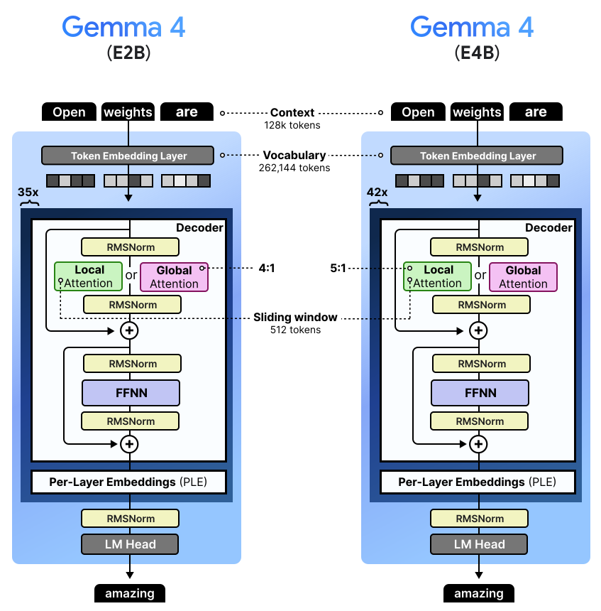
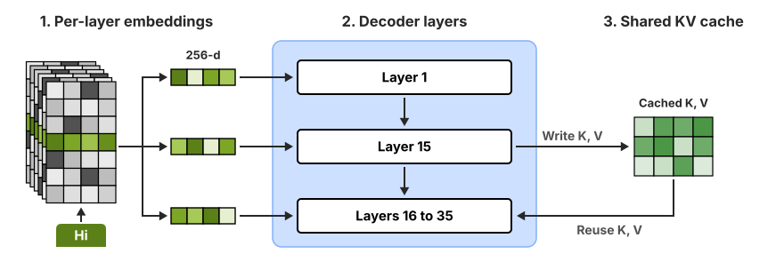
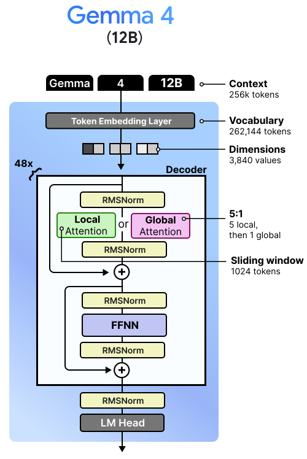
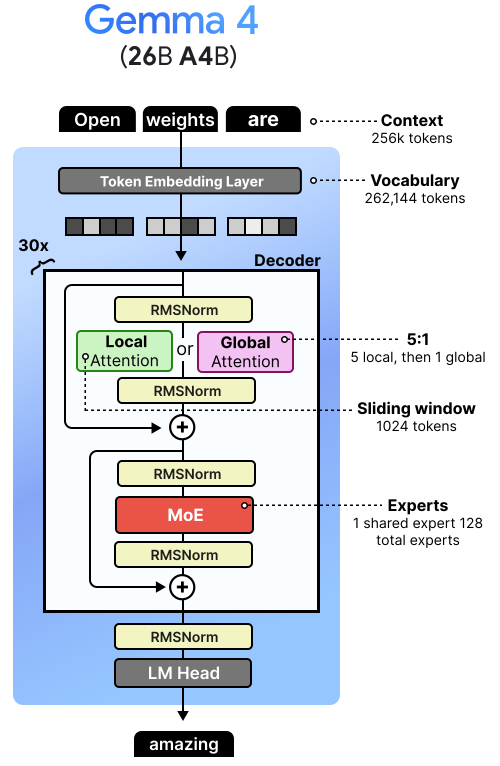
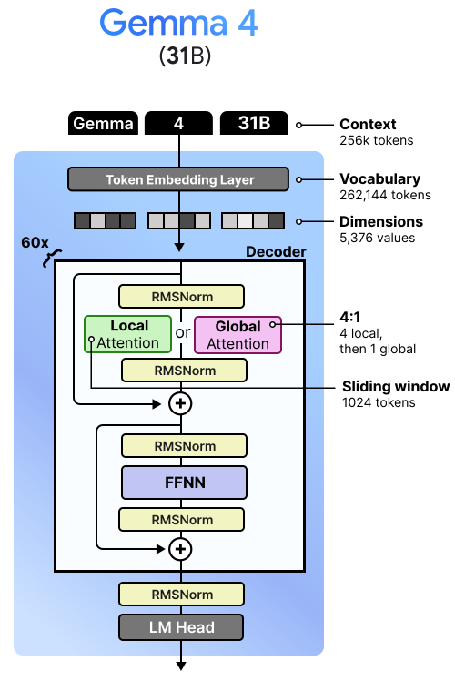
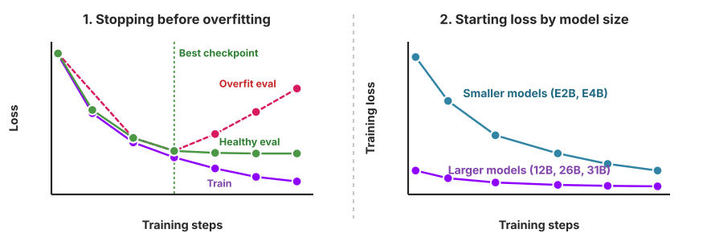

# 最佳實務

全部五款 Gemma 4 模型共用相同的 262,144 個詞元詞彙表、聊天範本與推理詞元。不過，它們底層採用四種不同的架構。

了解架構有助於你在開始訓練之前，選對訓練流程與參數。

---

## 1. 選擇 Gemma 4 模型

每款 Gemma 4 模型會依大小採用略有不同的架構。

### Gemma 4 E2B 與 E4B

Gemma 4 E2B 與 E4B 是專為快速迭代與邊緣裝置設計的精簡稠密模型。「E」代表**有效參數**。只有約 2B 與 4B 個參數會載入 VRAM 進行運算，其餘的查詢嵌入則留在快閃儲存體中。

這些稱為**逐層嵌入**，能在不拖慢速度的情況下，增加模型可容納的知識量。為了進一步提升效能，它們還會跨層共用 KV 快取。以下是一個範例：

請注意輸入詞元 `"Hi"` 在模型中的傳遞過程：

1. **逐層嵌入**：查詢表為每個詞元與每個層提供一個 256 維向量，該資訊會加在每個解碼器的末端。
2. **共用 KV 快取**：前 15 層會計算鍵（Key）與值（Value）並存入快取（也就是 KV 快取），讓後面的層可以直接重複使用，而不必重新計算。

微調 E2B 或 E4B 時，請遵守兩條規則：

- **LoRA 期間保持逐層嵌入凍結**：標準 LoRA 只針對注意力與 MLP 投影。在監督式微調期間，不要解凍或儲存逐層嵌入表，否則 VRAM 使用量會大幅增加。
- **盡可能使用 `bfloat16` 訓練**：E2B 與 E4B 的音訊編碼器在注意力遮罩期間可能讓 `float16` 溢位。在較新的 GPU 上使用 `bfloat16`，或在較舊的 `float16` GPU（例如 Tesla T4）上使用 Unsloth，讓它自動防止溢位。

### Gemma 4 12B

Gemma 4 12B 是無編碼器的多模態模型，移除了獨立的視覺與音訊編碼塔：

微調 12B 時，請記住兩個架構細節：

- **直接的影像區塊與音訊投影**：12B 不使用獨立的視覺或音訊編碼器，而是讓影像區塊與音訊波形透過輕量線性投影，直接進入解碼器。
- **統一的多模態適應**：由於文字、視覺與音訊詞元從一開始就共用相同的解碼器層，對標準注意力與 MLP 投影套用 LoRA，會在訓練期間同時影響三種模態。

### Gemma 4 26B A4B

Gemma 4 26B A4B 是混合專家（MoE）模型。「A」代表**啟用參數**。模型共有 26B 個參數載入記憶體，但每個詞元只會啟用其中 4B 個：

這種稀疏設計會改變微調的設定方式：

- **1 個共用專家 + 128 個路由專家**：每一層都有一個始終啟用的共用專家，以及 128 個路由專家，並為每個詞元挑選排名前 8 的路由專家。
- **保持路由器凍結**：監督式微調期間，不要對路由器套用 LoRA。在小資料集上訓練路由器，會讓詞元只選擇少數幾個專家，進而損害品質。
- **記憶體允許時優先使用 16 位元 LoRA**：將全部 128 個路由專家量化為 4 位元，可能會輕微改變前 8 名路由選擇，因此在 VRAM 允許的情況下，優先使用 `bfloat16` LoRA。16 位元與 4 位元兩種設定請見 [MoE 微調指南](moe-finetune.md)。

### Gemma 4 31B

Gemma 4 31B 是 Gemma 4 家族中最大的稠密模型。

由於 31B 是大型稠密模型，訓練時請記住兩點：

- **使用 QLoRA 可在 24 GB GPU 上執行**：使用 4 位元量化與梯度檢查點，你可以在約 18 至 22 GB 的 VRAM 中微調 31B。請見 [(Q)LoRA](qlora.md)。
- **留意早期記憶化**：31B 的容量很高，可能很快記住小型資料集。請使用權重衰減（例如 `0.01`）並經常評估。

---

## 2. 建議的超參數 

不同的訓練階段需要差異很大的學習率。例如，標準 LoRA 學習率（`2e-4`）比完整微調（`1e-5`）高出十倍，會迅速破壞預訓練權重。

請以這張表作為起點：

| 超參數 | LoRA / QLoRA SFT | 完整微調 | 持續預訓練 | 偏好最佳化 | 可驗證獎勵 |
| :--- | :--- | :--- | :--- | :--- | :--- |
| **基礎檢查點** | `-it` | `-it` 或預訓練 | 預訓練（不含 `-it`） | `-it` | `-it` |
| **學習率** | `1e-4` 至 `2e-4` | `1e-5` 至 `2e-5` | `5e-5`（LoRA）/ `1e-5`（完整） | `5e-6` 至 `1e-4`（LoRA）/ `5e-7`（完整） | `5e-6` 至 `1.5e-4`（LoRA）/ `1e-6`（完整） |
| **嵌入學習率** | 凍結 | 與主學習率相同 | `1e-5`（低 2 至 5 倍） | 凍結 | 凍結 |
| **有效批次大小** | `16` 至 `32` | `32` 至 `64` | `64` 至 `256`（已打包） | `16` 至 `32` 對 | `16` 至 `64`（`4` 至 `8` 次生成） |
| **學習率排程器** | 餘弦 | 餘弦 | 餘弦 | 餘弦 | 餘弦 |
| **預熱比例** | `3%` 至 `5%` | `5%` 至 `10%` | `5%` 至 `10%` | `10%` | `5%` 至 `10%` |
| **Epoch 數** | `1` 至 `3` | `1` 至 `2` | `1` | `1` | `1` 至 `2` |
| **最佳化器** | 8 位元 AdamW | 融合 AdamW | 8 位元 AdamW | 8 位元 AdamW | 8 位元 AdamW |
| **權重衰減** | `0.01` | `0.01` 至 `0.1` | `0.01` | `0.01` | `0.01` |
| **最大梯度範數** | `1.0` | `1.0` | `1.0` | `1.0` | `0.1` 至 `0.5` |

!!! important "保持繫結嵌入啟用"
    全部 Gemma 4 模型會在輸入詞元嵌入與輸出語言建模頭之間共用權重，在 262K 詞彙表上省下超過 1 GB 的記憶體。儲存檢查點或調整詞彙表大小時，請確認權重繫結已啟用。

---

## 3. 判讀損失曲線

訓練損失與驗證損失會在訓練期間提供寶貴的資訊。值得留意的有兩種模式：

1. **在過擬合前停止**：無論你跑多少個 epoch，訓練損失都會持續下降。一旦模型開始記憶訓練集，驗證損失就會轉為上升。保留 5% 至 10% 的資料做驗證會很有幫助。你通常會選擇驗證損失最低的檢查點。
2. **E2B 與 E4B 的起始損失較高**：在完全相同的資料集上，較小的模型（E2B 與 E4B）在訓練初期，起始訓練損失往往明顯高於較大的模型（12B、26B A4B 與 31B），之後才隨著訓練進行收斂到相近的範圍。

!!! tip "為什麼較小的模型一開始損失較高"
    全部五款 Gemma 4 模型都會在相同的 262,144 個詞元詞彙表上進行預測。由於 E2B 與 E4B 的隱藏容量比大型模型小，它們在面對不熟悉的領域或多模態任務時，一開始信心較低，會把機率分散到更多詞元上。這會造成初始交叉熵損失高出許多。在 E2B 或 E4B 上看到起始損失偏高時，不要停止訓練或提高學習率。只要損失在訓練期間穩定下降，就是健康的訓練過程。

---

## 4. 資料集

資料集是訓練的重要組成部分，或許比調整參數更重要。以下是一些常見的陷阱：

- **資料集大小**：LoRA SFT 通常只需要 **500 至 5,000** 個範例。完整 SFT 約需 **10,000** 個範例。在新領域或語言上做持續預訓練，則需要**數千萬至數十億**個詞元。因此請謹慎選擇方法與資料集大小。
- **混入 5% 至 15% 的重播資料**：在訓練中加入少量一般對話範例，通常有助於防止模型過擬合到你的任務。否則模型可能在其他任務（例如對話）上退化。
- **防止 RAG 樣板滲漏**：如果每個訓練範例都包含一段檢索到的段落，並以「*根據提供的檔案……*」作答，微調後的模型即使在沒有提供檔案時也會重複這句話。[自訂聊天範本](custom-chat-template.md)會示範如何防止這種行為。
- **凍結多模態編碼塔，不要刪除**：在純文字訓練流程中，在 LoRA 中跳過 `vision_tower` 與 `audio_tower`（`exclude_modules=r"model\.(vision_tower|audio_tower)\..*"`），而不是從檢查點中移除這些權重，讓模型在推論時仍保留視覺與音訊能力。

---

## 5. 訓練前的檢查清單

啟動訓練任務之前，請檢查以下四項：

1. **依 GPU 搭配精度與注意力**：在較新的 GPU（RTX 30/40/50 系列、L4、A100、H100）上使用 `bfloat16`。保留 PyTorch 預設的縮放點積注意力（SDPA），因為 Gemma 4 的全域注意力層使用 512 維的注意力頭，獨立的 FlashAttention-2 不支援。
2. **在 SFT 中遮罩提示詞元**：只對助理回應計算損失（使用者與系統回合設為 `-100`），詳見[資料集格式指南](datasets-formatting.md)。
3. **納入回合停止詞元**：Gemma 4 以 `<turn|>`{.token-turn}（詞元 ID `106`）結束助理回合，不只是 `<eos>`（詞元 ID `1`）。評估時，請確認生成設定會在兩個詞元上都停止。
4. **在混合資料中保留推理範例**：如果你希望模型繼續使用思考通道，請確保至少 50% 的 SFT 範例包含推理軌跡。

## 接下來

<a class="card" href="datasets-formatting.md">
  {{ icon('lucide/braces') }}
  
資料集格式

  
格式化對話回合、以 -100 遮罩提示損失，並使用思考詞元進行訓練。

</a>
<a class="card" href="qlora.md">
  {{ icon('lucide/zap') }}
  
(Q)LoRA

  
使用 TRL 與 PEFT 執行端到端的 LoRA 或 QLoRA 微調任務。

</a>
<a class="card" href="moe-finetune.md">
  {{ icon('lucide/split') }}
  
MoE 微調

  
使用 Split-LoRA、分組 GEMM 與凍結的路由器，高效訓練 Gemma 4 26B A4B。

</a>
<a class="card" href="full-finetune.md">
  {{ icon('lucide/cpu') }}
  
完整微調

  
以 bfloat16 更新 100% 的模型權重，並使用餘弦預熱與正則化。

</a>

--8<-- "glossary.md"
