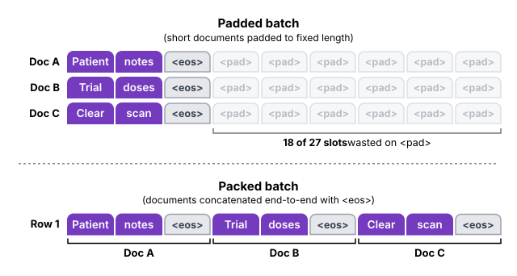
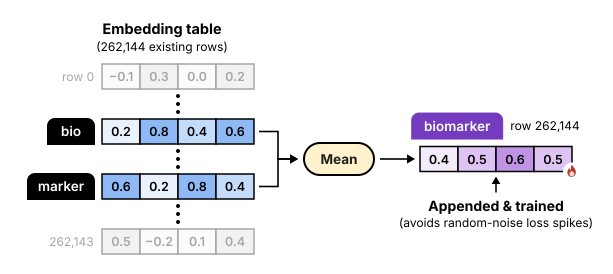
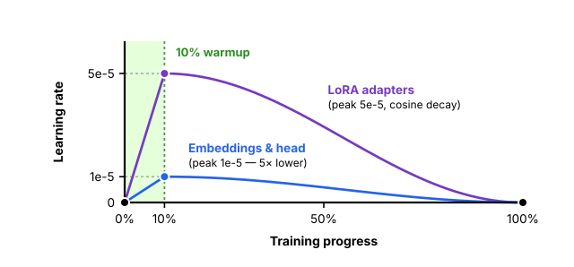
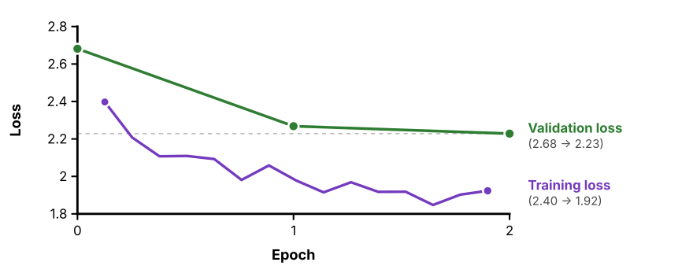

# 持續預訓練

當您想讓 Gemma 4 從大量未標註文字學習，例如內部原始碼、醫學論文、法律合約或一種新語言時，僅用數千組問答配對做監督式微調往往不夠。

您可以先對原始文件執行持續預訓練，再接一段簡短的監督式微調，讓模型學會對話。不過請注意，持續預訓練通常更進階，因為它需要額外的監督式微調階段（可能還包括強化學習），才能達到與 `-it` 對應版本相同或更好的效能。

!!! tip "從基礎檢查點開始"
    持續預訓練是教模型在長文件上預測下一個詞元。請務必從預訓練基礎檢查點（例如 `google/gemma-4-E2B` 或 `google/gemma-4-12B`）開始，而不是指令微調（`-it`）檢查點。如果您在 `-it` 模型上執行持續預訓練，它會覆寫 `<turn|>`{.token-turn} 回合結束機率，導致無止境生成。持續預訓練完成後，請執行[自訂聊天範本](custom-chat-template.md)或 [(Q)LoRA](qlora.md)，讓模型學會遵循指示。

---

## 1. 序列打包以消除填充

文件長度不一。有些筆記只有 50 個詞元，完整文章則有數千個詞元。

如果您把每份短文件都用填充詞元補到固定長度，批次中大部分位置都會浪費在空白槽位上。序列打包是把文件首尾相接、以序列結束詞元分隔，再裝滿整列，完全不留填充：



**Doc A**、**Doc B** 與 **Doc C** 在單一打包列中首尾相接，以 `<eos>`{.token-BosEos} 詞元分隔，因此批次中的每個位置都承載真實文字，而不是 `<pad>`{.token-BosEos} 詞元。

---

## 2. 擴充詞彙表

在新增詞元之前，請先檢查 Gemma 4 在您的文字上每個詞會產生多少詞元。Gemma 4 已有 262,144 個詞元的多語言詞彙表，開箱即支援超過 140 種語言、程式碼與科學文字。

只有在以下情況才需要新增詞元：

- **領域字串**：化學 SMILES 字串、基因標記或自訂程式碼符號會被切成 6 到 10 個小片段。
- **較少見的文字系統**：目標語言的日常用詞經常被切成 3 個以上的詞元。

當您在詞彙表中新增詞元時，模型會在輸入嵌入表與綁定的輸出頭中附加新的列。

如果這些新列一開始是隨機雜訊，第一步就會產生不穩定的預測並造成損失尖峰。子詞平均初始化的做法是把每個新詞切成現有的子詞，再以它們的平均值初始化新列：



將「bio」與「marker」現有的列取平均（`[0.2, 0.8, 0.4, 0.6]` 與 `[0.6, 0.2, 0.8, 0.4]`），可讓新的「biomarker」列（`[0.4, 0.5, 0.6, 0.5]`）在訓練開始前就有一個合理的起始向量。

!!! info "E2B 與 E4B 的自訂詞元，對比 12B 以上的詞彙表擴充"
    Gemma 4 E2B 與 E4B 會在主嵌入表之外，把額外的詞元表示存放在各層的嵌入表中。由於 `resize_token_embeddings()` 只會調整主表的大小，因此只有在 **12B**、**26B A4B** 或 **31B** 上才呼叫 `resize_token_embeddings()`。若要在**任何** Gemma 4 模型上加入最多 **6,227** 個自訂路由、來源或領域詞元，請如[未使用詞元](unused-tokens.md)所示，就地重複使用內建的 `<unused0>`..`<unused6226>` 槽位。

---

## 3. 學習率

當您在 LoRA 轉接器之外，同時解凍嵌入表與輸出頭時，等於一次訓練兩種不同的權重：

1. **LoRA 轉接器**：小型低秩矩陣，在 5e-5 的學習率下學習效果很好。
2. **嵌入**：輸入與輸出共用的 262,144 列查找表。用 5e-5 更新這張表會讓詞元表示變化得太快。

為了保持訓練穩定，請使用兩個最佳化器群組，並把嵌入學習率設為 LoRA 轉接器學習率（5e-5）的五分之一（1e-5）：



請注意，兩個參數群組都在前 10% 的步驟中暖身，接著遵循相同的餘弦衰減形狀，而嵌入的峰值比轉接器低五倍。

!!! tip "混入 5% 至 10% 通用文字"
    只用狹窄的領域文字訓練，可能讓模型失去通用語言能力。把 5% 至 10% 通用文字（例如維基百科）混入資料集，可以保持日常語言品質不受影響。

---

## 4. 設定環境

我們以**法羅語**（北日耳曼語，約 75,000 人使用）為例，把 `google/gemma-4-E2B` 加以調適：使用法羅語維基百科，並混入 10% 英語維基百科重播緩衝區。加入英語資料後，可以避免模型在英語上的效能下降。

我們同樣先安裝後訓練與評估函式庫：

```python { .notebook-cell }
# Install Hugging Face post-training, quantization, multimodal, and evaluation libraries
%pip install -q -U "transformers>=5.10.1" "trl>=0.16.0" "peft>=0.19.0" accelerate datasets bitsandbytes torchao
%pip install -q -U evaluate sacrebleu jiwer pillow soundfile librosa matplotlib tensorboard
```

如果您打算把訓練好的轉接器推送到 Hugging Face Hub，請用寫入權杖登入：

```python { .notebook-cell }
from huggingface_hub import login

# Optional: uncomment to push your trained adapter to the Hugging Face Hub
# login()
```

---

## 5. 準備資料集

在持續預訓練中，`SFTTrainer` 需要的是純 `"text"` 欄位，而不是對話用的 `"messages"`。以下我們載入[法羅語維基百科](https://huggingface.co/datasets/wikimedia/wikipedia)（`20231101.fo`），用 1,800 篇文章訓練，另外保留 50 篇未曾見過的文章做評估。我們還會加入 220 篇英語維基百科文章來穩定訓練。

```python { .notebook-cell }
from datasets import Dataset, concatenate_datasets, load_dataset

# Load Faroese Wikipedia and keep articles longer than 500 characters
fo_raw = load_dataset("wikimedia/wikipedia", "20231101.fo", split="train")
fo_clean = fo_raw.filter(lambda x: len(x["text"]) > 500)
print(f"Faroese articles >500 chars: {len(fo_clean)}")

# Format 1,800 Faroese articles for training and hold out 50 unseen articles for evaluation
fo_train = fo_clean.select(range(1800)).map(
    lambda x: {"text": f"# {x['title']}\n\n{x['text'][:3000]}"},
    remove_columns=fo_clean.column_names,
)
fo_heldout_raw = fo_clean.select(range(1800, 1850))
fo_eval = fo_heldout_raw.map(
    lambda x: {"text": f"# {x['title']}\n\n{x['text'][:3000]}"},
    remove_columns=fo_clean.column_names,
)

# Stream 220 English Wikipedia articles (200 for the 10% replay buffer, 20 for evaluation)
en_rows = list(
    load_dataset("wikimedia/wikipedia", "20231101.en", split="train", streaming=True).take(220)
)
en_train = Dataset.from_list(
    [{"text": f"# {r['title']}\n\n{r['text'][:3000]}"} for r in en_rows[:200]]
)
en_eval = Dataset.from_list(
    [{"text": f"# {r['title']}\n\n{r['text'][:3000]}"} for r in en_rows[200:220]]
)

# Combine Faroese and English training sets
train_dataset = concatenate_datasets([fo_train, en_train]).shuffle(seed=42)

print(f"Total documents: {len(train_dataset)} train | {len(fo_eval)} Faroese eval | {len(en_eval)} English eval")
print(f"Sample preview:\n{fo_train[0]['text'][:280]}...")
```

```{ .no-copy .output }
Faroese articles >500 chars: 6261
Total documents: 2000 train | 50 Faroese eval | 20 English eval
Sample preview:
# Føroyar

Føroyar (danskt: Færøerne; 62° norðurbreidd, 7° vesturlongd) eru oyggjaland í Norðuratlantshavi. Føroyar eru partur av Norðurlondum, staddar í Norðurevropa og eru limur í Ríkisfelagsskapinum. Føroya íbúgvar verða nevndir føroyingar, og tungumál føroyinga er føroyskt. F...
```

---

## 6. 載入模型

接著如先前一樣設定 LoRA，並載入預訓練基礎檢查點：

```python { .notebook-cell .model-swap }
import torch
from transformers import AutoTokenizer, AutoModelForMultimodalLM, BitsAndBytesConfig
from peft import LoraConfig, get_peft_model, prepare_model_for_kbit_training

# Use the pretrained base checkpoint (without the -it suffix)
model_id = "google/gemma-4-E2B"

# Configure 4-bit NF4 quantization
bnb_config = BitsAndBytesConfig(
    load_in_4bit=True,
    bnb_4bit_use_double_quant=True,
    bnb_4bit_quant_type="nf4",
    bnb_4bit_compute_dtype=torch.bfloat16,
    bnb_4bit_quant_storage=torch.bfloat16,
)

# Load the base model and tokenizer
model = AutoModelForMultimodalLM.from_pretrained(
    model_id,
    dtype=torch.bfloat16,
    device_map="auto",
    quantization_config=bnb_config,
)
tokenizer = AutoTokenizer.from_pretrained(model_id)
model = prepare_model_for_kbit_training(model)
```

<!-- notebook:skip-start -->
??? note "選用：在 12B、26B A4B 或 31B 上新增詞元"
    如果您訓練的是 Gemma 4 12B、26B A4B 或 31B，想用子詞平均初始化加入自訂領域詞元，請在調整嵌入表大小之前，先把每個新詞元切成現有的子詞：

    ```python
    new_domain_tokens = ["<|chemical_smiles|>", "biomarker_panel", "cytokine_release"]
    old_vocab_size = len(tokenizer)

    # Encode each new token with existing subwords before extending the tokenizer
    subword_ids = [tokenizer.encode(tok, add_special_tokens=False) for tok in new_domain_tokens]
    num_added = tokenizer.add_tokens(new_domain_tokens)
    print(f"Added {num_added} new tokens to vocabulary.")

    # Resize embed_tokens and the tied lm_head, then average constituent subword rows
    model.resize_token_embeddings(len(tokenizer))
    with torch.no_grad():
        embed_weight = model.get_input_embeddings().weight
        for offset, ids in enumerate(subword_ids):
            if ids:
                embed_weight[old_vocab_size + offset] = embed_weight[ids].mean(dim=0)
    ```

    在 12B、26B A4B 或 31B 上調整嵌入大小時，請取消註解下方 `LoraConfig` 中的 `modules_to_save=["embed_tokens", "lm_head"]` 與 `ensure_weight_tying=True`，讓新列隨轉接器一起訓練並儲存。
<!-- notebook:skip-end -->

我們設定 LoRA 為 `r = 32`、`lora_alpha = 64`，涵蓋全部七個文字解碼器投影層，並跳過視覺與音訊塔（`exclude_modules`）：

```python { .notebook-cell }
# Attach rank-32 LoRA adapters to all seven decoder projections
peft_config = LoraConfig(
    r=32,
    lora_alpha=64,
    lora_dropout=0.0,
    bias="none",
    target_modules=[
        "q_proj",
        "k_proj",
        "v_proj",
        "o_proj",
        "gate_proj",
        "up_proj",
        "down_proj",
    ],
    exclude_modules=r"model\.(vision_tower|audio_tower)\..*",
    task_type="CAUSAL_LM",
    # Uncomment on 12B, 26B A4B, or 31B when adding new tokens or unfreezing embeddings:
    # modules_to_save=["embed_tokens", "lm_head"],
    # ensure_weight_tying=True,
)
model = get_peft_model(model, peft_config)
model.print_trainable_parameters()
```

```{ .no-copy .output }
trainable params: 48,316,416 || all params: 5,152,613,920 || trainable%: 0.9377
```

---

## 7. 評估基礎模型

在訓練之前，我們就可以先建立 `SFTTrainer`，並在保留的文件上評估它，以建立基準。新增的參數很多，但以下幾點值得注意：

* 我們使用參數群組，以便為 LoRA 層（`5e-5`）與嵌入（`1e-5`）指定不同的學習率。
* 我們啟用 `packing=True` 來最佳化 GPU 使用率。
* 我們傳入兩個評估切分（`{"faroese": fo_eval, "english": en_eval}`）來追蹤過擬合。

```python { .notebook-cell }
from torch.optim import AdamW
from trl import SFTConfig, SFTTrainer

lora_lr = 5e-5
embedding_lr = 1e-5

# Group LoRA parameters at 5e-5 and any unfrozen embeddings at 1e-5
embed_params, lora_params = [], []
for name, param in model.named_parameters():
    if not param.requires_grad:
        continue
    if "embed_tokens" in name or "lm_head" in name:
        embed_params.append(param)
    else:
        lora_params.append(param)

optimizer_groups = [{"params": lora_params, "lr": lora_lr, "weight_decay": 0.01}]
if embed_params:
    optimizer_groups.append({"params": embed_params, "lr": embedding_lr, "weight_decay": 0.0})
optimizer = AdamW(optimizer_groups, fused=True)

# Set the configuration for packed continued pre-training
args = SFTConfig(
    output_dir="gemma-4-faroese-cpt",
    dataset_text_field="text",
    max_length=1024,
    packing=True,                   # Pack training documents end-to-end with <eos> separators
    eval_packing=False,             # Evaluate each held-out article individually
    num_train_epochs=2,
    per_device_train_batch_size=4,
    gradient_accumulation_steps=4,
    learning_rate=lora_lr,
    warmup_steps=0.10,
    lr_scheduler_type="cosine",
    max_grad_norm=1.0,
    bf16=True,
    logging_steps=10,
    eval_strategy="epoch",
    eval_on_start=True,
    save_strategy="epoch",
    report_to="tensorboard",
    seed=42,
)

# Define the trainer with separate Faroese and English validation splits
trainer = SFTTrainer(
    model=model,
    args=args,
    train_dataset=train_dataset,
    eval_dataset={"faroese": fo_eval, "english": en_eval},
    processing_class=tokenizer,
    optimizers=(optimizer, None),
)
```

由於 LoRA 會把矩陣 `B` 初始化為零，在呼叫 `trainer.train()` 之前先呼叫 `trainer.evaluate()`，量測到的是未經修改的 `google/gemma-4-E2B` 檢查點上精確的交叉熵損失（`math.exp(loss)` = 困惑度）：

```python { .notebook-cell }
import math


# Generate an 80-token continuation from the opening words of an unseen article
def continue_article(article_row):
    model.eval()
    prefix = f"# {article_row['title']}\n\n" + " ".join(article_row["text"].split()[:18])
    inputs = tokenizer(prefix, return_tensors="pt").to(model.device)
    with torch.no_grad():
        outputs = model.generate(**inputs, max_new_tokens=80, do_sample=False, use_cache=True)
    continuation = tokenizer.decode(
        outputs[0][inputs["input_ids"].shape[1] :], skip_special_tokens=True
    )
    return prefix, continuation


# Measure baseline Faroese and English perplexity via trainer.evaluate()
base_eval = trainer.evaluate()
fo_ppl_before = math.exp(base_eval["eval_faroese_loss"])
en_ppl_before = math.exp(base_eval["eval_english_loss"])
print(f"Held-out Faroese perplexity (before CPT): {fo_ppl_before:.2f}")
print(f"Held-out English perplexity (before CPT): {en_ppl_before:.2f}\n")

for idx in (1, 4):
    prefix, cont = continue_article(fo_heldout_raw[idx])
    print(f"--- Prefix ---\n{prefix}")
    print(f"--- Continuation (before CPT) ---\n{cont.strip()}\n")
```

```{ .no-copy .output }
Held-out Faroese perplexity (before CPT): 14.61
Held-out English perplexity (before CPT): 8.74

--- Prefix ---
# Buenos Aires

Buenos Aires er høvuðsstaður og størsti býur í Argentina. Í Buenos Aires og økinum rundanum búgva 12.741.364 fólk.Næstan
--- Continuation (before CPT) ---
10% av allra íbúgva í Buenos Aires.

# Skráseting

Buenos Aires er skrásettur í 6. de Enero, Buenos Aires, Argentina.

# Skráseting

Buenos Aires er skrásettur í 6. de Enero, Buenos Aires, Argentina.

# Skráseting

Buenos Aires er

--- Prefix ---
# John F. Kennedy

John Fitzgerald "Jack" Kennedy (29. mai 1917 – 22. november 1963) var 35. og yngsti forseti, amerikanarar nakrantíð
--- Continuation (before CPT) ---
. Hann var kjörin í forsetaflokki Demókrata, og var einn af fyrstu forsetum sem var kjörin í forsetaflokki Demókrata. Hann var einnig fyrsti forseti sem var kjörin í forsetaflokki Demókrata.

Kennedy var einn af fyrstu forset
```

在持續預訓練之前，有幾種失敗模式：

* 基礎模型在法羅語的困惑度一開始遠高於英語。
* 基礎模型傾向使用**冰島語**詞彙（`allra`、`kjörin`、`einn af`、`sem`）。
* 基礎模型會卡在重複子句與標題。

---

## 8. 訓練模型

現在我們可以執行持續預訓練管線並儲存產生的轉接器：

```python { .notebook-cell }
# Run packed continued pre-training and save the adapter
model.train()
trainer.train()
trainer.save_model()
```

```{ .no-copy .output }
[158/158 19:54, Epoch 2/2]

| Epoch | Training Loss | Faroese Loss | English Loss |
|---|---|---|---|
| 0 | — | 2.6816 | 2.1676 |
| 1 | 2.0575 | 2.2682 | 2.0842 |
| 2 | 1.9228 | 2.2284 | 2.0825 |
```

<!-- notebook:skip-start -->
??? info "檢視訓練曲線"
    
<!-- notebook:skip-end -->

---

## 9. 評估微調後的模型

要評估模型，請在相同的兩篇未曾見過的法羅語文章上重新執行 `trainer.evaluate()` 並產生接續文字：

```python { .notebook-cell }
# Re-evaluate held-out Faroese and English perplexity after training
post_eval = trainer.evaluate()
fo_ppl_after = math.exp(post_eval["eval_faroese_loss"])
en_ppl_after = math.exp(post_eval["eval_english_loss"])

print(
    f"Held-out Faroese perplexity: {fo_ppl_before:.2f} -> {fo_ppl_after:.2f} "
    f"({fo_ppl_after - fo_ppl_before:+.2f})"
)
print(
    f"Held-out English perplexity: {en_ppl_before:.2f} -> {en_ppl_after:.2f} "
    f"({en_ppl_after - en_ppl_before:+.2f})\n"
)

for idx in (1, 4):
    prefix, cont = continue_article(fo_heldout_raw[idx])
    print(f"--- Prefix ---\n{prefix}")
    print(f"--- Continuation (after CPT) ---\n{cont.strip()}\n")
```

```{ .no-copy .output }
Held-out Faroese perplexity: 14.61 -> 9.30 (-5.31)
Held-out English perplexity: 8.74 -> 8.01 (-0.72)

--- Prefix ---
# Buenos Aires

Buenos Aires er høvuðsstaður og størsti býur í Argentina. Í Buenos Aires og økinum rundanum búgva 12.741.364 fólk.Næstan
--- Continuation (after CPT) ---
10% av fólkinum í Argentina búgva í Buenos Aires.

Søga

Buenos Aires varð grundlagað í 1536 av Pedro de Mendoza, sum varð sendur av kongi av Spania til at leita eftir gulli í Argentina. Í 1580 varð býurin settur undir kong

--- Prefix ---
# John F. Kennedy

John Fitzgerald "Jack" Kennedy (29. mai 1917 – 22. november 1963) var 35. og yngsti forseti, amerikanarar nakrantíð
--- Continuation (after CPT) ---
. Hann varð valdur til forseti í 1960, og hann varð myrdur í Dallas í Texas í 1963.

Kennedy varð føddur í Boston í Massachusetts, og hann varð uppvaksin í New York City. Hann var sonur Joseph Kennedy, eini av teimum ríkastu fólkum í USA, og
```

表現看起來不錯，保留集法羅語的困惑度從 `14.61` 降到 `9.30`，英語困惑度則大致維持穩定。因此，模型現在能以比之前更好的法羅語繼續寫作！

持續預訓練執行完畢後，您可以用兩個步驟把模型變成聊天助手：

1. 用 `merge_and_unload()` 把轉接器合併到基礎模型，如 [(Q)LoRA](qlora.md) 指南所示。
2. 在對話範例上執行監督式微調。您可以使用 Gemma 4 的標準聊天範本，或在[自訂聊天範本](custom-chat-template.md)中加入 ChatML 範本，讓模型學會回答問題。

---

## 接下來

<div class="card-grid">
<a class="card" href="custom-chat-template.md">
  <span class="card-icon">{{ icon('lucide/notebook-pen') }}</span>
  <div class="card-title">自訂聊天範本</div>
  <p class="card-desc">為您的領域基礎模型加入 ChatML 範本，訓練乾淨的多輪對話。</p>
</a>
<a class="card" href="unused-tokens.md">
  <span class="card-icon">{{ icon('lucide/type') }}</span>
  <div class="card-title">未使用詞元</div>
  <p class="card-desc">在全部五種 Gemma 4 尺寸上，加入最多 6,227 個單一詞元領域詞彙或路由標籤。</p>
</a>
<a class="card" href="qlora.md">
  <span class="card-icon">{{ icon('lucide/sliders-horizontal') }}</span>
  <div class="card-title">(Q)LoRA</div>
  <p class="card-desc">在指令微調檢查點上，使用 TRL 與 PEFT 執行監督式微調。</p>
</a>
<a class="card" href="preference-alignment.md">
  <span class="card-icon">{{ icon('lucide/sparkles') }}</span>
  <div class="card-title">偏好最佳化</div>
  <p class="card-desc">使用選定與拒絕的回應配對，對齊您的指令微調模型。</p>
</a>
</div>

--8<-- "glossary.md"
