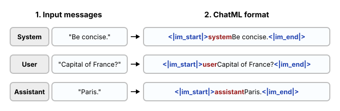
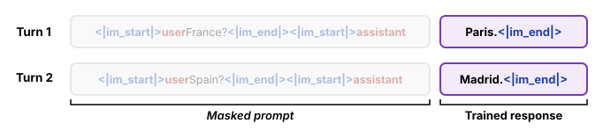
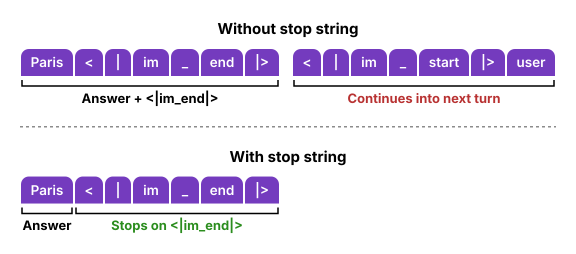
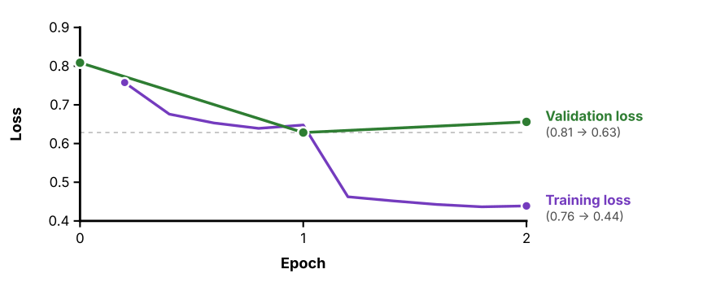

# 自訂聊天範本


預訓練 Gemma 4 檢查點（從 `google/gemma-4-E2B` 到 `google/gemma-4-31B`）只會接續文件。它們出廠時 `tokenizer.chat_template = None`，所以如果您提問，模型會把提示詞當成網頁，繼續寫下去，而不是回答並停下來。

對大多數助手任務來說，從指令微調（`-it`）檢查點開始、沿用 Gemma 4 內建聊天範本是最快的途徑。只有在兩種情況下才需要自訂聊天範本：

- **持續預訓練之後**：您已在[持續預訓練](continued-pretraining.md)中把基礎模型適應到新語言或領域，現在想把它變成聊天助手。
- **配合現有的服務格式**：您的技術堆疊已要求各模型共用開放格式，而不是 Gemma 4 預設的 `<|turn>`{.token-turn} ... `<turn|>`{.token-turn} 標記。

在本指南中，我們為 `google/gemma-4-E2B` 加入 **ChatML** 範本（`<|im_start|>` 與 `<|im_end|>`），並用 QLoRA 在多輪對話上訓練它。

---

## 1. 選擇對話格式

後訓練基礎模型時，只要訓練與推論使用完全相同的範本，您可以選擇任何清楚的回合格式。

一個熱門的廠商中立選擇是 **ChatML**，Liquid AI 的 LFM3、NVIDIA 的 Nemotron 3 與 Hugging Face 的 SmolLM 等模型都在使用。它把每則訊息包在 `<|im_start|>` 與 `<|im_end|>` 之間：



在 Gemma 4 上使用 ChatML 很容易，因為起始與結束詞元使用的子詞早已在 Gemma 4 的詞彙表中。
---

## 2. 遮罩使用者回合

在多輪對話中，對每個詞元都計算損失，會把更新浪費在背誦系統指示與使用者問題上。

我們改用 Jinja2 `...` 標籤把每則助手回覆包起來，告訴訓練器遮罩掉提示詞，只對助手的回答計算損失：



---

## 3. 在回合結束時停止

在 Gemma 4 的分詞器中，`<|im_end|>` 是六個一般詞元（`<`、`|`、`im`、`_`、`end`、`|>`），而不是單一特殊序列結束 ID。

訓練期間，模型會學會在每個答案結尾使用這六個詞元的序列。但推論時，生成器預設只會留意 `<eos>`（ID `1`），所以您需要把 `"<|im_end|>"` 當作停止字串傳入：



沒有停止字串時，模型寫完 `<|im_end|>` 後會繼續生成 `<|im_start|>user`，一直寫下去。在 Transformers 中傳入 `stop_strings=["<|im_end|>"]`（或在 vLLM 中傳入 `stop=["<|im_end|>"]`），生成一產生 `<|im_end|>` 就會立即停止。

---

## 4. 設定環境

我們一如往常安裝 Hugging Face 後訓練與評估函式庫：

```python { .notebook-cell }
# Install Hugging Face post-training, quantization, multimodal, and evaluation libraries
%pip install -q -U "transformers>=5.10.1" "trl>=0.16.0" "peft>=0.19.0" accelerate datasets bitsandbytes torchao
%pip install -q -U evaluate sacrebleu jiwer pillow soundfile librosa matplotlib tensorboard
```

如果您打算把轉接器推送到 Hugging Face Hub，請用寫入權杖登入：

```python { .notebook-cell }
from huggingface_hub import login

# Optional: uncomment to push your trained adapter to the Hugging Face Hub
# login()
```

---

## 5. 加入聊天範本

要加入聊天範本，我們先載入預訓練 `google/gemma-4-E2B` 分詞器，接著再三確認它確實沒有聊天範本，再加入一個 ChatML Jinja2 範本，在助手回合周圍加上 `` 標籤：

```python { .notebook-cell .model-swap }
from transformers import AutoTokenizer

# Load the pre-trained base tokenizer (without the -it suffix)
model_id = "google/gemma-4-E2B"
tokenizer = AutoTokenizer.from_pretrained(model_id)
print(f"Initial chat_template: {tokenizer.chat_template}")

# Add a ChatML template with  markers around assistant turns
CHATML_TEMPLATE = (
    "{{ bos_token }}"
    ""
    "<|im_start|>{{ message['role'] }}\n"
    ""
    "{{ message['content'] }}<|im_end|>\n"
    ""
    "{{ message['content'] }}<|im_end|>\n"
    ""
    ""
    ""
    "<|im_start|>assistant\n"
    ""
)
tokenizer.chat_template = CHATML_TEMPLATE

# Preview a 2-turn conversation and check the assistant token mask
sample_messages = [
    {"role": "system", "content": "Be concise."},
    {"role": "user", "content": "What is the capital of France?"},
    {"role": "assistant", "content": "Paris."},
    {"role": "user", "content": "And Spain?"},
    {"role": "assistant", "content": "Madrid."},
]
print("\nFormatted prompt:\n" + tokenizer.apply_chat_template(sample_messages, tokenize=False))

encoded = tokenizer.apply_chat_template(
    sample_messages,
    tokenize=True,
    return_dict=True,
    return_assistant_tokens_mask=True,
)
print(f"Total tokens: {len(encoded['input_ids'])} | Trained tokens: {sum(encoded['assistant_masks'])}")
```

```{ .no-copy .output }
Initial chat_template: None

Formatted prompt:
<bos><|im_start|>system
Be concise.<|im_end|>
<|im_start|>user
What is the capital of France?<|im_end|>
<|im_start|>assistant
Paris.<|im_end|>
<|im_start|>user
And Spain?<|im_end|>
<|im_start|>assistant
Madrid.<|im_end|>

Total tokens: 88 | Trained tokens: 16
```

如上所示，基礎模型內沒有聊天範本，同時也展示了 ChatML 範本的樣子。

---

## 6. 準備資料集

我們使用 [SmolTalk](https://huggingface.co/datasets/HuggingFaceTB/smoltalk) 的 `everyday-conversations` 切分，這是一組簡短多輪對話的集合。每列已有一個 `messages` 清單，內含交替的 `user` 與 `assistant` 回合，因此我們只需在前面加上系統訊息：

```python { .notebook-cell }
from datasets import load_dataset

SYSTEM_PROMPT = "You are a helpful, concise assistant."


def add_system_turn(example):
    return {
        "messages": [{"role": "system", "content": SYSTEM_PROMPT}] + example["messages"]
    }


# Load multi-turn dialogues and prepend the system prompt
dataset = load_dataset("HuggingFaceTB/smoltalk", "everyday-conversations")
train_dataset = dataset["train"].select(range(1200)).map(
    add_system_turn, remove_columns=["full_topic"]
)
eval_dataset = dataset["test"].map(
    add_system_turn, remove_columns=["full_topic"]
)

print(f"Conversations: {len(train_dataset)} train | {len(eval_dataset)} test")
print(f"Messages in first conversation: {len(train_dataset[0]['messages'])}")
```

```{ .no-copy .output }
Conversations: 1200 train | 119 test
Messages in first conversation: 9
```

---

## 7. 載入模型

現在我們可以 4-bit NF4 精度載入 `google/gemma-4-E2B`，並如 [(Q)LoRA](qlora.md) 一樣，在每個文字層的七個線性投影上加入 LoRA 轉接器：

```python { .notebook-cell }
import torch
from transformers import AutoModelForMultimodalLM, BitsAndBytesConfig
from peft import LoraConfig, get_peft_model, prepare_model_for_kbit_training

# Load the pre-trained base checkpoint in 4-bit NF4
bnb_config = BitsAndBytesConfig(
    load_in_4bit=True,
    bnb_4bit_use_double_quant=True,
    bnb_4bit_quant_type="nf4",
    bnb_4bit_compute_dtype=torch.bfloat16,
    bnb_4bit_quant_storage=torch.bfloat16,
)

model = AutoModelForMultimodalLM.from_pretrained(
    model_id,
    dtype=torch.bfloat16,
    device_map="auto",
    quantization_config=bnb_config,
)
model = prepare_model_for_kbit_training(model)

# Attach rank-16 LoRA adapters to the text decoder layers
peft_config = LoraConfig(
    r=16,
    lora_alpha=32,
    lora_dropout=0.0,
    bias="none",
    target_modules=[
        "q_proj",
        "k_proj",
        "v_proj",
        "o_proj",
        "gate_proj",
        "up_proj",
        "down_proj",
    ],
    exclude_modules=r"model\.(vision_tower|audio_tower)\..*",
    task_type="CAUSAL_LM",
)
model = get_peft_model(model, peft_config)
model.print_trainable_parameters()
```

```{ .no-copy .output }
trainable params: 24,158,208 || all params: 5,128,455,712 || trainable%: 0.4711
```

---

## 8. 評估基礎模型

訓練模型之前，我們先定義一個小型輔助函式：格式化對話、在 `"<|im_end|>"` 停止生成，並檢查未經修改的基礎模型在訓練前的回應方式：

```python { .notebook-cell }
def generate_reply(messages, max_new_tokens=96):
    was_checkpointing = model.is_gradient_checkpointing
    if was_checkpointing:
        model.gradient_checkpointing_disable()
    model.eval()

    prompt_text = tokenizer.apply_chat_template(
        messages, tokenize=False, add_generation_prompt=True
    )
    inputs = tokenizer(prompt_text, return_tensors="pt").to(model.device)
    with torch.no_grad():
        output_ids = model.generate(
            **inputs,
            max_new_tokens=max_new_tokens,
            do_sample=False,
            stop_strings=["<|im_end|>"],
            tokenizer=tokenizer,
            pad_token_id=tokenizer.pad_token_id,
        )
    if was_checkpointing:
        model.gradient_checkpointing_enable()

    new_ids = output_ids[0][inputs["input_ids"].shape[1] :]
    raw_text = tokenizer.decode(new_ids, skip_special_tokens=True)
    stopped = "<|im_end|>" in raw_text
    clean_reply = raw_text.split("<|im_end|>")[0].strip()
    return clean_reply, stopped, len(new_ids)


# Test the raw base model before training
turn_1 = [
    {"role": "system", "content": SYSTEM_PROMPT},
    {"role": "user", "content": "What are three easy indoor plants for beginners?"},
]
reply_before, stopped_before, tokens_before = generate_reply(turn_1, max_new_tokens=60)
print(f"Stopped on <|im_end|>: {stopped_before} ({tokens_before} tokens)")
print(f"Reply before training:\n{reply_before}")
```

```{ .no-copy .output }
Stopped on <|im_end|>: False (60 tokens)
Reply before training:
1. **Pothos (Epipremnum aureum)**:
- **Description**: A popular and easy-to-care-for plant that thrives in low light conditions.
- **Care Tips**:
- **Light**: Thrives in low to medium light.
- **
```

這個基準顯示，基礎模型會忽略 `<|im_end|>`，開始寫一篇條列式文章，然後在 60 個詞元的上限處被截斷。

---

## 9. 訓練模型

現在，我們可以訓練模型了：

```python { .notebook-cell }
from trl import SFTConfig, SFTTrainer

sft_args = SFTConfig(
    output_dir="gemma-4-chatml",
    max_length=1024,
    assistant_only_loss=True,
    num_train_epochs=2,
    per_device_train_batch_size=4,
    gradient_accumulation_steps=4,
    learning_rate=2e-4,
    warmup_steps=0.05,
    lr_scheduler_type="cosine",
    bf16=True,
    logging_steps=15,
    eval_strategy="epoch",
    eval_on_start=True,
    save_strategy="epoch",
    report_to="tensorboard",
    seed=42,
)

trainer = SFTTrainer(
    model=model,
    args=sft_args,
    train_dataset=train_dataset,
    eval_dataset=eval_dataset,
    processing_class=tokenizer,
)
model.train()
trainer.train()
```

```{ .no-copy .output }
[150/150 08:28, Epoch 2/2]

| Epoch | Training Loss | Validation Loss | Mean Token Accuracy |
|---|---|---|---|
| 0 | — | 0.8088 | 0.7574 |
| 1 | 0.6465 | 0.6284 | 0.8045 |
| 2 | 0.4388 | 0.6559 | 0.8054 |
```

<!-- notebook:skip-start -->
??? info "檢視訓練曲線"
    
<!-- notebook:skip-end -->

---

## 10. 評估微調後的模型

我們在訓練好的模型上執行一段兩輪對話，驗證它回答簡潔、在第二輪記得上下文，而且兩次都在 `<|im_end|>` 停止。我們先問：

> 「*What are three easy indoor plants for beginners?*」

再追問：

> 「*Which of those needs the least sunlight?*」

```python { .notebook-cell }
# Turn 1: ask our initial question
reply_1, stopped_1, tokens_1 = generate_reply(turn_1)
print(f"[Turn 1] Stopped on <|im_end|>: {stopped_1} ({tokens_1} tokens)")
print(f"Assistant: {reply_1}\n")

# Turn 2: follow up using the model's first reply
turn_2 = turn_1 + [
    {"role": "assistant", "content": reply_1},
    {"role": "user", "content": "Which of those needs the least sunlight?"},
]
reply_2, stopped_2, tokens_2 = generate_reply(turn_2)
print(f"[Turn 2] Stopped on <|im_end|>: {stopped_2} ({tokens_2} tokens)")
print(f"Assistant: {reply_2}")
```

```{ .no-copy .output }
[Turn 1] Stopped on <|im_end|>: True (35 tokens)
Assistant: For beginners, I recommend Snake Plant, Spider Plant, and Pothos. They're easy to care for and thrive in low light conditions.

[Turn 2] Stopped on <|im_end|>: True (48 tokens)
Assistant: The Snake Plant needs very little sunlight, making it ideal for low-light areas. The Spider Plant can tolerate some indirect light, while the Pothos can handle low light, but prefers bright, indirect light.
```

成功了！我們給了基礎模型一個聊天範本，模型現在已能合理地遵循指示。實務上，您可能想用多得多的資料訓練，確保模型在各種不同情境下都能遵循指示，從短對話到長對話與任務皆然。

有三樣東西需要儲存：

* 模型
* 分詞器
* 生成設定

```python { .notebook-cell }
model.generation_config.stop_strings = ["<|im_end|>"]

trainer.save_model("gemma-4-chatml")
tokenizer.save_pretrained("gemma-4-chatml")
model.generation_config.save_pretrained("gemma-4-chatml")
```

!!! tip "使用 vLLM 或 OpenAI 相容 API 提供服務"
    使用 `vllm serve` 提供合併後檢查點的服務時，請把 `tokenizer.save_pretrained(merged_dir)` 與合併後的權重一起儲存，讓 vLLM 自動讀取 `chat_template.jinja`，並在 `/v1/chat/completions` 請求中傳入 `stop: ["<|im_end|>"]`。


---

## 接下來

<div class="card-grid">
<a class="card" href="continued-pretraining.md">
  <span class="card-icon">{{ icon('lucide/book-open') }}</span>
  <div class="card-title">持續預訓練</div>
  <p class="card-desc">在執行對話監督式微調之前，先把基礎檢查點適應到原始領域文字或新語言。</p>
</a>
<a class="card" href="unused-tokens.md">
  <span class="card-icon">{{ icon('lucide/type') }}</span>
  <div class="card-title">未使用詞元</div>
  <p class="card-desc">把 Gemma 4 的保留詞元槽位變成單一詞元路由標籤、來源標籤與領域詞彙。</p>
</a>
<a class="card" href="preference-alignment.md">
  <span class="card-icon">{{ icon('lucide/sparkles') }}</span>
  <div class="card-title">偏好最佳化</div>
  <p class="card-desc">合併監督式微調轉接器，再用 DPO 以選定與拒絕的配對對齊回應。</p>
</a>
<a class="card" href="export.md">
  <span class="card-icon">{{ icon('lucide/rocket') }}</span>
  <div class="card-title">匯出</div>
  <p class="card-desc">把合併後的檢查點部署到 vLLM、GGUF（llama.cpp 與 Ollama）與 LiteRT-LM。</p>
</a>
</div>
