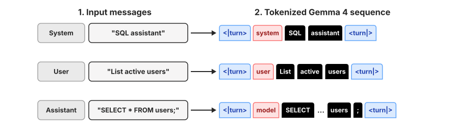
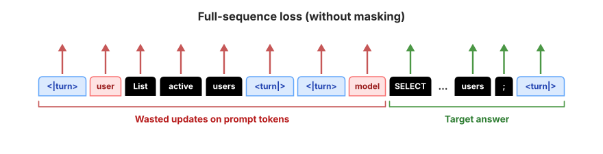
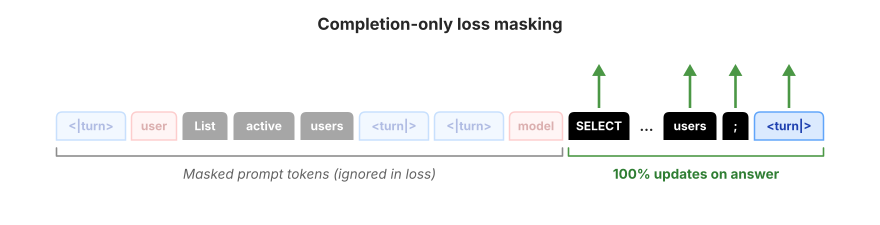
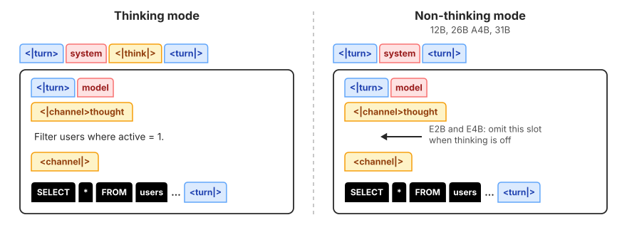
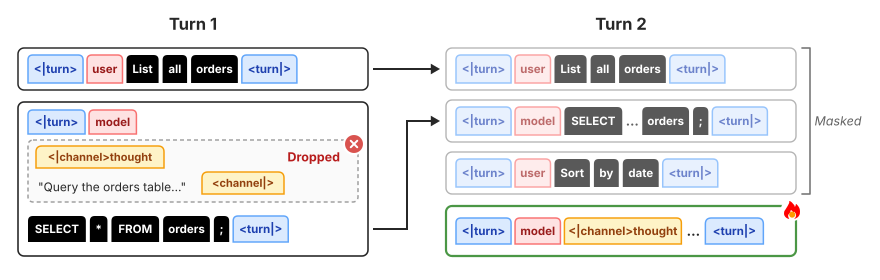

# 資料集格式

要微調模型，讓它遵循指令、逐步推理或呼叫工具，必須用與推論時相同的控制詞元來格式化訓練範例。同時也必須遮罩提示詞元，讓模型只對自己的回應計算損失。

本指南說明 Gemma 4 如何為監督式微調建構對話、推理軌跡、多回合歷史記錄與工具呼叫。

---

## 1. Gemma 4 聊天範本

在 Gemma 4 中，對話裡的每則訊息（系統、使用者與助理）會在詞元化之前包在回合詞元中：

每個回合都以 `<|turn>`{.token-turn} 開頭，緊接著是角色與換行，並以 `<turn|>`{.token-turn} 結尾。請注意，標準對話資料集中的助理角色會對應到 `model`{.token-role} 詞元。

以下是 Gemma 4 使用的主要控制詞元：

| 控制詞元 | 用途 |
| :--- | :--- |
| <code class="token-turn">&lt;&#124;turn&gt;</code> ... <code class="token-turn">&lt;turn&#124;&gt;</code> | 開啟與關閉每個對話回合。 |
| `system`{.token-role}、`user`{.token-role}、`model`{.token-role} | 緊接在 <code class="token-turn">&lt;&#124;turn&gt;</code> 之後宣告說話者角色。 |
| <code class="token-think">&lt;&#124;think&#124;&gt;</code> | 啟用推理模式。 |
| <code class="token-think">&lt;&#124;channel&gt;thought</code> ... <code class="token-think">&lt;channel&#124;&gt;</code> | 包住模型的內部推理軌跡。 |
| <code class="token-tool">&lt;&#124;tool&gt;</code> ... <code class="token-tool">&lt;tool&#124;&gt;</code> | 包住提供給模型的函式定義。 |
| <code class="token-tool">&lt;&#124;tool_call&gt;</code> ... <code class="token-tool">&lt;tool_call&#124;&gt;</code> | 包住模型產生的函式呼叫。 |
| <code class="token-tool">&lt;&#124;tool_response&gt;</code> ... <code class="token-tool">&lt;tool_response&#124;&gt;</code> | 將工具的輸出回傳給模型。 |
| <code class="token-tool">&lt;&#124;"&#124;&gt;</code> | 分隔結構化工具區塊內的字串值。 |

關於這些控制詞元的更多資訊，請見[提示詞格式](../get-started/prompt-formatting.md)。

---

## 2. 遮罩提示詞元 

在語言建模中，損失是對序列中的每個詞元計算的。這對使用原始文件的持續預訓練很有效。但在監督式微調中，每個範例都以系統提示、工具定義與使用者問題開頭，情況就不同了。

如果不做遮罩就對整個序列計算損失，模型會把大量訓練花在記住提示上：

在上述範例中，大多數更新都在訓練模型預測使用者的問題，而非 SQL 答案。當資料集包含很長的系統提示或檢索到的文件時，未遮罩的提示詞元可能占損失的 90% 以上。

修正方法是使用**僅計算完成部分的損失遮罩**，它會遮罩答案詞元以外的所有詞元：

提示詞元仍會經過前向傳播，讓模型能關注完整的問題，但在計算損失時會被忽略。現在 100% 的權重更新都集中在模型的答案與結尾回合詞元上。在 Hugging Face TRL 中，把文字範例整理成 `prompt` 與 `completion` 鍵，就會自動遮罩提示；而視覺與音訊任務則使用小型自訂 collator，額外遮罩影像與音訊軟詞元。

---

## 3. 使用思考詞元訓練 

Gemma 4 模型可以在寫出最終答案之前，於 `<|channel>thought`{.token-think} ... `<channel|>`{.token-think} 區塊內進行推理。準備 SFT 資料集時，你可以把範例格式化為**思考模式**或**非思考模式**：

兩種模式的運作方式如下：

1. **思考模式**：系統回合包含 `<|think|>`{.token-think}，模型回合則以包含推理步驟的思考區塊開頭，再寫出最終答案。
2. **非思考模式**：當系統回合省略 `<|think|>`{.token-think} 時，**E2B** 與 **E4B** 會省略所有與思考相關的詞元，而 **12B**、**26B A4B** 與 **31B** 會在最終答案之前放一個空的思考區塊。

如果你只用沒有思考區塊的直接答案進行微調，即使提示模型推理，模型也會逐漸停止使用思考通道。

要在監督式微調期間保持推理能力：

- **混合推理與直接範例**：在訓練資料集中，同時納入帶有思考區塊的範例與直接作答的範例。
- **當資料集只有最終答案時，產生推理軌跡**：如果資料集只有問題與標準答案，請用開啟思考功能的 **Gemma 4 31B** 對訓練問題產生回應，保留最終答案與標準答案標籤相符的回應，並把這些產生的思考區塊納入訓練資料。

---

## 4. 多回合對話

在多回合對話中，模型可能在**第 1 回合**寫下數百個推理詞元，之後才給出簡短的最終答案。

當**第 2 回合**開始時，Gemma 4 會捨棄第 1 回合的思考區塊，在對話歷史記錄中只保留最終答案：

流程如下：

1. **第 1 回合**：使用者問「列出所有訂單」，模型產生一個思考區塊，接著給出最終答案（`SELECT * FROM orders;`）。
2. **第 2 回合**：只有使用者提示與第 1 回合的最終答案會帶入第 2 回合的提示歷史記錄（並從損失中遮罩）。第 1 回合的思考區塊會被捨棄，而第 2 回合的新模型回應則保留其思考區塊以供訓練。

捨棄先前的思考內容可以讓多回合上下文視窗保持簡短，也符合推論引擎在執行期間格式化對話歷史記錄的方式。

!!! note "呼叫工具時的思考內容"
    有一個例外值得注意，那就是工具呼叫。在同一個多步驟回合內，工具呼叫前後產生的思考內容都應該保留。這有助於模型追蹤呼叫各個工具的原因。

---

## 5. 工具呼叫資料集

Gemma 4 使用專用的控制詞元，在對話內格式化函式定義、工具呼叫與工具輸出。

以下是工具呼叫軌跡在訓練範例內的結構：

<pre><code>&lt;|turn&gt;system
&lt;|think|&gt;
&lt;|tool&gt;declaration:get_stock{description:&lt;|"|&gt;Look up available units for a product SKU.&lt;|"|&gt;,parameters:{properties:{sku:{description:&lt;|"|&gt;Product SKU&lt;|"|&gt;,type:&lt;|"|&gt;STRING&lt;|"|&gt;}},required:[&lt;|"|&gt;sku&lt;|"|&gt;],type:&lt;|"|&gt;OBJECT&lt;|"|&gt;}}&lt;tool|&gt;&lt;turn|&gt;
&lt;|turn&gt;user
How many units of SKU-9042 are in stock?&lt;turn|&gt;
&lt;|turn&gt;model
&lt;|channel&gt;thought
I need to check the inventory for SKU-9042.
&lt;channel|&gt;&lt;|tool_call&gt;call:get_stock{sku:&lt;|"|&gt;SKU-9042&lt;|"|&gt;}&lt;tool_call|&gt;&lt;|tool_response&gt;response:get_stock{value:&lt;|"|&gt;{"available_units": 142}&lt;|"|&gt;}&lt;tool_response|&gt;&lt;|channel&gt;thought
The tool returned 142 units.
&lt;channel|&gt;There are 142 units of SKU-9042 in stock.&lt;turn|&gt;</code></pre>

請注意，工具呼叫、工具回應與後續答案會合併為單一模型回合。為監督式微調遮罩工具呼叫軌跡時，請遮罩系統回合、使用者回合與工具回應，讓模型只對自己的思考內容、工具呼叫與最終答案計算損失。

## 接下來

<a class="card" href="qlora.md">
  {{ icon('lucide/zap') }}
  
(Q)LoRA

  
在單張 GPU 上使用 TRL 與 PEFT，於格式化好的資料集上訓練轉接器。

</a>
<a class="card" href="full-finetune.md">
  {{ icon('lucide/cpu') }}
  
完整微調

  
以 bfloat16 更新 100% 的 Gemma 4 權重，並使用僅計算完成部分的損失遮罩。

</a>
<a class="card" href="preference-alignment.md">
  {{ icon('lucide/sparkles') }}
  
偏好最佳化

  
為 DPO、ORPO 與 KTO 格式化選定與拒絕的回應配對。

</a>
<a class="card" href="reinforcement-learning.md">
  {{ icon('lucide/brain') }}
  
可驗證獎勵

  
使用 GRPO 與可驗證獎勵函式訓練思考鏈。

</a>

--8<-- "glossary.md"
