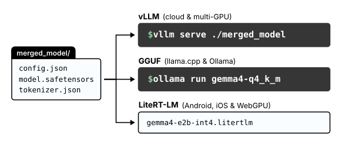

# 匯出

訓練與轉接器合併完成後，你的 `merged_model/` 目錄（`config.json`、`model.safetensors`、`tokenizer.json`）可以直接在 GPU 叢集上提供服務，也可以在桌上型電腦、Apple Silicon 與行動裝置上使用。




---

## 1. vLLM

[vLLM](../deployment/vllm.md) 可以直接提供 Hugging Face SafeTensors 目錄的服務，也可以在請求時動態掛載未合併的 LoRA 轉接器：

=== "選項 A：提供已合併檢查點的服務"
    如果你已用 `merge_and_unload()` 把 LoRA 轉接器合併進基礎權重，或已執行完整微調，請把 `vllm serve` 指向你的 `merged_model/` 資料夾：

    ```bash
    # Serve merged E2B or E4B on a single GPU
    vllm serve ./merged_model \
        --dtype bfloat16 \
        --max-model-len 32768

    # Serve merged 26B A4B or 31B across 2 GPUs with Tensor Parallelism
    vllm serve ./merged_model \
        --dtype bfloat16 \
        --tensor-parallel-size 2 \
        --max-model-len 32768
    ```

=== "選項 B：提供多個 LoRA 轉接器的服務"
    如果你把 LoRA 轉接器保留為獨立檔案，請載入一次官方凍結的 Gemma 4 基礎檢查點，並用 `--enable-lora` 掛載多個轉接器：

    ```bash
    # Serve one shared base checkpoint with multiple per-request LoRA adapters
    vllm serve google/gemma-4-E4B-it \
        --enable-lora \
        --max-lora-rank 32 \
        --lora-modules sql-adapter=./gemma-4-text-to-sql medical-adapter=./gemma-4-medical-lora
    ```

    在 OpenAI 相容 API 請求中傳入 `"model": "sql-adapter"` 或 `"model": "medical-adapter"`，即可依請求選擇轉接器。

---

## 2. GGUF

要在本機使用 [llama.cpp](../deployment/llamacpp.md) 或 [Ollama](../deployment/ollama.md) 執行微調後的 Gemma 4 模型，你可以把它轉換為 16 位元的 `.gguf` 檔案，再量化為 4 位元：

```bash
# Convert Hugging Face SafeTensors directory to FP16 GGUF
python llama.cpp/convert_hf_to_gguf.py ./merged_model \
    --outfile model-f16.gguf \
    --outtype f16

# Quantize FP16 GGUF to 4-bit Q4_K_M
./llama.cpp/build/bin/llama-quantize \
    model-f16.gguf \
    model-q4_k_m.gguf \
    Q4_K_M
```

---

## 3. LiteRT-LM


要在行動裝置上使用 LiteRT-LM 執行小型模型（Gemma 4 E2B 與 E4B），請把檢查點匯出為 `.litertlm` 套件。傳入 `--externalize_embedder` 會分離 Gemma 4 的逐層嵌入表，讓啟用的 Transformer 權重能在行動 GPU 或 NPU 上以 4 位元精度執行，而不會耗盡裝置記憶體。

安裝 `litert-torch-nightly` 與 `litert-lm`，匯出 `./merged_model`，並在本機測試套件：

```bash
# Install LiteRT conversion and CLI tools
uv tool install litert-torch-nightly litert-lm

# Export the merged checkpoint with externalized Per-Layer Embeddings
litert-torch export_hf \
    --model=./merged_model \
    --output_dir=./litert_out \
    --externalize_embedder \
    --jinja_chat_template_override=litert-community/gemma-4-E2B-it-litert-lm

# Run a quick local smoke test on the exported bundle
litert-lm run ./litert_out/model.litertlm --prompt="What is the capital of France?"
```

Android、iOS、C++ 與 Python 的整合步驟，請見 [LiteRT-LM 部署指南](../deployment/litert.md)。

---

## 接下來

<div class="card-grid">
<a class="card" href="../deployment/index.md">
  <span class="card-icon">{{ icon('lucide/rocket') }}</span>
  <div class="card-title">執行 Gemma</div>
  <p class="card-desc">使用 vLLM、Ollama、llama.cpp、Google Cloud 或 LiteRT-LM 部署微調後的 Gemma 4 檢查點。</p>
</a>
<a class="card" href="scaling.md">
  <span class="card-icon">{{ icon('lucide/boxes') }}</span>
  <div class="card-title">擴展規模</div>
  <p class="card-desc">使用 FSDP2 將訓練分片到多 GPU 節點，並使用 TorchAO QAT 恢復 4 位元精度。</p>
</a>
<a class="card" href="unsloth.md">
  <span class="card-icon">{{ icon('lucide/zap') }}</span>
  <div class="card-title">Unsloth</div>
  <p class="card-desc">使用單一輔助呼叫加速單 GPU LoRA，並直接匯出為 GGUF。</p>
</a>
<a class="card" href="gemma-trainer.md">
  <span class="card-icon">{{ icon('lucide/wrench') }}</span>
  <div class="card-title">Gemma 訓練器技能</div>
  <p class="card-desc">讓 AI 程式設計代理為你設定、驗證並執行本機 Gemma 4 微調工作流程。</p>
</a>
</div>

--8<-- "glossary.md"
