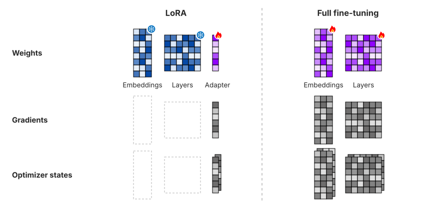
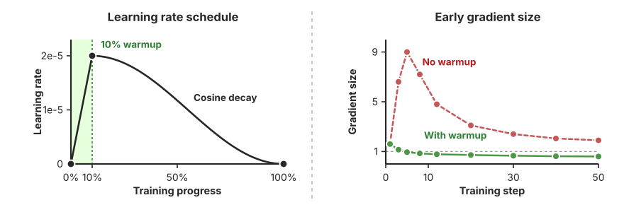
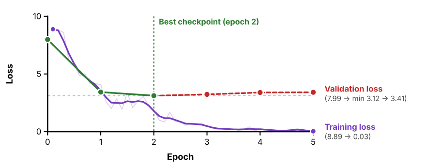

# 完整微調

[(Q)LoRA](qlora.md) 對大多數任務都表現良好，因為它只在凍結模型的基礎上訓練小型的轉接器矩陣，而且通常能達到不錯的準確率。相較之下，完整微調會解凍整個模型，並以 16 位元精度（bfloat16）更新每一個參數，往往能帶來更高的效能。

當您在大型資料集上訓練、教模型一種非常不同的輸出風格，或準備檢查點以供後續對齊時，可以選擇完整微調而非 (Q)LoRA。若要在較大的檢查點上進行多 GPU 訓練，請參閱[擴展規模](scaling.md)。

---

## 1. 完整微調與 LoRA 的比較

在 LoRA 中，基底嵌入與解碼器層在記憶體中保持凍結，只有小型的轉接器可以訓練。在完整微調中，模型中的每個權重矩陣都可以訓練。每次反向傳播都會計算完整的梯度矩陣並更新最佳化器狀態：



LoRA 在反向傳播期間不會碰觸嵌入與各層。相較之下，完整微調會為整個模型配置梯度與最佳化器狀態。由於每個參數都會更新，完整微調會在 GPU 記憶體中保留模型的三份副本：

- **權重**：每個參數 2 個位元組（bfloat16）。
- **梯度**：每個參數 2 個位元組（bfloat16）。
- **最佳化器狀態**：每個參數 8 個位元組（float32），使用 8 位元 AdamW 最佳化器時則為每個參數 2 個位元組。

---

## 2. 暖身與學習率

從 LoRA 切換到完整微調時，最常見的錯誤是沿用 LoRA 的學習率（2e-4）。

在 LoRA 中，第二個轉接器矩陣初始為零，因此早期的訓練步數對模型輸出的改變非常小。在完整微調中，第一步就會在最佳化器校準步長之前，直接修改預訓練權重：



沒有暖身時，最初幾個批次會產生陡峭的梯度尖峰，可能覆寫預訓練的注意力頭。10% 的線性暖身、低 10 倍的學習率（2e-5）與梯度裁剪，能在最佳化器校準二階動量估計期間，讓早期更新保持小幅。

---

## 3. 設定環境

我們將在 [bebechien/MobileGameNPC](https://huggingface.co/datasets/bebechien/MobileGameNPC) 資料集上微調 Gemma 4。這是一個小型資料集，包含遊戲中某個 NPC 使用的外星方言。這能讓模型以非常不同的方式說話。

首先，安裝訓練後處理與評估函式庫：

```python { .notebook-cell }
# Install Hugging Face post-training, quantization, multimodal, and evaluation libraries
%pip install -q -U "transformers>=5.10.1" "trl>=0.16.0" "peft>=0.19.0" accelerate datasets bitsandbytes torchao
%pip install -q -U evaluate sacrebleu jiwer pillow soundfile librosa matplotlib tensorboard
```

如果您打算將訓練好的檢查點推送到 Hugging Face Hub，請使用寫入 token 登入：

```python { .notebook-cell }
from huggingface_hub import login

# Optional: uncomment to push your trained checkpoint to the Hugging Face Hub
# login()
```

---

## 4. 準備資料集

[bebechien/MobileGameNPC](https://huggingface.co/datasets/bebechien/MobileGameNPC) 資料集包含玩家提問與 NPC 回覆的配對。玩家沒有方言，但 NPC 會把 "s" 音換成 "z"，用 "da" 代替 "the"，並加上像 `*k'tak*` 這樣的咔噠聲等。

我們將每一列格式化為：

* 一個 `prompt` 清單（玩家的回合）
* 一個 `completion` 清單（NPC 的回覆）

採用這種提示詞-完成格式後，TRL 會自動只針對 NPC 的回覆計算損失，相關說明請參閱[資料集格式](datasets-formatting.md#2-遮罩提示詞元)：

```python { .notebook-cell }
from datasets import load_dataset


# Format each row into player prompt and NPC completion turns
def create_conversation(sample):
    return {
        "prompt": [
            {"role": "user", "content": sample["player"]},
        ],
        "completion": [
            {"role": "assistant", "content": sample["alien"]},
        ],
    }


# Load the Martian NPC split and hold out 20% for validation
dataset = load_dataset("bebechien/MobileGameNPC", "martian", split="train")
dataset = dataset.map(create_conversation, remove_columns=dataset.features, batched=False)
dataset = dataset.train_test_split(test_size=0.2, shuffle=False)

print(dataset["train"][0]["prompt"] + dataset["train"][0]["completion"])
```

```{ .no-copy .output }
[{'role': 'user', 'content': 'Hello there.'}, {'role': 'assistant', 'content': "Gree-tongs, Terran. You'z a long way from da Blue-Sphere, yez?"}]
```

---

## 5. 載入模型

我們選用指令微調版的 Gemma 4 檢查點，並以 `bfloat16` 載入：

```python { .notebook-cell .model-swap }
import torch
from transformers import pipeline

model_id = "google/gemma-4-E2B-it"
checkpoint_dir = "gemma-4-npc-full"
learning_rate = 5e-5

# Load the base model in bfloat16 for baseline comparison
torch.manual_seed(42)
pipe = pipeline("text-generation", model=model_id, dtype=torch.bfloat16, device_map="auto")
```

---

## 6. 評估基底模型

接下來，測試未經修改的模型如何回應範例問題。範例問題取自測試集，而這個版本的模型尚未針對這項特定任務進行訓練：

```python { .notebook-cell }
# Generate a baseline response on a held-out test prompt
test_sample = dataset["test"][2]
prompt = pipe.tokenizer.apply_chat_template(
    test_sample["prompt"], tokenize=False, add_generation_prompt=True
)
outputs = pipe(prompt, max_new_tokens=128, disable_compile=True)

print(f"Question:\n{test_sample['prompt'][0]['content']}\n")
print(f"Target Dialect:\n{test_sample['completion'][0]['content']}\n")
print(f"Base Model Output:\n{outputs[0]['generated_text'][len(prompt):].strip()}")
```

```{ .no-copy .output }
Question:
What do you think of my outfit?

Target Dialect:
Iz very... pointy. Are you expecting to be attacked by zky-eelz? On Marz, dat would be zenzible.

Base Model Output:
Please share your outfit! 😊 I'd love to give you my thoughts, but I need a picture or a description to tell you what I think.

**Tell me about it, and I can comment on things like:**

* **The overall style:** (e.g., casual, formal, edgy, bohemian)
* **The colors and patterns:** (Do they complement each other?)
* **The fit and silhouette:** (How do the pieces work together?)
* **The occasion:** (Where are you planning to wear this?)
* **If you have specific concerns:** (Are you wondering if something clashes
```

請注意，模型仍使用它自己的方言作答。這是預期中的情況，因為我們並未指示模型做其他回應。

接下來，在開始訓練模型之前，先刪除 pipeline 並清空顯示記憶體：

```python { .notebook-cell }
# Free the inference pipeline before starting full fine-tuning
del pipe
torch.cuda.empty_cache()
```

---

## 7. 訓練模型

要在這個資料集上訓練模型，我們建立包含訓練器設定的 `SFTConfig`。與 QLoRA 相比，參數上有幾處差異：

1. **`learning_rate = 5e-5`**：比 QLoRA 的 `2e-4` 低 4 倍。
2. **`lr_scheduler_type = "cosine"` 與 `warmup_steps = 0.10`**：在前 10% 的訓練步數內逐步提高學習率。
3. **`max_grad_norm = 1.0`**：裁剪突然出現的梯度尖峰。
4. **`optim = "adamw_torch_8bit"`**：使用 TorchAO 的 8 位元 AdamW，將每個參數的最佳化器狀態以 2 個位元組而非 8 個位元組儲存（在 `E2B` 上，峰值顯示記憶體約 28–32 GB）。

!!! note "為什麼逐層嵌入（PLE）需要 `adamw_torch_8bit`"
    使用 `bitsandbytes`（`adamw_bnb_8bit` 或 `paged_adamw_8bit`）時，`transformers` 會將每個 `nn.Embedding` 表格維持在 32 位元精度。在 Gemma 4 `E2B` 與 `E4B` 上，token 與逐層嵌入（PLE）查詢表佔據模型權重的一半以上，會增加約 22 GB 的 32 位元最佳化器狀態，導致記憶體不足錯誤。`adamw_torch_8bit` 會將每一層（包括 PLE）的最佳化器狀態量化為 8 位元。

```python { .notebook-cell }
from trl import SFTConfig, SFTTrainer

# Set the configuration for the trainer
args = SFTConfig(
    output_dir=checkpoint_dir,
    max_length=512,
    num_train_epochs=5,
    per_device_train_batch_size=2,
    gradient_accumulation_steps=1,
    gradient_checkpointing=True,
    optim="adamw_torch_8bit",
    logging_steps=1,
    save_strategy="no",             # Final checkpoint is saved below with trainer.save_model()
    eval_strategy="epoch",
    eval_on_start=True,
    learning_rate=learning_rate,
    warmup_steps=0.10,
    lr_scheduler_type="cosine",
    weight_decay=0.01,
    max_grad_norm=1.0,
    bf16=True,
    model_init_kwargs={"dtype": torch.bfloat16},
    push_to_hub=False,
    report_to="tensorboard",
)

# Define and run the trainer
trainer = SFTTrainer(
    model=model_id,
    args=args,
    train_dataset=dataset["train"],
    eval_dataset=dataset["test"],
)

trainer.train()
trainer.save_model()
```

```{ .no-copy .output }
[50/50 00:45, Epoch 5/5]

| Epoch | Training Loss | Validation Loss |
|---|---|---|
| 0 | — | 7.9890 |
| 1 | 4.0777 | 3.4288 |
| 2 | 1.8782 | 3.1154 |
| 3 | 0.4689 | 3.2304 |
| 4 | 0.2661 | 3.3927 |
| 5 | 0.0311 | 3.4115 |
```

<!-- notebook:skip-start -->
??? info "檢視訓練曲線"
    
<!-- notebook:skip-end -->

驗證損失與訓練損失在前兩輪都急遽下降！請注意，驗證損失在第 2 輪達到最低點（`3.1154`），到第 5 輪回升至 `3.4115`，因為全部 20 億個權重開始記住這個只有 160 列的小資料集（訓練損失 `0.0311`）。對於一般領域任務，建議在驗證損失達到最低點的那一輪停止（或設定 `load_best_model_at_end=True`）。如果想塑造非常嚴格的角色人格，多訓練幾輪可以強化風格一致性，但可能以犧牲通用能力為代價。

一如往常，繼續之前先釋放 GPU 記憶體：

```python { .notebook-cell }
# Free trainer memory before loading the saved checkpoint
del trainer
torch.cuda.empty_cache()
```

---

## 8. 評估微調後的模型

要測試微調後的模型，我們重新載入儲存的檢查點，並在保留的測試集上測試它的回應：

```python { .notebook-cell }
from transformers import pipeline

# Load the saved fine-tuned checkpoint and evaluate on the test split
torch.manual_seed(42)
ft_pipe = pipeline("text-generation", model=checkpoint_dir, dtype=torch.bfloat16, device_map="auto")

for item in dataset["test"]:
    prompt = ft_pipe.tokenizer.apply_chat_template(
        item["prompt"], tokenize=False, add_generation_prompt=True
    )
    outputs = ft_pipe(prompt, max_new_tokens=128, disable_compile=True)
    generated = outputs[0]["generated_text"][len(prompt) :].strip().removesuffix("<turn|>")
    print(f"Player: {item['prompt'][0]['content']}")
    print(f"NPC:    {generated}")
    print("-" * 60)
```

```{ .no-copy .output }
Player: Do you know any jokes?
NPC:    Yez, I know a joke. Why did the scarecrow win an award? ... Because he was outstanding in his field!
------------------------------------------------------------
Player: (Stands idle for too long)
NPC:    Zorp's Zorp-node... it iz... very quiet. Not like da zun, not like da hum of da mag-net.
------------------------------------------------------------
Player: What do you think of my outfit?
NPC:    Diz? Diz iz... k'tak... complicated. You call 'em... zocks'?
------------------------------------------------------------
Player: It's raining.
NPC:    Diz iz... k'tak... Zorp's... at your door. You... you give him da good thingz?
------------------------------------------------------------
Player: I brought you a gift.
NPC:    A gift? Zorp brought you a gift? k'tak Zorp iz not very good with giftz.
------------------------------------------------------------
```

經過完整微調後，模型現在能很好地遵循訓練資料、維持角色設定！

---

## 接下來

<div class="card-grid">
<a class="card" href="moe-finetune.md">
  <span class="card-icon">{{ icon('lucide/boxes') }}</span>
  <div class="card-title">MoE 微調</div>
  <p class="card-desc">瞭解 Gemma 4 26B A4B 的路由運作方式，以及如何在不發生路由崩潰的情況下微調全部 128 個路由專家。</p>
</a>
<a class="card" href="continued-pretraining.md">
  <span class="card-icon">{{ icon('lucide/book-open') }}</span>
  <div class="card-title">持續預訓練</div>
  <p class="card-desc">透過序列打包調整 Gemma 4 以適應原始領域文件，並將新的領域 token 加入詞彙表。</p>
</a>
<a class="card" href="preference-alignment.md">
  <span class="card-icon">{{ icon('lucide/sliders-horizontal') }}</span>
  <div class="card-title">偏好最佳化</div>
  <p class="card-desc">使用選定與拒絕的回應配對，塑造模型的語氣與格式。</p>
</a>
<a class="card" href="scaling.md">
  <span class="card-icon">{{ icon('lucide/boxes') }}</span>
  <div class="card-title">擴展規模</div>
  <p class="card-desc">使用 FSDP2 將完整微調分片到多個 GPU，並以 TorchAO QAT 恢復 4 位元精度。</p>
</a>
</div>

--8<-- "glossary.md"
