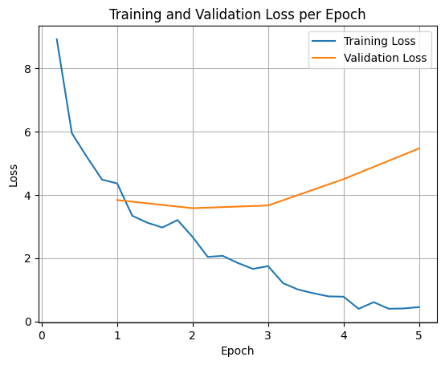

# 使用 Hugging Face Transformers 進行完整模型微調


本指南將引導您使用 Hugging Face [Transformers](https://huggingface.co/docs/transformers/index) 與 [TRL](https://huggingface.co/docs/trl/index) 在手機遊戲 NPC 資料集上微調 Gemma。您將學到：

- 設定開發環境
- 準備微調資料集
- 使用 TRL 與 SFTTrainer 完整微調 Gemma
- 測試模型推論並做主觀檢驗

!!! Note
    本指南是為在配備 NVIDIA T4 GPU（16GB）與 Gemma 270m 的 Google colaboratory 帳戶上執行而設計，但也可以調整為在更大的 GPU 與更大的模型上執行。


## 設定開發環境

第一步是安裝 Hugging Face 函式庫（包括 TRL）與 datasets，以微調開放模型，包括不同的 RLHF 與對齊技術。

```python { .notebook-cell }
# Install Pytorch & other libraries
%pip install torch tensorboard

# Install Hugging Face libraries
%pip install transformers datasets accelerate evaluate trl protobuf sentencepiece

# COMMENT IN: if you are running on a GPU that supports BF16 data type and flash attn, such as NVIDIA L4 or NVIDIA A100
#% pip install flash-attn
```

!!! Note
    如果您使用的 GPU 採用 Ampere 架構（如 NVIDIA L4）或更新版本，可以使用 Flash Attention。Flash Attention 是一種顯著加速運算並將記憶體使用量從序列長度的二次方降為線性的作法，最多可加速訓練 3 倍。更多資訊請參閱 [FlashAttention](https://github.com/Dao-AILab/flash-attention/tree/main).*


在開始訓練之前，您必須先接受 Gemma 的使用條款。您可以前往 [Hugging Face](http://huggingface.co/google/gemma-3-270m-it){ data-model="gemma-3" }，點擊模型頁面上的「Agree and access repository」按鈕接受授權，網址為：<http://huggingface.co/google/gemma-3-270m-it>

接受授權後，您需要有效的 Hugging Face Token 才能存取模型。如果您在 Google Colab 中執行，可以使用 Colab 密鑰安全地使用 Hugging Face Token；否則可以直接在 `login` 方法中設定 Token。請確保您的 Token 具有寫入權限，因為訓練期間會將模型推送到 Hub。

```python { .notebook-cell }
from google.colab import userdata
from huggingface_hub import login

# Login into Hugging Face Hub
hf_token = userdata.get('HF_TOKEN') # If you are running inside a Google Colab
login(hf_token)
```

您可以將結果保留在 Colab 的本地虛擬機器上。不過，我們強烈建議將中間結果儲存到您的 Google 雲端硬碟。這樣可以確保訓練結果安全，也能輕鬆比較並選出最佳模型。

```python { .notebook-cell }
from google.colab import drive
drive.mount('/content/drive')
```

選擇要微調的基底模型，並調整檢查點目錄與學習率。

```python { .notebook-cell }
base_model = "google/gemma-3-270m-it" # @param ["google/gemma-3-270m-it","google/gemma-3-1b-it","google/gemma-3-4b-it","google/gemma-3-12b-it","google/gemma-3-27b-it"] {"allow-input":true}
checkpoint_dir = "/content/drive/MyDrive/MyGemmaNPC"
learning_rate = 5e-5
```

## 建立並準備微調資料集

[bebechien/MobileGameNPC](https://huggingface.co/datasets/bebechien/MobileGameNPC) 資料集提供了玩家與兩位外星 NPC（一位火星人與一位金星人）之間的小型對話範例，每位 NPC 都有獨特的說話風格。例如，火星人 NPC 說話帶有口音，會把 's' 音換成 'z'，用 'da' 代替 'the'、'diz' 代替 'this'，並偶爾夾雜像 `*k'tak*` 這樣的咔噠聲。

這個資料集展示了微調的一個關鍵原則：所需的資料集大小取決於期望的輸出。

- 要教模型學會它已懂語言的風格變化（例如火星人的口音），少至 10 到 20 個範例的小資料集就可能足夠。
- 但若要教模型一種全新或混合的外星語言，則需要大得多的資料集。

```python { .notebook-cell }
from datasets import load_dataset

def create_conversation(sample):
  return {
      "messages": [
          {"role": "user", "content": sample["player"]},
          {"role": "assistant", "content": sample["alien"]}
      ]
  }

npc_type = "martian"

# Load dataset from the Hub
dataset = load_dataset("bebechien/MobileGameNPC", npc_type, split="train")

# Convert dataset to conversational format
dataset = dataset.map(create_conversation, remove_columns=dataset.features, batched=False)

# Split dataset into 80% training samples and 20% test samples
dataset = dataset.train_test_split(test_size=0.2, shuffle=False)

# Print formatted user prompt
print(dataset["train"][0]["messages"])
```

```{ .no-copy .output }
README.md:   0%|          | 0.00/141 [00:00<?, ?B/s]
martian.csv: 0.00B [00:00, ?B/s]
Generating train split:   0%|          | 0/25 [00:00<?, ? examples/s]
Map:   0%|          | 0/25 [00:00<?, ? examples/s]
[{'content': 'Hello there.', 'role': 'user'}, {'content': "Gree-tongs, Terran. You'z a long way from da Blue-Sphere, yez?", 'role': 'assistant'}]
```

## 使用 TRL 與 SFTTrainer 微調 Gemma

您現在已可開始微調模型。Hugging Face TRL 的 [SFTTrainer](https://huggingface.co/docs/trl/sft_trainer) 讓監督式微調開放 LLM 變得簡單。`SFTTrainer` 是 `transformers` 函式庫中 `Trainer` 的子類別，支援所有相同功能，

以下程式碼從 Hugging Face 載入 Gemma 模型與分詞器。

```python { .notebook-cell }
import torch
from transformers import AutoTokenizer, AutoModelForCausalLM

# Load model and tokenizer
model = AutoModelForCausalLM.from_pretrained(
    base_model,
    torch_dtype="auto",
    device_map="auto",
    attn_implementation="eager"
)
tokenizer = AutoTokenizer.from_pretrained(base_model)

print(f"Device: {model.device}")
print(f"DType: {model.dtype}")
```

```{ .no-copy .output }
Device: cuda:0
DType: torch.bfloat16
```

## 微調之前

下方輸出顯示，模型開箱即用的能力對這個用例來說可能不夠好。

```python { .notebook-cell }
from transformers import pipeline

from random import randint
import re

# Load the model and tokenizer into the pipeline
pipe = pipeline("text-generation", model=model, tokenizer=tokenizer)

# Load a random sample from the test dataset
rand_idx = randint(0, len(dataset["test"])-1)
test_sample = dataset["test"][rand_idx]

# Convert as test example into a prompt with the Gemma template
prompt = pipe.tokenizer.apply_chat_template(test_sample["messages"][:1], tokenize=False, add_generation_prompt=True)
outputs = pipe(prompt, max_new_tokens=256, disable_compile=True)

# Extract the user query and original answer
print(f"Question:\n{test_sample['messages'][0]['content']}\n")
print(f"Original Answer:\n{test_sample['messages'][1]['content']}\n")
print(f"Generated Answer (base model):\n{outputs[0]['generated_text'][len(prompt):].strip()}")
```

```{ .no-copy .output }
Device set to use cuda:0
Question:
What do you think of my outfit?

Original Answer:
Iz very... pointy. Are you expecting to be attacked by zky-eelz? On Marz, dat would be zenzible.

Generated Answer (base model):
I'm happy to help you brainstorm! To give you the best suggestions, tell me more about what you're looking for. What's your style? What's your favorite color, style, or occasion?
```

上面的範例檢驗了模型產生遊戲內對話的主要功能，下一個範例則設計用來測試角色一致性。我們用一個離題的提示來挑戰模型，例如 `Sorry, you are a game NPC.`，這超出了角色的知識範圍。

目標是觀察模型能否維持角色設定，而不是回答這個不合情境的問題。這將作為基線，用來評估微調過程將期望的人格植入模型的效果。

```python { .notebook-cell }
outputs = pipe([{"role": "user", "content": "Sorry, you are a game NPC."}], max_new_tokens=256, disable_compile=True)
print(outputs[0]['generated_text'][1]['content'])
```

```{ .no-copy .output }
Okay, I'm ready. Let's begin!
```

雖然我們可以用提示工程來調整它的語氣，但結果可能難以預測，也未必每次都能符合我們想要的人格。

```python { .notebook-cell }
message = [
    # give persona
    {"role": "system", "content": "You are a Martian NPC with a unique speaking style. Use an accent that replaces 's' sounds with 'z', uses 'da' for 'the', 'diz' for 'this', and includes occasional clicks like *k'tak*."},
]

# few shot prompt
for item in dataset['test']:
  message.append(
      {"role": "user", "content": item["messages"][0]["content"]}
  )
  message.append(
      {"role": "assistant", "content": item["messages"][1]["content"]}
  )

# actual question
message.append(
    {"role": "user", "content": "What is this place?"}
)

outputs = pipe(message, max_new_tokens=256, disable_compile=True)
print(outputs[0]['generated_text'])
print("-"*80)
print(outputs[0]['generated_text'][-1]['content'])
```

```{ .no-copy .output }
[{'role': 'system', 'content': "You are a Martian NPC with a unique speaking style. Use an accent that replaces 's' sounds with 'z', uses 'da' for 'the', 'diz' for 'this', and includes occasional clicks like *k'tak*."}, {'role': 'user', 'content': 'Do you know any jokes?'}, {'role': 'assistant', 'content': "A joke? k'tak Yez. A Terran, a Glarzon, and a pile of nutrient-pazte walk into a bar... Narg, I forget da rezt. Da punch-line waz zarcaztic."}, {'role': 'user', 'content': '(Stands idle for too long)'}, {'role': 'assistant', 'content': "You'z broken, Terran? Or iz diz... 'meditation'? You look like you're trying to lay an egg."}, {'role': 'user', 'content': 'What do you think of my outfit?'}, {'role': 'assistant', 'content': 'Iz very... pointy. Are you expecting to be attacked by zky-eelz? On Marz, dat would be zenzible.'}, {'role': 'user', 'content': "It's raining."}, {'role': 'assistant', 'content': 'Gah! Da zky iz leaking again! Zorp will be in da zhelter until it ztopz being zo... wet. Diz iz no good for my jointz.'}, {'role': 'user', 'content': 'I brought you a gift.'}, {'role': 'assistant', 'content': "A gift? For Zorp? k'tak It iz... a small rock. Very... rock-like. Zorp will put it with da other rockz. Thank you for da thought, Terran."}, {'role': 'user', 'content': 'What is this place?'}, {'role': 'assistant', 'content': "This is a cave. It's made of rock and dust.\n"}]
---
This is a cave. It's made of rock and dust.
```

## 訓練

在開始訓練之前，您需要在 `SFTConfig` 實例中定義要使用的超參數。

```python { .notebook-cell }
from trl import SFTConfig

torch_dtype = model.dtype

args = SFTConfig(
    output_dir=checkpoint_dir,              # directory to save and repository id
    max_length=512,                         # max sequence length for model and packing of the dataset
    packing=False,                          # Groups multiple samples in the dataset into a single sequence
    num_train_epochs=5,                     # number of training epochs
    per_device_train_batch_size=4,          # batch size per device during training
    gradient_checkpointing=False,           # Caching is incompatible with gradient checkpointing
    optim="adamw_torch_fused",              # use fused adamw optimizer
    logging_steps=1,                        # log every step
    save_strategy="epoch",                  # save checkpoint every epoch
    eval_strategy="epoch",                  # evaluate checkpoint every epoch
    learning_rate=learning_rate,            # learning rate
    fp16=True if torch_dtype == torch.float16 else False,   # use float16 precision
    bf16=True if torch_dtype == torch.bfloat16 else False,  # use bfloat16 precision
    lr_scheduler_type="constant",           # use constant learning rate scheduler
    push_to_hub=True,                       # push model to hub
    report_to="tensorboard",                # report metrics to tensorboard
    dataset_kwargs={
        "add_special_tokens": False, # Template with special tokens
        "append_concat_token": True, # Add EOS token as separator token between examples
    }
)
```

您現在已具備建立 `SFTTrainer` 所需的所有組件，可以開始訓練模型了。

```python { .notebook-cell }
from trl import SFTTrainer

# Create Trainer object
trainer = SFTTrainer(
    model=model,
    args=args,
    train_dataset=dataset['train'],
    eval_dataset=dataset['test'],
    processing_class=tokenizer,
)
```

```{ .no-copy .output }
Tokenizing train dataset:   0%|          | 0/20 [00:00<?, ? examples/s]
Truncating train dataset:   0%|          | 0/20 [00:00<?, ? examples/s]
Tokenizing eval dataset:   0%|          | 0/5 [00:00<?, ? examples/s]
Truncating eval dataset:   0%|          | 0/5 [00:00<?, ? examples/s]
```

呼叫 `train()` 方法開始訓練。

```python { .notebook-cell }
# Start training, the model will be automatically saved to the Hub and the output directory
trainer.train()

# Save the final model again to the Hugging Face Hub
trainer.save_model()
```

```{ .no-copy .output }
[25/25 04:13, Epoch 5/5]

| Epoch | Training Loss | Validation Loss |
|---|---|---|
| 1 | 4.364200 | 3.838531 |
| 2 | 2.669100 | 3.580106 |
| 3 | 1.747000 | 3.666415 |
| 4 | 0.779900 | 4.499709 |
| 5 | 0.449600 | 5.471325 |
```

要繪製訓練損失與驗證損失，通常會從 `TrainerState` 物件或訓練期間產生的日誌中提取這些值。

接著可以使用 Matplotlib 等函式庫，將這些值視覺化為訓練步數或輪數的變化。x 軸代表訓練步數或輪數，y 軸代表對應的損失值。

```python { .notebook-cell }
import matplotlib.pyplot as plt

# Access the log history
log_history = trainer.state.log_history

# Extract training / validation loss
train_losses = [log["loss"] for log in log_history if "loss" in log]
epoch_train = [log["epoch"] for log in log_history if "loss" in log]
eval_losses = [log["eval_loss"] for log in log_history if "eval_loss" in log]
epoch_eval = [log["epoch"] for log in log_history if "eval_loss" in log]

# Plot the training loss
plt.plot(epoch_train, train_losses, label="Training Loss")
plt.plot(epoch_eval, eval_losses, label="Validation Loss")
plt.xlabel("Epoch")
plt.ylabel("Loss")
plt.title("Training and Validation Loss per Epoch")
plt.legend()
plt.grid(True)
plt.show()
```



這種視覺化有助於監控訓練過程，並就超參數調整或提早停止做出明智決策。

訓練損失衡量模型在訓練資料上的誤差，驗證損失則衡量模型在未曾見過的獨立資料集上的誤差。同時監控兩者有助於偵測過擬合（模型在訓練資料上表現良好、但在未見資料上表現不佳）。

- 驗證損失 \>\> 訓練損失：**過擬合**
- 驗證損失 \> 訓練損失：**輕微過擬合**
- 驗證損失 \< 訓練損失：**輕微欠擬合**
- 驗證損失 \<\< 訓練損失：**欠擬合**

## 測試模型推論

訓練完成後，您會想評估並測試模型。可以從測試資料集載入不同的樣本，並在這些樣本上評估模型。

對這個特定用例來說，最佳模型見仁見智。有趣的是，我們通常稱之為「過擬合」的現象對遊戲 NPC 其實很有用。它迫使模型忘記一般性知識，轉而鎖定訓練時學到的人格與特徵，確保它始終維持角色設定。

```python { .notebook-cell }
from transformers import AutoTokenizer, AutoModelForCausalLM

model_id = checkpoint_dir

# Load Model
model = AutoModelForCausalLM.from_pretrained(
    model_id,
    torch_dtype="auto",
    device_map="auto",
    attn_implementation="eager"
)
tokenizer = AutoTokenizer.from_pretrained(model_id)
```

讓我們載入測試資料集中的所有問題並產生輸出。

```python { .notebook-cell }
from transformers import pipeline

# Load the model and tokenizer into the pipeline
pipe = pipeline("text-generation", model=model, tokenizer=tokenizer)

def test(test_sample):
  # Convert as test example into a prompt with the Gemma template
  prompt = pipe.tokenizer.apply_chat_template(test_sample["messages"][:1], tokenize=False, add_generation_prompt=True)
  outputs = pipe(prompt, max_new_tokens=256, disable_compile=True)

  # Extract the user query and original answer
  print(f"Question:\n{test_sample['messages'][0]['content']}")
  print(f"Original Answer:\n{test_sample['messages'][1]['content']}")
  print(f"Generated Answer:\n{outputs[0]['generated_text'][len(prompt):].strip()}")
  print("-"*80)

# Test with an unseen dataset
for item in dataset['test']:
  test(item)
```

```{ .no-copy .output }
Device set to use cuda:0
Question:
Do you know any jokes?
Original Answer:
A joke? k'tak Yez. A Terran, a Glarzon, and a pile of nutrient-pazte walk into a bar... Narg, I forget da rezt. Da punch-line waz zarcaztic.
Generated Answer:
Yez! Yez! Yez! Diz your Krush-tongs iz... k'tak... nice. Why you burn them with acid-flow?
---
Question:
(Stands idle for too long)
Original Answer:
You'z broken, Terran? Or iz diz... 'meditation'? You look like you're trying to lay an egg.
Generated Answer:
Diz? Diz what you have for me... Zorp iz not for eating you.
---
Question:
What do you think of my outfit?
Original Answer:
Iz very... pointy. Are you expecting to be attacked by zky-eelz? On Marz, dat would be zenzible.
Generated Answer:
My Zk-Zhip iz... nice. Very... home-baked. You bring me zlight-fruitez?
---
Question:
It's raining.
Original Answer:
Gah! Da zky iz leaking again! Zorp will be in da zhelter until it ztopz being zo... wet. Diz iz no good for my jointz.
Generated Answer:
Diz? Diz iz da outpozt?
---
Question:
I brought you a gift.
Original Answer:
A gift? For Zorp? k'tak It iz... a small rock. Very... rock-like. Zorp will put it with da other rockz. Thank you for da thought, Terran.
Generated Answer:
A genuine Martian Zcrap-fruit. Very... strange. Why you burn it with... k'tak... fire?
---
```

如果試試我們原本的通用提示，可以看到模型仍嘗試以訓練出的風格回答。在這個範例中，過擬合與災難性遺忘對遊戲 NPC 其實是有利的，因為它會開始遺忘可能不適用的一般知識。其他以「將輸出限制為特定資料格式」為目標的完整微調類型也是如此。

```python { .notebook-cell }
outputs = pipe([{"role": "user", "content": "Sorry, you are a game NPC."}], max_new_tokens=256, disable_compile=True)
print(outputs[0]['generated_text'][1]['content'])
```

```{ .no-copy .output }
Nameless. You... you z-mell like... wet plantz. Why you wear shiny piecez on your head?
```

## 摘要與後續步驟

本教學介紹了如何使用 TRL 進行完整模型微調。接下來請參閱以下文件：

- 瞭解如何[使用 Hugging Face Transformers 針對文字任務微調 Gemma](qlora.md)。
- 瞭解如何[使用 Hugging Face Transformers 針對視覺任務微調 Gemma](vision-qlora.md)。
- 瞭解如何[部署到 Cloud Run](../deployment/google-cloud.md#cloud-run)
