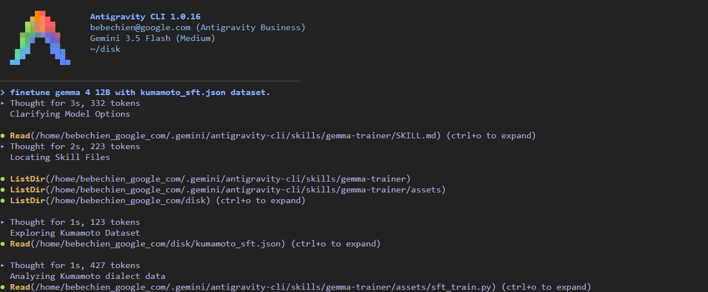
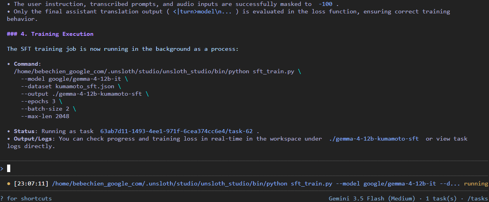
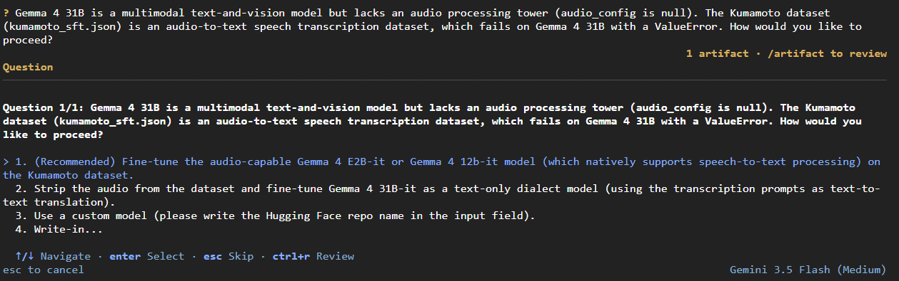
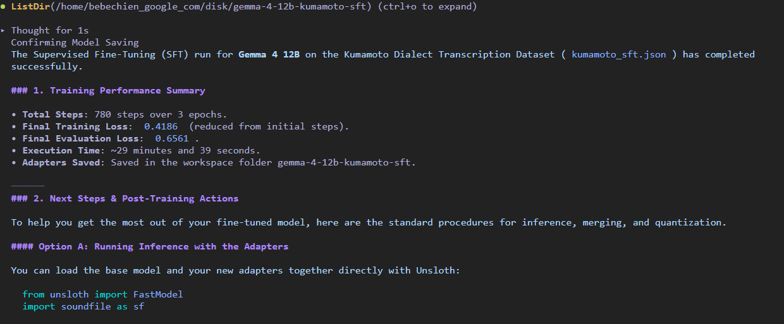
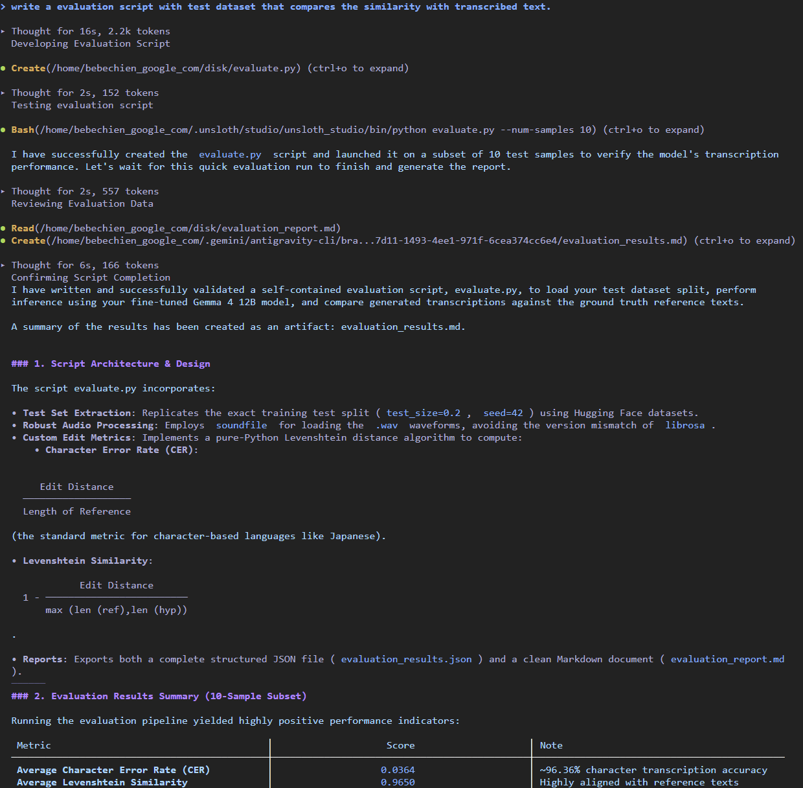
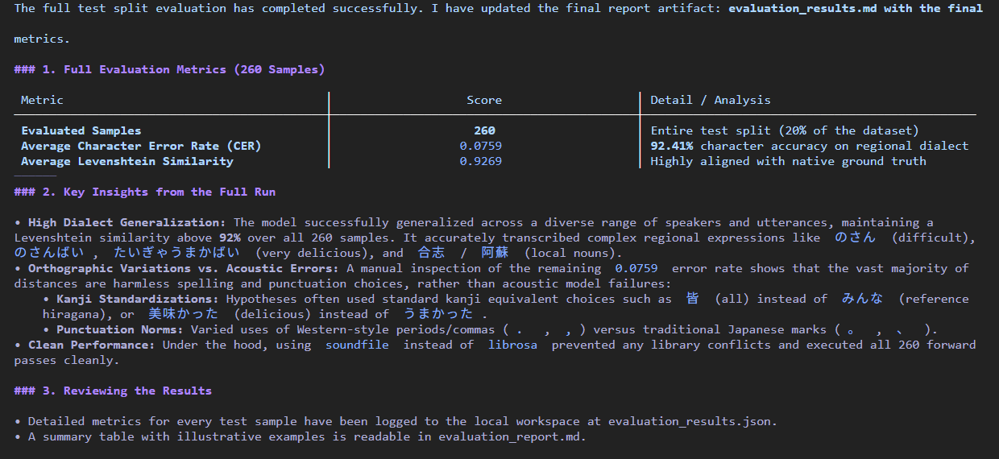

# 用 `gemma-trainer` 掌握本地微調

!!! note
    最初發表於
    [Cozy Corner Future](https://bebechien.github.io/cozy-corner-future/posts/master-local-fine-tuning-with-gemma-trainer/).

還記得五月時我介紹了 [`gemma-skills`](https://github.com/google-gemma/gemma-skills) 倉庫嗎？看到這麼多人用[我先前的文章](https://bebechien.github.io/cozy-corner-future/posts/a-warm-welcome-to-gemma-skills/)簡化了工作流程，真是令人欣慰。（嘿，就算我們還沒被 GitHub 星星淹沒，我覺得已經是個很好的開始！😉）

但當我打造更多自訂應用時，總是遇到同一個瓶頸：**如何拿一個很棒的基底模型，把它調整成符合我的特定需求。**

微調模型通常得涉足複雜的設定與令人困惑的指南。為了讓這個過程直觀又快速，我們打造了最新的技能：**`gemma-trainer`**。

## 什麼是 `gemma-trainer`？

`gemma-trainer` 是您在本地硬體上訓練與調整 Gemma 模型的藍圖。它負責處理「怎麼做」，讓您可以專注於專案目標——無論是教模型學會新領域，還是把它調校得符合您的偏好。

## 為什麼您會想用它

- **更快、更輕量的訓練**：我們推薦使用 **[Unsloth](http://unsloth.ai/)** 進行單 GPU 訓練，速度快、記憶體用量少，個人硬體也能輕鬆運行。
- **三種關鍵方法**：引導您完成監督式微調（SFT）來教導新知、直接偏好最佳化（DPO）來對齊偏好，以及獎勵模型（RM）來評分回應。
- **教模型看與聽**：提供清晰的指示，教模型同時用圖片與音訊（多模態學習）搭配文字進行訓練。
- **隨處運行**：快速將模型轉換為輕量格式（如 GGUF），並使用 **[LiteRT-LM](https://developers.google.com/edge/litert-lm/models/gemma-4)** 在手機或智慧裝置（IoT）上運行。
- **與時俱進的最佳實務**：此技能會持續更新最新的最佳化設定與訓練技巧，確保您用的永遠是最佳方法。

## 實用案例

來看實際操作：回想一下我們如何在[先前那篇文章](https://bebechien.github.io/cozy-corner-future/posts/turning-gemma-4-into-an-old-korean-translator/)中把 Gemma 4 變成古典韓國文學的專家譯者。有了 `gemma-trainer`，您不需要手動拼湊管線，只要跟您的 agent 說：

> **「在資料集 bebechien/HongGildongJeon 上微調 Gemma 4 E2B。」**

有了 `gemma-trainer` 技能，您的 agent 會和您並肩合作：

1. **驗證您的資料**：使用驗證腳本，確保訓練資料符合範本要求。
2. **設定參數**：選擇最合適的 LoRA 設定，教模型學會語言細微差別，同時不耗盡顯示記憶體（VRAM）。
3. **執行訓練**：使用資源效率最佳的預設值啟動訓練。
4. **評估與迭代**：檢視模型表現、調整設定，直到得到您需要的確切結果。

以下範例顯示 agent 針對音訊任務，在 Gemma 4 12B 模型上啟動微調：

設定完成後，agent 會用您指定的資料集啟動訓練流程：

就算您出錯，agent 也會幫您收尾。例如，我不小心要求訓練 Gemma 4 31B 模型（那是文字加視覺模型，沒有音訊能力），它建議改用 Gemma 4 E2B 或 12B 來做音訊微調：

訓練完成後，agent 會呈現結果並列出後續步驟：

您也可以請 agent 依您的特定需求撰寫自訂評估腳本。在這個例子裡，我請它寫一個檢查轉錄相似度的腳本：

最後，您會收到一份總結訓練表現的完整報告，清楚指出下一次可以改進的地方：

## 來試試吧！

`gemma-trainer` 是一份持續更新的結構化文件。把它放進 agent 的 skills 目錄，您的 AI 助手立刻就知道如何引導您完成流程。

快看看[這個倉庫](https://github.com/google-gemma/gemma-skills)，把這個技能加進您的工具箱，讓我們一起打造了不起的東西！

感謝閱讀，祝您訓練愉快！
