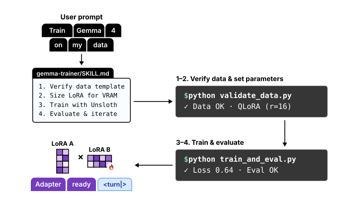

# Gemma trainer 技能

來自 [`google-gemma/gemma-skills`][gemma-skills-repo] 的 **`gemma-trainer`** 技能，讓 Gemini CLI、Claude Code、Cursor 與 Antigravity 等 AI 程式撰寫代理掌握 Gemma 4 微調的最新實務知識。您不用再從零拼湊樣板程式碼，只要用淺白的英文描述資料集與目標，代理就會驗證資料格式、依您的 GPU 調整超參數、執行訓練並評估結果。

---

## 1. 安裝技能

把 `gemma-trainer` 安裝到程式撰寫代理的 skills 目錄：

=== "skills CLI"

    ```bash
    # Install the gemma-trainer skill from google-gemma/gemma-skills
    npx skills add google-gemma/gemma-skills --skill gemma-trainer
    ```

=== "Antigravity CLI"

    ```bash
    # Install the full Gemma Skills bundle
    agy plugin install https://github.com/google-gemma/gemma-skills
    ```

如需瞭解如何列出與管理倉庫中的其他技能（例如 `gemma-dev`），請參閱 [Gemma Skills](../resources/gemma-skills.md)。

---

## 2. 技能如何運作

當您請程式撰寫代理微調 Gemma 4 模型時，`gemma-trainer` 會在訓練前後引導整個工作階段經過四個階段：



1. **驗證資料集與範本**：檢查本機的 `JSONL`、`CSV`、`Parquet` 或 Hugging Face 資料集，用 `<|turn>` 與 `<turn|>` 格式化對話輪次，並啟用僅完成損失遮罩，讓提示詞 token 不會稀釋權重更新。
2. **配對模型與 GPU 記憶體**：檢查可用的顯示記憶體，選擇相容的 Gemma 4 檢查點（自動捕捉模態不符的情況，例如把語音任務導向具備音訊能力的 `E2B`、`E4B` 或 `12B`，而非文字加視覺的 `26B A4B` 或 `31B`），並在啟動前提出 LoRA 秩、批次大小與學習率供您確認。
3. **執行訓練配方**：產生乾淨的獨立 Python 訓練指令碼——單 GPU 快速執行用 [Unsloth](unsloth.md)，自訂設定與多 GPU [擴展](scaling.md)則用 Hugging Face TRL 與 PEFT——並追蹤訓練與驗證損失。
4. **評估與匯出**：在保留的範例上執行訓練前後的評估，並把轉接器或合併後的檢查點匯出至 Hugging Face、`GGUF` 或 `LiteRT-LM`。

---

## 3. 支援的工作流程

`gemma-trainer` 涵蓋本文件套組中完整的後訓練生命週期：

| 目標 | 功能 | 指南 |
| :--- | :--- | :--- |
| **新語言** | 用重播混合打包原始領域文字，避免遺忘 | [持續預訓練](continued-pretraining.md) |
| **自訂格式** | 設定自訂聊天範本或單一 token 路由標籤 | [自訂聊天範本](custom-chat-template.md) · [未使用詞元](unused-tokens.md) |
| **任務微調** | 在單一 GPU 上訓練輕量 LoRA 或 4 位元 QLoRA 轉接器 | [(Q)LoRA](qlora.md) |
| **全權重調整** | 使用記憶體效率佳的 8 位元 AdamW 更新所有模型權重 | [完整微調](full-finetune.md) |
| **MoE 微調** | 調整全部 128 個路由專家，同時保持路由器凍結 | [MoE 微調](moe-finetune.md) |
| **視覺任務** | 從圖片、收據與文件擷取結構化資料 | [視覺微調](vision-qlora.md) |
| **音訊任務** | 微調語音轉錄與音訊理解 | [音訊微調](audio-qlora.md) |
| **風格與語氣** | 依選擇與拒絕的偏好配對對齊回應 | [偏好最佳化](preference-alignment.md) |
| **可驗證任務** | 以數學或程式碼的簡潔推理與精確答案獲得獎勵 | [可驗證獎勵](reinforcement-learning.md) |
| **擴展與匯出** | 分割多 GPU 執行，並匯出至 vLLM、GGUF 或 LiteRT-LM | [擴展](scaling.md) · [匯出](export.md) |

---

## 4. 範例提示詞

安裝完成後，直接在專案資料夾中向程式撰寫代理下提示詞：

- **本機資料監督式微調**：
  > *"Fine-tune Gemma 4 E4B on `./data/support_tickets.jsonl` to classify ticket priority and draft concise replies. Validate the dataset first and size QLoRA for a 24 GB GPU."*
- **多模態視覺擷取**：
  > *"Train Gemma 4 E2B to extract structured JSON line items from the receipt images in `./invoices/` and evaluate exact-match accuracy before and after training."*
- **可驗證獎勵推理**：
  > *"Run GRPO on Gemma 4 E2B using my SQL benchmark so it reasons inside `<|thought>` blocks and gets rewarded when queries execute and match the expected rows."*
- **裝置端匯出**：
  > *"Merge my trained Gemma 4 E2B LoRA adapter and convert it to GGUF Q4_K_M and LiteRT-LM for mobile deployment."*

---

## 接下來

<div class="card-grid">
<a class="card" href="index.md">
  <span class="card-icon">{{ icon('lucide/graduation-cap') }}</span>
  <div class="card-title">微調總覽</div>
  <p class="card-desc">探索互動式管線地圖，選擇訓練階段、方法與檢查點。</p>
</a>
<a class="card" href="qlora.md">
  <span class="card-icon">{{ icon('lucide/sliders-horizontal') }}</span>
  <div class="card-title">(Q)LoRA</div>
  <p class="card-desc">逐步瞭解 LoRA 微調背後的 Hugging Face TRL 與 PEFT 程式碼。</p>
</a>
<a class="card" href="unsloth.md">
  <span class="card-icon">{{ icon('lucide/zap') }}</span>
  <div class="card-title">Unsloth</div>
  <p class="card-desc">換用 Unsloth 的融合核心，在 16–40 GB GPU 上加快單 GPU 訓練。</p>
</a>
<a class="card" href="export.md">
  <span class="card-icon">{{ icon('lucide/rocket') }}</span>
  <div class="card-title">匯出</div>
  <p class="card-desc">把微調後的模型匯出為 vLLM、GGUF 或 LiteRT-LM 以便部署。</p>
</a>
</div>

--8<-- "glossary.md"
