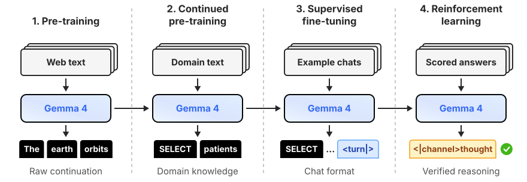
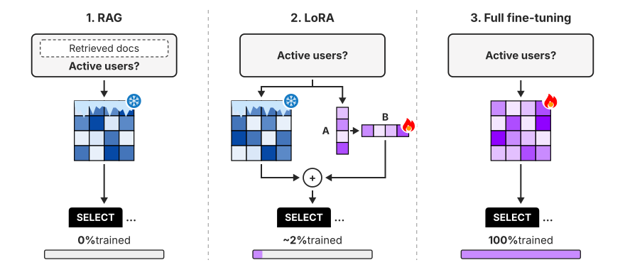
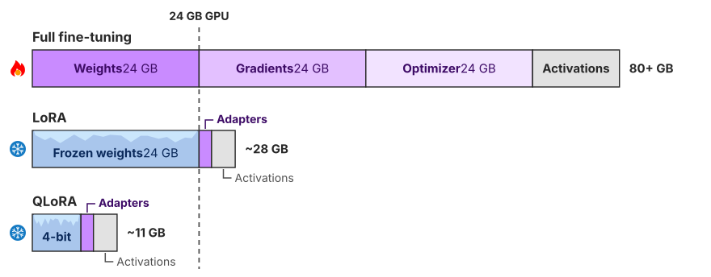
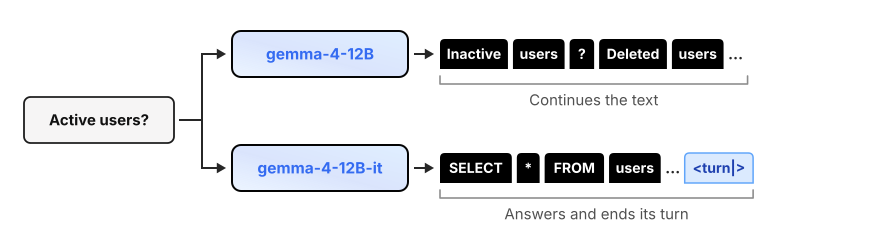

# 微調總覽

Gemma 4 能推理問題、呼叫工具，也能理解圖片與音訊。微調可以教它原本不知道的事物，例如特定領域的術語、新語言或語料，以及超出其現有技能範圍的能力。這組頁面將引導您完成微調，從持續預訓練與監督式微調，一路到強化學習與多 GPU 訓練。

微調並不簡單，很快就可能讓人不知所措。本頁協助您找到方向，首先是一張地圖，呈現依特定任務微調 Gemma 4 時常見的路徑。

<div class="tmap" id="gemma-tuning-map">
  <div class="tmap-canvas">
    <div class="tmap-stage">
      <div class="tmap-stage__meta">
        <span class="tmap-pill">基礎</span>
        <span class="tmap-stage__name">訓練前</span>
        <span class="tmap-stage__hint">模型、設定、輪次遮罩</span>
      </div>
      <div class="tmap-nodes">
        <a class="tmap-node" data-guide="best-practices" href="best-practices.md">
          <div class="tmap-node__top"><span class="tmap-node__title">最佳實務</span></div>
          <span class="tmap-node__desc">選擇模型大小、學習率與資料集設定。</span>
        </a>
        <a class="tmap-node" data-guide="datasets-formatting" href="datasets-formatting.md">
          <div class="tmap-node__top"><span class="tmap-node__title">資料集格式</span></div>
          <span class="tmap-node__desc">格式化對話輪次，並把提示詞 token 排除在損失計算之外。</span>
        </a>
      </div>
    </div>

    <div class="tmap-stage">
      <div class="tmap-stage__meta">
        <span class="tmap-pill">階段 1</span>
        <span class="tmap-stage__name">基底模型</span>
        <span class="tmap-stage__hint">預訓練檢查點（無 -it）</span>
      </div>
      <div class="tmap-nodes">
        <a class="tmap-node" data-guide="continued-pretraining" href="continued-pretraining.md">
          <div class="tmap-node__top"><span class="tmap-node__title">持續預訓練</span></div>
          <span class="tmap-node__desc">用 10% 重播緩衝打包未標註的領域文字。</span>
        </a>
        <a class="tmap-node" data-guide="custom-chat-template" href="custom-chat-template.md">
          <div class="tmap-node__top"><span class="tmap-node__title">自訂聊天範本</span></div>
          <span class="tmap-node__desc">用 ChatML 把基底檢查點變成對話模型。</span>
        </a>
      </div>
    </div>

    <div class="tmap-stage">
      <div class="tmap-stage__meta">
        <span class="tmap-pill">階段 2</span>
        <span class="tmap-stage__name">監督式微調</span>
        <span class="tmap-stage__hint">任務、模態、自訂 token</span>
      </div>
      <div class="tmap-nodes tmap-nodes--three">
        <a class="tmap-node" data-guide="qlora" href="qlora.md">
          <div class="tmap-node__top"><span class="tmap-node__title">(Q)LoRA</span></div>
          <span class="tmap-node__desc">在單一 GPU 上訓練 4 位元或 16 位元轉接器。</span>
        </a>
        <a class="tmap-node" data-guide="full-finetune" href="full-finetune.md">
          <div class="tmap-node__top"><span class="tmap-node__title">完整微調</span></div>
          <span class="tmap-node__desc">以 8 位元 AdamW 在 bfloat16 下更新每一個權重。</span>
        </a>
        <a class="tmap-node" data-guide="moe-finetune" href="moe-finetune.md">
          <div class="tmap-node__top"><span class="tmap-node__title">MoE 微調</span></div>
          <span class="tmap-node__desc">調整全部 128 個路由專家，同時保持路由器凍結。</span>
          <div class="tmap-node__tags"><span class="tmap-tag">僅限 26B A4B</span></div>
        </a>
        <a class="tmap-node" data-guide="vision-qlora" href="vision-qlora.md">
          <div class="tmap-node__top"><span class="tmap-node__title">視覺微調</span></div>
          <span class="tmap-node__desc">用軟 token 預算，在圖片、收據與文件上訓練。</span>
        </a>
        <a class="tmap-node" data-guide="audio-qlora" href="audio-qlora.md">
          <div class="tmap-node__top"><span class="tmap-node__title">音訊微調</span></div>
          <span class="tmap-node__desc">以 bfloat16 LoRA 訓練語音轉錄。</span>
          <div class="tmap-node__tags"><span class="tmap-tag">僅限 E2B、E4B、12B</span></div>
        </a>
        <a class="tmap-node" data-guide="unused-tokens" href="unused-tokens.md">
          <div class="tmap-node__top"><span class="tmap-node__title">未使用詞元</span></div>
          <span class="tmap-node__desc">把路由或來源標籤對應到單一保留 token 位置。</span>
        </a>
      </div>
    </div>

    <div class="tmap-stage">
      <div class="tmap-stage__meta">
        <span class="tmap-pill">階段 3</span>
        <span class="tmap-stage__name">強化學習</span>
        <span class="tmap-stage__hint">偏好、可驗證獎勵</span>
      </div>
      <div class="tmap-nodes">
        <a class="tmap-node" data-guide="preference-alignment" href="preference-alignment.md">
          <div class="tmap-node__top"><span class="tmap-node__title">偏好最佳化</span></div>
          <span class="tmap-node__desc">以選擇與拒絕的配對形塑風格與簡潔度。</span>
        </a>
        <a class="tmap-node" data-guide="reinforcement-learning" href="reinforcement-learning.md">
          <div class="tmap-node__top"><span class="tmap-node__title">可驗證獎勵</span></div>
          <span class="tmap-node__desc">用 GRPO 獎勵檢查提升數學、程式碼或 SQL 的準確度。</span>
        </a>
      </div>
    </div>

    <div class="tmap-stage">
      <div class="tmap-stage__meta">
        <span class="tmap-pill">階段 4</span>
        <span class="tmap-stage__name">部署</span>
        <span class="tmap-stage__hint">多 GPU 分割、服務</span>
      </div>
      <div class="tmap-nodes">
        <a class="tmap-node" data-guide="scaling" href="scaling.md">
          <div class="tmap-node__top"><span class="tmap-node__title">擴展</span></div>
          <span class="tmap-node__desc">以 FSDP2 分割多 GPU 執行，並用 QAT 恢復 4 位元準確度。</span>
        </a>
        <a class="tmap-node" data-guide="export" href="export.md">
          <div class="tmap-node__top"><span class="tmap-node__title">匯出</span></div>
          <span class="tmap-node__desc">以 vLLM、GGUF、Ollama 或 LiteRT-LM 提供合併後的檢查點。</span>
        </a>
        <a class="tmap-node" data-guide="unsloth" href="unsloth.md">
          <div class="tmap-node__top"><span class="tmap-node__title">Unsloth</span></div>
          <span class="tmap-node__desc">加速單 GPU 4 位元執行，並直接匯出為 GGUF。</span>
        </a>
        <a class="tmap-node" data-guide="gemma-trainer" href="gemma-trainer.md">
          <div class="tmap-node__top"><span class="tmap-node__title">Gemma trainer</span></div>
          <span class="tmap-node__desc">讓程式撰寫代理設定、執行並評估本機工作。</span>
        </a>
      </div>
    </div>
  </div>
</div>

!!! example "使用程式撰寫代理？"

    安裝 [gemma-trainer](gemma-trainer.md) 技能，讓代理為您準備資料、依 GPU 選擇設定並執行微調：

    ```bash
    npx skills add google-gemma/gemma-skills --skill gemma-trainer --global
    ```

---

## 1. 四個訓練階段

LLM 通常分階段訓練。在每個階段，模型接觸的資料種類不同，專注的任務也不同：



各階段的情況如下：

1. **預訓練**：模型在大量的網路文字、程式碼、圖片與音訊語料上訓練，以預測下一個 token。產生的預訓練檢查點可以接續您給它的任何文件，但不會遵循指示。
2. **持續預訓練**：您繼續在所屬領域的原始文字上訓練，例如醫學文獻、新語言或內部程式碼庫。模型會學到領域知識、術語與表達方式。請參閱[持續預訓練](continued-pretraining.md)。
3. **監督式微調**：您用範例對話訓練，每組對話都把提示詞與您想要的確切回應配對。請參閱 [(Q)LoRA](qlora.md) 與[完整微調](full-finetune.md)。
4. **強化學習**：模型不是模仿單一目標答案，而是從評分過的輸出中學習。在偏好最佳化中，模型比較選擇與拒絕的答案；使用可驗證獎勵時，獎勵函式會為模型產生的每個答案評分。請參閱[偏好最佳化](preference-alignment.md)與[可驗證獎勵](reinforcement-learning.md)。

您很少需要全部四個階段。多數團隊從指令微調（`-it`）檢查點開始，該檢查點已能遵循指示，再於其上執行監督式微調或強化學習。

---

## 2. RAG、LoRA 或完整微調

開始訓練前，先問自己是否真的需要更新權重；如果需要，是否需要更新模型的全部權重。



改善模型一般有三種方法：

- **RAG**（*檢索增強生成*）：不動模型權重，直接把檢索到的文件注入提示詞。
- **LoRA**（*低秩適應*）：凍結基底模型，在每一層旁邊訓練兩個小型低秩矩陣，只更新約 1% 至 2% 的參數。**QLoRA**（*量化低秩適應*）使用完全相同的轉接器技術，同時以 4 位元精度儲存凍結的基底權重，以節省 GPU 記憶體。
- **完整微調**：在反向傳播期間解凍並更新 100% 的模型權重。

用下表依目標選擇合適的方法：

| 目標 | 方法 | 原因 |
| :--- | :--- | :--- |
| 經常變動的事實，例如即時庫存或使用者記錄 | **RAG** | 更新搜尋索引只需幾秒。權重應該學習技能，而非變動的事實。 |
| 新語言或大型領域語料 | **持續預訓練** | 在指令微調前先以原始文字訓練，有助於深層的領域轉換。 |
| 新的輸出格式、人格、工具結構描述或任務技能 | **監督式微調** | 小型轉接器能用適量的對話資料集，在單一 GPU 上學會新行為。 |
| 把大型模型的推理能力遷移至 E2B 或 E4B | **監督式微調**  | 用 31B 產生的推理軌跡訓練精簡模型。 |
| 嚴格的正確性，例如可驗證的程式碼、數學或 SQL | **強化學習** | 偏好配對或獎勵函式能抓到監督式微調遺漏的錯誤。 |

!!! tip "結合 RAG 與 LoRA"
    RAG 與微調能很好地互補。常見的模式是先用 LoRA 微調 Gemma 4，讓它學會您的領域知識，再用 RAG 提供更新的資訊。

---

## 3. GPU 記憶體

訓練需要的 GPU 記憶體遠多於推論。對於每個要訓練的參數，GPU 必須儲存三個值：

- **權重本身**：每個參數在 `bfloat16` 下佔 2 個位元組。
- **梯度**：權重在反向傳播期間應改變的幅度，另外 2 個位元組。
- **最佳化器狀態**：AdamW 這類最佳化器會為每個受訓權重追蹤兩個移動平均值。8 位元最佳化器佔 2 個位元組，32 位元精度則佔 8 個位元組。

除此之外還有**活化值**，也就是前向傳播過程中保留在記憶體裡的中間值，用於在反向傳播期間計算梯度。

綜合以上，套用至 **Gemma 4 12B** 時的概況如下：



每種方法改變這些元件的記憶體用量：

如您所見，不同訓練技術需要的顯示記憶體量不同。下表顯示全部五種 Gemma 4 模型在序列長度 2,048 個 token 時的 GPU 記憶體（VRAM）峰值：

<table>
<thead>
<tr>
<th>模型</th>
<th>參數</th>
<th>QLoRA</th>
<th>完整微調</th>
</tr>
</thead>
<tbody>

<tr>
<td>{{ size.full_name }}</td>
<td>{{ size.parameters }}</td>
<td>{{ size.training_memory.qlora_unsloth }}</td>
<td>{{ size.training_memory.full_bf16 }}</td>
</tr>

</tbody>
</table>

---

## 4. 預訓練或指令微調

每種 Gemma 4 模型大小都有兩種檢查點：

- **預訓練**（無後綴），例如 `google/gemma-4-12B`。
- **指令微調**（`-it` 後綴），例如 `google/gemma-4-12B-it`。

預訓練模型只受過接續文件的訓練，一般不會回應指示。相對地，指令微調模型會遵循指示、知道何時停止，也能分辨使用者輪次與模型輪次。



因此，`google/gemma-4-12B-it` 是從預訓練的 `google/gemma-4-12B` 檢查點微調而來的檢查點。多數情況下，使用者會從 `google/gemma-4-12B-it` 開始再進一步微調。

選擇檢查點時可參考以下經驗法則：

- **幾乎所有情況都從 `-it` 檢查點開始**：監督式微調、工具使用、視覺與音訊微調、DPO 及 GRPO 都使用 `-it` 檢查點。您是在現有的指令遵循行為之上繼續建構，而非從頭教起。
- **持續預訓練或自訂對話格式時從預訓練檢查點開始**：想用大量資料訓練、新增領域或語言，或加入自己的聊天範本時，使用預訓練檢查點。這需要大量運算，因為一般涉及大量資料，才能完成完整微調的各個階段（持續預訓練、監督式微調、強化學習等）。

---

## 5. 訓練框架

Gemma 4 開箱即用，可搭配生態系中常用的各種工具：

<!-- Generated from data/frameworks.yml -- edit that file, not this grid. -->



<ul class="engine-grid engine-grid--detailed">



  <li><a class="engine" href="../{{ page }}{{ path.url }}"
         target="_blank" rel="noopener"
          data-model="{{ path.pinned }}">
    <span class="engine-mark" aria-hidden="true">
      {{ icon(fw.icon, 'engine-logo') }}{{ path.get('mark') or fw.mark }}
    </span>
    <span class="engine-body">
      <span class="engine-name">{{ path.label }} ↗</span>
      <span class="engine-blurb">{{ path.blurb }}</span>
    </span>
  </a></li>

</ul>


{{ paths(["transformers-peft", "unsloth-gemma4", "axolotl", "vertex-ai", "gke"]) }}

---

## 接下來

<div class="card-grid">
<a class="card" href="best-practices.md">
  <span class="card-icon">{{ icon('lucide/sliders-horizontal') }}</span>
  <div class="card-title">最佳實務</div>
  <p class="card-desc">比較五種 Gemma 4 模型，選擇學習率與資料集設定。</p>
</a>
<a class="card" href="datasets-formatting.md">
  <span class="card-icon">{{ icon('lucide/braces') }}</span>
  <div class="card-title">資料集格式</div>
  <p class="card-desc">格式化對話輪次、遮罩提示詞 token，並用思考 token 訓練。</p>
</a>
<a class="card" href="qlora.md">
  <span class="card-icon">{{ icon('lucide/zap') }}</span>
  <div class="card-title">(Q)LoRA</div>
  <p class="card-desc">用 TRL 與 PEFT 在單一 GPU 上執行第一個微調工作。</p>
</a>
<a class="card" href="moe-finetune.md">
  <span class="card-icon">{{ icon('lucide/split') }}</span>
  <div class="card-title">MoE 微調</div>
  <p class="card-desc">用 Split-LoRA、分組 GEMM 與凍結路由器微調 26B A4B 模型。</p>
</a>
</div>
