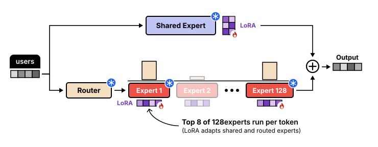
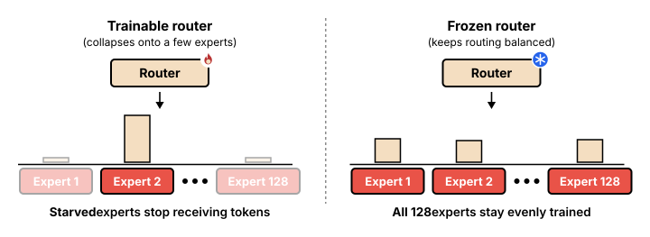
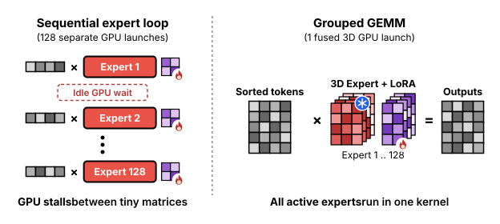
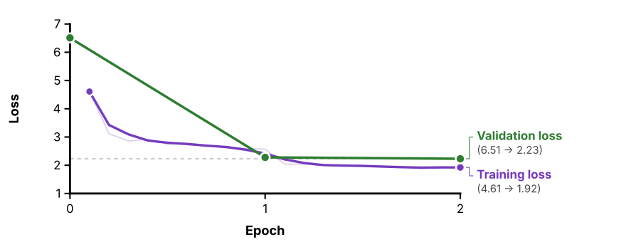

# MoE 微調

Gemma 4 26B A4B 是混合專家（MoE）模型，共有 26B 個參數，但每個詞元只會啟用其中 4B 個參數。

與稠密模型相比，訓練混合專家模型有兩個重點需要注意。第一，必須保持路由器凍結，以免它把每個詞元都送到相同的少數專家。第二，應該針對融合的 3D 專家張量，讓全部 128 個路由專家都收到 LoRA 更新。

---

## 1. 混合專家

在 Gemma 4 12B 或 31B 這類稠密模型中，每個詞元都會經過相同的前饋網路。而在 Gemma 4 26B A4B 中，每一層會把這個步驟拆成兩條平行路徑：

1. **共用專家**：一個始終啟用的 MLP，會處理每個詞元。
2. **路由專家**：由路由器控制的 128 個較小型 MLP 集合，會為每個詞元挑選 8 個專家。



使用 LoRA 微調 26B A4B 時，你會把 LoRA 轉接器掛到共用專家與 128 個路由專家上。路由器本身則保持凍結。

---

## 2. 凍結路由器

在數兆個詞元的預訓練期間，路由器學會了把工作平均分配到全部 128 個專家上。在小型資料集上微調可能會打亂這種路由：

1. **訓練路由器會造成崩潰**：如果在訓練期間只有少數專家經常被選中，那麼只有這些專家會繼續收到更新，其餘專家則得不到訓練。
2. **4 位元量化與 16 位元精度**：由於容量分散在 128 個較小的專家矩陣上，把它們全部四捨五入為 4 位元 NF4，會造成輕微的啟用值偏移，進而改變後續層中路由器的選擇。



---

## 3. 使用分組 GEMM 加速訓練

Gemma 4 26B A4B 把 128 個路由專家儲存為融合的 3D 參數張量（`experts.gate_up_proj` 與 `experts.down_proj`），而不是 128 個獨立的線性層。

如果訓練器逐一遍歷全部 128 個專家，GPU 大多數時間都在等待。分組矩陣乘法（grouped GEMM）會依專家 ID 對詞元排序，並在單次 GPU 啟動中執行所有啟用的專家：



把所有啟用的專家批次處理到單次啟動中，可以讓 GPU 保持忙碌，而不必在每個專家之間等待。

---

## 4. 設定環境

我們要在 [google/smol](https://huggingface.co/datasets/google/smol) 基準上微調 `google/gemma-4-26B-A4B-it`，涵蓋五種低資源原住民與非洲語言（**克丘亞語**、**瓜拉尼語**、**埃維語**、**阿坎語**與**班巴拉語**）。26B A4B 開箱即用就能流暢翻譯高資源語言，但在低資源語言上經常留下未翻譯的英文片語，或陷入重複迴圈。讓全部 128 個路由專家都參與適應，可以讓模型在單張 GPU 上同時針對全部五種語言進行專門化。

首先，安裝訓練後處理與評估函式庫：

```python { .notebook-cell }
# Install Hugging Face post-training, quantization, multimodal, and evaluation libraries
%pip install -q -U "transformers>=5.10.1" "trl>=0.16.0" "peft>=0.19.0" accelerate datasets bitsandbytes torchao
%pip install -q -U evaluate sacrebleu jiwer pillow soundfile librosa matplotlib tensorboard
```

如果你打算把訓練好的轉接器推送到 Hugging Face Hub，請使用寫入權杖登入：

```python { .notebook-cell }
from huggingface_hub import login

# Optional: uncomment to push your trained adapter to the Hugging Face Hub
# login()
```

---

## 5. 準備資料集

接下來載入資料，也就是 [google/smol](https://huggingface.co/datasets/google/smol)，其中包含五種低資源語言的翻譯配對。我們選擇其中一個子集 `smolsent`，它包含多種語言的句子，可以讓我們選出這五種低資源語言。我們會保留 4,000 個訓練範例與 315 個保留的測試範例：

```python { .notebook-cell }
from datasets import concatenate_datasets, load_dataset

LANGUAGES = {
    "smolsent__en_qu": "Quechua",
    "smolsent__en_gn": "Guarani",
    "smolsent__en_ee": "Ewe",
    "smolsent__en_ak": "Akan",
    "smolsent__en_bm": "Bambara",
}


# Format each translation pair into prompt and completion turns
def to_chat(sample, lang):
    return {
        "prompt": [
            {
                "role": "system",
                "content": (
                    f"You are a fluent {lang} translator. Translate the user's "
                    f"English sentence into natural {lang}. Output only the translation."
                ),
            },
            {"role": "user", "content": sample["src"]},
        ],
        "completion": [{"role": "assistant", "content": sample["trg"]}],
    }


# Build non-overlapping training (rows 0..799) and held-out test (rows 800+) splits
train_parts, eval_parts, test_by_lang = [], [], {}
for subset, lang in LANGUAGES.items():
    ds = load_dataset("google/smol", subset, split="train")
    formatted = ds.map(lambda row: to_chat(row, lang), remove_columns=ds.column_names)
    train_parts.append(formatted.select(range(800)))
    eval_parts.append(formatted.select(range(800, len(formatted))))
    test_by_lang[lang] = formatted.select(range(800, 820))

train_dataset = concatenate_datasets(train_parts).shuffle(seed=3407)
eval_dataset = concatenate_datasets(eval_parts)
print(f"Train size: {len(train_dataset)} | Eval size: {len(eval_dataset)}")
```

```{ .no-copy .output }
Train size: 4000 | Eval size: 315
```

---

## 6. 載入模型

要把低秩轉接器掛到全部 128 個專家上，我們載入模型，並把 `target_parameters` 設為 `"experts.gate_up_proj"` 與 `"experts.down_proj"`。這些代表專家本身，可以確保路由器保持凍結。

!!! tip "使用 24–40 GB GPU 嗎？"
    標準的 `bitsandbytes` 4 位元量化會跳過融合的 3D 專家張量，因此這個 `bfloat16` Hugging Face 設定需要約 56 GB 的 VRAM（80 GB GPU，或透過 [FSDP2](scaling.md) 使用多張 GPU）。要在單張 24–40 GB GPU 上以約 21 GB 訓練 `26B A4B`，請把這個載入儲存格換成 [使用 Unsloth 微調](unsloth.md)中的 `FastVisionModel(..., load_in_4bit=True)`，其餘筆記本內容保持不變。

```python { .notebook-cell }
import torch
from transformers import AutoModelForMultimodalLM, AutoProcessor
from peft import LoraConfig, get_peft_model

model_id = "google/gemma-4-26B-A4B-it"

# Load the 26B A4B model in bfloat16 and its processor
model = AutoModelForMultimodalLM.from_pretrained(
    model_id,
    dtype=torch.bfloat16,
    device_map="auto",
)
processor = AutoProcessor.from_pretrained(model_id)

# Attach LoRA to attention, the shared expert, and all 128 routed 3D expert tensors
peft_config = LoraConfig(
    r=16,
    lora_alpha=32,
    lora_dropout=0.0,
    bias="none",
    target_modules=[
        "q_proj",
        "k_proj",
        "v_proj",
        "o_proj",
        "gate_proj",
        "up_proj",
        "down_proj",
    ],
    target_parameters=[
        "experts.gate_up_proj",
        "experts.down_proj",
    ],
    exclude_modules=r"(model\.(vision_tower|audio_tower)\..*|.*router.*)",
    task_type="CAUSAL_LM",
)
model = get_peft_model(model, peft_config)
```

我們可以驗證路由器（`router.proj`）已凍結，而注意力與專家轉接器是可訓練的：

```python { .notebook-cell }
# Confirm that 0 router parameters are marked trainable
trainable_params = sum(p.numel() for p in model.parameters() if p.requires_grad)
all_params = sum(p.numel() for p in model.parameters())
router_trainable = [n for n, p in model.named_parameters() if p.requires_grad and "router" in n]

print(f"Trainable params: {trainable_params:,} / {all_params:,} ({100 * trainable_params / all_params:.2f}%)")
print(f"Trainable router parameters (must be 0): {len(router_trainable)}")
```

```{ .no-copy .output }
Trainable params: 494,376,960 / 26,300,310,832 (1.88%)
Trainable router parameters (must be 0): 0
```

如你所見，模型只有一小部分參數是可訓練的，而路由器的參數完全無法訓練。

---

## 7. 評估基礎模型

在訓練之前，我們先建立基準：在 100 個保留的測試句子（每種語言 20 句）上進行評估，使用 `evaluate.load("chrf")`（字元 n-gram F 分數，是形態豐富的低資源語言的標準指標）。由於 LoRA 會把輸出矩陣 `B` 初始化為零，在 `trainer.train()` 之前執行推論，評估的就是未經修改的基礎模型：

```python { .notebook-cell }
import evaluate

# Load the standard chrF translation metric
chrf = evaluate.load("chrf")
stop_ids = [processor.tokenizer.eos_token_id, processor.tokenizer.convert_tokens_to_ids("<turn|>")]


# Evaluate corpus chrF across 20 unseen test sentences per language
def evaluate_translations(tag):
    model.eval()
    orig_padding = processor.tokenizer.padding_side
    processor.tokenizer.padding_side = "left"
    all_preds, all_refs, scores = [], [], {}

    for lang, subset in test_by_lang.items():
        prompts = [
            processor.apply_chat_template(p, tokenize=False, add_generation_prompt=True)
            for p in subset["prompt"]
        ]
        refs = [c[0]["content"] for c in subset["completion"]]
        inputs = processor(text=prompts, return_tensors="pt", padding=True).to(model.device)
        with torch.no_grad():
            outputs = model.generate(
                **inputs, max_new_tokens=128, do_sample=False, eos_token_id=stop_ids, use_cache=True
            )

        prompt_len = inputs["input_ids"].shape[1]
        preds = [
            processor.decode(seq[prompt_len:], skip_special_tokens=True).split("\n")[0].strip()
            for seq in outputs
        ]
        scores[lang] = chrf.compute(predictions=preds, references=refs)["score"]
        all_preds.extend(preds)
        all_refs.extend(refs)
        print(f"  [{tag}] {lang:10s} chrF = {scores[lang]:5.2f}")

    processor.tokenizer.padding_side = orig_padding
    overall = chrf.compute(predictions=all_preds, references=all_refs)["score"]
    print(f"  [{tag}] OVERALL    chrF = {overall:5.2f}")
    return overall, scores


base_overall, base_lang = evaluate_translations("BEFORE")
```

```{ .no-copy .output }
  [BEFORE] Quechua    chrF = 28.56
  [BEFORE] Guarani    chrF = 24.23
  [BEFORE] Ewe        chrF = 19.09
  [BEFORE] Akan       chrF = 26.01
  [BEFORE] Bambara    chrF = 12.00
  [BEFORE] OVERALL    chrF = 22.02
```

這就是我們的基準。來看看能不能改善它！

---

## 8. 訓練模型

現在把模型切回訓練模式，訓練 2 個 epoch（有效批次大小為 `16` 時，共 `500` 個最佳化器步驟）：

```python { .notebook-cell }
from trl import SFTConfig, SFTTrainer

model.train()

# Set the configuration for the trainer
args = SFTConfig(
    output_dir="gemma-4-26b-a4b-smol-lora",
    max_length=512,
    num_train_epochs=2,
    per_device_train_batch_size=4,
    gradient_accumulation_steps=4,
    gradient_checkpointing=True,
    gradient_checkpointing_kwargs={"use_reentrant": False},
    optim="adamw_torch_8bit",
    learning_rate=2e-4,
    warmup_steps=0.05,
    lr_scheduler_type="cosine",
    weight_decay=0.01,
    max_grad_norm=1.0,
    bf16=True,
    logging_steps=25,
    eval_strategy="epoch",
    eval_on_start=True,
    save_strategy="epoch",
    report_to="tensorboard",
    seed=3407,
)

# Define and run the trainer
trainer = SFTTrainer(
    model=model,
    args=args,
    train_dataset=train_dataset,
    eval_dataset=eval_dataset,
    processing_class=processor.tokenizer,
)

trainer.train()
trainer.save_model()
```

```{ .no-copy .output }
[500/500 29:55, Epoch 2/2]

| Epoch | Training Loss | Validation Loss |
|---|---|---|
| 0 | — | 6.5089 |
| 1 | 2.5725 | 2.2794 |
| 2 | 1.9231 | 2.2304 |
```

<!-- notebook:skip-start -->
??? info "查看訓練曲線"
    
<!-- notebook:skip-end -->

---

## 9. 評估微調後的模型

訓練完成後，我們可以在相同的 100 個未見測試句子上重新執行 `evaluate_translations`，衡量適應共用專家與 128 個路由專家後，翻譯品質在全部五種語言上提升了多少：

```python { .notebook-cell }
# Re-evaluate chrF across the 100 unseen test sentences after fine-tuning
after_overall, after_lang = evaluate_translations("AFTER")

print("\nSummary (chrF):")
for lang in LANGUAGES.values():
    b, a = base_lang[lang], after_lang[lang]
    print(f"  {lang:10s}: {b:5.2f} -> {a:5.2f} ({a - b:+5.2f})")
print(f"  {'OVERALL':10s}: {base_overall:5.2f} -> {after_overall:5.2f} ({after_overall - base_overall:+5.2f})")
```

```{ .no-copy .output }
  [AFTER] Quechua    chrF = 36.95
  [AFTER] Guarani    chrF = 35.55
  [AFTER] Ewe        chrF = 27.98
  [AFTER] Akan       chrF = 31.16
  [AFTER] Bambara    chrF = 15.72
  [AFTER] OVERALL    chrF = 29.60

Summary (chrF):
  Quechua   : 28.56 -> 36.95 (+8.39)
  Guarani   : 24.23 -> 35.55 (+11.32)
  Ewe       : 19.09 -> 27.98 (+8.89)
  Akan      : 26.01 -> 31.16 (+5.15)
  Bambara   : 12.00 -> 15.72 (+3.73)
  OVERALL   : 22.02 -> 29.60 (+7.57)
```

整體品質提升幅度不錯，`chrF` 總分提高了 `+7.57`！


評估完成後，你可以透過 `.merge_and_unload` 把轉接器合併進模型：

<!-- notebook:skip-start -->
```python
# Merge the trained MoE LoRA adapter directly into the bfloat16 model and save
merged_model = model.merge_and_unload()
merged_model.save_pretrained("gemma-4-26b-a4b-smol-merged", safe_serialization=True, max_shard_size="4GB")
AutoProcessor.from_pretrained(model_id).save_pretrained("gemma-4-26b-a4b-smol-merged")
```
<!-- notebook:skip-end -->

---

## 接下來

<div class="card-grid">
<a class="card" href="continued-pretraining.md">
  <span class="card-icon">{{ icon('lucide/book-open') }}</span>
  <div class="card-title">持續預訓練</div>
  <p class="card-desc">使用序列打包與子詞初始化，教 Gemma 4 新的領域文字與語言。</p>
</a>
<a class="card" href="vision-qlora.md">
  <span class="card-icon">{{ icon('lucide/eye') }}</span>
  <div class="card-title">視覺微調</div>
  <p class="card-desc">在自訂文件、圖表與視覺問答資料集上微調 26B A4B。</p>
</a>
<a class="card" href="reinforcement-learning.md">
  <span class="card-icon">{{ icon('lucide/brain') }}</span>
  <div class="card-title">可驗證獎勵</div>
  <p class="card-desc">使用 GRPO 與可驗證獎勵函式，訓練 26B A4B 的思考通道。</p>
</a>
<a class="card" href="scaling.md">
  <span class="card-icon">{{ icon('lucide/boxes') }}</span>
  <div class="card-title">擴展規模</div>
  <p class="card-desc">使用 FSDP2 將 26B A4B 分片到多張 GPU，並使用 TorchAO QAT 恢復 4 位元精度。</p>
</a>
</div>

--8<-- "glossary.md"
