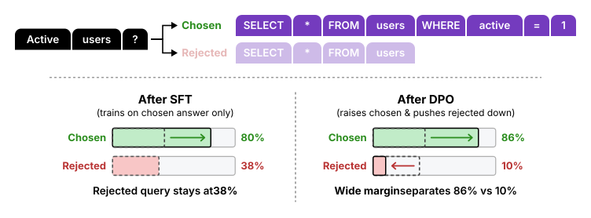
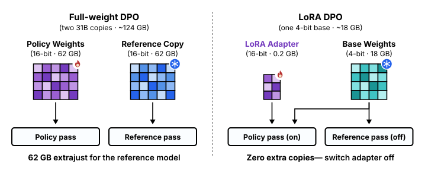
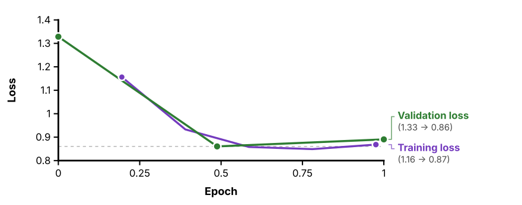

# 偏好最佳化

監督式微調（SFT）只讓 Gemma 4 知道好的答案長什麼樣子，卻沒讓它知道不好的答案長什麼樣子。因此，只用 SFT 訓練可能導致模型在該任務上過度擬合。

偏好最佳化改用配對來訓練。針對每個提示，您給模型一個偏好的答案（chosen）和一個不偏好的答案（rejected）。本指南將說明一種名為直接偏好最佳化（DPO）的強化學習技術如何從這些配對中學習、LoRA 如何避免載入第二份模型副本，以及如何用 Hugging Face TRL 端到端執行 DPO。

---

## 1. 從偏好與拒絕的答案中學習

在 SFT 中，每個訓練範例是一個提示搭配一個目標答案，損失函式會提升該答案的機率。然而，模型從未見過您希望它停止產生的答案。

直接偏好最佳化（DPO）針對一個提示搭配兩個答案進行訓練。以 SQL 助理為例：對於「Active users?」這個提示，偏好的查詢會篩選活躍使用者，而拒絕的查詢則漏了篩選條件，回傳所有使用者。


訓練期間，模型學會提高被接受答案的機率，並降低被拒絕答案的機率：



DPO 會將每次更新與起始模型的凍結副本（稱為參考模型）比較，確保模型不會偏離太遠。我們假設原始模型已經很出色、值得進一步改進，因此它不忘記原本擅長的事很重要。beta 正則化設定控制這一點：值越小，模型改變的空間越大；值越大，模型越接近原始模型。由於損失函式直接作用於您的配對，DPO 不需要獨立的獎勵模型，也不需要強化學習迴圈，因此比經典的人類回饋強化學習（RLHF；[Rafailov et al., 2023](https://arxiv.org/abs/2305.18290)）簡單得多。

---

## 2. 用 LoRA 共用參考模型

每個 DPO 步驟會對偏好與拒絕的答案各評分兩次：一次用正在訓練的模型，一次用參考模型。在完整微調中，這是 GPU 記憶體中的兩份 Gemma 4 副本。以 bfloat16 的 Gemma 4 31B 而言，僅第二份副本就佔用約 62 GB。

使用 LoRA 時，參考模型是免費的！基礎權重在訓練期間永不改變，因此關閉轉接器就能取回原始模型：



請注意，**LoRA DPO** 只有一份凍結的基礎模型與一個小型轉接器，沒有第二份副本。每個批次中，訓練器會執行模型兩次：一次開啟轉接器（可訓練的模型），一次關閉轉接器（參考模型）。

---

## 3. 在 DPO、ORPO 與 KTO 之間選擇

Hugging Face TRL 支援三種偏好方法，各有優點。請依您手邊的回饋類型選擇：

| 方法 | 需要的資料 | 參考模型傳遞 | 最適合 |
| :--- | :--- | :--- | :--- |
| **DPO** (`DPOTrainer`) | 提示、偏好與拒絕的答案 | 是，LoRA 關閉轉接器 | SFT 之後的語氣、長度與安全性 |
| **ORPO** (`ORPOTrainer`) | 提示、偏好與拒絕的答案 | 否 | 一次執行完成 SFT 與偏好對齊 |
| **KTO** (`KTOTrainer`) | 提示、完成內容與二元標籤 | 是，LoRA 關閉轉接器 | 使用者的讚與倒讚回饋 |

DPO 可以說是最常用的方法，因此我們將聚焦於此。以下設定在使用 DPO 訓練 Gemma 4 時最為關鍵：

- **學習率**：在大型同策略資料集上進行標準 LoRA DPO 時，使用 `5e-6` 至 `5e-5`（在少於 1,000 組配對的執行中使用錨定 `apo_zero` 損失時為 `5e-5` 至 `1e-4`）；完整微調則使用 `5e-7`。在未錨定的 DPO 上使用完整權重 SFT 的學習率，會很快把模型推離參考模型太遠。
- **Epoch**：通常一個 epoch 就夠了。將相同的偏好配對重複訓練第二個 epoch，會讓驗證損失上升、獎勵正確率下降，因為轉接器開始記住表面的捷徑。
- **長度去敏感化（`ld_alpha`）與 beta**：將 `beta=0.1` 作為起始的 KL 錨點。當偏好與拒絕的答案長度差異很大時（例如在異策略配對上做簡潔度對齊），將 `ld_alpha` 設為 `0.1`，讓詞元數量本身無法主導加總後的對數比率。

!!! tip "在 LoRA SFT 階段之後執行 DPO"
    當 `DPOTrainer` 以單一 LoRA 轉接器訓練（`ref_model=None`）時，它會暫時停用作用中的 LoRA 轉接器來計算參考對數機率。如果您在 SFT 期間已經訓練了一個領域 LoRA 轉接器，請先將該 SFT 轉接器合併到基礎檢查點（`model.merge_and_unload()`），再為 DPO 掛上全新的 LoRA 轉接器。

---

## 4. 設定環境

我們先安裝後訓練與評估函式庫：

```python { .notebook-cell }
# Install Hugging Face post-training, quantization, multimodal, and evaluation libraries
%pip install -q -U "transformers>=5.10.1" "trl>=0.16.0" "peft>=0.19.0" accelerate datasets bitsandbytes torchao
%pip install -q -U evaluate sacrebleu jiwer pillow soundfile librosa matplotlib tensorboard
```

如果您打算把對齊後的轉接器推送到 Hugging Face Hub，請使用寫入權杖登入：

```python { .notebook-cell }
from huggingface_hub import login

# Optional: uncomment to push your aligned adapter to the Hugging Face Hub
# login()
```

---

## 5. 準備資料集

在本範例中，我們將使用來自 [`nvidia/HelpSteer2`](https://huggingface.co/datasets/nvidia/HelpSteer2) 的人工評分簡潔度配對。這個資料集能讓模型對齊得更有幫助、事實更正確、表達更連貫。雖然各個 Gemma 模型並不需要這樣做，但它示範了如何引導風格偏好（例如降低輸出的冗長程度）而不損害品質。這個資料集包含 `helpfulness`、`correctness` 與 `verbosity` 三項分數。

為了準備偏好／拒絕配對，我們只保留正確且有幫助（`>= 3`）的答案，再將簡潔的答案（`chosen`）與過於冗長的答案（`rejected`）配對：

```python { .notebook-cell }
from collections import defaultdict
from datasets import Dataset, load_dataset

# Load HelpSteer2 and pair accurate concise answers against overly verbose ones
raw_dataset = load_dataset("nvidia/HelpSteer2")


def parse_prompt(text):
    parts = text.split("\n<extra_id_1>")
    messages = [{"role": "user", "content": parts[0].strip()}]
    for part in parts[1:]:
        role_line, content = part.split("\n", 1)
        role = "assistant" if role_line.strip().lower() == "assistant" else "user"
        messages.append({"role": role, "content": content.strip()})
    return messages


def build_concise_pairs(split_data):
    grouped = defaultdict(list)
    for row in split_data:
        grouped[row["prompt"]].append(row)

    pairs = []
    for prompt, rows in grouped.items():
        if len(rows) != 2:
            continue
        a, b = rows
        if min(a["correctness"], b["correctness"]) < 3 or min(a["helpfulness"], b["helpfulness"]) < 3:
            continue
        chosen, rejected = (a, b) if a["verbosity"] < b["verbosity"] else (b, a)
        chosen_words = len(chosen["response"].split())
        rejected_words = len(rejected["response"].split())
        if chosen["verbosity"] <= 1 and rejected["verbosity"] >= 2 and rejected_words > chosen_words:
            pairs.append(
                {
                    "prompt": parse_prompt(prompt),
                    "chosen": [{"role": "assistant", "content": chosen["response"]}],
                    "rejected": [{"role": "assistant", "content": rejected["response"]}],
                }
            )
    return Dataset.from_list(pairs)


# Build the training and validation preference splits
train_dataset = build_concise_pairs(raw_dataset["train"])
eval_dataset = build_concise_pairs(raw_dataset["validation"])

print(f"Train pairs: {len(train_dataset)} | Validation pairs: {len(eval_dataset)}")
print("Prompt:  ", train_dataset[0]["prompt"][-1]["content"][:120])
print(f"Chosen   ({len(train_dataset[0]['chosen'][0]['content'].split())} words):", train_dataset[0]["chosen"][0]["content"][:160])
print(f"Rejected ({len(train_dataset[0]['rejected'][0]['content'].split())} words):", train_dataset[0]["rejected"][0]["content"][:160])
```

```{ .no-copy .output }
Train pairs: 819 | Validation pairs: 47
Prompt:   c#
Chosen   (109 words): C# is a high-level, object-oriented programming language developed by Microsoft as part of its .NET initiative. It was created as a modern alternative to Java a
Rejected (250 words): C# (pronounced "C sharp") is a modern, object-oriented programming language developed by Microsoft. It is widely used for building various types of applications
```

---

## 6. 載入模型

建立好資料集後，接著載入要微調的模型：

```python { .notebook-cell .model-swap }
import torch
from transformers import AutoTokenizer, AutoModelForMultimodalLM, BitsAndBytesConfig
from peft import LoraConfig, PeftModel, prepare_model_for_kbit_training

model_id = "google/gemma-4-E2B-it"

# Configure 4-bit NF4 quantization
bnb_config = BitsAndBytesConfig(
    load_in_4bit=True,
    bnb_4bit_use_double_quant=True,
    bnb_4bit_quant_type="nf4",
    bnb_4bit_compute_dtype=torch.bfloat16,
    bnb_4bit_quant_storage=torch.bfloat16,
)

# Load the base model and tokenizer
model = AutoModelForMultimodalLM.from_pretrained(
    model_id,
    dtype=torch.bfloat16,
    device_map="auto",
    quantization_config=bnb_config,
)
tokenizer = AutoTokenizer.from_pretrained(model_id)
```

---

## 7. 評估基礎模型

接著，我們建立一個輔助函式來產生回應，藉此檢查未修改的模型在保留的驗證提示上有多冗長：

```python { .notebook-cell }
# Helper to generate deterministic responses across validation prompts
def generate_responses(eval_model, prompts, batch_size=16):
    eval_model.eval()
    orig_padding = tokenizer.padding_side
    tokenizer.padding_side = "left"
    stop_ids = [tokenizer.eos_token_id, tokenizer.convert_tokens_to_ids("<turn|>")]
    responses = []
    try:
        for i in range(0, len(prompts), batch_size):
            batch = prompts[i : i + batch_size]
            rendered = [
                tokenizer.apply_chat_template(p, tokenize=False, add_generation_prompt=True)
                for p in batch
            ]
            inputs = tokenizer(rendered, return_tensors="pt", padding=True).to(eval_model.device)
            prompt_len = inputs["input_ids"].shape[1]
            with torch.no_grad():
                outputs = eval_model.generate(
                    **inputs,
                    max_new_tokens=512,
                    do_sample=False,
                    eos_token_id=stop_ids,
                )
            for seq in outputs:
                responses.append(tokenizer.decode(seq[prompt_len:], skip_special_tokens=True).strip())
    finally:
        tokenizer.padding_side = orig_padding
    return responses


# Measure baseline response length before training
eval_prompts = [row["prompt"] for row in eval_dataset]
before_responses = generate_responses(model, eval_prompts)
before_words = [len(r.split()) for r in before_responses]
print(f"Baseline mean length across {len(before_words)} validation prompts: {sum(before_words)/len(before_words):.1f} words")
```

```{ .no-copy .output }
Baseline mean length across 47 validation prompts: 254.8 words
```

---

## 8. 訓練模型

要訓練模型，我們先像先前的微調指南一樣定義 `LoraConfig`：

```python { .notebook-cell }
# Prepare the 4-bit model and configure LoRA adapters on the seven decoder projections
model = prepare_model_for_kbit_training(model)

peft_config = LoraConfig(
    r=16,
    lora_alpha=32,
    lora_dropout=0.0,
    bias="none",
    target_modules=[
        "q_proj",
        "k_proj",
        "v_proj",
        "o_proj",
        "gate_proj",
        "up_proj",
        "down_proj",
    ],
    exclude_modules=r"model\.(vision_tower|audio_tower)\..*",
    task_type="CAUSAL_LM",
)
```

訓練設定方面，我們使用 `DPOConfig` 來定義參數。大部分與一般 SFT 相似，有幾個差異值得指出：

- `ld_alpha=0.1` 會降低超過共用 `min(|chosen|, |rejected|)` 長度的詞元權重，讓較長的拒絕答案不會只因詞元較多就受到懲罰。
- `loss_type=["apo_zero", "sft"]` 搭配 `loss_weights=[1.0, 0.1]`，使用錨定偏好最佳化（`apo_zero`）將 `rewards/chosen` 推到 `0` 以上、`rewards/rejected` 推到 `0` 以下，並搭配 `0.1` 的輕量 SFT 權重，讓模型學會在簡潔答案結尾乾淨地輸出 `<turn|>`。


```python { .notebook-cell }
from trl import DPOConfig, DPOTrainer

# Set the configuration for the DPO trainer
dpo_args = DPOConfig(
    output_dir="gemma-4-dpo-concise",
    beta=0.1,                           # KL regularization strength against the reference model
    ld_alpha=0.1,                       # Length-desensitized DPO for asymmetric response lengths
    loss_type=["apo_zero", "sft"],      # Anchor chosen > 0, rejected < 0, plus light SFT on <turn|>
    loss_weights=[1.0, 0.1],
    learning_rate=1e-4,
    lr_scheduler_type="cosine",
    warmup_steps=0.10,                  # Values below 1 specify the warmup ratio
    num_train_epochs=1,                 # One epoch avoids memorizing off-policy pairs
    per_device_train_batch_size=2,
    per_device_eval_batch_size=2,
    gradient_accumulation_steps=4,
    max_length=1024,
    optim="adamw_bnb_8bit",
    weight_decay=0.01,
    max_grad_norm=1.0,
    bf16=True,
    logging_steps=20,
    eval_strategy="steps",
    eval_steps=50,
    eval_on_start=True,
    save_strategy="epoch",
    report_to="tensorboard",
)

# Define and run the DPO trainer
trainer = DPOTrainer(
    model=model,
    ref_model=None,                     # With peft_config, adapter-off base weights act as reference
    args=dpo_args,
    train_dataset=train_dataset,
    eval_dataset=eval_dataset,
    peft_config=peft_config,
    processing_class=tokenizer,
)

trainer.train()
trainer.save_model()
```

```{ .no-copy .output }
[103/103 08:47, Epoch 1/1]

| Step | Training Loss | Validation Loss | Rewards/chosen | Rewards/rejected | Rewards/accuracies | Rewards/margins |
|---|---|---|---|---|---|---|
| 0 (eval) | — | 1.3284 | 0.0000 | 0.0000 | 0.0000 | 0.0000 |
| 20 | 1.1564 | — | 0.2039 | -0.7938 | 0.8000 | 0.9976 |
| 40 | 0.9330 | — | 1.0321 | -2.7632 | 0.9313 | 3.7953 |
| 50 (eval) | — | 0.8606 | 1.6859 | -4.3396 | 0.9375 | 6.0255 |
| 60 | 0.8582 | — | 2.0880 | -3.0744 | 0.9500 | 5.1624 |
| 80 | 0.8490 | — | 3.0838 | -1.9389 | 0.9062 | 5.0226 |
| 100 | 0.8683 | 0.8920 | 4.3522 | -1.1215 | 0.9375 | 5.4737 |
| 103 (final eval) | — | 0.8905 | 4.3614 | -1.1049 | 0.9375 | 5.4662 |
```

<!-- notebook:skip-start -->
??? info "檢視訓練曲線"
    
<!-- notebook:skip-end -->


在 A100 GPU 上訓練全部 819 組配對約需 9 分鐘。對於較大的資料集，請如[最佳實務](best-practices.md)所列，調整 `gradient_accumulation_steps`，讓每步達到 16 至 32 組配對。

### 如何解讀 DPO 日誌

DPO 將對數機率的偏移稱為「獎勵」。每個獎勵衡量經過訓練的轉接器讓某個答案變得更可能（高於 `0`）或更不可能（低於 `0`）的程度，是相對於凍結的起始模型、並以 `beta` 縮放後的結果。

由於這些數字衡量的是相對於起始模型的變化，而非答案的絕對品質，因此在步驟 0 時每個欄位都是 `0.0000`（因為未經訓練的轉接器仍與參考模型完全相同，並不是基礎模型給了不好的答案！）。隨著訓練進行：

- **`rewards/chosen`** 與 **`rewards/rejected`** 顯示簡潔答案變得更可能、冗長答案變得更不可能的程度，是相對於起始檢查點而言。
- **`rewards/margins`** 是這兩項偏移之間的差距（`chosen - rejected`）。
- **`rewards/accuracies`** 是轉接器朝簡潔答案偏移多於冗長答案的配對占比。

<!-- notebook:skip-start -->
??? tip "替代方案：用 ORPOTrainer 進行單階段對齊"
    如果您已有偏好配對但還沒有 SFT 檢查點，ORPO（勝算比偏好最佳化）會在同一次傳遞中對偏好答案執行 SFT，同時壓低拒絕答案，而且不需要參考模型：

    ```python
    from trl.experimental.orpo import ORPOConfig, ORPOTrainer

    orpo_args = ORPOConfig(
        output_dir="gemma-4-orpo",
        beta=0.1,                       # Weight of the odds-ratio preference penalty
        learning_rate=8e-6,
        lr_scheduler_type="cosine",
        warmup_steps=0.10,
        num_train_epochs=1,
        per_device_train_batch_size=1,
        gradient_accumulation_steps=8,
        max_length=1024,
        optim="adamw_bnb_8bit",
        bf16=True,
    )

    orpo_trainer = ORPOTrainer(
        model=model,
        args=orpo_args,
        train_dataset=train_dataset,
        eval_dataset=eval_dataset,
        peft_config=peft_config,
        processing_class=tokenizer,
    )
    orpo_trainer.train()
    ```
<!-- notebook:skip-end -->

---

## 9. 評估微調後的模型

我們釋放 GPU 記憶體、載入訓練好的模型，並與基準進行比較：

```python { .notebook-cell }
# Free trainer memory and reload the saved adapter onto a fresh 4-bit base model
del trainer, model
torch.cuda.empty_cache()

base_model = AutoModelForMultimodalLM.from_pretrained(
    model_id,
    dtype=torch.bfloat16,
    device_map="auto",
    quantization_config=bnb_config,
)
aligned_model = PeftModel.from_pretrained(base_model, dpo_args.output_dir)

# Compare response lengths across the 47 held-out validation prompts
after_responses = generate_responses(aligned_model, eval_prompts)
after_words = [len(r.split()) for r in after_responses]
shorter_count = sum(1 for bw, aw in zip(before_words, after_words) if aw < bw)

mean_before = sum(before_words) / len(before_words)
mean_after = sum(after_words) / len(after_words)
pct_change = (mean_after - mean_before) / mean_before * 100

print(f"Before DPO mean length: {mean_before:.1f} words")
print(f"After DPO  mean length: {mean_after:.1f} words ({pct_change:.1f}%)")
print(f"Shorter responses on:   {shorter_count}/{len(before_words)} held-out validation prompts ({shorter_count / len(before_words) * 100:.1f}%)")

sample_idx = 5
print("\nPrompt:", eval_prompts[sample_idx][0]["content"])
print(f"\n--- Before DPO ({before_words[sample_idx]} words) ---")
print(before_responses[sample_idx][:489] + "\n...")
print(f"\n--- After DPO ({after_words[sample_idx]} words) ---")
print(after_responses[sample_idx])
```

```{ .no-copy .output }
Before DPO mean length: 254.8 words
After DPO  mean length: 198.3 words (-22.2%)
Shorter responses on:   41/47 held-out validation prompts (87.2%)

Prompt: do you know what Discord is?

--- Before DPO (348 words) ---
Yes, I do know what Discord is.

**Discord is a free, voice, video, and text chat application that is primarily used for community building and communication.**

Here's a breakdown of what it is and what it's used for:

### Key Features of Discord:

1. **Servers (The Core Concept):** Discord is organized around **servers**. A server is a private community or group created by a host. Members join servers based on shared interests (gaming, hobbies, study groups, specific fandoms, etc.).
...

--- After DPO (28 words) ---
Yes, I do. **Discord** is a very popular **free voice, video, and text chat app** that is primarily used by communities, gamers, and groups of people to communicate.
```

結果顯示，DPO 讓模型在保留的提示上產生明顯更短、更直接的回覆，同時保持答案清晰正確：

| 指標 | DPO 之前 | DPO 之後 | 變化 |
| :--- | :--- | :--- | :--- |
| **平均回應長度** | 254.8 words | **198.3 words** | **-22.2%** |
| **變短的驗證提示** | — | **41 / 47** | **87.2%** |

---

## 接下來

<div class="card-grid">
<a class="card" href="reinforcement-learning.md">
  <span class="card-icon">{{ icon('lucide/brain') }}</span>
  <div class="card-title">可驗證獎勵</div>
  <p class="card-desc">教 Gemma 4 用 GRPO 與程式碼可以檢查的獎勵進行推理。</p>
</a>
<a class="card" href="qlora.md">
  <span class="card-icon">{{ icon('lucide/zap') }}</span>
  <div class="card-title">(Q)LoRA</div>
  <p class="card-desc">執行通常在 DPO 之前的監督式微調步驟。</p>
</a>
<a class="card" href="datasets-formatting.md">
  <span class="card-icon">{{ icon('lucide/braces') }}</span>
  <div class="card-title">資料集格式</div>
  <p class="card-desc">在訓練前格式化對話輪次並遮罩提示詞元。</p>
</a>
<a class="card" href="export.md">
  <span class="card-icon">{{ icon('lucide/rocket') }}</span>
  <div class="card-title">匯出</div>
  <p class="card-desc">合併對齊後的轉接器，並匯出為 vLLM、GGUF 或 LiteRT-LM。</p>
</a>
</div>

--8<-- "glossary.md"
