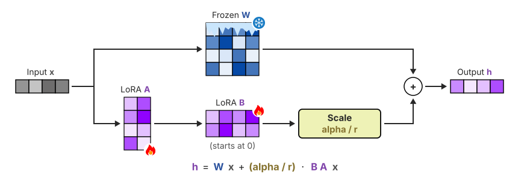
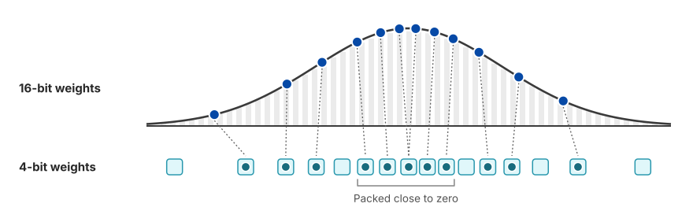
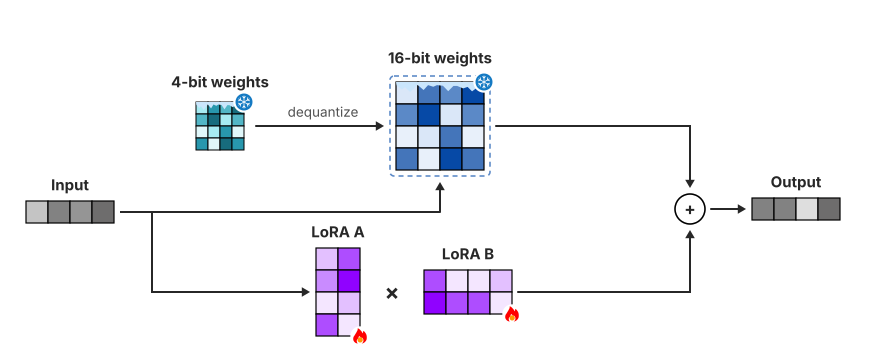
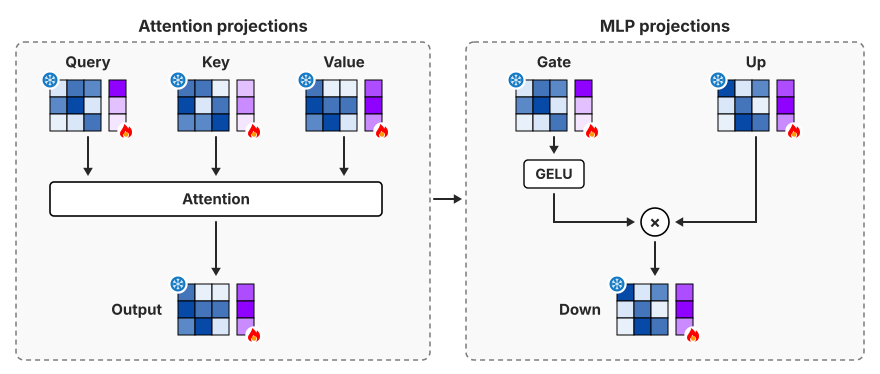
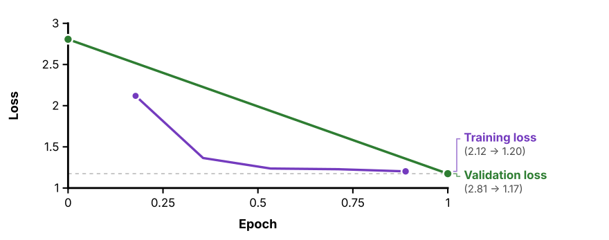
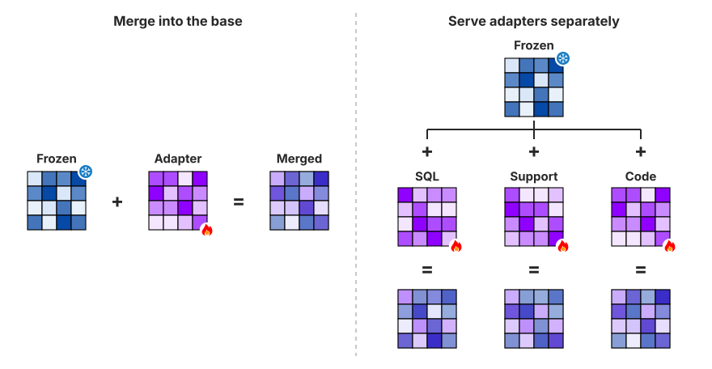

# (Q)LoRA

LoRA 是自訂 Gemma 4 最簡單的方式。您不需要更新數十億個權重，只要凍結模型，並在每一層旁邊訓練一個小型轉接器。

QLoRA 更進一步，將凍結的模型以 4 個位元儲存。這讓您能在單一 GPU 上微調大得多的模型。

在本指南中，我們先瞭解 LoRA 與 QLoRA 的運作方式，以及要調整哪些層。接著微調 Gemma 4，讓它先以指定的語言推理，再以英文回答。

---

## 1. LoRA 的運作方式 <a id="1-lora-的運作方式"></a>

使用 LoRA 微調時，您會凍結原始權重矩陣 <span style="color: #2B529E; font-weight: 700;">W</span>，並在其旁邊附加兩個小型轉接器矩陣（<span style="color: #7F43AA; font-weight: 700;">A</span> 與 <span style="color: #7F43AA; font-weight: 700;">B</span>）。只有這些轉接器會接收更新，因此您可以略過數十億個凍結權重的梯度與最佳化器狀態。

可以把凍結的矩陣 <span style="color: #2B529E; font-weight: 700;">W</span> 想像成承載通用語言知識的主要幹道，而 LoRA 轉接器則是一條狹窄的側邊車道，只學習您的任務所需的調整。矩陣 <span style="color: #7F43AA; font-weight: 700;">A</span> 會將輸入壓縮到較小的秩 <span style="color: #857230; font-weight: 700;">r</span>（例如 16 或 32），矩陣 <span style="color: #7F43AA; font-weight: 700;">B</span> 再將其投影回輸出尺寸：



如圖底部的方程式所示，轉接器的輸出在加到凍結層之前，會先乘以 <span style="color: #857230; font-weight: 700;">alpha / r</span>。以下兩個設定控制了這一點：

- **<span style="color: #857230; font-weight: 700;">r</span>**（秩）：轉接器的大小。秩越高，可訓練參數越多，訓練所需的運算量也越大。
- **<span style="color: #857230; font-weight: 700;">alpha</span>**：控制轉接器輸出的加權強度。將 <span style="color: #857230; font-weight: 700;">alpha</span> 設為與 <span style="color: #857230; font-weight: 700;">r</span> 相等（1 倍乘數）或 <span style="color: #857230; font-weight: 700;">r</span> 的兩倍（2 倍乘數），在所有 Gemma 4 模型上都有良好的效果。

| 任務類型 | 秩 | Alpha | 說明 |
| :--- | :--- | :--- | :--- |
| 格式、語氣、分類、JSON 或 SQL | `16` | `16` 或 `32` | 快速、低 VRAM、過度擬合風險低。 |
| 領域知識、多步驟推理、工具使用 | `32` | `32` 或 `64` | 適用於所有 Gemma 4 模型的良好預設值。 |
| 大幅領域轉移或持續預訓練 | `64` 至 `128` | `64` 至 `128` | 為新領域或新語言提供額外的轉接器容量。 |

---

## 2. 從 LoRA 到 QLoRA

不過，標準 LoRA 有一個問題：凍結權重仍以 16 位元精度（bfloat16）佔用 GPU 記憶體，每個權重 2 個位元組。以 Gemma 4 31B 來說，訓練還沒開始就已佔用約 60 GB。

QLoRA（[Dettmers 等人，2023 年](https://arxiv.org/abs/2305.14314)）使用一種稱為 NF4（4 位元 NormalFloat）的資料型別，將每個權重只用 4 個位元儲存，藉此縮小這份凍結副本。

### NF4 如何以 4 個位元儲存權重

4 個位元只能表示 16 種不同的值。NF4 格式運用這 16 種值，並對應到訓練後權重的分佈情形。一般來說，大多數權重都接近零，只有少數相對較大的離群值：



NF4 以 64 個權重為一個區塊運作，每個區塊有自己的縮放係數，因此單一較大的權重不會拉伸整個矩陣的值。QLoRA 還會以第二輪量化（雙重量化）壓縮這些縮放係數，在 31B 上大約又能省下 1.5 GB。

### QLoRA 如何以 4 位元權重訓練

不過，這裡有一個問題：矩陣乘法仍以 16 位元精度（bfloat16）執行，在訓練期間成本可能相當高。因此，QLoRA 會一次將一層反量化為暫時的 16 位元權重，供該層使用後再釋放：



儲存的 4 位元權重與解開的 16 位元權重都保持凍結，只有 LoRA A 與 LoRA B 會接收更新，就像一般 LoRA 一樣。

簡而言之，QLoRA 是以部分速度換取大量記憶體：

| | LoRA | QLoRA |
| :--- | :--- | :--- |
| 凍結權重 | bfloat16，每個權重 2 個位元組 | NF4，每個權重約 0.5 個位元組 |
| 轉接器 | bfloat16 | bfloat16 |
| 速度 | 較快 | 較慢，因為每個步驟都會對每一層反量化 |
| 適用時機 | 16 位元模型放得進記憶體 | GPU 記憶體是瓶頸 |

!!! note "微調 26B A4B"
    26B A4B 混合專家（Mixture-of-Experts）模型將其 128 個路由專家儲存為融合的 3D 參數張量，並使用一個在微調期間必須保持凍結的可學習路由器。[MoE 微調](moe-finetune.md)介紹了 4 位元 QLoRA（約 21 GB VRAM）與 16 位元 LoRA（約 56 GB VRAM）兩種設定，皆使用分組 GEMM。

---

## 3. 選定要調整的層

每個 Gemma 4 解碼器層包含七個線性投影：注意力機制中有四個，前饋 MLP 區塊中有三個：



這些投影的運作方式如下：

1. **注意力投影**：Query、Key 與 Value 投影將資料送入注意力步驟，Output 投影再將結果對應回殘差流。
2. **MLP 投影**：Gate 投影經過 GELU 活化函數後與 Up 投影相乘，再由 Down 投影將結果對應回較低維度。

每個凍結的投影都有自己的可訓練 LoRA 轉接器。早期的 LoRA 做法只調整 Query 與 Value 投影。QLoRA 論文發現，要達到與完整 16 位元微調相當的效果，必須調整全部七個線性投影，而額外的轉接器只會增加少量的可訓練權重。

---

## 4. 設定環境

讓我們微調 Gemma 4，使其以英文以外的語言推理，但最終答案仍以英文撰寫。`gemma-4-E2B-it` 在預設狀態下會忽略以不同語言推理的指令，改以英文思考，或不小心切換最終答案的語言。

首先，我們需要安裝各種常用的訓練與評估函式庫：

```python { .notebook-cell }
# Install Hugging Face post-training, quantization, multimodal, and evaluation libraries
%pip install -q -U "transformers>=5.10.1" "trl>=0.16.0" "peft>=0.19.0" accelerate datasets bitsandbytes torchao
%pip install -q -U evaluate sacrebleu jiwer pillow soundfile librosa matplotlib tensorboard
```

如果您打算將訓練好的轉接器推送到 Hugging Face Hub，請依下列方式登入：

```python { .notebook-cell }
from huggingface_hub import login

# Optional: uncomment to push your trained adapter to the Hugging Face Hub
# login()
```

---

## 5. 準備資料集

我們使用 [Multilingual-Thinking](https://huggingface.co/datasets/HuggingFaceH4/Multilingual-Thinking) 資料集，它將 1,000 個英文提示與法文、德文、西班牙文、義大利文及英文的逐步推理軌跡配對，並附上最終的英文回覆。

將每個範例格式化為：

* `prompt` 清單（系統與使用者輪次）
* `completion` 清單（助手的 `"reasoning_content"` 與最終 `"content"`）
* `"chat_template_kwargs": {"enable_thinking": True}`

有了這種結構，TRL 會自動在系統輪次中放入 `<|think|>`{.token-think}，將推理軌跡包在 `<|channel>thought`{.token-think} … `<channel|>`{.token-think} 之中，並在計算損失時遮蔽提示詞元，如同我們在[資料集格式](datasets-formatting.md#3-使用思考詞元訓練)中介紹的：

```python { .notebook-cell }
from datasets import load_dataset


# Format each row into prompt and completion turns with thinking enabled
def create_conversation(sample):
    system_message = (
        f"reasoning language: {sample['reasoning_language']}\n\n{sample['developer']}"
    ).strip()
    return {
        "prompt": [
            {"role": "system", "content": system_message},
            {"role": "user", "content": sample["user"]},
        ],
        "completion": [
            {
                "role": "assistant",
                "reasoning_content": sample["analysis"],
                "content": sample["final"],
            },
        ],
        "chat_template_kwargs": {"enable_thinking": True},
    }


# Load the dataset and create a 90/10 train-test split
dataset = load_dataset("HuggingFaceH4/Multilingual-Thinking", split="train")
dataset = dataset.map(create_conversation, remove_columns=dataset.features)
dataset = dataset.train_test_split(test_size=0.1, seed=42)

for turn in dataset["train"][0]["prompt"] + dataset["train"][0]["completion"]:
    print({k: (v[:180] + "..." if len(v) > 180 else v) for k, v in turn.items()})
```

```{ .no-copy .output }
{'role': 'system', 'content': 'reasoning language: French\n\nyou are a chatbot assuming the role of a rogue space pirate in a distant galaxy'}
{'role': 'user', 'content': "Can you create a dramatic dialogue between two characters named John and Mary in a play, where they're discussing a serious issue that could potentially end their relationship?"}
{'role': 'assistant', 'reasoning_content': "D'accord, l'utilisateur souhaite un dialogue dramatique entre John et Marie abordant un problème sérieux susceptible de mettre fin à leur relation. Ils ont mentionné une pièce de t...", 'content': '**Title:** *Shattered Stars*  \n**Setting:** A dimly lit cargo hold on a rogue starship, *The Black Siren*. The hum of the engine pulses like a heartbeat. A viewport shows a distant...'}
```

---

## 6. 載入模型

接著我們定義一個 `BitsAndBytesConfig`，讓我們能以 NF4 儲存凍結權重，並以 bfloat16 執行暫時的層級乘法。我們同時載入模型：

```python { .notebook-cell .model-swap }
import torch
from transformers import AutoProcessor, BitsAndBytesConfig

model_id = "google/gemma-4-E2B-it"

# Configure 4-bit NF4 quantization with bfloat16 compute
quantization_config = BitsAndBytesConfig(
    load_in_4bit=True,
    bnb_4bit_use_double_quant=True,
    bnb_4bit_quant_type="nf4",
    bnb_4bit_compute_dtype=torch.bfloat16,
    bnb_4bit_quant_storage=torch.bfloat16,
)

# Load the processor and tokenizer
processor = AutoProcessor.from_pretrained(model_id)
tokenizer = processor.tokenizer
```

各參數的作用如下：

* `bnb_4bit_quant_type="nf4"` 會選用 16 個 NF4 層級
* `bnb_4bit_use_double_quant=True` 會壓縮區塊縮放係數
* `bnb_4bit_compute_dtype=torch.bfloat16` 會設定暫存副本的精度。

接著定義轉接器。`LoraConfig` 會在語言解碼器的七個線性投影各加入一個秩為 16 的轉接器，同時跳過視覺與音訊編碼器：

```python { .notebook-cell }
from peft import LoraConfig

# Configure LoRA adapters across the seven decoder projections
peft_config = LoraConfig(
    r=16,
    lora_alpha=32,
    lora_dropout=0.0,
    bias="none",
    target_modules=[
        "q_proj",
        "k_proj",
        "v_proj",
        "o_proj",
        "gate_proj",
        "up_proj",
        "down_proj",
    ],
    exclude_modules=r"model\.(vision_tower|audio_tower)\..*",
    task_type="CAUSAL_LM",
)
```

設定 `exclude_modules` 可讓 `peft` 專注於文字解碼器層（`Gemma 4` 會以 `Gemma4ClippableLinear` 將 `vision_tower` 與 `audio_tower` 內的線性投影包裝起來）。秩與 alpha 遵循[第 1 節](#1-lora-的運作方式)的建議。

---

## 7. 評估基底模型

在訓練之前，讓我們先檢查未經修改的 4 位元模型如何處理一個保留的測試提示：該提示要求針對英文問題以 `French` 進行推理。請使用 `processor.parse_response` 並搭配 `skip_special_tokens=False`，將 `<|channel>thought`{.token-think} 區塊與最終答案分開：

```python { .notebook-cell }
from transformers import AutoModelForMultimodalLM

# Load the 4-bit base model for baseline evaluation
torch.manual_seed(42)
base_model = AutoModelForMultimodalLM.from_pretrained(
    model_id,
    quantization_config=quantization_config,
    device_map="auto",
)

# Format a held-out test prompt with thinking enabled and generate a baseline response
test_sample = dataset["test"][5]
prompt = processor.apply_chat_template(
    test_sample["prompt"],
    tokenize=False,
    add_generation_prompt=True,
    enable_thinking=True,
)
inputs = processor(text=prompt, return_tensors="pt").to(base_model.device)
input_len = inputs["input_ids"].shape[-1]

outputs = base_model.generate(**inputs, max_new_tokens=1024)
response = processor.decode(outputs[0][input_len:], skip_special_tokens=False)
result = processor.parse_response(response, prefix="")

print(f"System:\n{test_sample['prompt'][0]['content']}\n")
print(f"User:\n{test_sample['prompt'][1]['content']}\n")
print(f"Thoughts:\n{result['thinking']}\n")
print(f"Answer:\n{result['content']}")
```

```{ .no-copy .output }
System:
reasoning language: French

You are a virtual assistant that presents information in a conversational, casual tone

User:
Can you provide me with the details of your return policy, please?

Thoughts:
Thinking Process:

1.  **Analyze the Request:** The user is asking for the details of *my* return policy.
2.  **Identify My Persona/Nature:** I am a large language model (AI assistant). I do not sell physical products, run a business, or have a formal "return policy."
3.  **Determine the Core Conflict:** The user is treating me like a commercial entity. I need to gently correct this while maintaining a helpful, conversational tone.
4.  **Adopt the Required Tone:** Conversational, casual (in French, as requested by the reasoning instruction).
5.  **Formulate the Response Strategy:**
    *   Acknowledge the request directly.
    *   Explain *why* I don't have a policy (because I'm an AI).
    *   Pivot: Ask the user what they are referring to, or ask if they are looking for a policy related to something specific they might be thinking about.
6.  **Draft the Response (in French, casual tone):**

    *   *Initial thought (too formal):* Je suis un modèle d'IA et je n'ai pas de politique de retour.
    *   *Refining for conversational tone:* Ah, tu me demandes ma politique de retour ? Écoute, comme je suis une IA, je ne vends rien, donc je n'ai pas de politique de retour comme un magasin.
    *   *Adding a helpful closing:* Tu parles d'un produit ou d'un service en particulier ? Dis-m'en un peu plus !

7.  **Final Review:** Does it meet the requirements? Yes (French reasoning, conversational tone, addresses the request). (Self-Correction: Ensure the tone is friendly, not robotic.)

Answer:
Ah, tu me demandes ma politique de retour ? 😅

Écoute, comme je suis une intelligence artificielle, je ne vends rien de physique, donc je n'ai pas de politique de retour comme un magasin ! 😉

Tu parles peut-être d'un produit ou d'un service en particulier ? Dis-moi de quoi tu parles, et je pourrai peut-être t'aider à trouver l'information dont tu as besoin ! 😊
```

請注意，基底模型把指令理解反了：它在 `Thoughts` 中以英文推理，卻以法文回覆英文使用者。

在開始訓練之前，請先釋放 4 位元推論模型：

```python { .notebook-cell }
# Free GPU memory before starting training
del base_model, inputs, outputs
torch.cuda.empty_cache()
```

---

## 8. 訓練模型

將 `model_id`、`quantization_config` 與 `peft_config` 直接傳給 `SFTTrainer`。由於資料集使用 `prompt` 與 `completion` 鍵，TRL 會遮蔽提示詞元（`-100`），只針對推理軌跡與最終答案計算損失：

```python { .notebook-cell }
from trl import SFTConfig, SFTTrainer

# Set the configuration for the trainer
args = SFTConfig(
    output_dir="gemma-4-multilingual-thinking",
    max_length=2048,
    num_train_epochs=1,               # Increase to 2 epochs for even stronger adherence
    per_device_train_batch_size=2,
    per_device_eval_batch_size=2,
    gradient_accumulation_steps=8,
    optim="paged_adamw_8bit",
    logging_steps=10,
    save_strategy="epoch",
    eval_strategy="epoch",
    eval_on_start=True,
    learning_rate=2e-4,
    weight_decay=0.01,
    warmup_steps=0.05,
    lr_scheduler_type="cosine",
    max_grad_norm=1.0,
    bf16=True,
    model_init_kwargs={"dtype": torch.bfloat16},
    push_to_hub=False,                # Set True to upload your adapter to the Hub
    report_to="tensorboard",
)

# Define and run the trainer
trainer = SFTTrainer(
    model=model_id,
    args=args,
    train_dataset=dataset["train"],
    eval_dataset=dataset["test"],
    processing_class=tokenizer,
    quantization_config=quantization_config,
    peft_config=peft_config,
)

trainer.train()
trainer.save_model()
```

```{ .no-copy .output }
[57/57 07:22, Epoch 1/1]

| Step | Training Loss | Validation Loss | Mean Token Accuracy |
|---|---|---|---|
| 0 (eval) | - | 2.8064 | 0.5827 |
| 10 | 2.1192 | - | 0.6125 |
| 20 | 1.3644 | - | 0.6525 |
| 30 | 1.2367 | - | 0.6746 |
| 40 | 1.2285 | - | 0.6808 |
| 50 | 1.2025 | - | 0.6854 |
| 57 | - | 1.1743 | 0.6889 |
```

<!-- notebook:skip-start -->
??? info "檢視訓練曲線"
    
<!-- notebook:skip-end -->

在序列長度為 `2048` 且 `per_device_train_batch_size=2` 的情況下，這次執行的 VRAM 峰值不到 10 GB，並遵循[建議的 LoRA 超參數](best-practices.md#2-建議的超參數)。

在合併轉接器之前，讓我們先釋放 GPU 記憶體：

```python { .notebook-cell }
# Free trainer memory before merging the adapter
del trainer
torch.cuda.empty_cache()
```

---

## 9. 合併轉接器

由於基底模型保持凍結，`trainer.save_model()` 只會儲存小型的轉接器（`adapter_model.safetensors`），而非完整模型。部署時，您可以將它合併到基底權重中，也可以保持獨立：



選擇哪一種方式取決於您的部署方式：

- **合併**：當您想要一個在推論時不需額外處理的單一模型時。您也需要在匯出為 GGUF（供 llama.cpp 與 Ollama 使用）或 LiteRT-LM 之前先合併模型，相關內容請見[匯出微調後的模型](export.md)。
- **分開提供**：當一張 GPU 需要提供多個轉接器時。例如，vLLM 可以載入一個基底模型，並以 `--enable-lora` 依每個請求切換轉接器。

要將轉接器與模型合併，請以 16 位元重新載入基底模型，並使用 `merge_and_unload()`：

```python { .notebook-cell }
from peft import PeftModel

# Load the base model in 16-bit precision for a clean mathematical merge
base_model = AutoModelForMultimodalLM.from_pretrained(
    model_id,
    low_cpu_mem_usage=True,
    dtype=torch.bfloat16,
    device_map="auto",
)

# Attach the trained LoRA adapter and fold B*A into the base weights
peft_model = PeftModel.from_pretrained(base_model, args.output_dir)
merged_model = peft_model.merge_and_unload()
merged_model.save_pretrained("merged_model", safe_serialization=True, max_shard_size="2GB")

processor.save_pretrained("merged_model")

del base_model, peft_model, merged_model
torch.cuda.empty_cache()
```

!!! warning "合併到 16 位元基底模型"
    在呼叫 `merge_and_unload()` 之前，務必先以 bfloat16 或 float16 重新載入基底模型。合併到 4 位元權重會引入捨入誤差。您也需要足夠的記憶體來容納完整的 16 位元模型。

---

## 10. 評估微調後的模型

接著重新載入獨立的合併檢查點，並傳送與第 7 節完全相同的測試提示：

```python { .notebook-cell }
# Load the merged checkpoint and processor
torch.manual_seed(42)
merged_dir = "merged_model"
model = AutoModelForMultimodalLM.from_pretrained(merged_dir, device_map="auto", dtype="auto")
merged_processor = AutoProcessor.from_pretrained(merged_dir)

# Run the held-out test prompt and parse the reasoning trace from the answer
prompt = merged_processor.apply_chat_template(
    test_sample["prompt"],
    tokenize=False,
    add_generation_prompt=True,
    enable_thinking=True,
)
inputs = merged_processor(text=prompt, return_tensors="pt").to(model.device)
input_len = inputs["input_ids"].shape[-1]

outputs = model.generate(**inputs, max_new_tokens=1024)
response = merged_processor.decode(outputs[0][input_len:], skip_special_tokens=False)
result = merged_processor.parse_response(response, prefix="")

print(f"System:\n{test_sample['prompt'][0]['content']}\n")
print(f"User:\n{test_sample['prompt'][1]['content']}\n")
print(f"Thoughts:\n{result['thinking']}\n")
print(f"Answer:\n{result['content']}")
```

```{ .no-copy .output }
System:
reasoning language: French

You are a virtual assistant that presents information in a conversational, casual tone

User:
Can you provide me with the details of your return policy, please?

Thoughts:
Okay, l'utilisateur veut connaître notre politique de retour. Je dois vérifier les détails.

Je commence par identifier le type de produit. Le client ne l'a pas précisé, alors je devrais couvrir les cas généraux et peut-être mentionner si le produit est ré-stockable, est ouvert ou neuf.

Je note ensuite les règles de base:

1.  Période de retour: Souvent 30 jours pour des produits non ouverts.
2.  Condition du produit: Neuf, non utilisé, sans déformation.
3.  Politique de remboursement: Rendre l'article et obtenir un remboursement. Mentionner les exclusions (produits personnalisés, articles en solde).
4.  Processus de retour: Faire une demande via le site web ou par courriel, attendre la confirmation, puis expédier le colis.
5.  Récupération du produit: Le client devra couvrir les frais d'expédition ou l'étiquette de retour.
6.  Exceptions: Articles personnalisés, produits en solde ou pour cadeaux.
7.  Avertissements: Mentionner si un certain produit n'est pas éligible aux retours.

Je dois m'assurer que le ton est convivial et facile à comprendre. Je peux utiliser des phrases courtes et élever la lisibilité.

Commencer avec une introduction sympathique. Énumérer les règles clairement. S'assurer que chaque point est facile à comprendre. Terminer par une invitation à poser des questions.

Answer:
Sure thing! Here’s the lowdown on our return policy:

### General Guidelines

*   **Return Window:** You have **30 days** from the date of purchase to return products.
*   **Product Condition:** Items must be **unused, unworn, and in the original packaging** with tags intact.
*   **Refunds:** We’ll issue a refund to your original payment method within **5-7 business days** after receiving your return.

### How to Return

1.  **Request a Return:** Visit our **Returns Portal** (or email support@storename.com) to initiate your return.
2.  **Pack & Ship:** Include your order number and a completed return form. We’ll provide a pre-paid return label for most items.
3.  **Wait for Confirmation:** Once we receive your return, we’ll process the refund and notify you via email.

---

### Exceptions

*   **Custom Orders:** Personalized or customized items are not eligible for returns or exchanges.
*   **Gift Cards:** Gift cards cannot be returned.
*   **Final Sale Items:** Clearance, discontinued, or final sale items are excluded from returns.

---

### Need More Help?

If you’re unsure about a specific item or need assistance, hit up our **Customer Support** team at support@storename.com. We’re here to help!

Let me know if you’d like more details on a specific type of product!
```

經過一個 epoch 的 QLoRA 訓練後，模型會在 `<|channel>thought`{.token-think} 內以法文逐步推理，回答時再切換回英文。在 20 個保留的法文、德文、西班牙文與義大利文提示中，推理語言的遵循程度從基底檢查點的 `0/20` 躍升至 1 個 epoch 後的 `15/20`，訓練 2 個 epoch 則達到 `20/20`。

## 接下來

<div class="card-grid">
<a class="card" href="full-finetune.md">
  <span class="card-icon">{{ icon('lucide/cpu') }}</span>
  <div class="card-title">完整微調</div>
  <p class="card-desc">當轉接器不足以應付時，更新 Gemma 4 的每一個權重。</p>
</a>
<a class="card" href="moe-finetune.md">
  <span class="card-icon">{{ icon('lucide/split') }}</span>
  <div class="card-title">MoE 微調</div>
  <p class="card-desc">以凍結的路由器與 16 位元轉接器訓練 26B A4B。</p>
</a>
<a class="card" href="vision-qlora.md">
  <span class="card-icon">{{ icon('lucide/eye') }}</span>
  <div class="card-title">視覺微調</div>
  <p class="card-desc">在圖像與文字範例上使用相同的 LoRA 設定。</p>
</a>
<a class="card" href="export.md">
  <span class="card-icon">{{ icon('lucide/rocket') }}</span>
  <div class="card-title">匯出</div>
  <p class="card-desc">將合併後的模型匯出為 GGUF、LiteRT-LM 或 vLLM。</p>
</a>
</div>

--8<-- "glossary.md"
