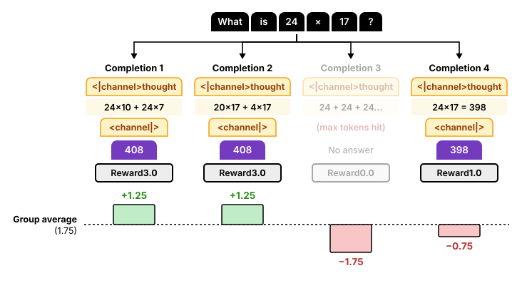
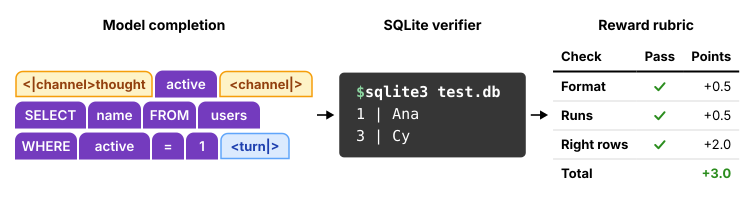
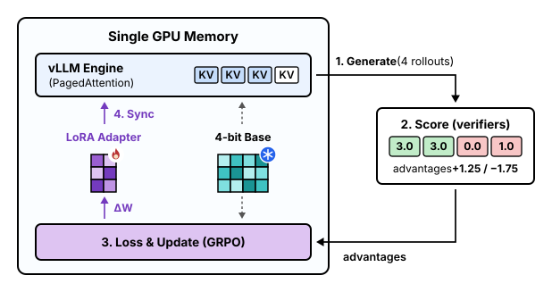
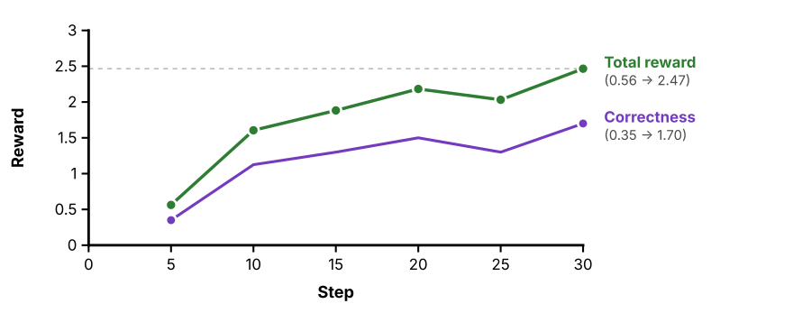

# 可驗證獎勵

監督式微調與偏好最佳化教 Gemma 4 模仿現有的範例。當您訓練數學、程式碼產生或 SQL 查詢時，您會希望模型在 `<|channel>thought`{.token-think} 與 `<channel|>`{.token-think} 推理區塊內測試中間步驟並修正自己的錯誤。


可驗證獎勵強化學習（RLVR）讓模型從自己的反覆嘗試與錯誤中學習。在本指南中，您將了解群組相對策略最佳化（GRPO）的運作方式、如何用 Python 撰寫多組成的獎勵評分標準、如何用並置 vLLM 加速產生，以及如何用 `GRPOTrainer` 訓練推理轉接器。

---

## 1. 群組相對策略最佳化（GRPO）

傳統的強化學習方法會在記憶體中保留一個獨立的評判模型來估計每個回應有多好，讓 GPU 記憶體用量加倍。群組相對策略最佳化則完全移除評判模型，做法是針對同一提示取樣一小組回應，再將每個回應與群組平均值比較：



在上圖中，請注意：

* 前兩個答案透過不同的心算拆解得到正確答案（408），各得 3.0 分。
* 第三個答案在關閉思考區塊前就用完詞元，得 0.0 分。
* 第四個答案格式正確，但算術出錯（398），得 1.0 分。

由於群組平均為 1.75，兩個 408 答案的優勢為 +1.25，兩個有瑕疵的答案優勢則為 −1.75 與 −0.75。這個方法有趣之處在於，GRPO 本質上只是產生許多答案，再拿它們與平均值比較，成本遠低於用評判模型逐一評判所有答案。

每個訓練步驟包含三個階段：

1. **取樣一組**：針對給定提示，以取樣溫度產生四個不同的答案，如上例所示。
2. **為每個答案評分**：由您自行定義的確定性函式為每個答案評分，並指定一個數字獎勵。
3. **與群組平均值比較**：高於群組平均值的答案獲得正向優勢並得到強化；低於平均值的答案獲得負向優勢並受到抑制。

---

## 2. 設計獎勵

與其訓練一個可能被自信語氣蒙騙的獎勵模型，可驗證獎勵改用確定性檢查，例如單元測試、SQL 執行或數學解析器。換句話說，這些都是您可以自己建立的函式！

不過，您通常不會只用一個非 0 即 1 的單一獎勵。原因在於，訓練初期每個答案可能都得 0 分，無法產生明確的訊號。您可以把三個小獎勵加總起來，建立平滑漸進的學習訊號：



請注意，正確性給 +2.0 分，確保準確度永遠重於格式，而 +0.5 分的格式與執行檢查則在訓練初期引導模型：

1. **格式** *(+0.5)*：檢查模型在寫下最終答案前，是否乾淨地開啟並關閉思考區塊。
2. **可執行** *(+0.5)*：檢查擷取出的答案能否順利執行，例如有效的 SQL 查詢或可解析的數字。
3. **正確的資料列** *(+2.0)*：查詢回傳預期的資料列，或數字與標準答案相符時，給予主要分數。

---

## 3. 加速產生

在監督式微調中，每個步驟只是快速掃過既有詞元一次。在強化學習中，模型在每個訓練步驟都必須逐詞元產生四到八個完整答案。為了加速，我們可以用 vLLM 做到所謂的「並置」。這是一個四步驟流程，讓推論引擎與訓練器共用同一張 GPU：

1. **產生**：vLLM 使用 PagedAttention 平行取樣一組答案。
2. **評分**：您的獎勵函式為每個完成內容評分（3.0、3.0、0.0、1.0）。
3. **更新**：訓練器對凍結的基礎模型執行反向傳播，並更新 LoRA 轉接器。
4. **同步轉接器**：更新後的 LoRA 權重會在下一個步驟開始前，直接在 GPU 記憶體內複製回 vLLM。



---

## 4. 設定環境

首先安裝後訓練與評估函式庫來設定環境：

```python { .notebook-cell }
# Install Hugging Face post-training, quantization, multimodal, and evaluation libraries
%pip install -q -U "transformers>=5.10.1" "trl>=0.16.0" "peft>=0.19.0" accelerate datasets bitsandbytes torchao
%pip install -q -U evaluate sacrebleu jiwer pillow soundfile librosa matplotlib tensorboard

# Optional: install vLLM on Linux GPUs for faster colocated GRPO rollouts
# %pip install -q vllm
```

如果您打算把訓練好的轉接器推送到 Hugging Face Hub，請使用寫入權杖登入：

```python { .notebook-cell }
from huggingface_hub import login

# Optional: uncomment to push your trained adapter to the Hugging Face Hub
# login()
```

---

## 5. 準備資料集

`gemma-4-E2B-it` 開箱即用，已能解出大多數小學程度的數學題目（在 1,024 詞元預算下，[`openai/gsm8k`](https://huggingface.co/datasets/openai/gsm8k) 約 75%）。不過，它的思考軌跡平均將近 700 個詞元，而且最終答案的格式會隨提示而變化。如果您的應用需要更少的詞元與更嚴格的解析器，我們可以微調模型，讓它的行為符合您的應用需求。

GSM8K 在此是相當合適的資料集，因為我們能用可驗證獎勵教模型更簡潔地推理，並總是以 `Answer:` 作結，方便我們擷取答案。因此，GSM8K 正好示範了我們如何改變模型的行為。

`GRPOTrainer` 只需要 `prompt` 欄位，以及獎勵函式會檢查的任何標準答案欄位（例如 `gold_answer`）。資料集中不需要思維鏈軌跡，因為我們只在意它們的長度。我們載入 500 道訓練題目與 100 道保留測試題目，擷取 `####` 之後的答案，並要求 Gemma 4 在寫下 `Answer: <number>` 之前先簡潔推理：

```python { .notebook-cell }
import re
from datasets import load_dataset

SYSTEM_PROMPT = (
    "Reason concisely inside your thinking block, then output only the final answer "
    "formatted as: Answer: <number>"
)


# Extract the ground-truth numeric answer after #### in GSM8K
def extract_gsm8k_gold(answer_str: str) -> str:
    match = re.search(r"####\s*([\-0-9\.,]+)", answer_str)
    return match.group(1).replace(",", "").strip() if match else ""


# Format each math problem into chat prompt messages and gold_answer
def format_grpo_sample(sample):
    return {
        "prompt": [
            {"role": "system", "content": SYSTEM_PROMPT},
            {"role": "user", "content": sample["question"]},
        ],
        "gold_answer": extract_gsm8k_gold(sample["answer"]),
    }


# Load 500 training and 100 test problems from GSM8K
train_dataset = load_dataset("openai/gsm8k", "main", split="train[:500]")
eval_dataset = load_dataset("openai/gsm8k", "main", split="test[:100]")

train_dataset = train_dataset.map(format_grpo_sample, remove_columns=train_dataset.column_names)
eval_dataset = eval_dataset.map(format_grpo_sample, remove_columns=eval_dataset.column_names)

print("Sample Prompt:", train_dataset[0]["prompt"])
print("Gold Answer:  ", train_dataset[0]["gold_answer"])
```

```{ .no-copy .output }
Sample Prompt: [{'role': 'system', 'content': 'Reason concisely inside your thinking block, then output only the final answer formatted as: Answer: <number>'}, {'role': 'user', 'content': 'Natalia sold clips to 48 of her friends in April, and then she sold half as many clips in May. How many clips did Natalia sell altogether in April and May?'}]
Gold Answer:   72
```

---

## 6. 載入模型

我們載入模型，並在七個文字解碼器投影層上設定 `LoraConfig`。一如往常，我們保持視覺與音訊編碼器凍結：

```python { .notebook-cell .model-swap }
import torch
from transformers import AutoTokenizer, AutoModelForMultimodalLM, BitsAndBytesConfig
from peft import LoraConfig, PeftModel

model_id = "google/gemma-4-E2B-it"

# Configure 4-bit NF4 quantization
bnb_config = BitsAndBytesConfig(
    load_in_4bit=True,
    bnb_4bit_use_double_quant=True,
    bnb_4bit_quant_type="nf4",
    bnb_4bit_compute_dtype=torch.bfloat16,
    bnb_4bit_quant_storage=torch.bfloat16,
)

# Load the base model and tokenizer
model = AutoModelForMultimodalLM.from_pretrained(
    model_id,
    dtype=torch.bfloat16,
    device_map="auto",
    quantization_config=bnb_config,
)
tokenizer = AutoTokenizer.from_pretrained(model_id)

# Configure LoRA adapters across the seven decoder projections
peft_config = LoraConfig(
    r=16,
    lora_alpha=32,
    lora_dropout=0.0,
    bias="none",
    target_modules=[
        "q_proj",
        "k_proj",
        "v_proj",
        "o_proj",
        "gate_proj",
        "up_proj",
        "down_proj",
    ],
    exclude_modules=r"model\.(vision_tower|audio_tower)\..*",
    task_type="CAUSAL_LM",
)
```

---

## 7. 評估基礎模型

訓練之前，先在全部 100 道未見過的 `gsm8k` 測試題目上評估模型，建立基準。請注意，我們加上 `max_new_tokens=512`，看看基礎模型能否維持在這個預算內：

```python { .notebook-cell }
ANSWER_NUMBER_PATTERN = re.compile(r"Answer:\s*([\-0-9\.,]+)")


# Helper to measure math accuracy, format adherence, and mean token length
def evaluate_gsm8k(eval_model, dataset_split, max_new_tokens=512, batch_size=25):
    eval_model.eval()
    orig_padding = tokenizer.padding_side
    tokenizer.padding_side = "left"
    stop_ids = [tokenizer.eos_token_id, tokenizer.convert_tokens_to_ids("<turn|>")]
    closed_count, format_count, correct_count = 0, 0, 0
    token_lengths = []
    try:
        for i in range(0, len(dataset_split), batch_size):
            batch = dataset_split.select(range(i, min(i + batch_size, len(dataset_split))))
            rendered = [
                tokenizer.apply_chat_template(
                    p, tokenize=False, add_generation_prompt=True, enable_thinking=True
                )
                for p in batch["prompt"]
            ]
            inputs = tokenizer(rendered, return_tensors="pt", padding=True).to(eval_model.device)
            prompt_len = inputs["input_ids"].shape[1]
            with torch.no_grad():
                outputs = eval_model.generate(
                    **inputs,
                    max_new_tokens=max_new_tokens,
                    do_sample=False,
                    eos_token_id=stop_ids,
                )
            for seq, gold in zip(outputs, batch["gold_answer"]):
                raw = (
                    tokenizer.decode(seq[prompt_len:], skip_special_tokens=False)
                    .split("<turn|>")[0]
                    .split("<eos>")[0]
                )
                token_lengths.append(len(tokenizer.encode(raw, add_special_tokens=False)))
                parsed = tokenizer.parse_response(raw, prefix="")
                thinking = parsed.get("thinking", "").strip()
                content = parsed.get("content", "").strip()
                if thinking and content:
                    closed_count += 1
                match = ANSWER_NUMBER_PATTERN.search(content)
                if thinking and match:
                    format_count += 1
                    pred = match.group(1).replace(",", "").strip().rstrip(".")
                    try:
                        if abs(float(pred) - float(gold)) < 1e-5:
                            correct_count += 1
                    except ValueError:
                        pass
    finally:
        tokenizer.padding_side = orig_padding
    n = len(dataset_split)
    return {
        "closed_pct": closed_count / n * 100,
        "format_pct": format_count / n * 100,
        "accuracy_pct": correct_count / n * 100,
        "mean_tokens": sum(token_lengths) / n,
    }


# Evaluate the zero-shot baseline before GRPO training
before_metrics = evaluate_gsm8k(model, eval_dataset, max_new_tokens=512)
print(
    f"Baseline (100 test problems): accuracy={before_metrics['accuracy_pct']:.1f}% | "
    f"valid format={before_metrics['format_pct']:.1f}% | "
    f"closed thoughts={before_metrics['closed_pct']:.1f}% | "
    f"mean length={before_metrics['mean_tokens']:.1f} tokens"
)
```

```{ .no-copy .output }
Baseline (100 test problems): accuracy=28.0% | valid format=29.0% | closed thoughts=46.0% | mean length=480.0 tokens
```

給定預算後，模型很難維持在預算之內。畢竟，它受訓時做的推理比我們的預算多得多。讓我們看看能否透過訓練改變這個行為。

---

## 8. 訓練模型

### 獎勵函式

開始訓練之前，我們需要先定義獎勵函式。

為了替每個產生的回應評分，我們先把推理軌跡與最終答案分開。請注意，如果模型在思考中途、尚未到達 `<channel|>` 就用完詞元，最終答案就會是空的。

接著，我們用三個函式為每個回應評分，總分最高 `3.0` 分：

* **格式** *(+0.5)*：檢查思考區塊是否簡潔地關閉，且答案以 `Answer:` 開頭。
* **可解析的數字** *(+0.5)*：檢查 `Answer:` 後面的值是否為有效數字。
* **正確性** *(+2.0)*：檢查數字是否與標準答案相符。

```python { .notebook-cell }
CHANNEL_END_TOKEN_ID = 101  # <channel|> in the Gemma 4 tokenizer


# Split each rollout into its thinking trace and visible final answer
def _split_completion(completion, token_ids=None) -> tuple[str, str]:
    if isinstance(completion, list) and completion:
        msg = completion[-1]
        if "thinking" in msg:
            return msg.get("thinking", "").strip(), msg.get("content", "").strip()
        text = msg.get("content", "")
    else:
        text = str(completion)

    if "<channel|>" in text:
        thinking, _, content = text.partition("<channel|>")
        return thinking.replace("<|channel>thought", "").strip(), content.strip()
    if token_ids is not None and CHANNEL_END_TOKEN_ID not in token_ids:
        return text.removeprefix("thought\n").strip(), ""
    if "Answer:" in text:
        idx = text.rfind("Answer:")
        return text[:idx].removeprefix("thought\n").strip(), text[idx:].strip()
    return "", text.strip()


def thinking_format_reward_func(completions, completion_ids=None, **kwargs) -> list[float]:
    """Awards up to +0.5 when a concise thinking block closes cleanly into 'Answer: ...'."""
    ids_iter = completion_ids if completion_ids is not None else [None] * len(completions)
    rewards = []
    for comp, ids in zip(completions, ids_iter):
        thinking, content = _split_completion(comp, ids)
        score = 0.0
        if thinking and content:
            score += 0.15
            if "Answer:" in content:
                score += 0.15
            if content.startswith("Answer:") and len(thinking.split()) <= 180:
                score += 0.20
        rewards.append(score)
    return rewards


def numeric_parse_reward_func(completions, completion_ids=None, **kwargs) -> list[float]:
    """Awards +0.5 if the extracted Answer: field parses cleanly as a number."""
    ids_iter = completion_ids if completion_ids is not None else [None] * len(completions)
    rewards = []
    for comp, ids in zip(completions, ids_iter):
        _, content = _split_completion(comp, ids)
        match = ANSWER_NUMBER_PATTERN.search(content)
        if match:
            cleaned = match.group(1).replace(",", "").strip().rstrip(".")
            try:
                float(cleaned)
                rewards.append(0.5)
                continue
            except ValueError:
                pass
        rewards.append(0.0)
    return rewards


def correctness_reward_func(completions, gold_answer, completion_ids=None, **kwargs) -> list[float]:
    """Awards +2.0 if the extracted numerical answer matches the ground-truth solution."""
    ids_iter = completion_ids if completion_ids is not None else [None] * len(completions)
    rewards = []
    for comp, gold, ids in zip(completions, gold_answer, ids_iter):
        _, content = _split_completion(comp, ids)
        match = ANSWER_NUMBER_PATTERN.search(content)
        if match:
            pred = match.group(1).replace(",", "").strip().rstrip(".")
            try:
                if abs(float(pred) - float(gold)) < 1e-5:
                    rewards.append(2.0)
                    continue
            except ValueError:
                pass
        rewards.append(0.0)
    return rewards
```

### 執行 GRPO 訓練

現在我們可以設定 `GRPOConfig` 並開始訓練。請注意，這裡將 `beta=0.0`。與 DPO 不同，我們不需要讓模型維持接近原本的風格，因為我們希望它縮短思考軌跡的長度：

```python { .notebook-cell }
from trl import GRPOConfig, GRPOTrainer

# Set the configuration for the GRPO trainer
grpo_args = GRPOConfig(
    output_dir="gemma-4-grpo-math",
    learning_rate=1.5e-4,
    lr_scheduler_type="cosine",
    warmup_steps=0.05,
    beta=0.0,                           # No KL penalty against verbose base thoughts (DAPO default)
    num_generations=4,                  # Sample 4 answers per prompt to form each group
    max_completion_length=512,
    temperature=1.0,
    chat_template_kwargs={"enable_thinking": True},
    per_device_train_batch_size=16,     # 4 prompts x 4 generations per step
    gradient_accumulation_steps=1,
    gradient_checkpointing=True,
    max_steps=30,
    optim="adamw_bnb_8bit",
    max_grad_norm=0.5,
    bf16=True,
    logging_steps=5,
    save_strategy="epoch",
    report_to="tensorboard",
    # Uncomment on Linux GPUs with a matching vllm build for faster rollouts:
    # use_vllm=True,
    # vllm_mode="colocate",
)

# Define and run the GRPO trainer with our three reward functions
trainer = GRPOTrainer(
    model=model,
    reward_funcs=[
        thinking_format_reward_func,
        numeric_parse_reward_func,
        correctness_reward_func,
    ],
    args=grpo_args,
    train_dataset=train_dataset,
    peft_config=peft_config,
    processing_class=tokenizer,
)

trainer.train()
trainer.save_model()
```

```{ .no-copy .output }
[30/30 37:58, Epoch 0.24]

| Step | Loss | Reward | Format Reward | Parse Reward | Correctness Reward | Completion Length |
|---|---|---|---|---|---|---|
| 5 | 0.0073 | 0.5625 | 0.1000 | 0.1125 | 0.3500 | 485.8 |
| 10 | 0.0226 | 1.6050 | 0.1988 | 0.2812 | 1.1250 | 443.3 |
| 15 | 0.0040 | 1.8825 | 0.2325 | 0.3500 | 1.3000 | 390.6 |
| 20 | 0.0101 | 2.1825 | 0.2700 | 0.4125 | 1.5000 | 326.2 |
| 25 | -0.0037 | 2.0312 | 0.2813 | 0.4500 | 1.3000 | 316.4 |
| 30 | -0.0174 | 2.4656 | 0.2906 | 0.4750 | 1.7000 | 258.6 |
```

<!-- notebook:skip-start -->
??? info "檢視獎勵曲線"
    
<!-- notebook:skip-end -->


在 A100 GPU 上訓練 30 步約需 40 分鐘，使用約 11 GB 的 VRAM，因此也能在 Colab T4 這類 16 GB GPU 上執行。

看看上表中兩個主要欄位如何一起變化。隨著平均回應長度大約減半，正確性與格式獎勵也穩定上升！

---

## 9. 評估微調後的模型

釋放訓練器，把儲存的 LoRA 轉接器重新載入全新的 4 位元基礎模型，並在完全相同的 `100` 道未見過 `gsm8k` 測試題目上重新執行 `evaluate_gsm8k`，同時搭配一道質化文字題：

```python { .notebook-cell }
# Free trainer memory and reload the saved GRPO adapter onto a fresh 4-bit base model
del trainer, model
torch.cuda.empty_cache()

base_model = AutoModelForMultimodalLM.from_pretrained(
    model_id,
    dtype=torch.bfloat16,
    device_map="auto",
    quantization_config=bnb_config,
)
rl_model = PeftModel.from_pretrained(base_model, grpo_args.output_dir)

# Evaluate accuracy and reasoning length across the 100 unseen test problems
after_metrics = evaluate_gsm8k(rl_model, eval_dataset, max_new_tokens=512)
print(
    f"After GRPO  (100 test problems): accuracy={after_metrics['accuracy_pct']:.1f}% | "
    f"valid format={after_metrics['format_pct']:.1f}% | "
    f"closed thoughts={after_metrics['closed_pct']:.1f}% | "
    f"mean length={after_metrics['mean_tokens']:.1f} tokens\n"
)

test_messages = [
    {"role": "system", "content": SYSTEM_PROMPT},
    {
        "role": "user",
        "content": "A bakery bakes 120 croissants every morning. It sells 65% of them before noon at $4 each, and the remaining croissants in the afternoon at half price ($2 each). How much total revenue does the bakery make from croissants each day?",
    },
]
prompt = tokenizer.apply_chat_template(
    test_messages,
    tokenize=False,
    add_generation_prompt=True,
    enable_thinking=True,
)
inputs = tokenizer(prompt, return_tensors="pt").to(rl_model.device)

with torch.no_grad():
    outputs = rl_model.generate(
        **inputs,
        max_new_tokens=512,
        do_sample=False,
        eos_token_id=[
            tokenizer.eos_token_id,
            tokenizer.convert_tokens_to_ids("<turn|>"),
        ],
    )
generated_ids = outputs[0][inputs["input_ids"].shape[-1] :]
print(tokenizer.decode(generated_ids, skip_special_tokens=False).split("<turn|>")[0])
```

```{ .no-copy .output }
After GRPO  (100 test problems): accuracy=83.0% | valid format=94.0% | closed thoughts=98.0% | mean length=283.5 tokens

<|channel>thought
The user wants to calculate the total daily revenue from selling croissants based on two different price points for two different quantities sold.

1.  **Calculate the number of croissants sold before noon:**
    Total baked = 120
    Percentage sold before noon = 65%
    Number sold before noon = $120 \times 0.65 = 78$ croissants.

2.  **Calculate the revenue from the morning sales:**
    Price per croissant before noon = $4
    Revenue (morning) = $78 \times \$4 = \$312$.

3.  **Calculate the number of croissants sold in the afternoon:**
    Remaining croissants = Total baked - Sold before noon
    Remaining croissants = $120 - 78 = 42$ croissants.

4.  **Calculate the revenue from the afternoon sales:**
    Price per croissant in the afternoon = $2 (half price)
    Revenue (afternoon) = $42 \times \$2 = \$84$.

5.  **Calculate the total revenue:**
    Total Revenue = Revenue (morning) + Revenue (afternoon)
    Total Revenue = $\$312 + \$84 = \$396$.<channel|>Reason: Calculate the quantity and revenue for the morning sales (65% of 120 at $4 each), calculate the remaining quantity for afternoon sales (35% of 120), calculate the revenue from the afternoon sales (at $2 each), and sum the two amounts to find the total daily revenue.

Answer: 396
```

30 步 4 位元 QLoRA GRPO（`r=16`，峰值 VRAM **11.29 GB**）讓保留測試集上 `openai/gsm8k` 在 `512` 詞元下的正確率幾乎提升為三倍，甚至超越未截斷的 `1024` 詞元基準（以 `1024` 詞元評估時為 `75.0%` → `87.0%`），用的詞元還不到一半：

成果非常好！僅僅 30 步 GRPO，模型的推理就簡潔許多。它幾乎總能及時關閉思考區塊，而且只用不到一半的詞元就提升了正確率：

| 指標 | GRPO 之前 | GRPO 之後 |
| :--- | :--- | :--- |
| **完全比對正確率（`max_new_tokens=512`）** | 28.0% | **83.0%** |
| **完全比對正確率（`max_new_tokens=1024`）** | 75.0% | **87.0%** |
| **有效的 `Answer: <number>` 格式（`512` 詞元預算）** | 29.0% | **94.0%** |
| **平均完成長度（`512` 詞元預算）** | 480.0 tokens | **283.5 tokens** |

---

## 接下來

<div class="card-grid">
<a class="card" href="gemma-trainer.md">
  <span class="card-icon">{{ icon('lucide/wrench') }}</span>
  <div class="card-title">Gemma 訓練器技能</div>
  <p class="card-desc">讓 AI 程式撰寫代理為您設定、驗證並執行本機 Gemma 4 微調工作流程。</p>
</a>
<a class="card" href="export.md">
  <span class="card-icon">{{ icon('lucide/rocket') }}</span>
  <div class="card-title">匯出</div>
  <p class="card-desc">將經過 GRPO 訓練的推理檢查點匯出為 vLLM、GGUF 或 LiteRT-LM，或使用 MTP 加速推論服務。</p>
</a>
<a class="card" href="preference-alignment.md">
  <span class="card-icon">{{ icon('lucide/sliders-horizontal') }}</span>
  <div class="card-title">偏好最佳化</div>
  <p class="card-desc">結合推理改進與 DPO 偏好對齊，調整語氣、簡潔度與安全性。</p>
</a>
<a class="card" href="datasets-formatting.md">
  <span class="card-icon">{{ icon('lucide/braces') }}</span>
  <div class="card-title">資料集格式</div>
  <p class="card-desc">了解 Gemma 4 的思考通道在多輪對話與工具呼叫中的運作方式。</p>
</a>
</div>

--8<-- "glossary.md"
