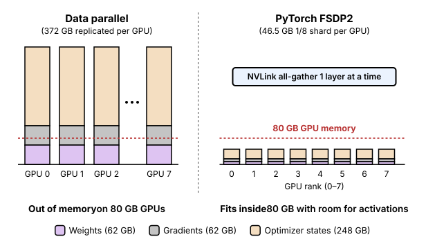
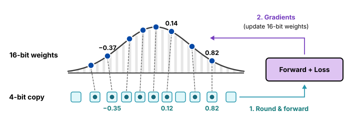

# 擴展規模

當微調或對齊流程在小樣本上跑通之後，兩種擴展技術可以協助你把它推向正式環境：

* **多 GPU 訓練**：當模型或批次大小超出單張顯示卡時，把訓練分片到多張 GPU 上。
* **量化感知訓練**（QAT）：執行 QAT，以最小的品質損失，從 16 位元精度走向 4 位元精度。

本指南涵蓋使用 PyTorch FSDP2 與 Accelerate 的多 GPU 分片、多 GPU QLoRA 資料並行，以及使用 TorchAO 的訓練後 QAT。若要把完成的檢查點打包給 vLLM、GGUF 或 LiteRT-LM 使用，請見[匯出](export.md)。

---

## 1. 使用 FSDP2 進行多 GPU 訓練

一般來說，使用多張 GPU 訓練時，每張 GPU 都會有一份模型權重、梯度與最佳化器狀態的副本。對 Gemma 4 31B 而言，每張 GPU 大約需要 370 GB（權重約 60 GB、梯度約 60 GB、最佳化器狀態約 250 GB），是 80 GB GPU 記憶體的四倍多。

要把權重、梯度與最佳化器狀態平均分配到各張 GPU 上，我們可以使用 **PyTorch FSDP2**（完全分片資料並行，Fully Sharded Data Parallel）。FSDP2 不會在每張顯示卡上複製完整模型，而是把訓練狀態切分到所有 GPU 上，讓每張顯示卡只儲存其中一部分。在八張 GPU 上，每張顯示卡只持有總量的八分之一（每張 GPU 約 46 GB），可以輕鬆放進 80 GB GPU：



在前向與反向傳播期間，GPU 會透過 NVLink 一次收集一層的權重，並在該層完成後立即釋放暫存副本。

接著，你可以把以下設定儲存為 `fsdp2_config.yaml`，把 Gemma 4 的層分片到 8 GPU 節點上（請依你的 GPU 數量調整 `num_processes`）：

```yaml
compute_environment: LOCAL_MACHINE
distributed_type: FSDP
downcast_bf16: 'no'
fsdp_config:
  fsdp_version: 2
  fsdp_auto_wrap_policy: TRANSFORMER_BASED_WRAP
  fsdp_backward_prefetch: BACKWARD_PRE
  fsdp_cpu_ram_efficient_loading: true
  fsdp_forward_prefetch: false
  fsdp_offload_params: false
  fsdp_reshard_after_forward: true
  fsdp_state_dict_type: SHARDED_STATE_DICT
  fsdp_sync_module_states: true
  fsdp_use_orig_params: true
machine_rank: 0
main_training_function: main
mixed_precision: bf16
num_machines: 1
num_processes: 8
rdzv_backend: static
same_network: true
use_cpu: false
```

要使用它，請用 `accelerate launch` 啟動任何 TRL 腳本（`SFTTrainer`、`DPOTrainer` 或 `GRPOTrainer`）：

```bash
accelerate launch --config_file fsdp2_config.yaml train_sft.py
```

??? tip "多 GPU QLoRA 資料並行"
    如果你在多張 GPU 上執行 4 位元 QLoRA 以提高批次處理量，而且 4 位元模型已經放得進單張 GPU，請不要使用 `device_map="auto"`。請改為把每個處理程序固定到各自的本機 GPU 排名：

    ```python
    from accelerate import PartialState
    from transformers import AutoModelForMultimodalLM

    # Pin each Accelerate worker process to its own local GPU rank
    device_string = PartialState().process_index
    model = AutoModelForMultimodalLM.from_pretrained(
        "google/gemma-4-E4B-it",
        quantization_config=bnb_config,
        device_map={"": device_string},
    )
    ```

---

## 2. 量化感知訓練

當你在訓練完成後把 16 位元模型量化為 4 位元整數時，把每個權重四捨五入為 16 個離散值之一，會引入雜訊，可能損害數學、程式設計與嚴格格式任務的精度。

量化感知訓練（QAT）會在微調的最後 500 至 1,500 步期間模擬 4 位元四捨五入，讓模型適應四捨五入的網格。

!!! note "如果不做微調，請從 Google 官方 QAT 檢查點開始"
    如果你想要 4 位元 Gemma 4 權重而不做自訂微調，請直接下載 Google 預先建置的 QAT 檢查點（`-qat-q4_0-gguf`、`-qat-w4a16-ct` 或 `-qat-q4_0-unquantized`）——請見[量化感知訓練](../get-started/qat.md)。只有在自訂 `bfloat16` 微調或對齊之後想恢復 4 位元精度時，才執行下方的 TorchAO 迴圈。



如上所示，每個 QAT 步驟都遵循兩階段迴圈：

1. **為前向傳播四捨五入**：訓練會把主權重保持在 16 位元精度（例如 -0.37、0.14 與 0.82），但在計算前向傳播與損失之前，先把暫存副本四捨五入為 4 位元值（-0.35、0.12 與 0.82）。
2. **更新 16 位元權重**：在反向傳播期間，梯度會回流並更新 16 位元主權重，讓它們穩定在能乾淨四捨五入的值上。

使用 PyTorch 的 [TorchAO](https://github.com/pytorch/ao) 函式庫，在微調後的 Gemma 4 模型上執行 QAT 只需三個步驟：準備模型以模擬 4 位元四捨五入、執行一次簡短的訓練、把權重轉換為打包的 4 位元整數。

我們還會傳入一個小型篩選函式，讓 QAT 只針對文字解碼器中的線性層，並把嵌入與視覺或音訊編碼器保持在 16 位元精度：

```python
import torch
from transformers import AutoModelForMultimodalLM, AutoProcessor, TorchAoConfig
from transformers.quantizers.quantizer_torchao import TorchAoHfQuantizer
from trl import SFTConfig, SFTTrainer
from torchao.quantization import (
    Int8DynamicActivationIntxWeightConfig,
    PerGroup,
    quantize_,
)
from torchao.quantization.qat import QATConfig

# Load the fine-tuned checkpoint and processor in bfloat16
model_id = "google/gemma-4-E2B-it"
processor = AutoProcessor.from_pretrained(model_id)
model = AutoModelForMultimodalLM.from_pretrained(
    model_id,
    dtype=torch.bfloat16,
    device_map="auto",
)

# Configure 4-bit per-group quantization for decoder linear layers
base_config = Int8DynamicActivationIntxWeightConfig(
    weight_dtype=torch.int4,
    weight_granularity=PerGroup(32),
)


def qat_filter(module, fqn):
    return (
        isinstance(module, torch.nn.Linear)
        and fqn.startswith("model.language_model.layers.")
        and module.in_features % 32 == 0
    )


# Step 1: Prepare the decoder linear layers to simulate 4-bit rounding
quantize_(model, QATConfig(base_config, step="prepare"), filter_fn=qat_filter)

# Step 2: Train for a short recovery pass at a low learning rate
qat_args = SFTConfig(
    output_dir="gemma-4-e2b-qat",
    max_steps=500,
    per_device_train_batch_size=1,
    gradient_accumulation_steps=8,
    learning_rate=1e-5,
    lr_scheduler_type="cosine",
    warmup_steps=0.10,
    optim="adamw_torch_8bit",
    gradient_checkpointing=True,
    bf16=True,
)

trainer = SFTTrainer(
    model=model,
    args=qat_args,
    train_dataset=train_dataset,
    processing_class=processor,
)
trainer.train()

# Step 3: Convert the layers into packed 4-bit weights
quantize_(model, QATConfig(base_config, step="convert"), filter_fn=qat_filter)

ao_config = TorchAoConfig(quant_type=base_config)
model.hf_quantizer = TorchAoHfQuantizer(ao_config)
model.config.quantization_config = ao_config
model.save_pretrained("gemma-4-e2b-int4-qat-exported")
processor.save_pretrained("gemma-4-e2b-int4-qat-exported")
```

---

## 接下來

<div class="card-grid">
<a class="card" href="export.md">
  <span class="card-icon">{{ icon('lucide/rocket') }}</span>
  <div class="card-title">匯出</div>
  <p class="card-desc">使用 vLLM、GGUF、Ollama 或 LiteRT-LM 打包並提供微調後的 Gemma 4 檢查點。</p>
</a>
<a class="card" href="../get-started/qat.md">
  <span class="card-icon">{{ icon('lucide/cpu') }}</span>
  <div class="card-title">量化感知訓練</div>
  <p class="card-desc">探索官方 QAT 檢查點格式，以及 GPU、桌上型電腦與行動硬體上的記憶體占用。</p>
</a>
<a class="card" href="full-finetune.md">
  <span class="card-icon">{{ icon('lucide/sliders-horizontal') }}</span>
  <div class="card-title">完整微調</div>
  <p class="card-desc">檢視單 GPU 完整微調的超參數、餘弦排程與損失曲線診斷。</p>
</a>
<a class="card" href="index.md">
  <span class="card-icon">{{ icon('lucide/graduation-cap') }}</span>
  <div class="card-title">微調總覽</div>
  <p class="card-desc">回到 Gemma 4 微調總覽，比較各種方法與硬體需求。</p>
</a>
</div>

--8<-- "glossary.md"
