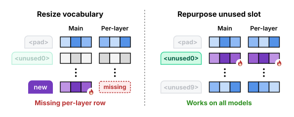
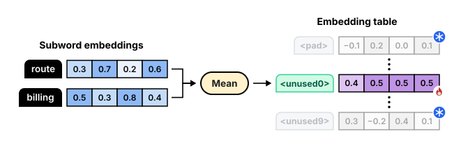
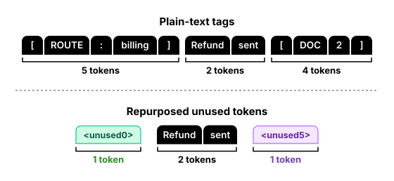
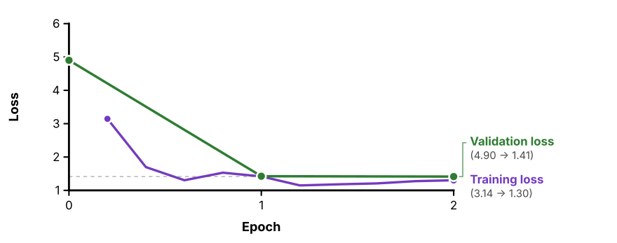

# 未使用詞元

每個 Gemma 4 檢查點都附帶 **6,227 個保留詞元槽位**，也就是從 `<unused0>`（詞元 ID `6`）到 `<unused6226>`（詞元 ID `262143`）。這些未使用詞元已經內建在 262,144 個詞元的詞彙表中。如此一來，我們可以保持詞彙表大小不變，就地重複使用 `<unused*>` 槽位。把詞彙表大小固定在 `262,144`，適用於**每種** Gemma 4 模型，不會破壞各層嵌入，也不會影響後續的 GGUF 與 LiteRT-LM 匯出。

在本指南中，我們把八個未使用槽位變成 `google/gemma-4-E2B-it` 上的單一詞元路由標籤與來源標籤。

---

## 1. 重複使用槽位，對比調整詞彙表大小

在 **Gemma 4 E2B** 與 **E4B** 上，每個解碼器層除了主嵌入表之外，還會查找一張獨立的各層嵌入表。如果我們擴大實際詞彙表，就會出問題，因為各層嵌入仍維持在 `262,144` 個詞元，進而引發錯誤：



---

## 2. 初始化並訓練選定的詞元

由於 `<unused0>` 到 `<unused6226>` 如其名所示從未使用過，它們的嵌入目前還沒有任務意義。從頭訓練它們需要更長時間，而解凍完整的 262,144 列嵌入表又會增加超過 4 億個可訓練權重。

我們可以用兩個步驟避開這兩個問題：先從子詞嵌入初始化未使用詞元，再只訓練該列：

1. **從現有詞彙初始化**：在附加 LoRA 之前，把每個新詞元的簡短描述（例如 `<unused0>`{.token-tool} 的 `"route billing"`）切成現有的子詞，再把子詞的平均值複製到該槽位的列中。
2. **只訓練您使用的列**：在 `LoraConfig` 中傳入 `trainable_token_indices`，讓 PEFT 只更新您選定的列（E2B 上 8 個詞元不到 10 萬個權重，而非 4.02 億個），合併時也能乾淨地折回模型。



這是個很巧妙的技巧，讓我們不必完全從頭訓練。

!!! important "在以 PEFT 包裝模型之前先初始化列"
    PEFT 會在您呼叫 `get_peft_model()` 的當下複製起始嵌入列。請務必在呼叫 `get_peft_model()` **之前**執行子詞初始化，讓訓練從平均後的向量開始。

---

## 3. 建立單一詞元

`[ROUTE: billing]` 或 `[DOC2]` 這類純文字標籤，每次模型生成時都會被切成好幾個詞元。把這些標籤對應到 `<unused0>` 至 `<unused7>`，每個標籤就變成單一生成步驟：



使用單一詞元表示結構化標籤有三個好處：

- **更快的生成**：寫出 `<unused0>`{.token-tool} 與 `<unused5>`{.token-multi} 各只需一步，而不是九個括號、冒號與標籤詞元。
- **單步路由分數**：觀察第一個生成詞元在 ID `6` 到 `11` 上的機率，就能在單次前向傳遞中直接得到每條路由的信心分數。
- **不會斷在括號中間**：單一詞元 ID 不會像 `[ROUTE: billing` 這樣在標籤中間被截斷。

---

## 4. 設定環境

一如往常，我們先安裝 Hugging Face 後訓練與評估函式庫：

```python { .notebook-cell }
# Install Hugging Face post-training, quantization, multimodal, and evaluation libraries
%pip install -q -U "transformers>=5.10.1" "trl>=0.16.0" "peft>=0.19.0" accelerate datasets bitsandbytes torchao
%pip install -q -U evaluate sacrebleu jiwer pillow soundfile librosa matplotlib tensorboard
```

如果您打算把轉接器推送到 Hugging Face Hub，請用寫入權杖登入：

```python { .notebook-cell }
from huggingface_hub import login

# Optional: uncomment to push your trained adapter to the Hugging Face Hub
# login()
```

---

## 5. 註冊未使用詞元

要註冊未使用詞元，我們先載入 `google/gemma-4-E2B-it` 分詞器，接著檢查它有多少個 `<unused*>` 槽位，並註冊 `<unused0>` 至 `<unused7>`（ID `6` 到 `13`）：

```python { .notebook-cell .model-swap }
from tokenizers import AddedToken
from transformers import AutoTokenizer

model_id = "google/gemma-4-E2B-it"
tokenizer = AutoTokenizer.from_pretrained(model_id)

# Count all reserved <unused*> slots in Gemma 4's 262,144-token vocabulary
vocab = tokenizer.get_vocab()
unused_slots = sorted(
    [(tok, idx) for tok, idx in vocab.items() if tok.startswith("<unused") and tok.endswith(">")],
    key=lambda item: item[1],
)
print(f"Reserved slots: {len(unused_slots)} ({unused_slots[0]} .. {unused_slots[-1]})")

# Show why unregistered '<unused0>' after a space splits into 5 subwords
print("Before registration:", tokenizer.tokenize("Answer <unused0>"))

# Map 6 task-routing intents + 2 source-citation badges to IDs 6..13
SLOT_PHRASES = {
    "<unused0>": "route closed question answering",
    "<unused1>": "route information extraction",
    "<unused2>": "route text summarization",
    "<unused3>": "route classification",
    "<unused4>": "route open question answering",
    "<unused5>": "route creative brainstorming",
    "<unused6>": "cite provided reference context",
    "<unused7>": "cite general model knowledge",
}

# Register with special=False, normalized=False so vocab stays 262,144 and decode() keeps tags
tokenizer.add_tokens(
    [AddedToken(slot, special=False, normalized=False) for slot in SLOT_PHRASES]
)
target_token_ids = [tokenizer.convert_tokens_to_ids(slot) for slot in SLOT_PHRASES]
print("After registration: ", tokenizer.tokenize("Answer <unused0>"))
print(f"Target IDs: {target_token_ids} | Vocab size: {len(tokenizer)}")

# Compare token count on a sample routed + cited answer
plain_example = "[ROUTE: billing] Refund sent [DOC2]"
compact_example = "<unused0>Refund sent<unused5>"
print(
    f"Token compression: {len(tokenizer.encode(plain_example, add_special_tokens=False))} plain tokens "
    f"-> {len(tokenizer.encode(compact_example, add_special_tokens=False))} compact tokens"
)
```

```{ .no-copy .output }
Reserved slots: 6227 (('<unused0>', 6) .. ('<unused6226>', 262143))
Before registration: ['Answer', '▁<', 'unused', '0', '>']
After registration:  ['Answer', '▁', '<unused0>']
Target IDs: [6, 7, 8, 9, 10, 11, 12, 13] | Vocab size: 262144
Token compression: 11 plain tokens -> 4 compact tokens
```

---

## 6. 準備資料集

我們從 [`databricks/databricks-dolly-15k`](https://huggingface.co/datasets/databricks/databricks-dolly-15k) 取六種任務類別，對應到 `<unused0>` 至 `<unused5>`。我們想把這些特定類別加入資料，讓未使用詞元承載這些類別的資訊。請注意，這只是範例，您可以使用任何類型的資料，例如不同語言或領域。

每個答案結尾，如果答案使用了參考段落就加上 `<unused6>`，如果仰賴通用知識就加上 `<unused7>`：

```python { .notebook-cell }
from datasets import load_dataset

CATEGORY_TO_SLOT = {
    "closed_qa": "<unused0>",
    "information_extraction": "<unused1>",
    "summarization": "<unused2>",
    "classification": "<unused3>",
    "open_qa": "<unused4>",
    "brainstorming": "<unused5>",
}

SYSTEM_INSTRUCTION = (
    "Prefix every response with its route token (<unused0>..<unused5>) and end with "
    "<unused6> when grounded in a Reference block or <unused7> when using general knowledge."
)

# Filter Dolly-15k to our six target categories and keep concise examples
raw_ds = load_dataset("databricks/databricks-dolly-15k", split="train").shuffle(seed=42)
filtered_ds = raw_ds.filter(
    lambda r: r["category"] in CATEGORY_TO_SLOT
    and len(r["context"]) < 1200
    and 20 < len(r["response"]) < 600
)


def format_routed_example(row):
    route_tok = CATEGORY_TO_SLOT[row["category"]]
    has_ctx = bool(row["context"].strip())
    cite_tok = "<unused6>" if has_ctx else "<unused7>"
    user_body = (
        f"Reference:\n{row['context'].strip()}\n\nQuestion: {row['instruction'].strip()}"
        if has_ctx
        else f"Question: {row['instruction'].strip()}"
    )
    return {
        "prompt": [
            {"role": "system", "content": SYSTEM_INSTRUCTION},
            {"role": "user", "content": user_body},
        ],
        "completion": [
            {"role": "assistant", "content": f"{route_tok}{row['response'].strip()}{cite_tok}"},
        ],
        "expected_route": route_tok,
        "expected_cite": cite_tok,
    }


formatted_ds = filtered_ds.select(range(1300)).map(
    format_routed_example, remove_columns=filtered_ds.column_names
)
train_dataset = formatted_ds.select(range(1200))
eval_dataset = formatted_ds.select(range(1200, 1300))
print(f"Prepared {len(train_dataset)} train and {len(eval_dataset)} eval examples")
print("Sample completion:", train_dataset[0]["completion"][0]["content"][:140])
```

```{ .no-copy .output }
Prepared 1200 train and 100 eval examples
Sample completion: <unused4>Garth the Gardener, John the Oak, Gilbert of the Vines, Brandon of the Bloody Blade, Foss the Archer, Owen Oakenshield, Harlon the
```

---

## 7. 載入模型

現在我們以 4-bit NF4 精度載入 `google/gemma-4-E2B-it` 模型，從子詞平均值初始化第 `6` 到 `13` 列，最後設定 LoRA，讓它在線性轉接器之外只訓練這八個詞元列：

```python { .notebook-cell }
import torch
from transformers import AutoModelForMultimodalLM, BitsAndBytesConfig
from peft import LoraConfig, get_peft_model, prepare_model_for_kbit_training

# Configure 4-bit NF4 quantization (embedding tables remain in bfloat16)
bnb_config = BitsAndBytesConfig(
    load_in_4bit=True,
    bnb_4bit_use_double_quant=True,
    bnb_4bit_quant_type="nf4",
    bnb_4bit_compute_dtype=torch.bfloat16,
    bnb_4bit_quant_storage=torch.bfloat16,
)

model = AutoModelForMultimodalLM.from_pretrained(
    model_id,
    dtype=torch.bfloat16,
    device_map="auto",
    quantization_config=bnb_config,
)
model = prepare_model_for_kbit_training(model)


# Copy the mean of subwords into embed_tokens and (on E2B/E4B) embed_tokens_per_layer
@torch.no_grad()
def initialize_unused_tokens(model, tokenizer, slot_to_phrase):
    text_model = model.model.language_model
    embedding_tables = [text_model.embed_tokens.weight]
    if hasattr(text_model, "embed_tokens_per_layer"):
        embedding_tables.append(text_model.embed_tokens_per_layer.weight)

    for slot_token, phrase in slot_to_phrase.items():
        slot_id = tokenizer.convert_tokens_to_ids(slot_token)
        subword_ids = tokenizer.encode(phrase, add_special_tokens=False)
        for weight in embedding_tables:
            weight[slot_id] = weight[subword_ids].mean(dim=0).to(weight.dtype)


# Initialize rows 6..13 BEFORE get_peft_model() snapshots original weights
initialize_unused_tokens(model, tokenizer, SLOT_PHRASES)

text_model = model.model.language_model
trainable_tokens = {"embed_tokens": target_token_ids}
if hasattr(text_model, "embed_tokens_per_layer"):
    trainable_tokens["embed_tokens_per_layer"] = target_token_ids

peft_config = LoraConfig(
    r=16,
    lora_alpha=32,
    lora_dropout=0.0,
    bias="none",
    target_modules=[
        "q_proj",
        "k_proj",
        "v_proj",
        "o_proj",
        "gate_proj",
        "up_proj",
        "down_proj",
    ],
    exclude_modules=r"model\.(vision_tower|audio_tower)\..*",
    trainable_token_indices=trainable_tokens,
    task_type="CAUSAL_LM",
)
model = get_peft_model(model, peft_config)

# Expose bias=None on PEFT's TrainableTokensWrapper for TRL's fused chunked LM head
if not hasattr(model.get_output_embeddings(), "bias"):
    model.get_output_embeddings().bias = None

model.print_trainable_parameters()
```

```{ .no-copy .output }
trainable params: 24,242,176 || all params: 5,128,539,680 || trainable%: 0.4727
```

<!-- notebook:skip-start -->
??? tip "用 `<unused*>` 縮短長領域詞彙"
    您可以用同一個 `initialize_unused_tokens` 輔助函式，把經常出現的領域詞彙（例如醫療代碼、產品 ID 或財務指標）縮短，這些詞彙原本會被切成許多子詞：

    ```python
    # Map recurring multi-token terms to <unused100>..<unused102>
    DOMAIN_TERMS = {
        "EGFR_T790M": "<unused100>",
        "HbA1c_mmol": "<unused101>",
        "Q3_EBITDA": "<unused102>",
    }
    tokenizer.add_tokens(
        [AddedToken(slot, special=False, normalized=False) for slot in DOMAIN_TERMS.values()]
    )
    initialize_unused_tokens(
        model, tokenizer, {slot: term for term, slot in DOMAIN_TERMS.items()}
    )
    ```

    在分詞之前，先把資料集中的這些字串替換掉（解碼後再把 `<unused100>` 對應回 `"EGFR_T790M"`），即可在詞彙表維持 `262,144` 的情況下縮短序列。
<!-- notebook:skip-end -->

---

## 8. 評估基礎模型

首先，我們檢查基礎模型在 40 個保留範例上寫出有效 `<unused*>` 標籤的頻率：

```python { .notebook-cell }
from torch.optim import AdamW
from trl import SFTConfig, SFTTrainer

ROUTE_SLOTS = set(CATEGORY_TO_SLOT.values())


# Check route accuracy and citation accuracy on 40 unseen examples
def evaluate_primitives(dataset_slice):
    model.eval()
    route_hits, cite_hits, valid_structure = 0, 0, 0
    for row in dataset_slice:
        prompt_text = tokenizer.apply_chat_template(
            row["prompt"], tokenize=False, add_generation_prompt=True, enable_thinking=False
        )
        inputs = tokenizer(prompt_text, return_tensors="pt").to(model.device)
        with torch.no_grad():
            out_ids = model.generate(
                **inputs, max_new_tokens=96, do_sample=False, use_cache=True
            )
        gen_ids = out_ids[0][inputs["input_ids"].shape[1] :]
        decoded = tokenizer.decode(gen_ids, skip_special_tokens=True).strip()
        starts_valid = any(decoded.startswith(s) for s in ROUTE_SLOTS)
        ends_valid = decoded.endswith("<unused6>") or decoded.endswith("<unused7>")
        valid_structure += int(starts_valid and ends_valid)
        route_hits += int(decoded.startswith(row["expected_route"]))
        cite_hits += int(decoded.endswith(row["expected_cite"]))
    n = len(dataset_slice)
    return {
        "valid_tag_pct": 100.0 * valid_structure / n,
        "route_acc_pct": 100.0 * route_hits / n,
        "cite_acc_pct": 100.0 * cite_hits / n,
    }


test_slice = eval_dataset.select(range(40))
before_metrics = evaluate_primitives(test_slice)
print(f"Before SFT: {before_metrics}")
```

```{ .no-copy .output }
Before SFT: {'valid_tag_pct': 0.0, 'route_acc_pct': 0.0, 'cite_acc_pct': 0.0}
```

訓練前，即使系統提示詞有要求，模型輸出的有效 `<unused*>` 標籤配對仍是 `0.0%`，因為第 `6` 到 `13` 列從未在對話中訓練過。

---

## 9. 訓練模型

現在，我們可以用 `2e-4` 的學習率訓練 LoRA 轉接器、以 `1e-4` 訓練選定的詞元列，訓練兩個週期：

```python { .notebook-cell }
lora_lr = 2e-4
token_lr = 1e-4

token_params, lora_params = [], []
for name, param in model.named_parameters():
    if not param.requires_grad:
        continue
    if "trainable_tokens" in name:
        token_params.append(param)
    else:
        lora_params.append(param)

optimizer = AdamW(
    [
        {"params": lora_params, "lr": lora_lr, "weight_decay": 0.01},
        {"params": token_params, "lr": token_lr, "weight_decay": 0.0},
    ]
)

# Train only on the assistant completion (route tag + answer + source tag)
sft_args = SFTConfig(
    output_dir="gemma-4-unused-tokens",
    max_length=1024,
    completion_only_loss=True,
    num_train_epochs=2,
    per_device_train_batch_size=4,
    gradient_accumulation_steps=4,
    learning_rate=lora_lr,
    warmup_steps=0.05,
    lr_scheduler_type="cosine",
    max_grad_norm=1.0,
    bf16=True,
    logging_steps=15,
    eval_strategy="epoch",
    eval_on_start=True,
    save_strategy="epoch",
    report_to="tensorboard",
    seed=42,
)

trainer = SFTTrainer(
    model=model,
    args=sft_args,
    train_dataset=train_dataset.remove_columns(["expected_route", "expected_cite"]),
    eval_dataset=eval_dataset.remove_columns(["expected_route", "expected_cite"]),
    processing_class=tokenizer,
    optimizers=(optimizer, None),
)
model.train()
trainer.train()
```

```{ .no-copy .output }
[150/150 08:49, Epoch 2/2]

| Epoch | Training Loss | Validation Loss | Mean Token Accuracy |
|---|---|---|---|
| 0 | — | 4.9008 | 0.5439 |
| 1 | 1.4174 | 1.4244 | 0.6762 |
| 2 | 1.3033 | 1.4140 | 0.6764 |
```

<!-- notebook:skip-start -->
??? info "檢視訓練曲線"
    
<!-- notebook:skip-end -->

---

## 10. 評估微調後的模型

訓練後，我們在保留範例上重新執行評估，再儲存轉接器與更新後的分詞器：

```python { .notebook-cell }
after_metrics = evaluate_primitives(test_slice)
print(f"Before SFT: {before_metrics}")
print(f"After SFT:  {after_metrics}\n")

# Check route probabilities from a single forward pass
sample = test_slice[0]
print(f"Expected route: {sample['expected_route']} ({SLOT_PHRASES[sample['expected_route']]})")
prompt_text = tokenizer.apply_chat_template(
    sample["prompt"], tokenize=False, add_generation_prompt=True, enable_thinking=False
)
inputs = tokenizer(prompt_text, return_tensors="pt").to(model.device)
with torch.no_grad():
    next_token_logits = model(**inputs).logits[0, -1, :]
    route_ids = target_token_ids[:6]
    route_probs = torch.softmax(next_token_logits[route_ids].float(), dim=-1)

for slot, prob in zip(list(SLOT_PHRASES)[:6], route_probs.tolist()):
    print(f"  {slot} ({SLOT_PHRASES[slot]}): {prob:.1%}")

# Save both the adapter and the updated tokenizer.json
trainer.save_model("gemma-4-unused-tokens")
tokenizer.save_pretrained("gemma-4-unused-tokens")
```

```{ .no-copy .output }
Before SFT: {'valid_tag_pct': 0.0, 'route_acc_pct': 0.0, 'cite_acc_pct': 0.0}
After SFT:  {'valid_tag_pct': 95.0, 'route_acc_pct': 82.5, 'cite_acc_pct': 90.0}

Expected route: <unused4> (route open question answering)
  <unused0> (route closed question answering): 0.6%
  <unused1> (route information extraction): 0.6%
  <unused2> (route text summarization): 0.4%
  <unused3> (route classification): 42.9%
  <unused4> (route open question answering): 44.2%
  <unused5> (route creative brainstorming): 11.2%
```

經過兩個週期的監督式微調，效能提升了不少！善用未使用詞元後，效能退化的風險較低，因為訓練大多集中在這些詞元上。

---

## 接下來

<div class="card-grid">
<a class="card" href="custom-chat-template.md">
  <span class="card-icon">{{ icon('lucide/notebook-pen') }}</span>
  <div class="card-title">自訂聊天範本</div>
  <p class="card-desc">使用 ChatML 與 QLoRA，把預訓練基礎模型變成多輪聊天助手。</p>
</a>
<a class="card" href="continued-pretraining.md">
  <span class="card-icon">{{ icon('lucide/book-open') }}</span>
  <div class="card-title">持續預訓練</div>
  <p class="card-desc">打包未標註的領域文件，讓 Gemma 4 適應新語言。</p>
</a>
<a class="card" href="datasets-formatting.md">
  <span class="card-icon">{{ icon('lucide/braces') }}</span>
  <div class="card-title">資料集格式</div>
  <p class="card-desc">整理思考區塊、多輪歷史與串連工具呼叫。</p>
</a>
<a class="card" href="export.md">
  <span class="card-icon">{{ icon('lucide/rocket') }}</span>
  <div class="card-title">匯出</div>
  <p class="card-desc">把合併後的 262,144 詞彙表檢查點轉換為 vLLM、GGUF 與 LiteRT-LM。</p>
</a>
</div>
