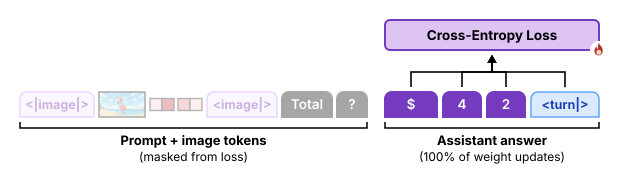
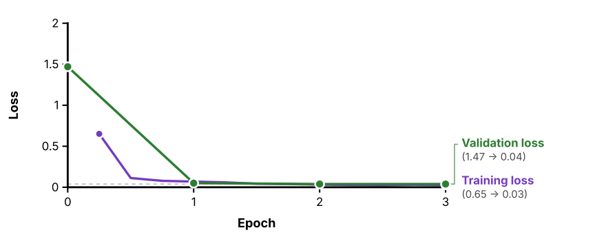

# 視覺微調

Gemma 4 家族的每個模型都能原生接受圖片與文字。在影像-文字配對上微調 Gemma 4，可以打造收據與文件 OCR、醫學影像、圖表擷取、UI 定位與商品編目等視覺助理。

!!! note "硬體需求"
    視覺微調需要支援 bfloat16 的 GPU（例如 NVIDIA L4、A100、H100 或 RTX 30/40/50 系列），E2B 與 E4B 至少需要 16 GB VRAM，12B 需要 24 GB，26B A4B 與 31B 則需要 48 至 80 GB。

---

## 1. 選擇視覺詞元預算

許多較舊的視覺語言模型會把每張圖片裁切成固定正方形，導致寬圖表與高收據變形。Gemma 4 會保留每張圖片原本的長寬比，將其切成圖塊，再彙整為可選的詞元預算：


每張圖片會包在 `<|image|>`{.token-multi} 與 `<image|>`{.token-multi} 詞元之間，並轉換為軟詞元。視覺詞元預算決定會產生多少個詞元。將預算從 1,120 個詞元降到 280 個詞元，可將視覺詞元數量減少 4 倍，進而降低活化記憶體，讓您能使用更大的批次大小。以下是選擇預算的一些指導原則：

- **70 或 140 個詞元**：最適合縮圖、多圖提示，或想使用較大批次大小的快速分類。
- **280 個詞元（預設）**：一般視覺問答、商品照片與 UI 截圖的良好平衡。
- **560 或 1,120 個詞元**：適用於密集 PDF 頁面、財務圖表、示意圖與小字 OCR 的高細節預算。

---

## 2. 兩種架構

圖片圖塊會透過專用的視覺編碼器（除 12B 以外的所有模型）或無編碼器的嵌入器（12B）處理。微調模型時，請注意除了轉接器之外，其他部分一律凍結：


如圖所示，編碼輸入圖片與訓練轉接器有兩種不同的架構：

1. **獨立視覺編碼器** *(E2B、E4B、26B A4B 與 31B)*：圖片會切成 16x16 像素的「圖塊」，再通過視覺編碼器。對於 OCR、圖說生成與商品描述等大多數任務，請保持視覺編碼器凍結，並將 LoRA 轉接器附加到語言層。只有當您希望模型學習它未曾見過的事物（例如 X 光片或衛星雷達影像）時，才解凍視覺編碼器。
2. **無編碼器（12B）**：Gemma 4 12B 沒有獨立的視覺編碼器。取而代之的是，48x48 像素的圖塊會通過凍結的 1x 嵌入器區塊進入 12B，因此將 LoRA 轉接器附加到 12B 的各層，就能同時調整視覺與文字。

---

## 3. 遮罩詞元

如前所述，遮罩輸入詞元很重要，這樣損失才只會嘗試預測輸出詞元，而不是嘗試預測輸入的圖片詞元。



如果不遮罩輸入圖片詞元，交叉熵損失會嘗試預測輸入圖片的佔位符 ID，進而破壞梯度。將所有提示與圖片詞元遮罩後，100% 的權重更新都會指向模型的文字回答與結尾的 `<turn|>`{.token-turn} 詞元。

---

## 4. 設定環境

我們將在 [`naver-clova-ix/cord-v2`](https://huggingface.co/datasets/naver-clova-ix/cord-v2) 上微調 Gemma 4，這是一個用於收據解析的多模態資料集。我們會使用資料集中的 1000 個範例進行訓練與驗證。目標是擷取收據上的結構化品項，例如小計與折扣。

首先，安裝 Hugging Face 的後訓練、量化、多模態與評估函式庫：

```python { .notebook-cell }
# Install Hugging Face post-training, quantization, multimodal, and evaluation libraries
%pip install -q -U "transformers>=5.10.1" "trl>=0.16.0" "peft>=0.19.0" accelerate datasets bitsandbytes torchao
%pip install -q -U evaluate sacrebleu jiwer pillow soundfile librosa matplotlib tensorboard
```

如果您打算將訓練好的轉接器推送到 Hugging Face Hub，請使用具寫入權限的權杖登入：

```python { .notebook-cell }
# Optional: Uncomment if using gated checkpoints or pushing to the Hub
# from huggingface_hub import login
# login()
```

---

## 5. 準備資料集


接下來是將資料集準備成對話格式：

```python { .notebook-cell }
import json
from datasets import load_dataset

system_message = (
    "You are a document extraction assistant that parses receipt images into "
    "structured JSON using the CORD schema (menu, sub_total, total). "
    "Return only valid JSON without markdown code fences."
)
user_prompt = "Extract all line items, subtotals, and totals from this receipt image as JSON."


# Format each receipt photo and ground-truth JSON into a multimodal conversation
def format_batch(batch):
    messages_list = []
    images_list = []
    for img, gt in zip(batch["image"], batch["ground_truth"]):
        rgb_img = img.convert("RGB")
        gt_parse = json.loads(gt)["gt_parse"]
        images_list.append(rgb_img)
        messages_list.append(
            [
                {"role": "system", "content": system_message},
                {
                    "role": "user",
                    "content": [
                        {"type": "image", "image": rgb_img},
                        {"type": "text", "text": user_prompt},
                    ],
                },
                {
                    "role": "assistant",
                    "content": [
                        {"type": "text", "text": json.dumps(gt_parse, ensure_ascii=False)}
                    ],
                },
            ]
        )
    return {"image": images_list, "messages": messages_list}


# Attach the lazy batch transform to the train, validation, and test splits
raw_dataset = load_dataset("naver-clova-ix/cord-v2")
dataset_train = raw_dataset["train"].with_transform(format_batch)
dataset_val = raw_dataset["validation"].with_transform(format_batch)
dataset_test = raw_dataset["test"].with_transform(format_batch)

print(f"Splits: train={len(dataset_train)}, val={len(dataset_val)}, test={len(dataset_test)}")
print(dataset_train[0]["messages"])
```

```{ .no-copy .output }
Splits: train=800, val=100, test=100
[{'role': 'system', 'content': 'You are a document extraction assistant that parses receipt images into structured JSON using the CORD schema (menu, sub_total, total). Return only valid JSON without markdown code fences.'}, {'role': 'user', 'content': [{'type': 'image', 'image': <PIL.Image.Image image mode=RGB size=864x1296>}, {'type': 'text', 'text': 'Extract all line items, subtotals, and totals from this receipt image as JSON.'}]}, {'role': 'assistant', 'content': [{'type': 'text', 'text': '{"menu": [{"nm": "Nasi Campur Bali", "cnt": "1 x", "price": "75,000"}, {"nm": "Bbk Bengil Nasi", "cnt": "1 x", "price": "125,000"}, ...], "sub_total": {"subtotal_price": "1,346,000", "service_price": "100,950", "tax_price": "144,695", "etc": "-45"}, "total": {"total_price": "1,591,600"}}'}]}]
```

請注意，在同一個回合中，圖片一定在文字之前。這是 Gemma 4 模型訓練的一部分，比起把圖片放在文字之後，這樣的順序通常能帶來更好的效能。

---

## 6. 載入模型

我們將以 4-bit 載入 Gemma 4 檢查點，並將詞元預算設為 560。560 是準確度與速度之間不錯的折衷。收據尤其能受益於更多的視覺詞元，因此值得進一步提高預算以改善效能（代價是速度變慢）。

```python { .notebook-cell .model-swap }
import torch
from transformers import AutoModelForMultimodalLM, AutoProcessor, BitsAndBytesConfig

model_id = "google/gemma-4-E2B-it"

# Configure 4-bit NF4 quantization with bfloat16 compute
bnb_config = BitsAndBytesConfig(
    load_in_4bit=True,
    bnb_4bit_use_double_quant=True,
    bnb_4bit_quant_type="nf4",
    bnb_4bit_compute_dtype=torch.bfloat16,
    bnb_4bit_quant_storage=torch.bfloat16,
)

# Load the multimodal base model and processor
model = AutoModelForMultimodalLM.from_pretrained(
    model_id,
    dtype=torch.bfloat16,
    device_map="auto",
    quantization_config=bnb_config,
)
processor = AutoProcessor.from_pretrained(model_id)

# Set the 560-token high-detail budget for dense receipt OCR (70, 140, 280, 560, or 1120)
processor.image_processor.max_soft_tokens = 560
```

---

## 7. 評估基底模型

我們先在保留的收據上評估基底模型，建立一個可供比較的基準：

```python { .notebook-cell }
# Evaluate CORD schema adherence and exact total_price accuracy on held-out receipts
def evaluate_receipts(eval_model, eval_processor, samples):
    eval_model.eval()
    stop_ids = [
        eval_processor.tokenizer.eos_token_id,
        eval_processor.tokenizer.convert_tokens_to_ids("<turn|>"),
    ]
    schema_ok, total_matches, total_count = 0, 0, 0
    preds = []

    for idx in range(len(samples)):
        sample = samples[idx]
        gold = json.loads(sample["messages"][2]["content"][0]["text"])
        prompt = eval_processor.apply_chat_template(
            sample["messages"][:2], tokenize=False, add_generation_prompt=True
        )
        inputs = eval_processor(
            text=[prompt], images=[[sample["image"]]], padding=True, return_tensors="pt"
        ).to(eval_model.device)

        with torch.no_grad():
            out = eval_model.generate(
                **inputs, max_new_tokens=512, do_sample=False, eos_token_id=stop_ids
            )
        pred_text = eval_processor.decode(
            out[0][inputs.input_ids.shape[1] :], skip_special_tokens=True
        ).strip()
        preds.append(pred_text)

        try:
            pred = json.loads(pred_text)
        except json.JSONDecodeError:
            pred = {}

        pred_total = pred.get("total") if isinstance(pred, dict) else None
        if isinstance(pred_total, dict) and "total_price" in pred_total:
            schema_ok += 1

        gold_price = (gold.get("total") or {}).get("total_price")
        if gold_price is not None:
            total_count += 1
            pred_price = pred_total.get("total_price") if isinstance(pred_total, dict) else pred_total
            if str(pred_price).strip() == str(gold_price).strip():
                total_matches += 1

    metrics = {
        "schema_valid_pct": round(100.0 * schema_ok / len(samples), 1),
        "total_price_acc_pct": round(100.0 * total_matches / max(total_count, 1), 1),
    }
    return metrics, preds


# Measure zero-shot performance on 40 unseen test receipts before training
eval_subset = raw_dataset["test"].select(range(40)).with_transform(format_batch)
before_metrics, before_preds = evaluate_receipts(model, processor, eval_subset)
print("Before QLoRA (40 unseen receipts):", before_metrics)
print("Sample #4 zero-shot output:", before_preds[4])
```

```{ .no-copy .output }
Before QLoRA (40 unseen receipts): {'schema_valid_pct': 0.0, 'total_price_acc_pct': 43.2}
Sample #4 zero-shot output: {"menu": ["ICE BLACKCOFFEE", "AVOCADO COFFEE", "CHICKEN KATSUFF"], "sub_total": 144000, "total": 200000}
```

未經任何微調，模型會出現一些失敗模式，例如誤讀數值（例如把實收現金 `200000` 誤認為實際的 `174,600` 總計），且未遵循精確的巢狀 CORD 格式（`{"total": {"total_price": "174,600"}}`），因為我們簡短的提示並未詳細說明每個巢狀鍵或逗號格式規則。這是很好的訊號，讓我們能在未經任何微調的情況下找出模型失敗的原因。在實際使用情境中，您可能想先找出失敗模式，再決定要使用或收集哪些資料。

---

## 8. 訓練模型

我們先定義 `LoraConfig`，選擇與之前相同的目標投影，並排除視覺編碼器（稱為 `vision_tower`）。請記住，我們不會微調編碼器本身（如果您選擇非 12B 模型），因為只微調模型本身就已經有很大的收穫。

```python { .notebook-cell }
from peft import LoraConfig, prepare_model_for_kbit_training

# Prepare the 4-bit model for gradient checkpointing and k-bit adapter training
model = prepare_model_for_kbit_training(model)

# Configure LoRA adapters on the language layers while keeping vision/audio towers frozen
peft_config = LoraConfig(
    r=16,
    lora_alpha=32,
    lora_dropout=0.0,
    bias="none",
    target_modules=[
        "q_proj",
        "k_proj",
        "v_proj",
        "o_proj",
        "gate_proj",
        "up_proj",
        "down_proj",
    ],
    exclude_modules=r"model\.(vision_tower|audio_tower)\..*",
    task_type="CAUSAL_LM",
)
```

接下來是訓練。這個過程與這些指南中的其他訓練過程類似，只有一處不同：我們需要正確建立多模態批次。這表示要確保批次正確填補，並在損失更新時忽略正確的輸入資訊：

```python { .notebook-cell }
from trl import SFTConfig, SFTTrainer

# Set the training hyperparameters for SFTTrainer
args = SFTConfig(
    output_dir="gemma-4-receipt-json",
    num_train_epochs=3,
    per_device_train_batch_size=2,
    per_device_eval_batch_size=2,
    gradient_accumulation_steps=4,
    optim="adamw_torch_fused",
    logging_steps=25,
    save_strategy="no",
    eval_strategy="epoch",
    eval_on_start=True,
    learning_rate=2e-4,
    warmup_steps=0.05,
    lr_scheduler_type="cosine",
    bf16=True,
    max_grad_norm=1.0,
    report_to="none",
    dataset_text_field="",
    dataset_kwargs={"skip_prepare_dataset": True},
    remove_unused_columns=False,
)

target_tokens = [
    processor.tokenizer.convert_tokens_to_ids("<|turn>"),
    processor.tokenizer.convert_tokens_to_ids("model"),
    processor.tokenizer.convert_tokens_to_ids("\n"),
]
target_len = len(target_tokens)


# Build multimodal batches and mask prompt, padding, and image soft tokens from the loss
def collate_fn(examples):
    texts = [
        processor.apply_chat_template(
            example["messages"], add_generation_prompt=False, tokenize=False
        ).strip()
        for example in examples
    ]
    images = [[example["image"]] for example in examples]

    batch = processor(text=texts, images=images, return_tensors="pt", padding=True)
    labels = batch["input_ids"].clone()

    for i in range(labels.size(0)):
        row_tokens = batch["input_ids"][i].tolist()
        for idx in range(len(row_tokens) - target_len, -1, -1):
            if row_tokens[idx : idx + target_len] == target_tokens:
                labels[i, : idx + target_len] = -100
                break

    labels[labels == processor.tokenizer.pad_token_id] = -100
    labels[labels == processor.tokenizer.boi_token_id] = -100
    labels[labels == processor.tokenizer.image_token_id] = -100
    labels[labels == processor.tokenizer.eoi_token_id] = -100

    batch["labels"] = labels
    return batch


# Initialize and run the multimodal trainer
trainer = SFTTrainer(
    model=model,
    args=args,
    train_dataset=dataset_train,
    eval_dataset=dataset_val,
    peft_config=peft_config,
    processing_class=processor,
    data_collator=collate_fn,
)

trainer.train()
trainer.save_model()
```

```{ .no-copy .output }
[300/300 24:23, Epoch 3/3]

| Epoch | Training Loss | Validation Loss | Mean Token Accuracy |
|---|---|---|---|
| 0 | — | 1.4696 | 0.8571 |
| 1 | 0.0691 | 0.0500 | 0.9869 |
| 2 | 0.0319 | 0.0389 | 0.9907 |
| 3 | 0.0252 | 0.0389 | 0.9908 |
```

<!-- notebook:skip-start -->
??? info "檢視訓練曲線"
    
<!-- notebook:skip-end -->

我們看到健康的損失，這絕對是個好兆頭！

---

## 9. 評估微調後的模型

要評估我們的模型，先釋放 GPU 記憶體並儲存轉接器：

```python { .notebook-cell }
import gc

# Free the 4-bit training model and optimizer states before merging
del model
del trainer
gc.collect()
torch.cuda.empty_cache()
```

```python { .notebook-cell }
from peft import PeftModel
from transformers import AutoModelForMultimodalLM, AutoProcessor

# Merge the trained LoRA adapter into the bfloat16 base checkpoint
base_model = AutoModelForMultimodalLM.from_pretrained(
    model_id,
    low_cpu_mem_usage=True,
    dtype=torch.bfloat16,
    device_map="auto",
)

peft_model = PeftModel.from_pretrained(base_model, args.output_dir)
merged_model = peft_model.merge_and_unload()
merged_model.save_pretrained("merged_vision_model", safe_serialization=True, max_shard_size="2GB")
processor.save_pretrained("merged_vision_model")

del base_model, peft_model, merged_model
torch.cuda.empty_cache()
```

現在，我們可以載入已合併到檢查點中的轉接器，看看它在未見過的收據上的表現：

```python { .notebook-cell }
# Reload the merged checkpoint and evaluate on the 40 unseen test receipts
merged_dir = "merged_vision_model"
reloaded_model = AutoModelForMultimodalLM.from_pretrained(
    merged_dir, device_map="auto", dtype="auto"
)
reloaded_processor = AutoProcessor.from_pretrained(merged_dir)

after_metrics, after_preds = evaluate_receipts(reloaded_model, reloaded_processor, eval_subset)
print("Before QLoRA (40 unseen receipts):", before_metrics)
print("After QLoRA  (40 unseen receipts):", after_metrics)

gold_sample_4 = eval_subset[4]["messages"][2]["content"][0]["text"]
print("\n--- Unseen Test Receipt #4 ---")
print("Ground Truth:", gold_sample_4)
print("Before QLoRA:", before_preds[4])
print("After QLoRA :", after_preds[4])
```

```{ .no-copy .output }
Before QLoRA (40 unseen receipts): {'schema_valid_pct': 0.0, 'total_price_acc_pct': 43.2}
After QLoRA  (40 unseen receipts): {'schema_valid_pct': 95.0, 'total_price_acc_pct': 91.9}

--- Unseen Test Receipt #4 ---
Ground Truth: {"menu": [{"nm": "ICE BLACKCOFFE", "cnt": "2", "price": "82,000"}, {"nm": "AVOCADO COFFEE", "cnt": "1", "price": "61,000"}, {"nm": "CHIKEN KATSU FF", "cnt": "1", "price": "51,000"}], "sub_total": {"subtotal_price": "194,000", "discount_price": "19,400"}, "total": {"total_price": "174,600", "cashprice": "200,000", "changeprice": "25,400"}}
Before QLoRA: {"menu": ["ICE BLACKCOFFEE", "AVOCADO COFFEE", "CHICKEN KATSUFF"], "sub_total": 144000, "total": 200000}
After QLoRA : {"menu": [{"nm": "ICE BLACKCOFFE", "cnt": "2", "price": "82,000"}, {"nm": "NEW AVOCADO COFFEE", "cnt": "1", "price": "61,000"}, {"nm": "OLBE CHIKEN KATSUFF", "cnt": "1", "price": "51,000"}], "sub_total": {"subtotal_price": "194,000", "discount_price": "19,400"}, "total": {"total_price": "174,600", "cashprice": "200,000", "changeprice": "28,400"}}
```

效能提升了不少！只微調語言轉接器，就讓模型學會了精確的巢狀 CORD JSON 結構描述（`95.0%`），並將未見過收據的精確 `total_price` 擷取率提高到 `91.9%`——不過請注意，在範例 #4 中，較困難的字元級品項 OCR（例如 `"NEW AVOCADO COFFEE"` 以及 `"changeprice": "28,400"` 對 `"25,400"`）在精簡的 E2B 模型上仍可能偶爾出錯。這顯示了只微調模型的一小部分（而非整個編碼器）能達到的效果。

---

## 接下來

<div class="card-grid">
<a class="card" href="audio-qlora.md">
  <span class="card-icon">{{ icon('lucide/audio-lines') }}</span>
  <div class="card-title">音訊微調</div>
  <p class="card-desc">針對語音轉錄、方言適應與口說問答，微調 Gemma 4 E2B、E4B 與 12B。</p>
</a>
<a class="card" href="preference-alignment.md">
  <span class="card-icon">{{ icon('lucide/sliders-horizontal') }}</span>
  <div class="card-title">偏好最佳化</div>
  <p class="card-desc">使用選定與拒絕的回應配對，塑造模型的語氣與格式。</p>
</a>
<a class="card" href="reinforcement-learning.md">
  <span class="card-icon">{{ icon('lucide/brain') }}</span>
  <div class="card-title">可驗證獎勵</div>
  <p class="card-desc">使用可驗證的獎勵函式，訓練 Gemma 4 的思考通道。</p>
</a>
<a class="card" href="export.md">
  <span class="card-icon">{{ icon('lucide/rocket') }}</span>
  <div class="card-title">匯出</div>
  <p class="card-desc">將多模態 Gemma 4 模型匯出為 LiteRT-LM、GGUF 或 vLLM。</p>
</a>
</div>
