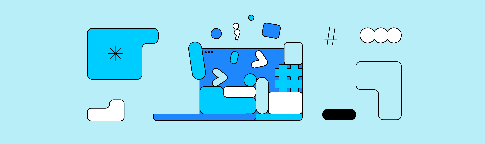

# Gemma 詳解：EmbeddingGemma 架構與配方

!!! note
    最初發表於
    [Google Developers 部落格](https://developers.googleblog.com/gemma-explained-embeddinggemma-architecture-and-recipe/)。



「Gemma 詳解」系列先前的文章詳細介紹了 Gemma 模型家族的架構。各篇文章的連結如下：

- [Gemma 詳解：Gemma 模型家族架構總覽](/tutorials/gemma-explained/overview/)
- [Gemma 詳解：Gemma 2 的新變化](/tutorials/gemma-explained/gemma-2/)
- [Gemma 詳解：RecurrentGemma 架構](/tutorials/gemma-explained/recurrentgemma/)
- [Gemma 詳解：PaliGemma 架構](/tutorials/gemma-explained/paligemma/)
- [Gemma 詳解：Gemma 3 的新變化](/tutorials/gemma-explained/gemma-3/)

在這篇文章中，你將探索全新的 [EmbeddingGemma](../../models/embeddinggemma/index.md) 架構及其配方。若想快速了解，可以閱讀[這篇公告部落格](https://developers.googleblog.com/introducing-embeddinggemma/)。若想全面了解其方法論、實驗與評估，請參閱[完整技術報告](https://arxiv.org/abs/2509.20354)。讓我們開始吧。

## 深入解析 EmbeddingGemma

你是否好奇過，電腦是如何被訓練來解讀文字、片語、甚至整份文件中的含義與上下文？其中的奧妙往往在於一種稱為「嵌入」（embeddings）的東西——一種能捕捉文字本質與含義的數值表示。EmbeddingGemma 是一個能把文字轉換成嵌入的嵌入模型。這些嵌入可以用於搜尋、檢索增強生成，以及語意理解等任務。

## 從 Gemma 到 EmbeddingGemma

EmbeddingGemma 並非從零打造。它起初是一個擁有 3 億參數的預訓練 Gemma 3 模型。接著，我們使用 [T5Gemma](https://developers.googleblog.com/t5gemma/) 的適配方法進行轉換，將原本僅含解碼器（decoder-only）的 Gemma 模型轉換為編碼器-解碼器（encoder-decoder）架構。然後，我們以這個新模型的編碼器來初始化 EmbeddingGemma，確保它從一開始就能產出富有表現力的表示。這種做法讓 EmbeddingGemma 無需額外訓練，就能從前代模型繼承大量「世界知識」。


## 嵌入是如何形成的

你可以使用 [EmbeddingGemma](../../models/embeddinggemma/index.md)，透過 [Sentence Transformers](https://www.sbert.net/) 等框架來產生嵌入。給定一段輸入文字序列，EmbeddingGemma 會經過一系列精心設計的步驟來處理，最終產出一個簡潔的向量表示。

```python
SentenceTransformer(
  (0): Transformer({'max_seq_length': 2048, 'do_lower_case': False, 'architecture': 'Gemma3TextModel'})
  (1): Pooling({'word_embedding_dimension': 768, 'pooling_mode_cls_token': False, 'pooling_mode_mean_tokens': True, 'pooling_mode_max_tokens': False, 'pooling_mode_mean_sqrt_len_tokens': False, 'pooling_mode_weightedmean_tokens': False, 'pooling_mode_lasttoken': False, 'include_prompt': True})
  (2): Dense({'in_features': 768, 'out_features': 3072, 'bias': False, 'activation_function': 'torch.nn.modules.linear.Identity'})
  (3): Dense({'in_features': 3072, 'out_features': 768, 'bias': False, 'activation_function': 'torch.nn.modules.linear.Identity'})
  (4): Normalize()
)
```

**(0): Transformer**

輸入序列會經過這個僅含編碼器的 Transformer 模型。這個 Transformer 利用雙向注意力來理解每個詞元在其所處上下文中的含義，為輸入序列中的每個詞元各產生一個 768 維向量。

**(1): Pooling**

Transformer 的輸出是一系列詞元嵌入。池化層的任務是將這個長度不定的序列，轉換成整個輸入的單一固定大小嵌入。EmbeddingGemma 使用的池化策略稱為「平均池化」（Mean Pooling）。這是最常見的做法：計算所有詞元嵌入的平均值。

**(2): Dense**

接著，我們套用一個線性投影，將嵌入（768 維）擴展到更大的嵌入維度（3072 維）。

**(3): Dense**

然後，再套用另一個線性投影，將學習到的 3072 維嵌入縮放到最終的目標維度（768 維）。

**(4): Normalize**

最後，我們套用歐幾里德正規化，以支援高效率的相似度比較。相較於其他 Gemma 模型中更複雜的 RMSNorm，這是一個更簡單、成本更低的操作。


## EmbeddingGemma 如何學習

在訓練過程中，EmbeddingGemma 透過最佳化三種不同的加權損失函數組合，學會產生強大的嵌入。

### 1. 噪聲對比估計（Noise-Contrastive Estimation，NCE）損失

NCE 損失教導模型相似與對比的基本概念。對於每個輸入（例如一個查詢），它會學習：

- **拉近「正樣本對」：**模型被訓練為在嵌入空間中最小化查詢與正確答案之間的距離。
- **推遠「負樣本對」：**同時，它會最大化查詢與同一訓練批次中錯誤答案之間的距離。

關鍵在於引入「困難負樣本」（hard negatives）：語意上與查詢相似但錯誤或不完整的答案。透過這些棘手的範例進行訓練，模型被迫學會區分正確答案與近似正確答案之間的細微差別。

這就像建造一座井然有序的圖書館：相關的書籍放在一起，無關的則保持距離。

### 2. 全域正交正則化器（Global Orthogonal Regularizer，GOR）

這個損失函數的設計目的是鼓勵 EmbeddingGemma 產出在嵌入空間中**廣泛分布**的嵌入。即使模型已經學會區分相似與不相似的事物，它仍可能偷懶，把所有嵌入都擠在同一個小角落。

這個正則化器讓嵌入對量化更具穩健性，並能在使用近似最近鄰（ANN）演算法的向量資料庫中進行高效率搜尋。

### 3. 幾何嵌入蒸餾（Geometric Embedding Distillation）

這個損失函數是一種**知識蒸餾**形式：EmbeddingGemma 以更大、更強的 Gemini Embedding 模型為教師，從中學習。

這個損失函數最小化兩個嵌入模型在查詢與段落嵌入之間的 L2 距離（差異的量測）。這讓 EmbeddingGemma 能向教師模型學習，有效繼承其大部分知識與能力。


結合這三種損失函數，EmbeddingGemma 學會產生結構良好、富有表現力且穩健的表示，從而在真實世界的搜尋與檢索任務中表現出色。

## Matryoshka 表示學習（Matryoshka Representation Learning，MRL）

MRL 是一種能在較大表示中嵌套較小、高品質表示的技術。舉例來說，即使 EmbeddingGemma 的嵌入有 768 維，你也可以將其截斷，得到 512、256 甚至 128 維的較小嵌入，而且品質依然很高。

在訓練期間，損失函數不僅套用於最終的 768 維嵌入，也套用於該嵌入的交疊子集（前 512、256 和 128 維）。這確保即使是完整嵌入的截斷版本，也依然是強大而完整的表示。

對你來說，這意味著可以為應用程式在效能與效率之間選擇合適的權衡，而不必訓練或管理多個模型。只需[選擇最符合需求的嵌入大小](../../models/embeddinggemma/inference.md#matryoshka-representation-learning-mrl)，從完整 768 維的最高品質，到較小維度以獲得更快速度與更低儲存成本，任君挑選。


## 開發配方

模型的旅程包含以下幾個階段：

- **編碼器-解碼器訓練：**如上所述適配 Gemma 3，使用 [UL2](https://arxiv.org/abs/2205.05131) 在 Gemma 3 資料上進一步預訓練。
- **預微調：**在大型、多樣化的任務（問答、句子相似度、程式碼檢索、網路搜尋）與語言混合資料上訓練，使用較大的批次大小與（查詢，目標）樣本對，且不使用困難負樣本。
- **微調：**在較小但更高品質的任務特定資料集混合上精煉模型，使用困難負樣本與較小的批次大小。任務混合比例透過貝氏最佳化進行最佳化。
- **模型混合（Model Souping）：**透過對微調運行產生的模型取參數平均值，來提升品質與穩健性。最終模型是來自多個使用不同微調混合資料的微調運行的檢查點的無加權平均值。
- **量化感知訓練（Quantization-Aware Training，QAT）：**在微調期間套用，以提供量化版本（例如 int4 逐區塊與混合精度逐通道），用更小的記憶體佔用換取極小的品質損失。

透過精心適配強大的基礎模型，並以多面向的訓練方式精煉，EmbeddingGemma 的架構旨在提供高效且通用的文字表示，適用於各種應用場景。

## 總結

我們探索了 EmbeddingGemma 的架構——一個產生文字嵌入的強大模型。我們了解了它的起源、嵌入的產生過程，以及開發配方。若想深入了解我們的訓練方法論、評估基準測試與完整實驗結果，建議閱讀[官方技術報告](https://arxiv.org/abs/2509.20354)。

像 EmbeddingGemma 這樣的模型為更高效、更強大的語意技術開闢了道路。隨著這些模型變得更加強大與普及，我們預期將在檢索增強生成（RAG）、裝置端 AI 與超個人化等關鍵領域看到進展。

現在就前往 [Hugging Face](https://huggingface.co/collections/google/embeddinggemma-68b9ae3a72a82f0562a80dc4)、[Kaggle](https://www.kaggle.com/models/google/embeddinggemma/)、[Vertex AI](https://console.cloud.google.com/vertex-ai/publishers/google/model-garden/embeddinggemma) 下載模型權重，開始動手玩玩看吧。

感謝閱讀！

## 參考資料

### 論文

- [EmbeddingGemma：強大且輕量的文字表示](https://arxiv.org/abs/2509.20354)

### 程式碼範例

- [使用 Sentence Transformers 產生嵌入](../../models/embeddinggemma/inference.md)
- [微調 EmbeddingGemma](../../models/embeddinggemma/fine-tuning.md)
- [使用 EmbeddingGemma 的 RAG](https://colab.research.google.com/github/google-gemma/cookbook/blob/main/tutorials/RAG_with_EmbeddingGemma.ipynb)
- [Mood Palette Generator](https://huggingface.co/spaces/google/mood-palette)，一個使用 EmbeddingGemma 的互動應用

### 完整的 Gemma 架構系列

- [Gemma 詳解：Gemma 模型家族架構總覽](/tutorials/gemma-explained/overview/)
- [Gemma 詳解：Gemma 2 的新變化](/tutorials/gemma-explained/gemma-2/)
- [Gemma 詳解：RecurrentGemma 架構](/tutorials/gemma-explained/recurrentgemma/)
- [Gemma 詳解：PaliGemma 架構](/tutorials/gemma-explained/paligemma/)
- [Gemma 詳解：Gemma 3 的新變化](/tutorials/gemma-explained/gemma-3/)
- Gemma 詳解：EmbeddingGemma 架構
