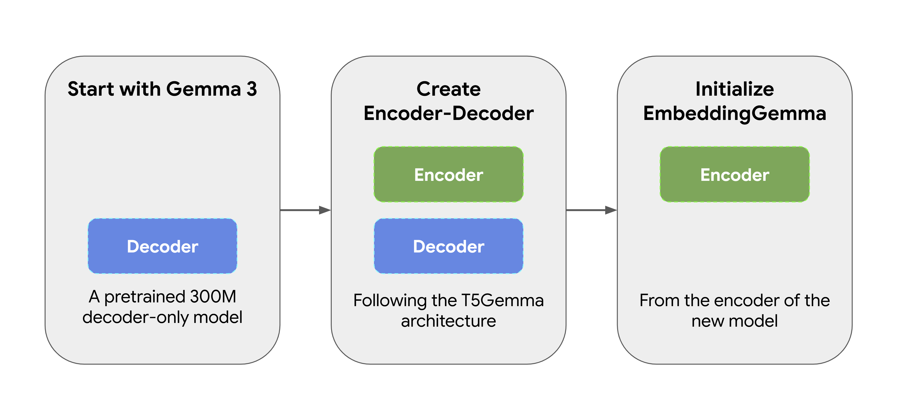
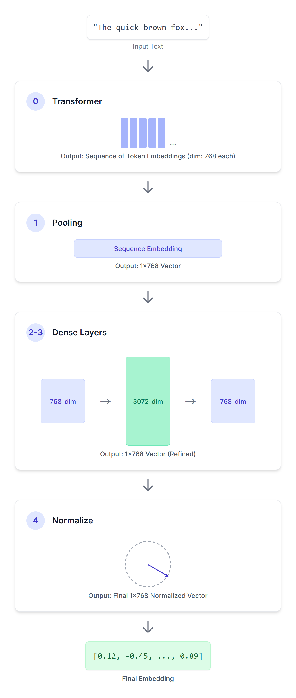
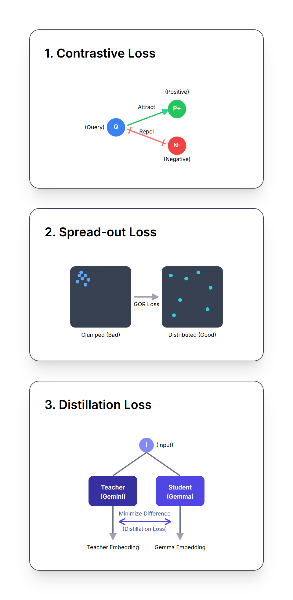
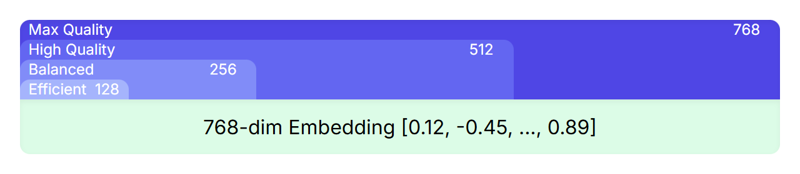

# Gemma Explained: EmbeddingGemma Architecture and Recipe

!!! note
    Originally published on the
    [Google Developers Blog](https://developers.googleblog.com/gemma-explained-embeddinggemma-architecture-and-recipe/).

The previous posts in the “Gemma explained” series provided a detailed overview of the Gemma model family's architectures. You can find links to each post below:

- [Gemma explained: An overview of Gemma model family architectures](https://developers.googleblog.com/gemma-explained-overview-gemma-model-family-architectures/)
- [Gemma explained: What’s new in Gemma 2](https://developers.googleblog.com/gemma-explained-new-in-gemma-2/)
- [Gemma explained: RecurrentGemma architecture](https://developers.googleblog.com/gemma-explained-recurrentgemma-architecture/)
- [Gemma explained: PaliGemma architecture](https://developers.googleblog.com/gemma-explained-paligemma-architecture/)
- [Gemma explained: What’s new in Gemma 3](https://developers.googleblog.com/gemma-explained-whats-new-in-gemma-3/)

In this post, you will explore the new [EmbeddingGemma](../../models/embeddinggemma/index.md)’s architecture and its recipe. For a high-level introduction, you can read [this announcement blog](https://developers.googleblog.com/introducing-embeddinggemma/). For a comprehensive look at the methodology, experiments, and evaluation, please see the [full technical report](https://arxiv.org/abs/2509.20354). Let’s get started.

## Unpacking EmbeddingGemma

Have you ever wondered how computers are trained to interpret the meaning and context within your words, phrases, or even entire documents? The magic often lies in something called “embeddings” - numerical representations that capture the essence and meaning of text. EmbeddingGemma is an embedding model that can turn text into embeddings. These embeddings can be used for tasks like searching, retrieval augmented generation, and understanding.

## From Gemma to EmbeddingGemma

EmbeddingGemma wasn’t created from scratch. It started as a pretrained 300M parameter Gemma 3 model. It was then transformed using [T5Gemma](https://developers.googleblog.com/t5gemma/)’s adaptation method, which converts the original decoder-only Gemma model into an encoder-decoder architecture. We then initialized EmbeddingGemma from the encoder of this new model, ensuring it is able to produce expressive representations from the start. This approach allows EmbeddingGemma to inherit a lot of “world knowledge” from its predecessor without having to do additional training



## How Embeddings Are Formed

You can [use EmbeddingGemma](../../models/embeddinggemma/index.md) to generate embeddings using frameworks such as [Sentence Transformers](https://www.sbert.net/). Given an input sequence of text, EmbeddingGemma processes it through a series of carefully designed steps to produce a concise vector representation.

```python
SentenceTransformer(
  (0): Transformer({'max_seq_length': 2048, 'do_lower_case': False, 'architecture': 'Gemma3TextModel'})
  (1): Pooling({'word_embedding_dimension': 768, 'pooling_mode_cls_token': False, 'pooling_mode_mean_tokens': True, 'pooling_mode_max_tokens': False, 'pooling_mode_mean_sqrt_len_tokens': False, 'pooling_mode_weightedmean_tokens': False, 'pooling_mode_lasttoken': False, 'include_prompt': True})
  (2): Dense({'in_features': 768, 'out_features': 3072, 'bias': False, 'activation_function': 'torch.nn.modules.linear.Identity'})
  (3): Dense({'in_features': 3072, 'out_features': 768, 'bias': False, 'activation_function': 'torch.nn.modules.linear.Identity'})
  (4): Normalize()
)
```

**(0): Transformer**

An input sequence passes through this encoder-only transformer model. This transformer utilizes bidirectional attention to understand the meaning of each token in the provided context, producing a sequence of 768-dimensional vectors, one for each token in your input sequence.

**(1): Pooling**

The output of the transformer is a sequence of token embeddings. The pooling layer’s job is to convert this variable-length sequence into a single, fixed-size embedding for the entire input. EmbeddingGemma is using a pooling strategy called “Mean Pooling”. This is the most common approach, where the average of all token embeddings is calculated.

**(2): Dense**

Next, we apply a linear projection to scale the embedding (768) up to a larger embedding dimension (3072).

**(3): Dense**

Then we apply another linear projection to scale the learned 3072-dimensional embedding to the final target dimension (768).

**(4): Normalize**

Finally, we apply Euclidean normalization, enabling efficient similarity comparisons. This is a simpler and cheaper operation compared to the more complex RMSNorm that you might recall from other Gemma models.



## How EmbeddingGemma Learns

EmbeddingGemma learns to create its powerful embeddings by optimizing a combination of three distinct, weighted loss functions during its training.

### 1. Noise-Contrastive Estimation (NCE) Loss

The NCE loss teaches the model the fundamental concepts of similarity and contrast. For each input (e.g., a query), it learns to:

- **Pull "positive pairs" closer together:** The model is trained to minimize the distance between the query and its correct answer in the embedding space.
- **Push "negative pairs" further apart:** Simultaneously, it maximizes the distance between the query and incorrect answers from the same training batch.

The key is the inclusion of "hard negatives" (answers that are semantically similar to the query but are incorrect or incomplete). By training on these tricky examples, the model is forced to learn the subtle, fine-grained distinctions that separate correct from nearly-correct ones.

It’s like building a well-organized library, where related items are placed near each other, while unrelated items are kept distant.

### 2. Global Orthogonal Regularizer (GOR)

This loss is designed to encourage EmbeddingGemma to produce embeddings that are **spread out over the embedding space**. Even if the model learned to separate similar and dissimilar things, it might still get lazy and just stack all embeddings in the same small corner.

This Regularizer makes embeddings robust to quantization and enables efficient search in vector databases using Approximate Nearest Neighbor (ANN) algorithms.

### 3. Geometric Embedding Distillation

This loss serves as a form of **knowledge distillation**, where EmbeddingGemma learns from a larger, more powerful Gemini Embedding model as a teacher.

The loss minimizes the L2 distance (a measure of difference) between the two embedding models’ embeddings for queries and passages. This enables EmbeddingGemma to learn from the teacher model, effectively inheriting much of its knowledge and capabilities.



By combining these three loss functions, EmbeddingGemma learns to produce representations that are well-structured, expressive, and robust, enabling strong performance in real-world search and retrieval tasks.

## Matryoshka Representation Learning (MRL)

MRL is a technique that allows nesting smaller, high-quality representations within a larger one. For example, even though EmbeddingGemma’s embeddings have 768 dimensions, you can truncate the embeddings and get smaller ones with 512, 256, or even 128 dimensions which retain high quality.

During training, the loss functions are not just applied to the final 768-dimensional embedding, but also to the overlapping subsets of that embedding (the first 512, 256, and 128 dimensions). This ensures that even a truncated version of the full embedding is a powerful and complete representation.

For you, this means you can choose the right trade-off between performance and efficiency for your application without needing to train or manage multiple models. Simply [select the embedding size](../../models/embeddinggemma/inference.md#matryoshka-representation-learning-mrl) that best fits your needs, ranging from the full 768 dimensions for maximum quality to smaller sizes for increased speed and lower storage costs.



## Development Recipe

The model’s journey includes several stages

- **Encoder-Decoder Training:** Adapting Gemma 3 as described above, further pretraining on Gemma 3 data with [UL2](https://arxiv.org/abs/2205.05131).
- **Pre Fine-tuning:** Training on a large, diverse mixture of tasks (question answering, sentence similarity, code retrieval, web search) and languages, using larger batch sizes and (query, target) pairs without hard negatives.
- **Fine-tuning:** Refining the model on a smaller, higher-quality mixture of task-specific datasets, utilizing hard negatives and smaller batch sizes. Task mixture rates are optimized using Bayesian optimization.
- **Model Souping:** Combining models from fine-tuning runs by averaging their parameters to improve quality and robustness. The final model is an unweighted average of checkpoints from fine-tuning runs with multiple different fine-tuning mixtures.
- **Quantization-Aware Training (QAT):** Applied during fine tuning to provide quantized versions (e.g., int4 per-block and mixed-precision per-channel), which have a reduced memory footprint, with minimal quality degradation.

By carefully adapting a powerful base model and refining it with a multi-faceted training approach, EmbeddingGemma's architecture is engineered to deliver highly effective and versatile text representations suitable for a wide range of applications.

## Summary

We explored the architecture of EmbeddingGemma, a powerful model for generating text embeddings. We learned its origins, the process of generating embeddings, and the development recipe. For an in-depth dive into our training methodology, evaluation benchmarks, and the full experimental results, we encourage you to read the [official technical report](https://arxiv.org/abs/2509.20354).

Models like EmbeddingGemma lead the way for more efficient and powerful semantic technologies. As these models become more capable and accessible, we can expect to see advancements in several key areas like Retrieval-Augmented Generation (RAG), on-device AI, and hyper-personalization.

Find the model weights on [Hugging Face](https://huggingface.co/collections/google/embeddinggemma-68b9ae3a72a82f0562a80dc4), [Kaggle](https://www.kaggle.com/models/google/embeddinggemma/), [Vertex AI](https://console.cloud.google.com/vertex-ai/publishers/google/model-garden/embeddinggemma) and start tinkering today.

Thanks for reading!

## References

### Papers

- [EmbeddingGemma: Powerful and Lightweight Text Representations](https://arxiv.org/abs/2509.20354)

### Code Examples

- [Generate Embeddings with Sentence Transformers](../../models/embeddinggemma/inference.md)
- [Fine-tune EmbeddingGemma](../../models/embeddinggemma/fine-tuning.md)
- [RAG with EmbeddingGemma](https://github.com/google-gemini/gemma-cookbook/blob/main/Gemma/%5BGemma_3%5DRAG_with_EmbeddingGemma.ipynb)
- [Mood Palette Generator](https://huggingface.co/spaces/google/mood-palette), an interactive application using EmbeddingGemma

### The complete Gemma architecture series

- [Gemma explained: An overview of Gemma model family architectures](https://developers.googleblog.com/gemma-explained-overview-gemma-model-family-architectures/)
- [Gemma explained: What’s new in Gemma 2](https://developers.googleblog.com/gemma-explained-new-in-gemma-2/)
- [Gemma explained: RecurrentGemma architecture](https://developers.googleblog.com/gemma-explained-recurrentgemma-architecture/)
- [Gemma explained: PaliGemma architecture](https://developers.googleblog.com/gemma-explained-paligemma-architecture/)
- [Gemma explained: What’s new in Gemma 3](https://developers.googleblog.com/gemma-explained-whats-new-in-gemma-3/)
- Gemma explained: EmbeddingGemma architecture
