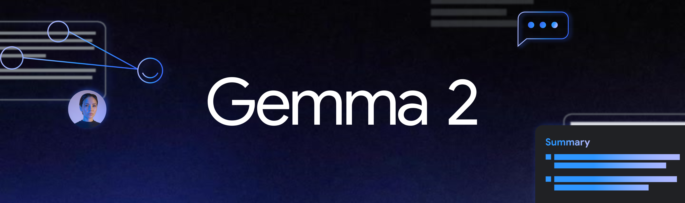
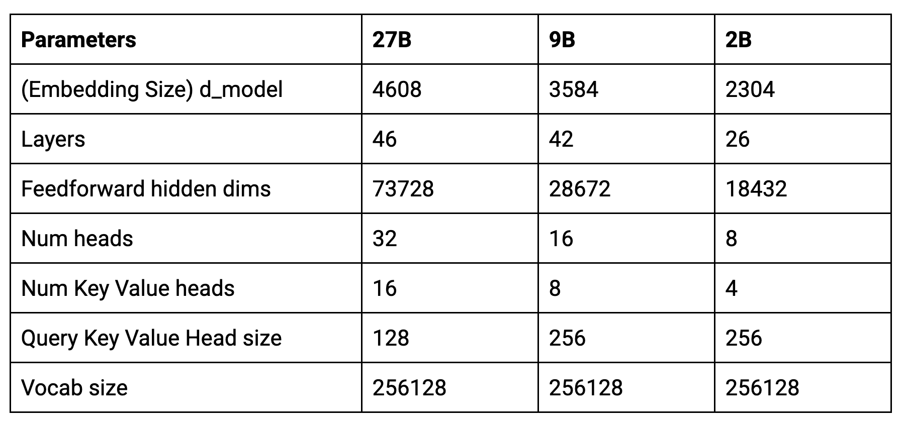
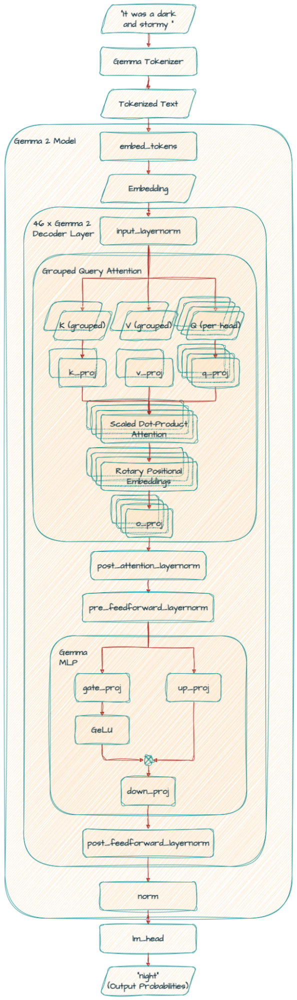

# Gemma 詳解：Gemma 2 的新變化

!!! note
    最初發表於
    [Google Developers 部落格](https://developers.googleblog.com/gemma-explained-new-in-gemma-2/)。



在「Gemma 詳解」系列的[上一篇文章](/tutorials/gemma-explained/overview/)中，我們討論了 Gemma 架構。在這篇文章中，你將探索最新的模型 Gemma 2。讓我們開始吧！

## **Gemma 2**

我們最近發布了 Gemma 2，這套劃時代的全新開放模型為效能與可及性樹立了新標準。Gemma 2 提供 2B、9B 與 27B 三種參數規模，很快就嶄露頭角。我們的 27B 模型迅速登上 LMSYS Chatbot Arena 排行榜，在引人入勝的真實世界對話中超越了體積超過其兩倍的熱門模型，奠定自己作為排名最高、最實用的開放模型之一的地位。同時，Gemma 2 2B 模型以能在邊緣裝置上運行的體積，在 Chatbot Arena 上超越了所有 GPT-3.5 模型，展現了卓越的對話式 AI 實力。

開發者可以在各種平台與工具中使用 Gemma 2 強大的調校能力。透過雲端解決方案如 [Google Cloud](https://console.cloud.google.com/vertex-ai/publishers/google/model-garden/gemma2) 與社群工具如 [Axolotl](https://github.com/OpenAccess-AI-Collective/axolotl)，微調 Gemma 2 變得簡單。與 Hugging Face、NVIDIA TensorRT-LLM 等合作夥伴的無縫整合，以及我們的 JAX 與 Keras，讓效能最佳化與在多種硬體配置上的高效部署成為可能。

以下是新模型的核心參數：



## **主要差異**

Gemma 2 與原始 Gemma 模型擁有相似的架構基礎，包括旋轉位置嵌入（Rotary Position Embeddings，RoPE）的實作與近似 GeGLU 非線性函數。然而，它引入了創新的架構改良，使其與前代有所區隔。

### **交替式區域與全域注意力**

它不再一次考慮文字中的所有詞彙，而是時而聚焦於一小段詞彙視窗（區域注意力），時而考慮所有詞彙（全域注意力）。這種組合幫助模型高效地同時理解即時上下文與文字的整體含義。

### **Logit 軟上限（Soft-Capping）**

想像你在訓練一個模型來預測句子中的下一個詞。有時候，模型可能對某個特定詞彙過度自信，即使那不是最佳選擇。Logit 軟上限透過限制模型對預測的自信程度來避免這種情況，從而帶來更好的整體效能。

### **用於前正規化與後正規化的 RMSNorm**

可以把它想成一種在訓練期間防止模型計算數值過大或過小的方法。就像我們調整喇叭音量來避免破音一樣，RMSNorm 確保流經模型的資訊維持在合理範圍內，讓訓練更穩定有效。

### **分組查詢注意力（Grouped-Query Attention，GQA）**

這項技術幫助模型更高效地處理資訊，尤其是在面對大量文字時。它透過將查詢分組，改良了傳統的多頭注意力（MHA），使大型模型的處理速度更快。這就像把大任務切成較小、易於管理的區塊，讓模型在不犧牲準確度的情況下更快理解詞彙之間的關係。

## **Gemma 27B**

```python
Gemma2ForCausalLM(
  (model): Gemma2Model(
    (embed_tokens): Embedding(256000, 4608, padding_idx=0)
    (layers): ModuleList(
      (0-45): 46 x Gemma2DecoderLayer(
        (self_attn): Gemma2SdpaAttention(
          (q_proj): Linear(in_features=4608, out_features=4096, bias=False)
          (k_proj): Linear(in_features=4608, out_features=2048, bias=False)
          (v_proj): Linear(in_features=4608, out_features=2048, bias=False)
          (o_proj): Linear(in_features=4096, out_features=4608, bias=False)
          (rotary_emb): Gemma2RotaryEmbedding()
        )
        (mlp): Gemma2MLP(
          (gate_proj): Linear(in_features=4608, out_features=36864, bias=False)
          (up_proj): Linear(in_features=4608, out_features=36864, bias=False)
          (down_proj): Linear(in_features=36864, out_features=4608, bias=False)
          (act_fn): PytorchGELUTanh()
        )
        (input_layernorm): Gemma2RMSNorm()
        (post_attention_layernorm): Gemma2RMSNorm()
        (pre_feedforward_layernorm): Gemma2RMSNorm()
        (post_feedforward_layernorm): Gemma2RMSNorm()
      )
    )
    (norm): Gemma2RMSNorm()
  )
  (lm_head): Linear(in_features=4608, out_features=256000, bias=False)
)
```



### **self_attn**

在自注意力機制中，Gemma 2 使用**分組查詢注意力（Grouped Query Attention，GQA）**。

*k_proj* 與 *v_proj* 共用相同的頭，頭大小為 128，共 16 個頭（128 x 16 = 2048）。相對地，*q_proj* 與 *o_proj* 並行使用 32 個頭（128 x 32 = 4096）。

---

注意 Gemma 9B 模型使用相同的 GQA，但頭數不同（*k_proj* 與 *v_proj* 用 8 個頭，*q_proj* 與 *o_proj* 用 16 個頭），頭大小為 256。

```python
(self_attn): Gemma2SdpaAttention(
          (q_proj): Linear(in_features=3584, out_features=4096, bias=False)
          (k_proj): Linear(in_features=3584, out_features=2048, bias=False)
          (v_proj): Linear(in_features=3584, out_features=2048, bias=False)
          (o_proj): Linear(in_features=4096, out_features=3584, bias=False)
          (rotary_emb): Gemma2RotaryEmbedding()
        )
```

2B 模型則是 *k_proj* 與 *v_proj* 用 4 個頭，*q_proj* 與 *o_proj* 用 8 個頭，頭大小為 256。

---

### **pre_feedforward_layernorm 與 post_feedforward_layernorm**

另一個顯著差異是 Gemma 2 加入了額外的 RMSNorm，增強了訓練過程的穩定性。

## **主要發現**

我們的[技術報告](https://storage.googleapis.com/deepmind-media/gemma/gemma-2-report.pdf)提供了深入的細節，以下是 Gemma 2 主要發現的快速摘要：

### **蒸餾 vs. 從頭訓練：**

我們以來自更大模型（27B）的知識蒸餾來訓練 2B 與 9B 模型。

從更大的模型蒸餾知識，即使訓練詞元數量相同，也能帶來顯著的效能提升。

### **分組查詢注意力 vs. 多頭注意力：**

用 GQA 取代 MHA 能獲得相當的效能，同時提供參數量效率與更快的推論速度，使 GQA 成為首選。

### **模型深度 vs. 寬度：**

在相同參數規模下，較深的模型展現出略勝一籌的效能。

## **下一步？**

在這篇文章中，你認識了 Gemma 2——新一代的 Gemma 模型。

在接下來的系列文章中，你將研究 RecurrentGemma——一個基於 [Griffin](https://arxiv.org/abs/2402.19427) 的開放模型。

如果你想深入探索迷人的 AI 世界，並從塑造其發展的專家那裡獲得見解，請前往 [goo.gle/ai-podcast](http://goo.gle/ai-podcast)，或在任何播客平台搜尋「**People of AI Podcast**」節目。

敬請期待，感謝閱讀！

## 參考資料

### **論文**

- [Gemma 2：在實用規模下改進開放語言模型](https://storage.googleapis.com/deepmind-media/gemma/gemma-2-report.pdf)

### **程式碼範例**

- [Keras Gemma 2 快速入門](https://colab.research.google.com/github/google-gemma/cookbook/blob/main/.archive/Gemma/[Gemma_2]Keras_Quickstart.ipynb)
- [Keras Gemma 2 快速入門：聊天](https://colab.research.google.com/github/google-gemma/cookbook/blob/main/.archive/Gemma/[Gemma_2]Keras_Quickstart_Chat.ipynb)

## 📋 完整的 Gemma 架構系列

- [Gemma 詳解：Gemma 模型家族架構總覽](/tutorials/gemma-explained/overview/)
- Gemma 詳解：Gemma 2 的新變化
- [Gemma 詳解：RecurrentGemma 架構](/tutorials/gemma-explained/recurrentgemma/)
- [Gemma 詳解：PaliGemma 架構](/tutorials/gemma-explained/paligemma/)
- [Gemma 詳解：Gemma 3 的新變化](/tutorials/gemma-explained/gemma-3/)
- [Gemma 詳解：EmbeddingGemma 架構](/tutorials/gemma-explained/embeddinggemma/)
