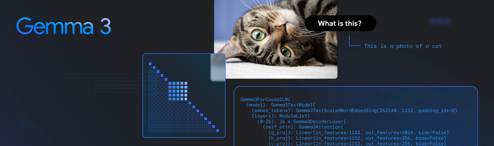
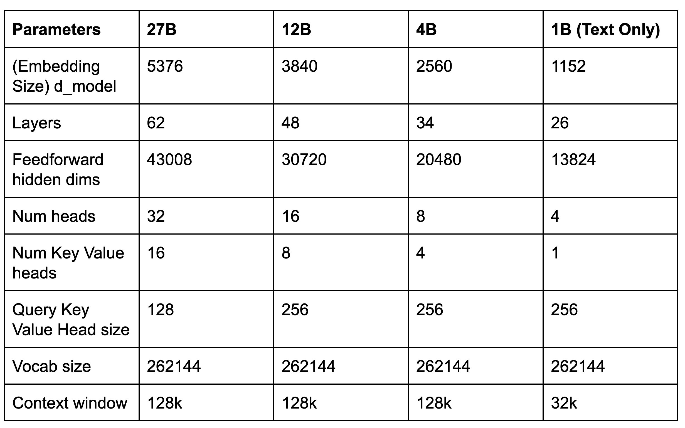
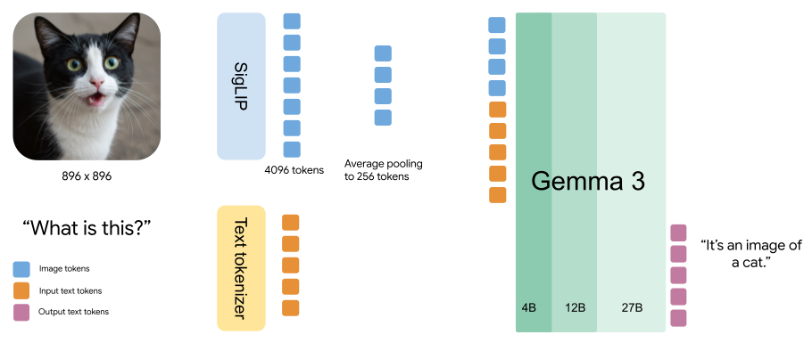
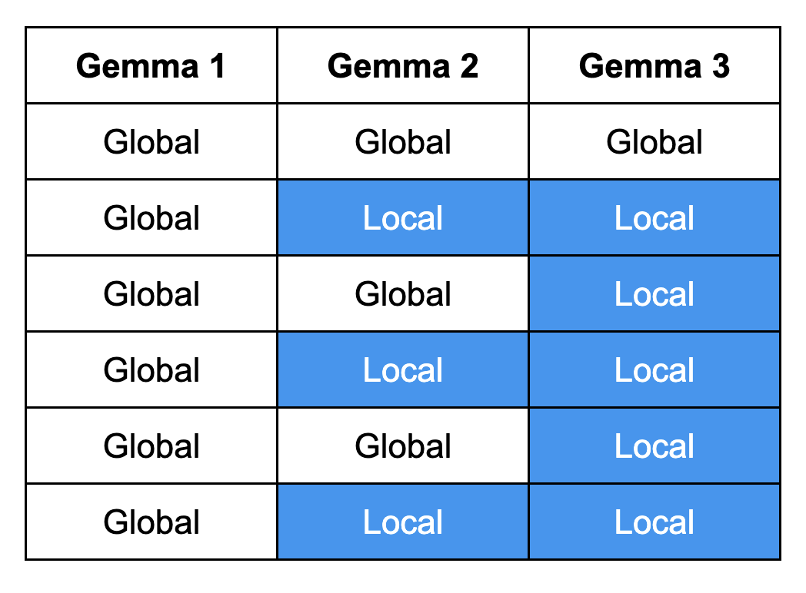
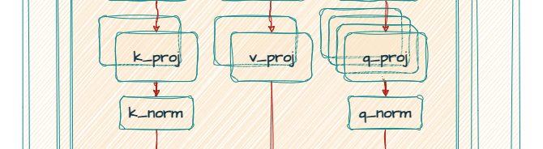
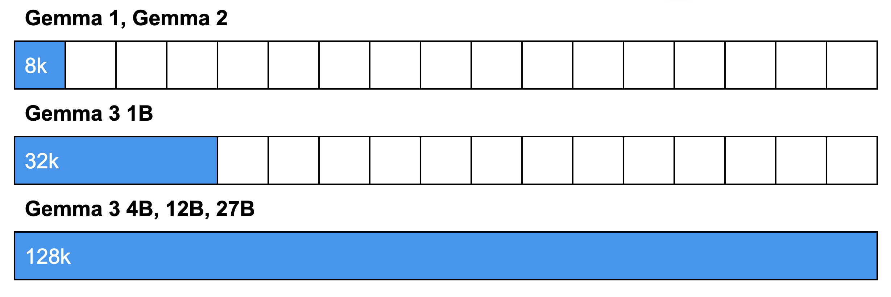
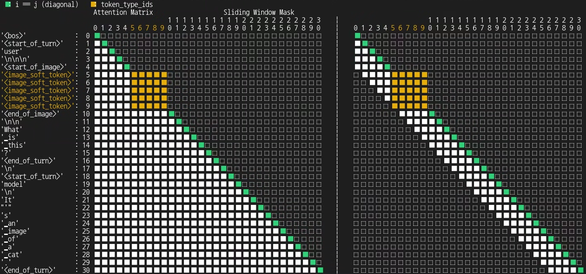
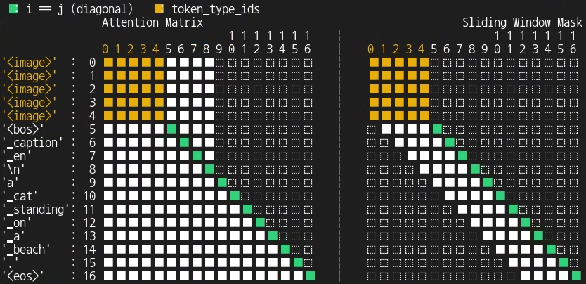
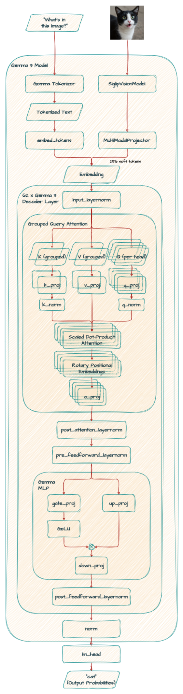

# Gemma Explained: What’s New in Gemma 3

!!! note
    Originally published on the
    [Google Developers Blog](https://developers.googleblog.com/gemma-explained-whats-new-in-gemma-3/).



The previous posts in the "Gemma explained" series provided a detailed overview of the Gemma model family's architectures. You can find links to each post below:

- [Gemma explained: An overview of Gemma model family architectures](/tutorials/gemma-explained/overview/)
- [Gemma explained: What’s new in Gemma 2](/tutorials/gemma-explained/gemma-2/)
- [Gemma explained: RecurrentGemma architecture](/tutorials/gemma-explained/recurrentgemma/)
- [Gemma explained: PaliGemma architecture](/tutorials/gemma-explained/paligemma/)

In this post, you will explore the latest model, [Gemma 3](https://developers.googleblog.com/introducing-gemma3/). Let’s dig in.

## **Gemma 3**

A significant change from prior versions is Gemma 3’s new support for vision-language capabilities. Those familiar with PaliGemma’s architecture might recognize a [SigLIP encoder](https://arxiv.org/abs/2303.15343) used in Gemma 3, though it has been tailored for this specific implementation.

Here’s the core parameters of the new models.



Let’s explore the key differences and improvements in Gemma 3.

## **Key Differences**

While Gemma 3's architecture inherits aspects from its predecessors, it also features new modifications that are described below.

## Vision-language support

A major enhancement in Gemma 3 is its new vision-language understanding capability. The 4B, 12B and 27B models employ a custom SigLIP vision encoder, which enables the model to interpret visual input.

The vision encoder operates on fixed 896x896 square images. To handle the images with different aspect ratios or high resolutions, a “Pan&Scan” algorithm is employed. This involves adaptively cropping the image, resizing each crop to 896x896, and then encoding it. While this method improves performance, particularly when detailed information is critical, it leads to increased computational overhead during inference.

Additionally, Gemma 3 treats images as a sequence of compact “soft tokens” produced by MultiModalProjector. This technique significantly cuts down on the inference resources needed for image processing by representing visual data with a fixed number of 256 vectors.



Before proceeding, you might wonder: **“When should I use Gemma 3 versus PaliGemma 2?”**

[PaliGemma 2](https://arxiv.org/abs/2412.03555)'s strength lies in features not found in Gemma 3 like image segmentation and object detection. However, Gemma 3 integrated and extended the technology from PaliGemma, offering multi-turn chat and strong zero-shot performance for handling various vision tasks directly.

Your final decision should also consider your available computational resources and the importance of advanced features like longer context or multilingual support, where Gemma 3 offers notable enhancements.

## Architectural Changes for Memory Efficiency

The architecture has been modified to reduce KV-cache memory usage, which tends to increase with long context.

### **5-to-1 interleaved attention**

The updated model architecture is composed of repeating interleaving blocks, each containing 5 local attention layers with a sliding window of 1024 and 1 global attention layer. This design enables the model to capture both short- and long-range dependencies, leading to more accurate and contextually relevant responses.

!!! note
    Gemma 1 relied solely on global attention, whereas Gemma 2 introduced a hybrid approach by alternating between local and global attention layers. Gemma 3 integrates 5 dedicated local attention layers, resulting in responses that are both more precise and contextually appropriate.



### **No softcapping**

Both Gemma 2 and Gemma 3 utilize Grouped-Query Attention (GQA) with post-norm and pre-norm with RMSNorm. However, Gemma 3 gains both improved accuracy and faster processing speeds by adopting QK-norm in place of Gemma 2’s soft-capping mechanism.



## Longer Context

As a result of the architectural changes discussed above, Gemma 3 utilizes interleaved attention to decrease memory requirements, enabling support for an extended context length. This allows for the analysis of longer documents and conversations without losing context. Specifically, it can handle 32k tokens for the 1B model and 128k tokens for larger models.

!!! note
    The 128k tokens context window allows the model to process an amount of text as long as a typical novel (around 80k words). This window size is approximately 96k words, 198 pages, 500 images, or 8+ minutes of video at 1 fps.



## Vision Encoder and Processing

Gemma 3 only uses bidirectional attention with image inputs.

Normal attention (a.k.a uni-directional attention) is like reading. Imagine reading a book. You understand each word by considering the words that came before it. This is how typical attention works in language models. It’s sequential and looks backward to build context.

On the other hand, bidirectional attention is like seeing a puzzle. Think of an image as a jigsaw puzzle. “Image Tokens” are like individual puzzle pieces. So it means each piece “looks at” and connects with every other piece in the image, regardless of their position. It considers the whole picture at once, not just a sequence. This gives a complete understanding because every part is related to every other part.

So why not always bidirectional? While bidirectional attention (seeing the whole context) sounds better, it’s not always used for text. It’s all about the task:

- **Understanding (Bidirectional is Good)** For tasks where we have the entire text and need to deeply understand it (like in models such as [BERT](https://arxiv.org/abs/1810.04805)), bidirectional attention is great.

- **Prediction (Uni-directional is Better)** When the task is to predict the next word or generate text, a one-directional (autoregressive) approach is more natural. Predicting what comes next is inherently sequential. It’s also often more computationally efficient.

The key difference is that the bidirectional approach is used when the model isn’t creating a sequence.

The following visualization illustrates the attention mechanism in Gemma 3.

Code:

```python
from transformers.utils.attention_visualizer import AttentionMaskVisualizer
visualizer = AttentionMaskVisualizer("google/gemma-3-4b-it")
visualizer("<start_of_turn>user\nWhat is this?<end_of_turn>\n<start_of_turn>model\nIt's an image of a cat.<end_of_turn>")
```

Output:



You can also see how this attention mechanism differs from that of PaliGemma. To provide context for this comparison, PaliGemma operates by receiving one or more images along with a text-based task description (the prompt or prefix), and subsequently generates its prediction as a text string (the answer or suffix) in an autoregressive manner.

Code:

```python
visualizer = AttentionMaskVisualizer("google/paligemma2-3b-mix-224")
visualizer(" caption en", suffix="a cat standing on a beach.")
```

Output



## New tokenizer

Gemma 3 has improved multilingual capabilities due to a revisited data mixture with an increased amount of multilingual data (both monolingual and parallel).

Gemma 3 also introduces an improved tokenizer. The vocabulary size has been changed to 262k, but uses the same [SentencePiece](https://github.com/google/sentencepiece) tokenizer. To avoid errors, use the new tokenizer with Gemma 3. This is the same tokenizer as Gemini which is more balanced for non-English languages.

## **Gemma 3 27B**

```python
Gemma3ForConditionalGeneration(
  (vision_tower): SiglipVisionModel(
    (vision_model): SiglipVisionTransformer(
      (embeddings): SiglipVisionEmbeddings(
        (patch_embedding): Conv2d(3, 1152, kernel_size=(14, 14), stride=(14, 14), padding=valid)
        (position_embedding): Embedding(4096, 1152)
      )
      (encoder): SiglipEncoder(
        (layers): ModuleList(
          (0-26): 27 x SiglipEncoderLayer(
            (self_attn): SiglipSdpaAttention(
              (k_proj): Linear(in_features=1152, out_features=1152, bias=True)
              (v_proj): Linear(in_features=1152, out_features=1152, bias=True)
              (q_proj): Linear(in_features=1152, out_features=1152, bias=True)
              (out_proj): Linear(in_features=1152, out_features=1152, bias=True)
            )
            (layer_norm1): LayerNorm((1152,), eps=1e-06, elementwise_affine=True)
            (mlp): SiglipMLP(
              (activation_fn): PytorchGELUTanh()
              (fc1): Linear(in_features=1152, out_features=4304, bias=True)
              (fc2): Linear(in_features=4304, out_features=1152, bias=True)
            )
            (layer_norm2): LayerNorm((1152,), eps=1e-06, elementwise_affine=True)
          )
        )
      )
      (post_layernorm): LayerNorm((1152,), eps=1e-06, elementwise_affine=True)
    )
  )
  (multi_modal_projector): Gemma3MultiModalProjector(
    (mm_soft_emb_norm): Gemma3RMSNorm((1152,), eps=1e-06)
    (avg_pool): AvgPool2d(kernel_size=4, stride=4, padding=0)
  )
  (language_model): Gemma3ForCausalLM(
    (model): Gemma3TextModel(
      (embed_tokens): Gemma3TextScaledWordEmbedding(262208, 5376, padding_idx=0)
      (layers): ModuleList(
        (0-61): 62 x Gemma3DecoderLayer(
          (self_attn): Gemma3Attention(
            (q_proj): Linear(in_features=5376, out_features=4096, bias=False)
            (k_proj): Linear(in_features=5376, out_features=2048, bias=False)
            (v_proj): Linear(in_features=5376, out_features=2048, bias=False)
            (o_proj): Linear(in_features=4096, out_features=5376, bias=False)
            (q_norm): Gemma3RMSNorm((128,), eps=1e-06)
            (k_norm): Gemma3RMSNorm((128,), eps=1e-06)
          )
          (mlp): Gemma3MLP(
            (gate_proj): Linear(in_features=5376, out_features=21504, bias=False)
            (up_proj): Linear(in_features=5376, out_features=21504, bias=False)
            (down_proj): Linear(in_features=21504, out_features=5376, bias=False)
            (act_fn): PytorchGELUTanh()
          )
          (input_layernorm): Gemma3RMSNorm((5376,), eps=1e-06)
          (post_attention_layernorm): Gemma3RMSNorm((5376,), eps=1e-06)
          (pre_feedforward_layernorm): Gemma3RMSNorm((5376,), eps=1e-06)
          (post_feedforward_layernorm): Gemma3RMSNorm((5376,), eps=1e-06)
        )
      )
      (norm): Gemma3RMSNorm((5376,), eps=1e-06)
      (rotary_emb): Gemma3RotaryEmbedding()
      (rotary_emb_local): Gemma3RotaryEmbedding()
    )
    (lm_head): Linear(in_features=5376, out_features=262208, bias=False)
  )
)
```



!!! note
    Technically RoPE (Rotary Positional Embedding) is inside the SDPA (Scaled Dot-Product Attention), but we simplified it in this diagram. Please see [the code](https://github.com/google-deepmind/gemma/blob/ebfa2c2bddcab1d7cc38b1dca0fe6d98e6e7df71/gemma/modules.py#L170-L182) for the precise architectural details.

## **Gemma 3 1B**

```python
Gemma3ForCausalLM(
  (model): Gemma3TextModel(
    (embed_tokens): Gemma3TextScaledWordEmbedding(262144, 1152, padding_idx=0)
    (layers): ModuleList(
      (0-25): 26 x Gemma3DecoderLayer(
        (self_attn): Gemma3Attention(
          (q_proj): Linear(in_features=1152, out_features=1024, bias=False)
          (k_proj): Linear(in_features=1152, out_features=256, bias=False)
          (v_proj): Linear(in_features=1152, out_features=256, bias=False)
          (o_proj): Linear(in_features=1024, out_features=1152, bias=False)
          (q_norm): Gemma3RMSNorm((256,), eps=1e-06)
          (k_norm): Gemma3RMSNorm((256,), eps=1e-06)
        )
        (mlp): Gemma3MLP(
          (gate_proj): Linear(in_features=1152, out_features=6912, bias=False)
          (up_proj): Linear(in_features=1152, out_features=6912, bias=False)
          (down_proj): Linear(in_features=6912, out_features=1152, bias=False)
          (act_fn): PytorchGELUTanh()
        )
        (input_layernorm): Gemma3RMSNorm((1152,), eps=1e-06)
        (post_attention_layernorm): Gemma3RMSNorm((1152,), eps=1e-06)
        (pre_feedforward_layernorm): Gemma3RMSNorm((1152,), eps=1e-06)
        (post_feedforward_layernorm): Gemma3RMSNorm((1152,), eps=1e-06)
      )
    )
    (norm): Gemma3RMSNorm((1152,), eps=1e-06)
    (rotary_emb): Gemma3RotaryEmbedding()
    (rotary_emb_local): Gemma3RotaryEmbedding()
  )
  (lm_head): Linear(in_features=1152, out_features=262144, bias=False)
)
```

This text-only 1B model is specifically optimized for on-device use, making advanced AI accessible on mobile and embedded systems. This significantly impacts accessibility, privacy, and performance, as AI-powered applications can now function efficiently even with limited or no network connectivity.

## **Key Findings**

Our [technical report](https://storage.googleapis.com/deepmind-media/gemma/Gemma3Report.pdf) provides in-depth details, but here’s a quick summary of Gemma 3’s main findings:

- **Superior Performance at same sizes:** Gemma 3 models achieve superior performance compared to Gemma 2 on both pre-trained instruction-tuned versions across various benchmarks. It is the best model that fits in a single consumer GPU or TPU host. The Gemma 27B IT model ranks among the top 10 models in [LM Arena](https://lmarena.ai/) as of Apr 12, 2025, outperforming much larger open models and showing a significantly higher Elo score than Gemma 2.

- **KV-cache Memory Reduction:** The architectural changes in Gemma 3 effectively reduce the memory overhead of the KV cache during inference with long context compared to global-only attention mechanisms used in Gemma 1 and the 1:1 local/global ratio used in Gemma 2.

- **Effective Long Context Handling:** Gemma 3 models can generalize to 128k context length after RoPE rescaling during pre-training. We increase RoPE base frequency from 10k to 1M on global self-attention layers, and keep the frequency of the local layers at 10k.

- **Improved Multilinguality:** Gemma 3 utilizes the same tokenizer as Gemini which is more balanced for non-English languages. We also revised the pre-training data mixture and post-training process to enhance its multilingual capabilities.

- **Impact of Vision Encoder Resolution:** Higher resolution vision encoders lead to better performance on vision tasks. The Pan & Scan method further improves performance on tasks involving non-square aspect ratios, high-resolution images, and text reading in images.

## Summary

We explored the architecture of Gemma 3, highlighting the new features that set it apart from previous versions. These architectural choices allow Gemma 3 to perform better on a broader set of tasks, including improved multilingual abilities and image interaction, while also paving the way for future, more capable and resource-friendly multimodal language models suitable for standard hardware.

We believe Gemma 3’s innovations will empower researchers and developers to create the next generation of efficient and powerful multimodal language models.

Thanks for reading!

## References

### **Papers**

- [Gemma 3 Technical Report](https://storage.googleapis.com/deepmind-media/gemma/Gemma3Report.pdf)

- [PaliGemma 2: A Family of Versatile VLMs for Transfer](https://arxiv.org/abs/2412.03555)

- [Sigmoid Loss for Language Image Pre-Training](https://arxiv.org/abs/2303.15343)

- [BERT: Pre-training of Deep Bidirectional Transformers for Language Understanding](https://arxiv.org/abs/1810.04805)

### **Code Examples**

- [Prompt with images and text using Gemma library](https://colab.research.google.com/github/google-gemma/cookbook/blob/main/docs/core/gemma_library.ipynb)
- [Gemma 3 Meme Generator](https://colab.research.google.com/github/google-gemma/cookbook/blob/main/.archive/Gemma/[Gemma_3]Meme_Generator.ipynb)

## 📋 The complete Gemma architecture series

- [Gemma explained: An overview of Gemma model family architectures](/tutorials/gemma-explained/overview/)
- [Gemma explained: What’s new in Gemma 2](/tutorials/gemma-explained/gemma-2/)
- [Gemma explained: RecurrentGemma architecture](/tutorials/gemma-explained/recurrentgemma/)
- [Gemma explained: PaliGemma architecture](/tutorials/gemma-explained/paligemma/)
- Gemma explained: What’s new in Gemma 3
- [Gemma explained: EmbeddingGemma architecture](/tutorials/gemma-explained/embeddinggemma/)
