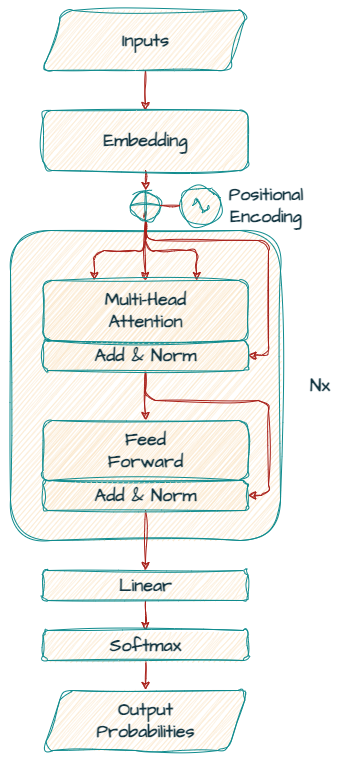
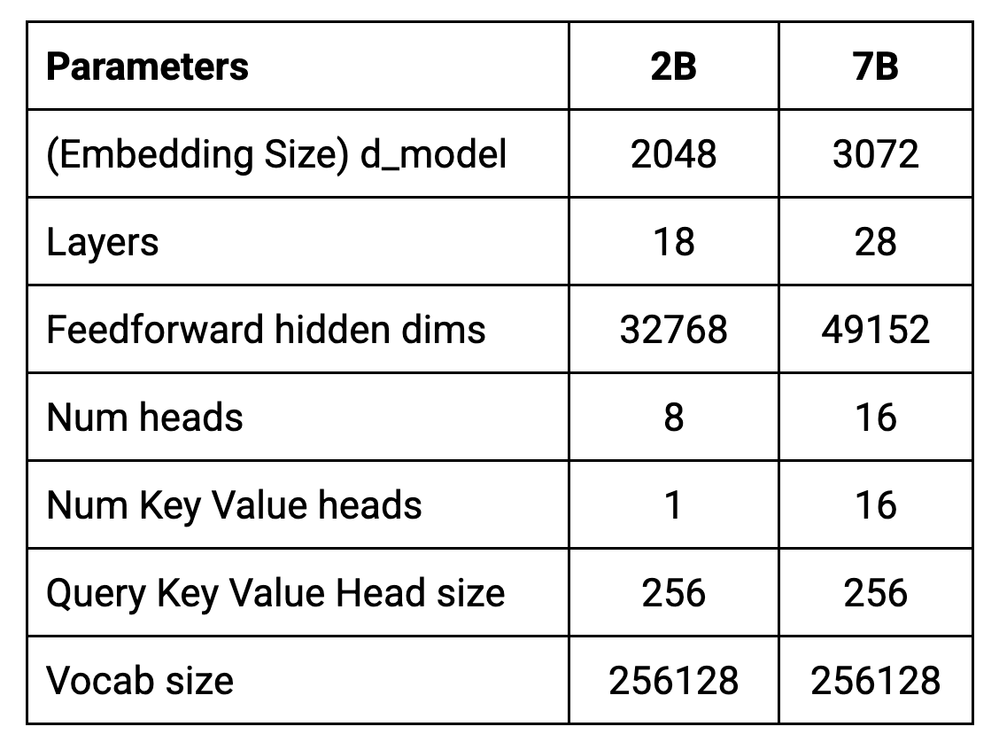
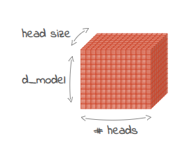
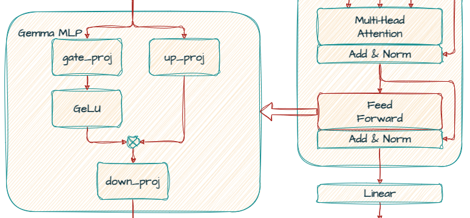
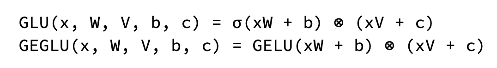
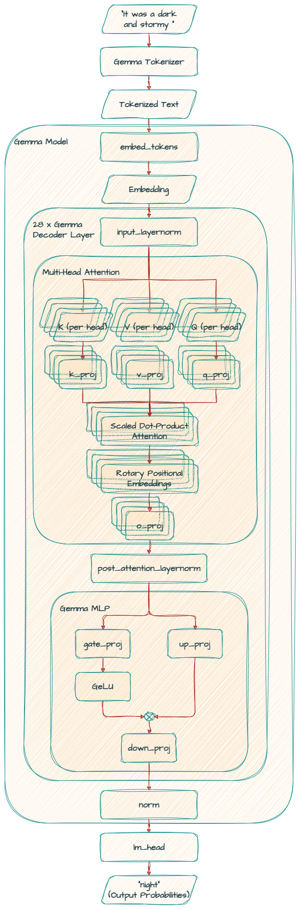
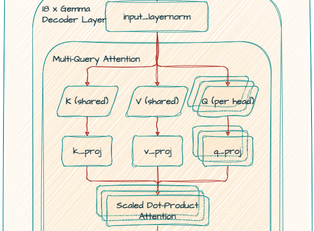
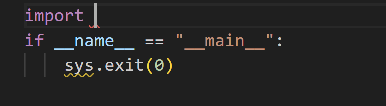

# Gemma 詳解：Gemma 模型家族架構總覽

!!! note
    最初發表於
    [Google Developers 部落格](https://developers.googleblog.com/gemma-explained-overview-gemma-model-family-architectures)。


[Gemma](https://ai.google.dev/gemma) 是一系列輕量、最先進的開放模型家族，採用與打造 Gemini 模型相同的研發成果與技術。

Gemma 的不同版本是為不同的使用場景與模態設計的，例如：

- 單一模態（文字輸入，文字輸出）

- 專門化於程式碼使用場景

- 多模態（文字與影像輸入，文字輸出）

- 不同體積，適用於不同硬體類型、推論需求與其他限制。

- 「新穎」架構

由於這些模型都擁有相似的基因，Gemma 家族提供了一種獨特的方式來認識現代 LLM 系統可用的架構與設計選擇。我們希望這能為開放模型的豐富生態系做出貢獻，並促進對 LLM 系統運作方式的更深入理解。

本系列將涵蓋：

- **Gemma 1（2B、7B）**——基於 Transformer 的文字轉文字模型。

- **CodeGemma（2B 與 7B）**——Gemma 的微調版本，為程式碼補全與生成最佳化。

- **Gemma 2（2B、9B、27B）**——採用較新架構訓練的更新版文字轉文字模型，其中 2B 與 9B 版本透過蒸餾自更大模型訓練而成。

- **RecurrentGemma（2B、9B）**——基於新穎的 Griffin 架構打造的模型。該架構結合區域注意力與線性遞迴，在生成長序列時實現快速推論。

- **PaliGemma（3B）**——視覺語言模型，可接受文字與影像輸入並輸出文字。

## 如何使用這份指南

在本系列中，我們將

- 整理各模型的具體架構

- 解釋這些參數如何影響模型生成（例如 num embeddings、多查詢 vs 多頭 vs 分組查詢）

- 提供模型的程式碼範例供進一步探索

為了呈現模型資訊，我們使用 Hugging Face Transformers 的 print 模組，像下面這樣的簡單程式碼。

```python
from transformers import AutoModelForCausalLM
model = AutoModelForCausalLM.from_pretrained("google/gemma-7b")
print(model)
```

你也可以用 [torchinfo](https://github.com/TylerYep/torchinfo) 或 Keras Model 類別 API 中的 [summary()](https://keras.io/api/models/model/#summary-method) 來探索模型內部。

## 這份指南不是什麼

這份指南不是 AI 入門教學。它假設你已具備神經網路、Transformer 以及詞元等相關術語的實務知識。如果你需要複習這些概念，以下是一些入門資源：

一個可在瀏覽器中實作的神經網路學習工具

- [http://playground.tensorflow.org/](http://playground.tensorflow.org/)

Transformer 入門介紹

- [Transformer 深度解析：理解 GPT、BERT 與 T5 背後的模型](https://www.youtube.com/watch?v=SZorAJ4I-sA&t=26s)
- [https://github.com/google/sentencepiece](https://github.com/google/sentencepiece)

## **Gemma**

Gemma 是一個開放權重的 LLM。它提供指令微調版與未經微調的原始預訓練版，並有多種參數規模。它基於 Google Research 在 [Attention Is All You Need](https://arxiv.org/abs/1706.03762v7) 論文中介紹的 LLM 架構。主要功能是根據使用者提供的提示，逐詞元生成文字。在翻譯等任務中，Gemma 接受一種語言的句子作為輸入，並輸出另一種語言的對應翻譯。

如你很快會看到的，Gemma 本身就是一個優秀的模型，同時也非常適合客製化擴展，以滿足不同的使用者需求。

### **Gemma 架構**

首先，來看看 Gemma 模型所基於的 [Transformer 解碼器](https://arxiv.org/abs/1706.03762v7)。



與《Attention Is All You Need》最初介紹的編碼器-解碼器 Transformer 模型架構不同，Gemma 純粹是一個「僅含解碼器」的模型。

架構的[核心參數](https://storage.googleapis.com/deepmind-media/gemma/gemma-report.pdf)摘要於下表。



模型以 8192 詞元的上下文長度訓練。這表示它們一次最多可處理約 6144 個單字（根據 100 詞元 ≈ 75 單字的經驗法則）。

值得注意的是，實際輸入上限會因任務與用法而異。這是因為文字生成會消耗上下文視窗內的詞元，實際上壓縮了新輸入的空間。雖然技術上的輸入上限不變，但生成的輸出會成為後續輸入的一部分，進而影響後續的生成。

### **d_model（2B: 2048，7B: 3072）**

*d_model* 代表用作解碼器輸入的嵌入（單字或子詞的向量表示，又稱詞元）的大小。它也決定了解碼器各層內部表示的大小。



「d_model x 注意力頭數 x 頭大小」定義了 self_attn 的參數量。

較大的 *d_model* 值表示模型有更多「空間」來表示不同詞彙的細微差異及其關係。這能帶來更好的效能，特別是在複雜的語言任務上。然而，增大 *d_model* 也會讓模型更大、訓練與使用的運算成本更高。

### **Layers（2B: 18，7B: 28）**

Transformer 由多個堆疊的層組成。更深的模型有更多層，因此參數更多，能學到更複雜的模式。然而，這些額外參數也讓它們更容易過擬合，並需要更多運算資源。

這種增強的表示能力可能導致模型學到雜訊，或學到訓練資料中無法泛化到新範例的特定模式。

此外，更深的模型通常需要更多訓練資料來避免過擬合。當可用資料有限時，模型可能沒有足夠的範例來學到可泛化的表示，反而會背記訓練資料。

### **Feedforward hidden dims（2B: 32768，7B: 49152）**

每個 Transformer 層在注意力機制後都包含一個前饋網路。這個網路有自己的維度，通常大於 d_model 的大小，以增加模型的表達能力。

它以多層感知器（multi-layer perceptron，MLP）實作——一種神經網路——用來進一步轉換嵌入並萃取更複雜的模式。



在 Gemma 中，標準的 ReLU 非線性被 [GeGLU 啟用函數](https://arxiv.org/abs/2002.05202)取代，這是 GLU（門控線性單元，Gate Linear Unit）的一種變體。GeGLU 將啟用分為兩部分：一個 S 形部分與一個線性投影。S 形部分的輸出與線性投影逐元素相乘，得到一個非線性啟用函數。



### **Num heads（2B: 8，7B: 16）**

每個 Transformer 層包含多個並行運作的注意力機制。這些「頭」讓模型能同時聚焦於輸入序列的不同面向。增加頭數能增強模型捕捉資料中多樣關係的能力。

### **Num KV heads（2B: 1，7B: 16）**

7B 模型使用多頭注意力（MHA），而 2B 模型使用多查詢注意力（MQA）。MQA 共用相同的鍵與值投影，表示每個頭都聚焦於相同的底層表示，但使用不同的查詢投影。

原始的 MHA 提供更豐富的表示學習，但運算成本更高。MQA 提供了一個高效的替代方案，已被[證明有效](https://arxiv.org/abs/1911.02150)。

### **Head size（2B: 256，7B: 256）**

它指的是多頭注意力機制中每個注意力頭的維度。計算方式是嵌入維度除以頭數。例如，若嵌入維度為 2048 且有 8 個頭，則每個頭的大小為 256。

### **Vocab size（2B: 256128，7B: 256128）**

它定義了模型能理解與處理的唯一詞元（單字、子詞或字元）數量。Gemma 的分詞器基於 [SentencePiece](https://github.com/google/sentencepiece)。詞彙表大小在訓練前就已預先決定，SentencePiece 再根據選定的詞彙表大小與訓練資料學習最佳的子詞切分方式。Gemma 高達 256k 的大型詞彙表讓它能處理多樣的文字輸入，並可能提升各種任務的效能，例如處理多語言文字輸入。

## **Gemma 7B**

```python
GemmaForCausalLM(
  (model): GemmaModel(
    (embed_tokens): Embedding(256000, 3072, padding_idx=0)
    (layers): ModuleList(
      (0-27): 28 x GemmaDecoderLayer(
        (self_attn): GemmaSdpaAttention(
          (q_proj): Linear(in_features=3072, out_features=4096, bias=False)
          (k_proj): Linear(in_features=3072, out_features=4096, bias=False)
          (v_proj): Linear(in_features=3072, out_features=4096, bias=False)
          (o_proj): Linear(in_features=4096, out_features=3072, bias=False)
          (rotary_emb): GemmaRotaryEmbedding()
        )
        (mlp): GemmaMLP(
          (gate_proj): Linear(in_features=3072, out_features=24576, bias=False)
          (up_proj): Linear(in_features=3072, out_features=24576, bias=False)
          (down_proj): Linear(in_features=24576, out_features=3072, bias=False)
          (act_fn): PytorchGELUTanh()
        )
        (input_layernorm): GemmaRMSNorm()
        (post_attention_layernorm): GemmaRMSNorm()
      )
    )
    (norm): GemmaRMSNorm()
  )
  (lm_head): Linear(in_features=3072, out_features=256000, bias=False)
)
```



### **embed_tokens（嵌入層）**

這一層將輸入詞元（單字或子詞）轉換成模型可處理的稠密數值表示（嵌入）。它的詞彙表大小為 256,000，並產生維度為 3072 的嵌入。

### **layers（層）**

這是模型的核心，由 28 個堆疊的 GemmaDecoderLayer 區塊組成。每個層都對詞元嵌入進行精煉，以捕捉詞彙與其上下文之間的複雜關係。

### **self_attn**

在自注意力機制中，模型在產生下一個詞時，會對輸入中的詞彙賦予不同的權重。利用縮放點積注意力機制，模型使用線性投影（*q_proj*、*k_proj*、*v_proj* 與 *o_proj*）來產生查詢、鍵、值與輸出的表示。

*q_proj*、*k_proj* 與 *v_proj* 的 out_features 都是相同的 4096，因為這個模型使用**多頭注意力（Multi Head Attention，MHA）**。它們並行使用 16 個大小為 256 的頭，總計 4096（256 x 16）。

此外，模型使用 *rotary_emb*（GemmaRotaryEmbedding）做位置編碼（即 RoPE），更有效地利用位置資訊。

最後，*o_proj* 層將注意力輸出投影回原始維度（3072）。

---

注意 **Gemma 2B** 模型使用**多查詢注意力（Multi Query Attention，MQA）**。



*k_proj* 與 *v_proj* 共用大小為 256 的同一個頭，因此 *out_features* 為 256。相對地，*q_proj* 與 *o_proj* 並行使用 8 個頭（256 x 8 = 2048）。

```python
(self_attn): GemmaSdpaAttention(
          (q_proj): Linear(in_features=2048, out_features=2048, bias=False)
          (k_proj): Linear(in_features=2048, out_features=256, bias=False)
          (v_proj): Linear(in_features=2048, out_features=256, bias=False)
          (o_proj): Linear(in_features=2048, out_features=2048, bias=False)
          (rotary_emb): GemmaRotaryEmbedding()
        )
```

---

### **mlp**

它使用 *gate_proj* 與 *up_proj* 實現門控機制，接著用 *down_proj* 將維度降回 3072。

### **input_layernorm、post_attention_layernorm 與 norm**

這些正規化層穩定了訓練，並提升了模型有效學習的能力。

### **lm_head**

這最終的一層將精煉後的嵌入（3072 維）映射回詞彙表空間（256000）上對下一個詞元的機率分布。

## **CodeGemma（2B and 7B）**

CodeGemma 模型是經過微調的 Gemma 模型，為程式碼補全與程式碼聊天助手最佳化。CodeGemma 模型以超過 5000 億個主要來自程式碼的詞元進行訓練。此外，CodeGemma 還增加了中間填空（fill-in-the-middle）能力，可以在兩段既有文字之間進行補全。

CodeGemma 彰顯了 Gemma 檢查點的可微調性。透過額外訓練，模型在特定任務上變得專精，學到比純粹的後綴補全更複雜的補全方式。

### **CodeGemma 用法**

你可以使用 4 個使用者自訂的詞元：其中 3 個用於 FIM，另一個 "<|file_separator|>" 詞元用於多檔案上下文支援。

```python
BEFORE_CURSOR = "<|fim_prefix|>"
AFTER_CURSOR = "<|fim_suffix|>"
AT_CURSOR = "<|fim_middle|>"
FILE_SEPARATOR = "<|file_separator|>"
```

想像你要補全如下方螢幕畫面所示的程式碼。



輸入提示應該長這樣：

```python
<|fim_prefix|>import <|fim_suffix|>if __name__ == "__main__":\n    sys.exit(0)<|fim_middle|>
```

模型會提供 "sys" 作為建議的程式碼補全。

你可以在 [CodeGemma／快速入門](https://colab.research.google.com/github/google-gemma/cookbook/blob/main/docs/codegemma/keras_quickstart.ipynb) 探索更多關於 CodeGemma 的內容。

## **下一步？**

這篇文章討論了 Gemma 架構。

在接下來的系列文章中，你將探索最新的模型 Gemma 2。憑藉安全措施的大幅增強，這個模型在推論時的效能與效率都超越了前代。

敬請期待，感謝閱讀！

## 參考資料

### **論文**

- [注意力就是你所需要的一切](https://arxiv.org/abs/1706.03762v7)
- [Gemma：基於 Gemini 研究與技術的開放模型](https://storage.googleapis.com/deepmind-media/gemma/gemma-report.pdf)
- [GLU 變體改進 Transformer](https://arxiv.org/abs/2002.05202)
- [快速 Transformer 解碼：一個寫入頭就足夠](https://arxiv.org/abs/1911.02150)

### **程式碼範例**

Gemma

- [使用 KerasNLP 入門 Gemma](../../get-started/index.md)

CodeGemma

- [快速入門](https://colab.research.google.com/github/google-gemma/cookbook/blob/main/docs/codegemma/keras_quickstart.ipynb)
- [使用 CodeGemma 進行 AI 輔助程式設計](https://colab.research.google.com/github/google-gemma/cookbook/blob/main/docs/codegemma/code_assist_keras.ipynb)

## 📋 完整的 Gemma 架構系列

- Gemma 詳解：Gemma 模型家族架構總覽
- [Gemma 詳解：Gemma 2 的新變化](/tutorials/gemma-explained/gemma-2/)
- [Gemma 詳解：RecurrentGemma 架構](/tutorials/gemma-explained/recurrentgemma/)
- [Gemma 詳解：PaliGemma 架構](/tutorials/gemma-explained/paligemma/)
- [Gemma 詳解：Gemma 3 的新變化](/tutorials/gemma-explained/gemma-3/)
- [Gemma 詳解：EmbeddingGemma 架構](/tutorials/gemma-explained/embeddinggemma/)
