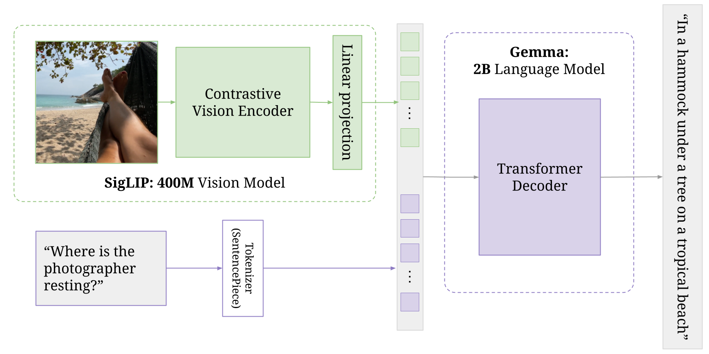
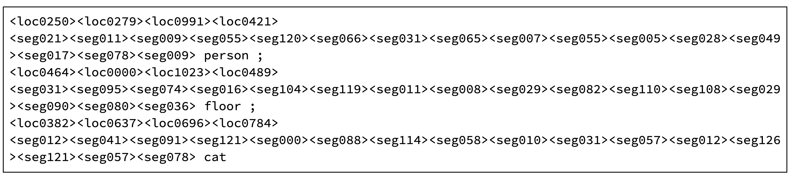
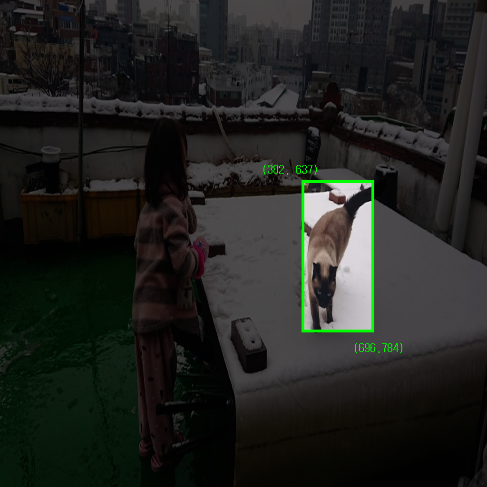
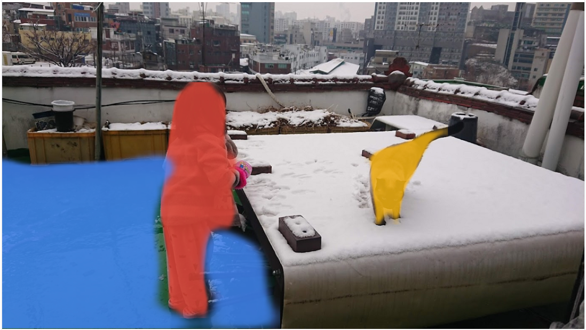

# Gemma 詳解：PaliGemma 架構

!!! note
    最初發表於
    [Google Developers 部落格](https://developers.googleblog.com/gemma-explained-paligemma-architecture/)。


在「Gemma 詳解」系列的[上一篇文章](/tutorials/gemma-explained/recurrentgemma/)中，你複習了 RecurrentGemma 架構。在這篇部落格文章中，你將探索 PaliGemma 架構。讓我們深入了解！

## **PaliGemma 3B**

PaliGemma 是一個輕量的開放視覺語言模型（VLM），靈感來自 [PaLI-3](https://arxiv.org/abs/2310.09199)，並基於開放元件打造，如 [SigLIP 視覺模型](https://arxiv.org/abs/2303.15343)與 [Gemma 語言模型](https://storage.googleapis.com/deepmind-media/gemma/gemma-report.pdf)。Pali 是 [**Pa**thway **L**anguage and **I**mage Model（路徑語言與影像模型）](https://arxiv.org/pdf/2209.06794)的縮寫。如其名所示，這個模型能同時接受影像與文字輸入並產生文字回應，如本微調[指南](../../models/paligemma/fine-tuning.md)所示。

## PaliGemma 架構

PaliGemma 在 BaseGemma 模型之上增加了一個由影像編碼器組成的視覺模型。這個編碼器連同文字詞元一起傳遞給一個專門化的 Gemma 2B 模型。視覺模型與 Gemma 模型都經過多個階段的獨立訓練與聯合訓練，以產出最終的聯合架構。完整細節請參閱 [Pali-3 論文](https://arxiv.org/abs/2310.09199)的第 3.2 節。



```python
PaliGemmaForConditionalGeneration(
  (vision_tower): SiglipVisionModel(
    (vision_model): SiglipVisionTransformer(
      (embeddings): SiglipVisionEmbeddings(
        (patch_embedding): Conv2d(3, 1152, kernel_size=(14, 14), stride=(14, 14), padding=valid)
        (position_embedding): Embedding(256, 1152)
      )
      (encoder): SiglipEncoder(
        (layers): ModuleList(
          (0-26): 27 x SiglipEncoderLayer(
            (self_attn): SiglipAttention(
              (k_proj): Linear(in_features=1152, out_features=1152, bias=True)
              (v_proj): Linear(in_features=1152, out_features=1152, bias=True)
              (q_proj): Linear(in_features=1152, out_features=1152, bias=True)
              (out_proj): Linear(in_features=1152, out_features=1152, bias=True)
            )
            (layer_norm1): LayerNorm((1152,), eps=1e-06, elementwise_affine=True)
            (mlp): SiglipMLP(
              (activation_fn): PytorchGELUTanh()
              (fc1): Linear(in_features=1152, out_features=4304, bias=True)
              (fc2): Linear(in_features=4304, out_features=1152, bias=True)
            )
            (layer_norm2): LayerNorm((1152,), eps=1e-06, elementwise_affine=True)
          )
        )
      )
      (post_layernorm): LayerNorm((1152,), eps=1e-06, elementwise_affine=True)
    )
  )
  (multi_modal_projector): PaliGemmaMultiModalProjector(
    (linear): Linear(in_features=1152, out_features=2048, bias=True)
  )
  (language_model): GemmaForCausalLM(
    (model): GemmaModel(
      (embed_tokens): Embedding(257216, 2048, padding_idx=0)
      (layers): ModuleList(
        (0-17): 18 x GemmaDecoderLayer(
          (self_attn): GemmaSdpaAttention(
            (q_proj): Linear(in_features=2048, out_features=2048, bias=False)
            (k_proj): Linear(in_features=2048, out_features=256, bias=False)
            (v_proj): Linear(in_features=2048, out_features=256, bias=False)
            (o_proj): Linear(in_features=2048, out_features=2048, bias=False)
            (rotary_emb): GemmaRotaryEmbedding()
          )
          (mlp): GemmaMLP(
            (gate_proj): Linear(in_features=2048, out_features=16384, bias=False)
            (up_proj): Linear(in_features=2048, out_features=16384, bias=False)
            (down_proj): Linear(in_features=16384, out_features=2048, bias=False)
            (act_fn): PytorchGELUTanh()
          )
          (input_layernorm): GemmaRMSNorm()
          (post_attention_layernorm): GemmaRMSNorm()
        )
      )
      (norm): GemmaRMSNorm()
    )
    (lm_head): Linear(in_features=2048, out_features=257216, bias=False)
  )
)
```

### **vision_tower（SiglipVisionModel）**

這個元件負責處理輸入影像。

它使用 SiglipVisionTransformer，這是一種為視覺任務設計的 Transformer 架構。

### **embeddings（SiglipVisionEmbeddings）**

PaliGemma 接受一張或多張影像作為輸入，SigLIP 編碼器會將它們轉換成「軟詞元」（soft tokens）。

它將影像切成較小的區塊，就像文字模型處理句子中的單字一樣。模型接著學會捕捉這些區塊之間的關係，從而有效理解影像的視覺內容。

### **patch_embedding**

它使用卷積層（Conv2d），參數如下。

- 3：輸入有 3 個通道（RGB 影像）

- 1152：輸出有 1152 個通道，即每個區塊的嵌入維度

- kernel_size=(14, 14)：每個區塊是 14x14 像素的正方形

- stride=(14, 14)：各區塊互不重疊（卷積濾波器每次移動 14 像素）

- padding=’valid’：不套用填充，因此輸出尺寸會小於輸入尺寸。

### **position_embedding**

每個區塊嵌入都會加上位置嵌入，用來編碼空間資訊（即每個區塊在原始影像中的位置）。

這是透過一個可學習的嵌入層（Embedding）完成的：它接受每個區塊的位置（最多 256 個位置）作為輸入，並輸出一個 1152 維的向量（與區塊嵌入維度相同）。

### **encoder（SiglipEncoder）**

嵌入會經過一系列 SiglipEncoderLayer，每層都包含自注意力與前饋神經網路。這幫助模型捕捉影像不同部分之間的關係。

### **multi_modal_projector（PaliGemmaMultiModalProjector）**

這個元件將視覺塔的輸出投影到多模態空間。這透過一個簡單的線性層實現，讓視覺與語言表示能有效結合。

### **language_model（GemmaForCausalLM）**

這個元件是基於 Gemma 2B 模型的語言模型。

它接受來自投影器的多模態表示作為輸入，並生成文字輸出。

對於文字輸入，每個檢查點以不同的序列長度訓練。例如，paligemma-3b-mix-224 以序列長度 256 訓練（輸入文字 + 由 Gemma 分詞器分詞的輸出文字）。

PaliGemma 使用有 256000 個詞元的 Gemma 分詞器，但擴展了詞彙表：新增 1024 個代表正規化影像空間中座標的詞條（<loc0000>...<loc1023>），以及另外 128 個作為輕量參照表達式分割用編碼字（codewords）的詞條（<seg000>...<seg127>），供[向量量化變分自編碼器（vector-quantized variational auto-encoder，VQ-VAE）](https://arxiv.org/abs/2301.02229)使用。（256000 + 1024 + 128 = 257216）

## 物件分割範例

額外的軟詞元負責編碼物件偵測與影像分割。以下是 paligemma-3b-mix-224 的範例輸出。你可以到 [HuggingFace 線上示範](https://huggingface.co/spaces/big-vision/paligemma)親自試試。


使用提示詞「`segment floor;cat;person;`」的 PaliGemma 輸出



如果你不熟悉 ML 與電腦視覺任務，模型的輸出可能不太直覺、難以解讀。

最初的四個位置詞元代表邊界框的座標，範圍從 0 到 1023。由於假設影像已縮放到 1024 x 1024，這些座標與長寬比無關。

例如，輸出顯示貓的位置位於座標 (382, 637) 與 (696, 784) 之間。在這個座標系統中，左上角記為 (0,0)，且垂直座標列在水平座標之前。



遮罩由以下 16 個分割詞元編碼。神經網路模型（VQ-VAE）可以透過解碼這些值，從量化表示（碼本索引）重建遮罩。你可以從[這裡](https://huggingface.co/spaces/big-vision/paligemma/blob/main/paligemma_parse.py)探索實際程式碼。

最後，你可以從 PaliGemma 的輸出得到這個漂亮的成果。



## **總結**

在這篇文章中，你認識了 PaliGemma。

Gemma 家族提供了理解現代大型語言模型系統的獨特機會：它是一系列擁有相似核心架構、但為不同使用場景設計的開放權重模型。這些由 Google 釋出給研究人員、開發者與終端使用者的模型，涵蓋了各種功能與複雜度。

希望這篇總覽能讓你簡潔地理解 Gemma 模型家族，並突顯其多功能性與適用於各種任務的特性。

[Google Developer Community](https://discord.gg/google-dev-community) Discord 伺服器是展示專案、與開發者同好建立連結、參與互動討論的絕佳平台。歡迎加入伺服器，探索這些令人興奮的機會。

感謝閱讀！

## 參考資料

### **論文**

- [PaLI-3 視覺語言模型：更小、更快、更強](https://arxiv.org/abs/2310.09199)
- [語言影像預訓練的 Sigmoid 損失](https://arxiv.org/abs/2303.15343)
- [一切皆詞元：透過軟詞元統一視覺任務的輸出空間](https://arxiv.org/abs/2301.02229)
- [PaliGemma：適用於遷移的多功能 3B VLM](https://arxiv.org/abs/2407.07726)

### **程式碼範例**

- [使用 Keras 推論](../../models/paligemma/inference.md)
- [使用 JAX 微調](../../models/paligemma/fine-tuning.md)
- [HuggingFace 線上示範](https://huggingface.co/spaces/big-vision/paligemma)

## 📋 完整的 Gemma 架構系列

- [Gemma 詳解：Gemma 模型家族架構總覽](/tutorials/gemma-explained/overview/)
- [Gemma 詳解：Gemma 2 的新變化](/tutorials/gemma-explained/gemma-2/)
- [Gemma 詳解：RecurrentGemma 架構](/tutorials/gemma-explained/recurrentgemma/)
- Gemma 詳解：PaliGemma 架構
- [Gemma 詳解：Gemma 3 的新變化](/tutorials/gemma-explained/gemma-3/)
- [Gemma 詳解：EmbeddingGemma 架構](/tutorials/gemma-explained/embeddinggemma/)
