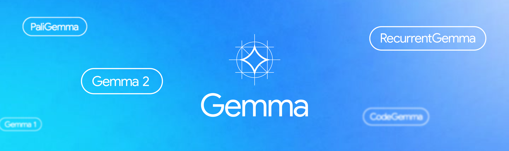
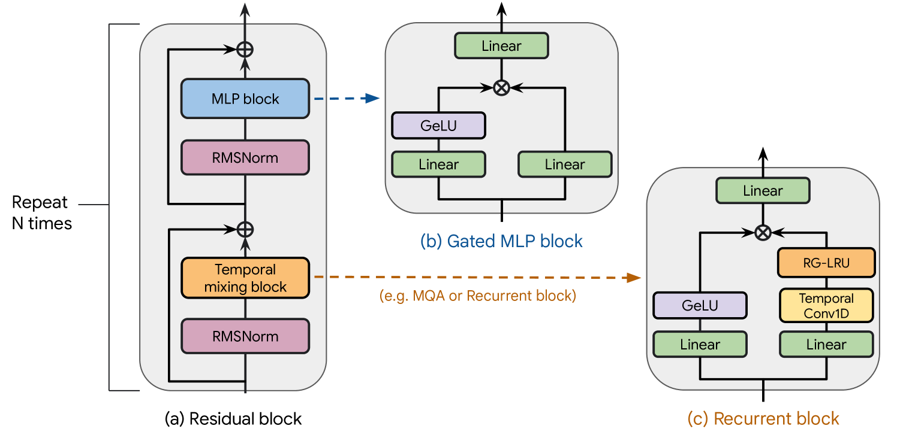
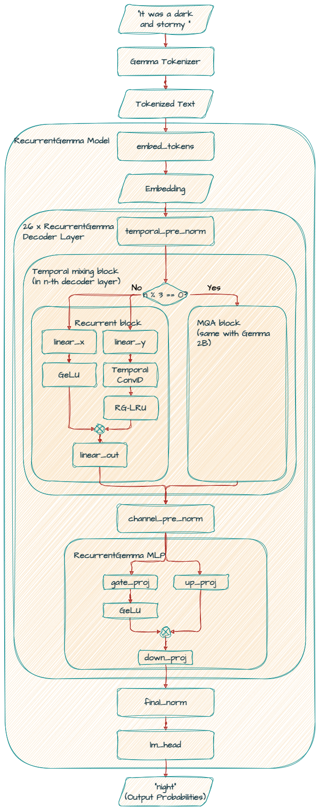
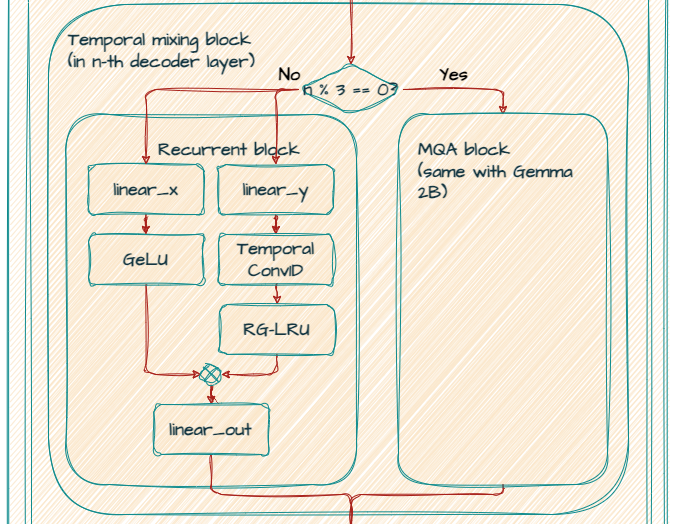
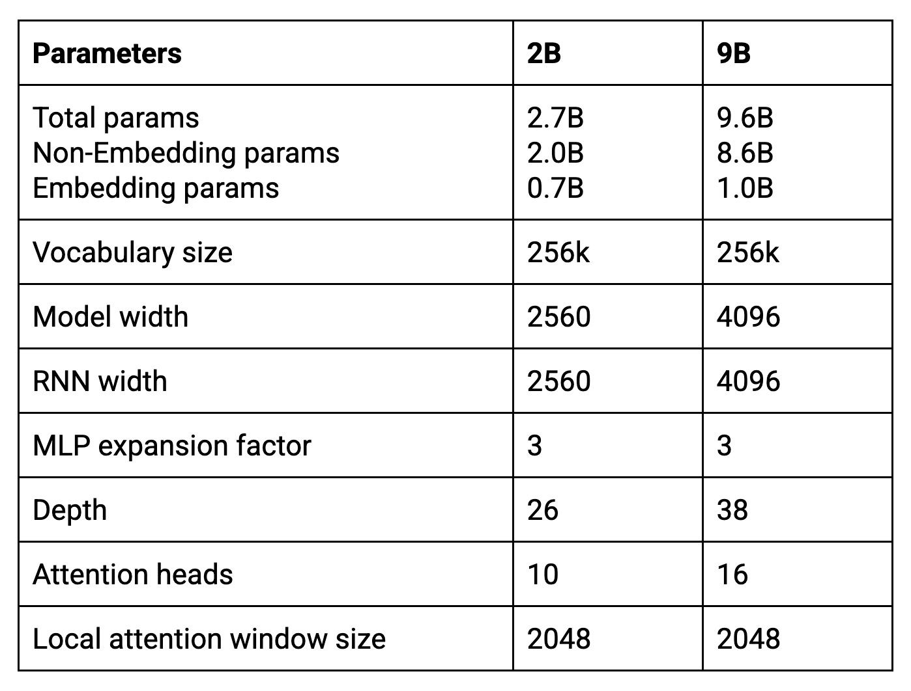
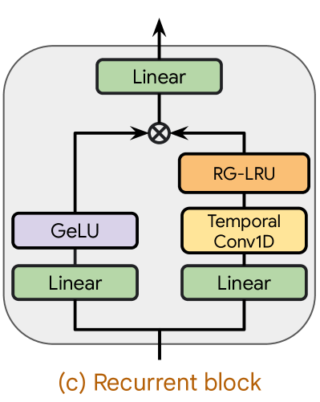
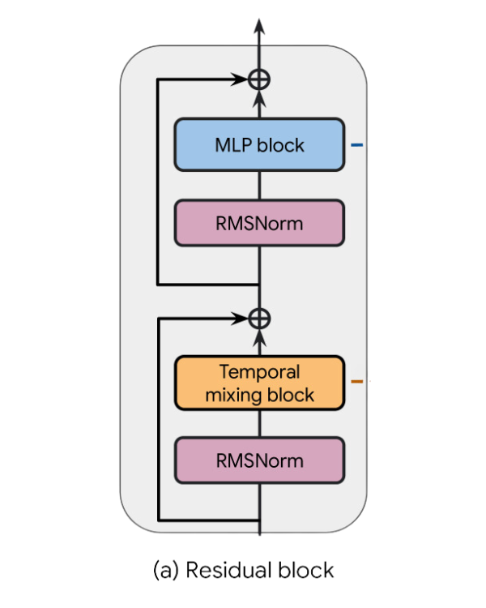

# Gemma 詳解：RecurrentGemma 架構

!!! note
    最初發表於
    [Google Developers 部落格](https://developers.googleblog.com/gemma-explained-recurrentgemma-architecture/)。



在「Gemma 詳解」系列的[上一篇文章](/tutorials/gemma-explained/gemma-2/)中，我們討論了最新的 Gemma 2 架構。在這篇文章中，你將探索 RecurrentGemma 架構。讓我們開始吧！

## RecurrentGemma 2B, 9B

RecurrentGemma 基於 [Griffin](https://arxiv.org/abs/2402.19427)，這是一個混合模型，結合了門控線性遞迴與區域滑動視窗注意力。這種改變改善了運算與記憶體效率，更適合長上下文提示。



然而，由於 Griffin 架構的狀態大小固定，它在「大海撈針」（needle-in-a-haystack）測試中的效能有所下降。雖然可以將整本書的文字作為輸入提供給模型，但這種做法未必是最佳的。遞迴神經網路（RNN）在極長序列中學習長程依賴時可能遇到困難，且模型的上下文視窗有限。這表示它在做預測時，只能有效考慮一定數量的前文詞元。

此外，與 Transformer 相比，遞迴模型在推論時間最佳化方面尚未受到同等關注。相較於成熟的 Transformer 架構，可用的研究與社群支援也較少。

因此，當你擔心 LLM 的上下文視窗被耗盡時，這個模型會非常有價值。透過優先保留最新資訊並策略性地捨棄舊資料，RecurrentGemma 確保隨著上下文擴大，LLM 的效能依然強勁。

以下是 Recurrent Gemma 2B 模型的架構圖。



Griffin 遵循與其他 Transformer 基準模型相同的殘差模式與 MLP 區塊。然而，不同於 MQA Transformer 基準模型與 Hawk 模型，Griffin 混合使用了遞迴區塊與 MQA 區塊。



Griffin 採用分層結構：以兩個含遞迴區塊的殘差區塊交替排列，接著是一個包含區域 MQA 注意力區塊的殘差區塊。

架構的[核心參數](https://storage.googleapis.com/deepmind-media/gemma/recurrentgemma-report.pdf)摘要於下表。



### **非嵌入參數與嵌入參數（Non-Embedding params and Embedding params）**

非嵌入參數分布於模型的隱藏層中，例如注意力機制與前饋網路等元件。

**注意：**模型名稱「2B」來自這個參數。

嵌入參數通常位於稱為嵌入層的專用層中。這一層負責將離散的詞元（如單字或字元）映射為連續的向量表示（嵌入）。

**注意：**0.7B 可計算為 256k（詞彙表大小）x 2560（模型寬度）。

### **模型寬度與 RNN 寬度（Model width and RNN width）**

模型寬度指的是模型隱藏層的大小，決定了模型表示複雜模式的能力，就像基礎的 Gemma 模型一樣。

遞迴神經網路（RNN）寬度是 Real-Gated Linear Recurrent Unit（RG-LRU）所維護的隱藏狀態大小。與傳統 Transformer 不同，遞迴區塊維護一個固定大小的內部狀態，不隨輸入長度變化。這讓 RecurrentGemma 能以更少的記憶體處理更長的序列，在生成長篇文章或程式碼等任務上更有效率。

### **MLP 擴展因子（MLP expansion factor）**

它與基礎 Gemma 模型中的前饋隱藏層維度相同。為求簡潔，我們在 Recurrent Gemma 模型中套用了 3 的擴展因子，得到 MLP 維度為 7680（由 2560 x 3 計算而得）。

### **區域注意力視窗大小（Local attention window size）**

RecurrentGemma 維護的狀態大小有限，不會隨超過 2k 詞元區域注意力視窗的序列增長。這表示，雖然 Gemma 以自迴歸方式生成的樣本最大長度受主機系統記憶體容量限制，RecurrentGemma 卻能生成任意長度的序列，克服了這項限制。

```python
RecurrentGemmaForCausalLM(
  (model): RecurrentGemmaModel(
    (embed_tokens): Embedding(256000, 2560, padding_idx=0)
    (layers): ModuleList(
      (0-1): 2 x RecurrentGemmaDecoderLayer(
        (temporal_pre_norm): RecurrentGemmaRMSNorm()
        (temporal_block): RecurrentGemmaRecurrentBlock(
          (linear_y): Linear(in_features=2560, out_features=2560, bias=True)
          (linear_x): Linear(in_features=2560, out_features=2560, bias=True)
          (linear_out): Linear(in_features=2560, out_features=2560, bias=True)
          (conv_1d): Conv1d(2560, 2560, kernel_size=(4,), stride=(1,), padding=(3,), groups=2560)
          (rg_lru): RecurrentGemmaRglru()
          (act_fn): PytorchGELUTanh()
        )
        (channel_pre_norm): RecurrentGemmaRMSNorm()
        (mlp_block): RecurrentGemmaMlp(
          (gate_proj): Linear(in_features=2560, out_features=7680, bias=True)
          (up_proj): Linear(in_features=2560, out_features=7680, bias=True)
          (down_proj): Linear(in_features=7680, out_features=2560, bias=True)
          (act_fn): PytorchGELUTanh()
        )
      )
      (2): RecurrentGemmaDecoderLayer(
        (temporal_pre_norm): RecurrentGemmaRMSNorm()
        (temporal_block): RecurrentGemmaSdpaAttention(
          (q_proj): Linear(in_features=2560, out_features=2560, bias=False)
          (k_proj): Linear(in_features=2560, out_features=256, bias=False)
          (v_proj): Linear(in_features=2560, out_features=256, bias=False)
          (o_proj): Linear(in_features=2560, out_features=2560, bias=True)
          (rotary_emb): RecurrentGemmaRotaryEmbedding()
        )
        (channel_pre_norm): RecurrentGemmaRMSNorm()
        (mlp_block): RecurrentGemmaMlp(
          (gate_proj): Linear(in_features=2560, out_features=7680, bias=True)
          (up_proj): Linear(in_features=2560, out_features=7680, bias=True)
          (down_proj): Linear(in_features=7680, out_features=2560, bias=True)
          (act_fn): PytorchGELUTanh()
        )
      )

      :

      (23): RecurrentGemmaDecoderLayer(
        (temporal_pre_norm): RecurrentGemmaRMSNorm()
        (temporal_block): RecurrentGemmaSdpaAttention(
          (q_proj): Linear(in_features=2560, out_features=2560, bias=False)
          (k_proj): Linear(in_features=2560, out_features=256, bias=False)
          (v_proj): Linear(in_features=2560, out_features=256, bias=False)
          (o_proj): Linear(in_features=2560, out_features=2560, bias=True)
          (rotary_emb): RecurrentGemmaRotaryEmbedding()
        )
        (channel_pre_norm): RecurrentGemmaRMSNorm()
        (mlp_block): RecurrentGemmaMlp(
          (gate_proj): Linear(in_features=2560, out_features=7680, bias=True)
          (up_proj): Linear(in_features=2560, out_features=7680, bias=True)
          (down_proj): Linear(in_features=7680, out_features=2560, bias=True)
          (act_fn): PytorchGELUTanh()
        )
      )
      (24-25): 2 x RecurrentGemmaDecoderLayer(
        (temporal_pre_norm): RecurrentGemmaRMSNorm()
        (temporal_block): RecurrentGemmaRecurrentBlock(
          (linear_y): Linear(in_features=2560, out_features=2560, bias=True)
          (linear_x): Linear(in_features=2560, out_features=2560, bias=True)
          (linear_out): Linear(in_features=2560, out_features=2560, bias=True)
          (conv_1d): Conv1d(2560, 2560, kernel_size=(4,), stride=(1,), padding=(3,), groups=2560)
          (rg_lru): RecurrentGemmaRglru()
          (act_fn): PytorchGELUTanh()
        )
        (channel_pre_norm): RecurrentGemmaRMSNorm()
        (mlp_block): RecurrentGemmaMlp(
          (gate_proj): Linear(in_features=2560, out_features=7680, bias=True)
          (up_proj): Linear(in_features=2560, out_features=7680, bias=True)
          (down_proj): Linear(in_features=7680, out_features=2560, bias=True)
          (act_fn): PytorchGELUTanh()
        )
      )
    )
    (final_norm): RecurrentGemmaRMSNorm()
  )
  (lm_head): Linear(in_features=2560, out_features=256000, bias=False)
)
```

### **embed_tokens（嵌入層）**

接受輸入文字作為詞元序列，並將每個詞元映射為 2560 維的連續向量表示。它的詞彙表大小為 256000，與基礎 Gemma 模型相同。

### **layers（層）**

總共有 26 個解碼器層，以重複模式分組排列。

模型從兩個含遞迴區塊的殘差區塊（0-1）開始，接著是一個殘差區塊（2），以及一系列交替排列的連續區塊，直到最後一層（25）。



#### **含遞迴區塊的殘差區塊**

在遞迴區塊（時間混合區塊，Temporal mixing block）中，模型接受維度為 2560（模型寬度）的輸入，並並行套用兩個輸出維度為 2560（RNN 寬度）的線性層，形成兩個分支。

在第一個分支（右側），它套用一個時間濾波器維度為 4 的小型可分離 Conv1D 層，接著是 RG-LRU（Real-Gated Linear Recurrent Unit）層。

在第二個分支（左側），它套用 GeLU 非線性函數。

然後以逐元素相乘合併兩個分支，再套用最終的線性層，輸出維度為 2560（模型寬度）。



套用 RMSNorm 之後，接著是 MLP 區塊。

#### **含區域 MQA 的殘差區塊**

在兩個含遞迴區塊的殘差區塊（0-1）之後，接著是一個含區域 MQA 的殘差區塊（2）。使用全域注意力的一個主要缺點是，其計算複雜度隨序列長度二次增長。為了解決這個問題，RecurrentGemma 使用區域滑動視窗注意力，只允許每個位置關注過去固定數量的詞元。

在區域 MQA 區塊（時間混合區塊）中，模型接受維度為 2560（模型寬度）的輸入。它使用線性投影（*q_proj*、*k_proj*、*v_proj*、*o_proj*）來產生查詢、鍵、值與輸出的表示。注意 *k_proj* 與 *v_proj* 的 *out_features* 為 256，因為它們共用大小為 256 的同一個頭，而 *q_proj* 與 *o_proj* 並行使用 10 個頭（256 x 10 = 2560）。

它使用 *rotary_emb*（RecurrentGemmaRotaryEmbedding）做旋轉位置嵌入（RoPE），與基礎 Gemma 模型相同。

RMSNorm 與 MLP 區塊的套用方式與前一個殘差區塊相同。

## **下一步？**

在這篇文章中，你認識了 RecurrentGemma。

在下一篇文章中，你將探索 PaliGemma——一個輕量的開放視覺語言模型（VLM）。

敬請期待，感謝閱讀！

##

## 參考資料

### **論文**

- [Griffin：混合門控線性遞迴與區域注意力打造高效語言模型](https://arxiv.org/abs/2402.19427)
- [RecurrentGemma：超越 Transformer 的高效開放語言模型](https://storage.googleapis.com/deepmind-media/gemma/recurrentgemma-report.pdf)

### **程式碼範例**

- [RecurrentGemma 入門](https://colab.research.google.com/github/google-deepmind/recurrentgemma/blob/main/colabs/sampling_tutorial_jax.ipynb)

## 📋 完整的 Gemma 架構系列

- [Gemma 詳解：Gemma 模型家族架構總覽](/tutorials/gemma-explained/overview/)
- [Gemma 詳解：Gemma 2 的新變化](/tutorials/gemma-explained/gemma-2/)
- Gemma 詳解：RecurrentGemma 架構
- [Gemma 詳解：PaliGemma 架構](/tutorials/gemma-explained/paligemma/)
- [Gemma 詳解：Gemma 3 的新變化](/tutorials/gemma-explained/gemma-3/)
- [Gemma 詳解：EmbeddingGemma 架構](/tutorials/gemma-explained/embeddinggemma/)
